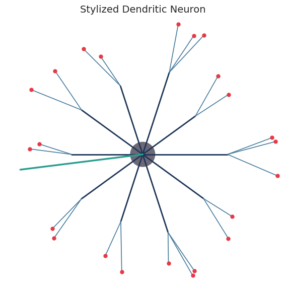

# Dendritic Modeling Framework

<p align="center">
  <a href="https://github.com/KempnerInstitute/dendritic_modeling/actions/workflows/ci.yml">
    
  </a>
  <a href="https://github.com/KempnerInstitute/dendritic_modeling/actions/workflows/pr-quick-check.yml">
    
  </a>
  <a href="https://codecov.io/gh/KempnerInstitute/dendritic-modeling" >
 
 </a>
</p>

<p align="center">
  
</p>

**A comprehensive framework for modeling dendritic computation in artificial neural networks, featuring biologically-inspired excitation-inhibition dynamics, sophisticated synaptic processing, and extensive analysis capabilities.**

## Overview

The Dendritic Modeling Framework provides a complete toolkit for building and analyzing neural networks that emulate the complex computational properties of biological dendrites. This framework enables researchers to explore how dendritic branching structures, excitation-inhibition dynamics, and synaptic plasticity contribute to neural computation.

### 🧠 **Core Capabilities**

- **Advanced Network Architectures**: EINet, DendriNet, and hybrid models with configurable dendritic morphologies
- **Sophisticated Synaptic Mechanisms**: TopK selection, stochastic connectivity, dynamic sparse training (DeepST)
- **Flexible Training Strategies**: Standard, layer-wise, branch-wise, two-step, and voltage stabilization training
- **Comprehensive Analysis Suite**: Information-theoretic, correlation, ablation, and visualization tools
- **Extensive Dataset Support**: Vision, synthetic, biological, and custom datasets with various preprocessing options

## Quick Start

### Installation

```bash
# Create conda environment
conda env create -f environment.yml
conda activate dendritic_env

# Install the package in development mode
pip install -e .
```

### Basic Usage

```bash
# Run a simple EINet experiment
python src/dendritic_modeling/scripts/train_experiments.py configs/config_exp.yaml

# Run with custom parameters
python src/dendritic_modeling/scripts/train_experiments.py configs/config_exp.yaml \
    --learning_strategy two_step \
    --output_dir ./my_results \
    --run_name einet_experiment
```

## Network Architectures

### EINet (Excitation-Inhibition Networks)

The primary architecture featuring separate excitatory and inhibitory pathways with dendritic computation.

```yaml
model:
  network:
    type: EINet
    parameters:
      # Basic architecture
      excitatory_layer_sizes: [256, 128, 64]    # Excitatory neurons per layer
      inhibitory_layer_sizes: [128, 64, 32]     # Inhibitory neurons per layer
      excitatory_branch_factors: [2, 2]         # Dendritic branching structure
      
      # Synaptic connectivity
      ee_synapses_per_branch_per_layer: [200, 100]  # E→E connections
      ei_synapses_per_branch_per_layer: [100, 50]   # E→I connections  
      ie_synapses_per_branch_per_layer: [50, 25]    # I→E connections
      
      # E-I dynamics
      use_shunting: true                         # Shunting vs subtractive inhibition
      somatic_synapses: true                     # Direct soma connections
```

**Shunting vs Subtractive Inhibition:**
- `use_shunting: true`: V = E/(E+I+1) (biologically plausible divisive inhibition)
- `use_shunting: false`: V = E-I (simple subtraction)

### DendriNet (Pure Dendritic Networks)

Multi-level branching networks with hierarchical dendritic processing.

```yaml
model:
  network:
    type: DendriNet
    parameters:
      n_soma: 64                                 # Number of output neurons
      branch_factors: [4, 2]                     # Branching hierarchy
      excitatory_synapses_per_branch: 50         # Synapses per branch
      reactivate: true                           # Enable reactivation functions
      reactivation_type: param_tanh              # Activation type
```

### Classical Networks

For baseline comparisons and hybrid architectures:

| Network Type | Description | Key Features |
|-------------|-------------|--------------|
| **MLP** | Standard multi-layer perceptron | Configurable depth, activations |
| **MatchedParamMLP** | Parameter-matched baseline | Same parameter count as EINet |
| **CNNDownsample** | Convolutional encoder | Configurable conv layers |
| **CNNUpsample** | Convolutional decoder | Transpose convolutions |
| **AlexNet** | Pre-trained CNN features | Transfer learning |
| **MLPAutoencoder** | MLP-based autoencoder | Reconstruction tasks |
| **CNNAutoencoder** | CNN-based autoencoder | Image reconstruction |

## Synaptic Mechanisms

### TopK Synapse Selection

Controls which synapses are active based on weight ranking.

```yaml
parameters:
  # Basic TopK (deterministic)
  topk_type: standard
  ee_synapses_per_branch_per_layer: [100, 50]   # Number of active synapses
  
  # Stochastic TopK (probabilistic selection)
  topk_type: stochastic
  topk_temperature: 0.3                         # Selection randomness (0.1-1.0)
  topk_ultrafast: true                          # 10-50x faster approximation
  
  # Variance-based selection
  topk_type: variance
  
  # Dynamic Sparse Training (DeepST)
  topk_type: deepst
  excitatory_target_density: 0.1                # Target connection density
  rewiring_mode: global                         # Rewiring strategy
  rewire_frequency: 10                          # Rewiring every N steps
  use_noise: true                               # Brownian motion noise
  sigma: 0.05                                   # Noise magnitude
```

**Synaptic Selection Strategies:**

| Strategy | Description | Use Cases |
|----------|-------------|-----------|
| **standard** | Deterministic top-K selection | Fast, stable training |
| **stochastic** | Probabilistic selection by rank | Exploration, robustness |
| **variance** | Selection based on input variance | Adaptive connectivity |
| **deepst** | Dynamic sparse training with rewiring | Evolving connectivity |

### Weight Initialization

```yaml
parameters:
  topk_init_method: xavier_normal                # Weight initialization
  # Options: xavier_normal, xavier_uniform, kaiming_normal, 
  #          kaiming_uniform, orthogonal, normal, uniform, eye
```

### Dynamic Sparse Training (DeepST)

Advanced connectivity evolution during training:

```yaml
parameters:
  topk_type: deepst
  excitatory_target_density: 0.1                # Target sparsity level
  inhibitory_target_density: 0.05
  
  # Rewiring modes
  rewiring_mode: global                          # 'global', 'local', 'constant_branch'
  rewire_frequency: 1                            # How often to rewire
  
  # Brownian motion parameters
  use_noise: true                                # Add exploration noise
  sigma: 0.05                                    # Noise standard deviation
  weight_threshold: 1e-6                        # Pruning threshold
  
  # Connectivity freezing
  freeze_excitatory_connectivity: false         # Disable E rewiring
  freeze_inhibitory_connectivity: false         # Disable I rewiring
```

## Input Processing Modes

### Input Mode Configuration

```yaml
parameters:
  input_mode: 2                                  # Input processing mode
  
  # Mode 0: Raw input to excitatory, None to inhibitory
  # Mode 1: Same input to both excitatory and inhibitory  
  # Mode 2: Transform inputs using input_net_dict
```

### Input Network Transforms

When `input_mode: 2`, configure input transformation networks:

```yaml
parameters:
  input_net_dict:
    # CNN-based transformation
    type: CNNInputTransform
    input_shape: [3, 32, 32]                    # [channels, height, width]
    excitatory_hidden_dims: [32, 64]            # Conv channels for E pathway
    inhibitory_hidden_dims: [16, 32]            # Conv channels for I pathway
    excitatory_kernel_sizes: [5, 3]             # Kernel sizes for E
    inhibitory_kernel_sizes: [7, 5]             # Kernel sizes for I
    excitatory_strides: [1, 1]                  # Strides for E
    inhibitory_strides: [1, 1]                  # Strides for I
```

**Available Input Transforms:**

| Transform Type | Description | Parameters |
|---------------|-------------|------------|
| **IndexInputTransform** | Random index splitting | `excitatory_dim`, `inhibitory_dim` |
| **MLPInputTransform** | MLP-based transformation | `hidden_dims`, output dimensions |
| **CNNInputTransform** | CNN-based transformation | Conv parameters, kernel sizes |
| **AlexNetTransform** | Pre-trained AlexNet features | Output dimensions |
| **FeatureExtractorMLP** | Feature extraction MLP | Hidden layers, output dim |
| **SigmoidInputNetTransform** | MLP with sigmoid output | Network parameters |

### Input Network Training

```yaml
train:
  input_net_training:
    training_mode: sequential                    # 'joint' or 'sequential'
    train_input_net: true                       # Whether to train input network
    input_net_epochs: 20                        # Pre-training epochs
    train_heads_independently: false            # Independent E/I head training
    
    # Inhibitory head objectives
    inhibitory_head_objective: classification   # 'classification', 'diversity', 'combined'
    diversity_weight: 0.5                       # Weight for diversity loss
```

## Activation Functions

### Reactivation Types

```yaml
parameters:
  reactivate: true                               # Enable reactivation
  reactivation_type: param_tanh                  # Activation function type
  reactivation_init_m: 1.5                      # Initial slope parameter
  reactivation_init_b: 0.5                      # Initial bias parameter
```

**Available Activation Functions:**

| Type | Description | Parameters |
|------|-------------|------------|
| **none** | Identity (no reactivation) | None |
| **param_tanh** | Parametric tanh with learnable slope and bias | `init_m`, `init_b` |
| **param_tanh_only_m** | Parametric tanh with only slope learnable | `init_m`, `fixed_b` |
| **param_linear_sigmoid** | Trainable linear-sigmoid interpolation | `init_m`, `init_b` |
| **linear_sigmoid** | Fixed linear-sigmoid interpolation | `init_m`, `init_b` |
| **param_linear_tanh** | Trainable linear-tanh interpolation | `init_m`, `init_b` |
| **linear_tanh** | Fixed linear-tanh interpolation | `init_m`, `init_b` |
| **param_linear_tanh_transition** | Smooth transition linear to tanh | `init_threshold`, `init_slope` |
| **linear_tanh_transition** | Fixed transition function | `init_threshold`, `init_slope` |
| **relu** | Standard ReLU | None |
| **sigmoid** | Standard sigmoid | None |
| **tanh** | Standard tanh | None |

### Gradient Scaling Strategies

Control gradient flow through different network components:

```yaml
parameters:
  # Reactivation gradient scaling
  reactivation_strategy: inverse                # 'none', 'inverse'
  
  # TopK layer gradient scaling  
  topk_strategy: conductance_dynamic            # 'none', 'conductance_dynamic'
  
  # Branch layer gradient scaling
  blocklinear_strategy: distal_upweight_by_idx  # 'none', 'conductance_dynamic', 'distal_upweight_by_idx'
  
  print_hooks: false                            # Debug gradient statistics
```

## Training Strategies

### Standard Training

```yaml
train:
  learning_strategy: standard                   # Standard backpropagation
  trainer:
    epochs: 100
    batch_size: 128
    loss_function: categorical_nll
```

### Layer-wise Training

Train layers sequentially from soma to input or reverse:

```yaml
train:
  learning_strategy: freeze_layers              # Layer-wise training
  trainer:
    pretrain_epochs: 10                         # Full network pre-training
    epochs_per_layer: 10                        # Epochs per layer
    final_tune_epochs: 20                       # Final fine-tuning
    reverse_training: false                     # Train input→soma vs soma→input
```

### Branch-wise Training (Local Credit Assignment)

Train dendritic branches sequentially:

```yaml
train:
  learning_strategy: freeze_branches            # Branch-wise training
  trainer:
    pretrain_epochs: 10                         # Full network pre-training
    epochs_per_branch: 10                       # Epochs per branch
    final_tune_epochs: 20                       # Final fine-tuning
    reverse_training: false                     # Training direction
```

### Two-Step Training

Local pre-training followed by global fine-tuning:

```yaml
train:
  learning_strategy: two_step                   # Two-step training
  trainer:
    pretrain_epochs: 20                         # Local pre-training epochs
    epochs: 100                                 # Global training epochs
```

### Two-Step with KL Divergence

Two-step training with additional KL regularization:

```yaml
train:
  learning_strategy: two_step_kl                # Two-step with KL
  trainer:
    pretrain_epochs: 20
    kl_weight: 0.1                              # KL divergence weight
```

### Voltage Stabilization

Biologically-motivated warm-up procedure:

```yaml
train:
  learning_strategy: voltage_stabilization      # Voltage stabilization
  trainer:
    pretrain_epochs: 10                         # Stabilization epochs
    target_voltage: 0.5                         # Target voltage level
```

## Optimization and Weight Decay

### Learning Rate Management

```yaml
train:
  optim_dict:
    split_params: true                          # Use different LRs for components
    
    # Component-specific learning rates
    input_net_lr: 0.001                        # Input network
    topk_lr: 0.005                             # Synaptic weights  
    blocklinear_lr: 0.001                      # Branch aggregation
    reactivation_lr: 0.01                      # Activation parameters
    output_layer_lr: 0.001                     # Output layer
    
    # Global learning rate (if split_params: false)
    lr: 0.01
```

### Weight Decay

```yaml
train:
  weight_decay_rate: 0.1                        # L2 regularization strength
```

### Training Parameters

```yaml
trainer:
  epochs: 100
  batch_size: 128
  early_stopping: true
  patience: 10                                  # Early stopping patience
  grad_clip_value: 5.0                         # Gradient clipping
  shuffle: true
  print_every: 10
```

## Datasets

### Vision Datasets

```yaml
task:
  dataset: mnist                                # Dataset name
  parameters:
    flatten: true                               # Flatten images to vectors
    normalize: true                             # Normalize pixel values
    train_size: 8000                           # Training samples
    valid_size: 1000                           # Validation samples  
    test_size: 1000                            # Test samples
```

**Supported Vision Datasets:**

| Dataset | Description | Parameters |
|---------|-------------|------------|
| **mnist** | MNIST handwritten digits | `flatten`, `normalize` |
| **cifar10** | CIFAR-10 natural images | `flatten`, `normalize` |
| **random_flip_mnist** | MNIST with random label flips | Noise parameters |

### Synthetic Datasets

```yaml
task:
  dataset: line                                 # Synthetic line detection
  parameters:
    image_size: 16                              # Image dimensions
    train_size: 5000
    valid_size: 1000
    test_size: 1000
```

**Available Synthetic Datasets:**

| Dataset | Description | Key Parameters |
|---------|-------------|----------------|
| **line** | Line detection (horizontal/vertical/none) | `image_size` |
| **center_surround** | Center-surround patterns | `image_size` |
| **orientation_bars** | Oriented bar detection | `image_size`, `n_orient_classes` |
| **multi_xor** | Multi-bit XOR problems | `n_bits` |
| **info_shunting** | Information routing task | `input_dim` |
| **noise_resilience** | Noisy line detection | `image_size`, `noise_level` |

### Biological Task Datasets

```yaml
task:
  dataset: feature_selectivity                  # Sparse feature detection
  parameters:
    threshold: 0.3                              # Sparsity threshold
```

**Biological Task Datasets:**

| Dataset | Description | Purpose |
|---------|-------------|---------|
| **feature_selectivity** | Sparse MNIST features | Sparse coding, selectivity |
| **context_gating** | Contextual figure-ground | Context modulation |
| **learning_dynamics** | Multi-task line detection | Transfer learning |
| **hierarchical_processing** | Compositional MNIST | Hierarchical computation |

### Generated Datasets

```yaml
task:
  dataset: synthetic_correlated                 # Correlated Gaussian inputs
  parameters:
    input_dim: 300                              # Input dimensionality
    correlation_range: [-0.1, 0.1]             # Correlation range
    mean_magnitude: 0.5                         # Class separation
```

**Generated Dataset Types:**

| Dataset | Description | Key Parameters |
|---------|-------------|----------------|
| **synthetic_correlated** | Correlated Gaussian classes | `input_dim`, `correlation_range` |
| **poisson_generator** | Poisson-sampled data | `base_dataset`, `rate_multiplier` |
| **orthonet** | Orthogonal network generated | `input_dim`, `n_layers`, `nonlinearity` |

### OrthoNet Parameters

```yaml
task:
  dataset: orthonet
  parameters:
    input_dim: 10                               # Input dimension
    n_layers: 5                                 # Network depth
    nonlinearity: sigmoid                       # 'sigmoid', 'tanh', None
    repeat_layers: false                        # Repeat layer weights
    noise_std: 0.1                             # Noise for repeated layers
```

## Comprehensive Analysis Suite

### Information-Theoretic Analysis

```yaml
analysis:
  information_analysis:
    enabled: true
    params:
      # Estimation method
      method: kraskov                           # 'kraskov', 'sklearn', 'copula', 'auto'
      n_neighbors: 10                          # K-NN parameter
      max_samples: 5000                        # Limit for efficiency
      
      # Metrics to compute
      compute_basic_mi: true                   # I(E;C), I(I;C), I(Vout;C)
      compute_pairwise_mi: true                # I(E;I), I(E;Vout), etc.
      compute_conditional_mi: true             # I(E;I|C), I(E;Vout|C)
      compute_pid: false                       # Partial Information Decomposition
      
      # Additional options
      include_vinf: true                       # Include soma activation
      normalize_mi: false                      # Normalize by entropy
      compute_per_branch: true                 # Per-branch analysis
```

### Performance Analysis

```yaml
analysis:
  performance_analysis:
    enabled: true
    params:
      accuracy: true                           # Classification accuracy
      categorical_loglikelihood: true         # Log-likelihood
      mse: false                              # Mean squared error
      cosine_similarity: false                # Cosine similarity
```

### Ablation Analysis

```yaml
analysis:
  ablation_analysis:
    enabled: true
    params:
      layer_ablation: true                     # Remove individual layers
      compartment_ablation: true               # Remove E or I compartments
      ablate_all_synapses: true               # Remove all synapses
      ablate_excitation: true                  # Remove excitatory input
      ablate_inhibition: true                  # Remove inhibitory input
      ablate_upstream: true                    # Remove dendritic branches
```

### Noise Perturbation Analysis

```yaml
analysis:
  noise_perturbation_analysis:
    enabled: true
    params:
      # Uniform noise
      uniform_noise: true
      uniform_magnitudes: [0.1, 0.2, 0.5]     # Noise levels to test
      
      # Gaussian noise  
      gaussian_noise: true
      gaussian_sdevs: [0.1, 0.2, 0.5]         # Noise standard deviations
      
      n_samples: 10                            # Samples per noise level
```

### Correlation Analysis

```yaml
analysis:
  correlation_analysis:
    enabled: true
    params:
      compute_tuning_curves: true              # Stimulus tuning analysis
      analyze_weight_correlations: true        # Weight correlation patterns
```

### Weight and Synaptic Analysis

```yaml
analysis:
  weight_analysis:
    enabled: true
    params:
      synapse_weights: true                    # Analyze synaptic weights
      branch_weights: true                     # Analyze branch weights

  synaptic_activation_analysis:
    enabled: true
    params:
      network_summary: true                    # Network-wide statistics
      layer_summary: true                      # Per-layer statistics
      branch_summary: true                     # Per-branch statistics
      samples: 1000                           # Sample size for analysis
```

### Single Layer Contribution

```yaml
analysis:
  single_layer_contribution:
    enabled: true
    params:
      save_plots: true                         # Generate plots
      save_csv: true                          # Save numerical results
```

## Visualization

### Plot Configuration

```yaml
visualization:
  enabled: true
  plots:
    - weights                                  # Synaptic weight matrices
    - activations                             # Activation distributions  
    - gradients                               # Gradient flow analysis
    - profiles                                # Dendritic profiles
    - branch_info                             # Branch information content
    - branch_ablation                         # Branch ablation effects
    - layer_ablation                          # Layer contribution analysis
```

**Available Visualization Types:**

| Plot Type | Description | Purpose |
|-----------|-------------|---------|
| **weights** | Synaptic weight matrices | Weight distribution analysis |
| **activations** | Activation distributions | Activity pattern analysis |
| **gradients** | Gradient flow visualization | Training dynamics |
| **profiles** | Dendritic response profiles | Branch characterization |
| **branch_info** | Branch information content | Information processing |
| **branch_ablation** | Ablation effect visualization | Component importance |
| **layer_ablation** | Layer contribution plots | Layer-wise analysis |

## Logging and Experiment Tracking

### Weights & Biases Integration

```yaml
wandb:
  use_wandb: true                              # Enable W&B logging
  entity: your_entity                         # W&B entity/username
  project: dendritic_modeling                 # Project name
  group: experiments                          # Run grouping
  tags: [dendritic, einet, experiment]        # Run tags
```

### Output Configuration

```yaml
outputs:
  dir: ./outputs                              # Output directory
  run_name: my_experiment                     # Experiment name
```

## Advanced Configuration Examples

### Complex EINet with DeepST

```yaml
model:
  task: classification
  network:
    type: EINet
    parameters:
      # Architecture
      excitatory_layer_sizes: [512, 256, 128]
      inhibitory_layer_sizes: [256, 128, 64]
      excitatory_branch_factors: [4, 2]
      
      # DeepST connectivity
      topk_type: deepst
      excitatory_target_density: 0.15
      inhibitory_target_density: 0.1
      rewiring_mode: global
      rewire_frequency: 5
      use_noise: true
      sigma: 0.03
      
      # Advanced activation
      reactivation_type: param_linear_tanh_transition
      reactivation_init_m: 2.0
      reactivation_init_b: 0.3
      
      # Input processing
      input_mode: 2
      input_net_dict:
        type: CNNInputTransform
        input_shape: [3, 32, 32]
        excitatory_hidden_dims: [64, 128]
        inhibitory_hidden_dims: [32, 64]
        excitatory_kernel_sizes: [5, 3]
        inhibitory_kernel_sizes: [7, 5]
      
      # Gradient scaling
      reactivation_strategy: inverse
      topk_strategy: conductance_dynamic
      blocklinear_strategy: distal_upweight_by_idx

train:
  learning_strategy: two_step_kl
  optim_dict:
    split_params: true
    input_net_lr: 0.0005
    topk_lr: 0.002
    blocklinear_lr: 0.001
    reactivation_lr: 0.005
  trainer:
    pretrain_epochs: 30
    epochs: 150
    kl_weight: 0.05
    batch_size: 64

analysis:
  information_analysis:
    enabled: true
    params:
      method: kraskov
      compute_basic_mi: true
      compute_pairwise_mi: true
      compute_conditional_mi: true
      compute_per_branch: true
  
  ablation_analysis:
    enabled: true
    params:
      layer_ablation: true
      compartment_ablation: true
  
  correlation_analysis:
    enabled: true
```

### Multi-Dataset Comparison Study

```yaml
# Configuration for systematic dataset comparison
task:
  dataset: synthetic_correlated
  parameters:
    input_dim: 200
    correlation_range: [-0.2, 0.2]
    train_size: 10000
    valid_size: 2000
    test_size: 2000

model:
  network:
    type: EINet
    parameters:
      excitatory_layer_sizes: [128, 64]
      inhibitory_layer_sizes: [64, 32]
      topk_type: stochastic
      topk_temperature: 0.4
      use_shunting: true

train:
  learning_strategy: voltage_stabilization
  trainer:
    pretrain_epochs: 15
    target_voltage: 0.4
    epochs: 80

analysis:
  information_analysis:
    enabled: true
    params:
      method: kraskov
      compute_basic_mi: true
      compute_pairwise_mi: true
  
  noise_perturbation_analysis:
    enabled: true
    params:
      gaussian_noise: true
      gaussian_sdevs: [0.05, 0.1, 0.2, 0.3]
      n_samples: 20
```

## Performance Optimization

### GPU Acceleration

```bash
# Automatic GPU detection
python src/dendritic_modeling/scripts/train_experiments.py configs/config_exp.yaml

# Force CPU usage
CUDA_VISIBLE_DEVICES="" python src/dendritic_modeling/scripts/train_experiments.py configs/config_exp.yaml
```

### Memory Optimization

```yaml
train:
  trainer:
    batch_size: 32                             # Reduce for large networks
    grad_clip_value: 1.0                       # Prevent gradient explosion

analysis:
  information_analysis:
    params:
      max_samples: 2000                        # Limit MI estimation samples
```

### Ultrafast Stochastic TopK

```yaml
parameters:
  topk_type: stochastic
  topk_ultrafast: true                         # 10-50x speedup with approximation
  topk_temperature: 0.3
```

## Testing and Validation

### Run Tests

```bash
# All tests
pytest

# Specific test categories  
pytest -m unit                                # Unit tests
pytest -m integration                         # Integration tests
pytest -m "not slow"                          # Skip slow tests

# With coverage
pytest --cov=dendritic_modeling --cov-report=html
```

### Configuration Validation

```bash
# Validate configuration file
python -c "
from dendritic_modeling.config import load_config
config = load_config('configs/config_exp.yaml')
print('Configuration is valid!')
"
```

## Development and Contributing

### Development Setup

```bash
# Install with development dependencies
pip install -e ".[dev]"

# Setup pre-commit hooks
pre-commit install

# Run code quality checks
pre-commit run --all-files
```

### Code Quality Tools

- **Formatting**: Black code formatter
- **Linting**: Ruff for fast Python linting  
- **Type Checking**: MyPy for static analysis
- **Testing**: Pytest with comprehensive coverage

## Citation

```bibtex
@software{dendritic_modeling,
  title={Dendritic Modeling Framework},
  author={Kempner Institute Team},
  url={https://github.com/KempnerInstitute/dendritic_modeling},
  year={2024}
}
```

## License

This project is licensed under the MIT License - see the [LICENSE](LICENSE) file for details.

## Support

- **GitHub Issues**: Bug reports and feature requests
- **Documentation**: Comprehensive configuration guides
- **Community**: Discussion forum for questions and collaboration

---

*For additional examples and advanced usage patterns, see the `configs/` directory and the comprehensive configuration documentation.*
