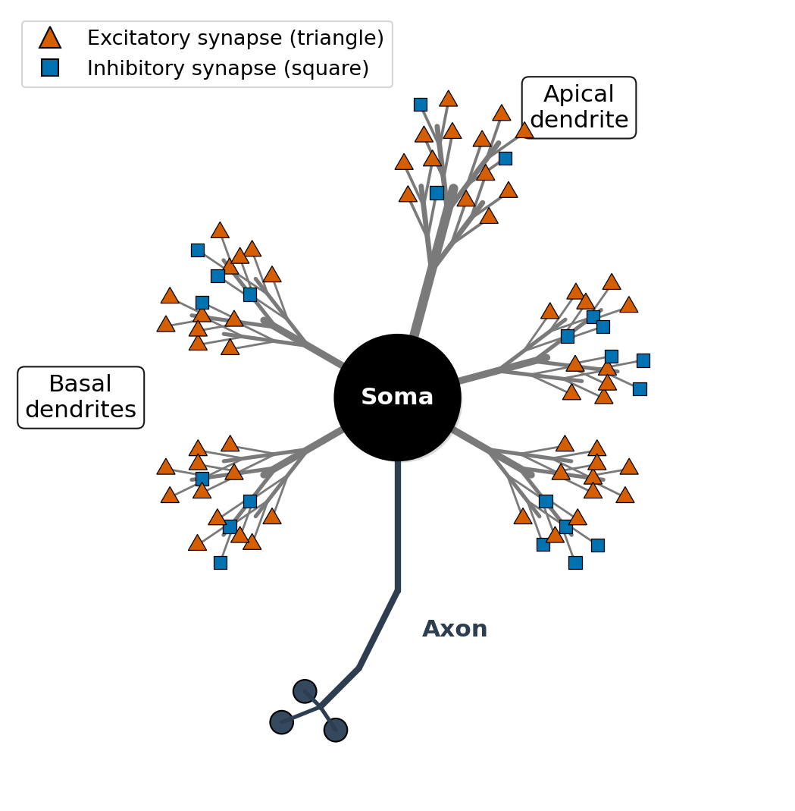

# Dendritic Modeling Framework

[](https://github.com/KempnerInstitute/DendriNet/actions/workflows/ci-simplified.yml?query=branch%3Adevelop)
[](https://github.com/KempnerInstitute/DendriNet/actions/workflows/ci-simplified.yml?query=branch%3Adevelop)
[](https://github.com/KempnerInstitute/DendriNet/actions/workflows/deploy-docs.yml?query=branch%3Adevelop)
[](LICENSE)
[](pyproject.toml)

A framework for biologically-inspired dendritic excitation-inhibition networks:
feedforward and recurrent architectures with shunting inhibition, sparse
connectivity, hierarchical dendritic trees, named E/I populations, typed
synapses, spiking soma dynamics, and soma-to-dendrite feedback.

<p align="center">
  
</p>

## Installation

```bash
conda env create -f setup/environment.yml
conda activate dendritic_env
pip install -e .
```

Full setup options are documented in [INSTALL.md](INSTALL.md).

## Common Commands

Train a standard experiment:

```bash
python -m dendritic_modeling.scripts.training.train_experiments \
    configs/config_exp.yaml
```

Distributed training uses the package entry points directly; wrap these in a
site-local SLURM script when running on a cluster:

```bash
# DDP
torchrun --nproc_per_node=4 \
    -m dendritic_modeling.scripts.training.train_experiments \
    configs/my_config.yaml

# FSDP
python -m dendritic_modeling.scripts.training.train_experiments_fsdp \
    configs/my_config.yaml
```

Run a sweep from an example config:

```bash
python -m dendritic_modeling.scripts.sweeps.sweep_manager \
    --config configs/sweep_config.yaml --generate-only
```

Analyze an existing sweep:

```bash
python -m dendritic_modeling.scripts.sweeps.result_analyzer \
    /path/to/sweep/results
```

Analysis runtime is configured centrally under `analysis.runtime` in YAML.
Use `mode: "stream"` there for large datasets, and set `max_samples` for
expensive analyses that should only inspect a bounded subset. For ImageNet
streaming, `in_order: false` can reduce DataLoader head-of-line blocking. Keep
`mode: "auto"` for the normal default, and use `mode: "materialize"` when you
want exact small-dataset single-GPU analysis behavior.
If `analysis.runtime` is omitted entirely, non-distributed runs default to that
single-process materialized behavior automatically.
Analyzers may temporarily move the model to the requested analysis device, but
they restore the original device and train/eval mode before returning.
For ImageNet training stalls, set `training.main.common.profile_dataloader: true`
to log epoch data-wait time.

## Documentation

The user docs live under [docs/README.md](docs/README.md).
Start with:

- [docs/examples.rst](docs/examples.rst)
- [docs/network_architectures.rst](docs/network_architectures.rst)
- [docs/configuration_guide.rst](docs/configuration_guide.rst)
- [docs/training_strategies.rst](docs/training_strategies.rst)
- [docs/datasets.rst](docs/datasets.rst)
- [docs/analysis.rst](docs/analysis.rst)
- [docs/sweeps.rst](docs/sweeps.rst)
- [docs/fsdp_troubleshooting.rst](docs/fsdp_troubleshooting.rst)
- [docs/config_reference.rst](docs/config_reference.rst)

## Core Network Types

Feedforward dendritic cores:

- `einet` / `dendritic_shunting` — shunting (divisive) inhibition
- `dendritic_additive` — raw additive inhibition, `V = E - I`
- `dendritic_normalized_additive` — additive inhibition with explicit voltage normalization
- `flat_shunting` / `flat_additive` / `flat_normalized_additive` — single-compartment variants

Recurrent dendritic cores:

- `population_network` — feedforward/recurrent notation with named
  populations, explicit directed connections, per-population morphologies,
  synapse types, spiking soma, and feedback
- `unified_ei` — hierarchical recurrent E-I with learnable time constants
- `ei_unified` — equivalent factory name
- `rnn_dendritic_*` / `rnn_flat_*` — recurrent shunting, raw additive, and normalized-additive aliases

Pretrained-replacement cores (vision):

- `hierarchical_dendritic_tensor_map` — replace FC layers in pretrained CNNs
- `hierarchical_dendritic_conv` — spatially local dendritic convolution

## Repository Layout

- `src/dendritic_modeling/networks/`: architectures and layers
- `src/dendritic_modeling/training/`: trainer implementations and utilities
- `src/dendritic_modeling/analysis/`: analyzers and metric code
- `src/dendritic_modeling/scripts/`: CLI entry points
- `configs/`: experiment, sweep, and comparison configs
- `projects/`: registry for paper-specific reproducibility workspaces
  (project subfolders are ignored until individually released)
- `tests/`: pytest-based test suite

## License

MIT. See [LICENSE](LICENSE).
