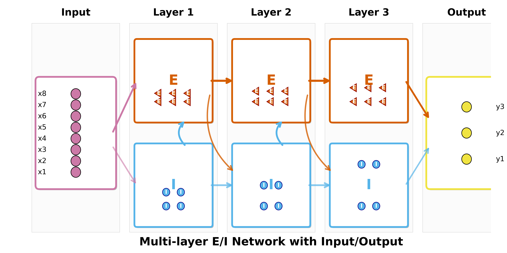
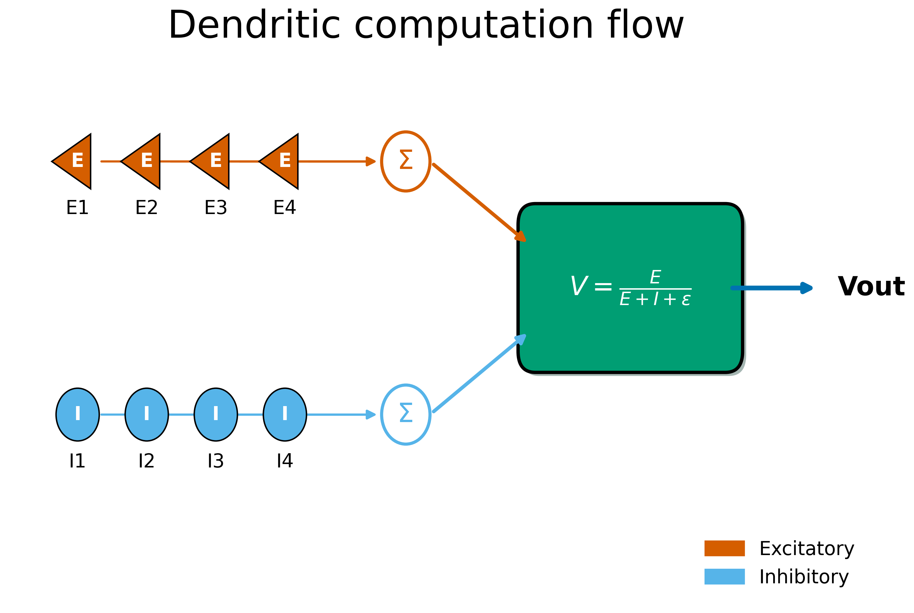
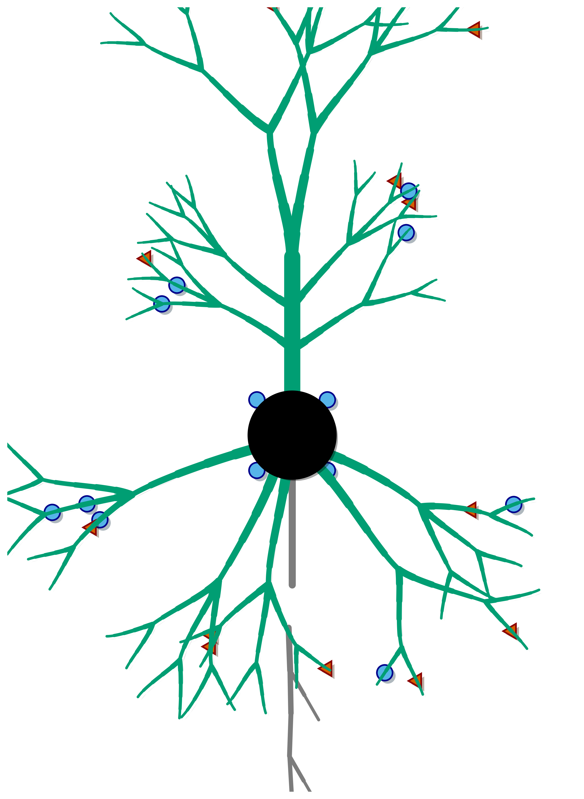

# Network Architectures Guide

This guide provides detailed information about all network architectures available in the Dendritic Modeling Framework, their biological motivation, mathematical formulations, and practical usage guidelines.



## Table of Contents

1. [EINet (Excitation-Inhibition Networks)](#einet-excitation-inhibition-networks)
2. [DendriNet (Pure Dendritic Networks)](#dendrinet-pure-dendritic-networks)
3. [Classical Networks](#classical-networks)
4. [Hybrid Architectures](#hybrid-architectures)
5. [Architecture Selection Guide](#architecture-selection-guide)

---

## EINet (Excitation-Inhibition Networks)


### Biological Motivation

EINets model the fundamental excitation-inhibition dynamics found in biological neural circuits. They implement:

- **Separate E/I pathways**: Distinct excitatory and inhibitory processing streams
- **Dendritic integration**: Hierarchical synaptic integration across dendritic branches
- **Shunting inhibition**: Biologically plausible divisive inhibition mechanisms
- **Compartmentalized processing**: Different processing in dendritic vs somatic compartments



### Mathematical Formulation

For each layer `l`, the EINet computes:

#### Excitatory Pathway
```
E^(l) = f_E(∑_branches TopK(W_EE^(l) * E^(l-1) + W_IE^(l) * I^(l-1)))
```

#### Inhibitory Pathway  
```
I^(l) = f_I(∑_branches TopK(W_EI^(l) * E^(l-1) + W_II^(l) * I^(l-1)))
```

#### Somatic Integration
With shunting inhibition:
```
V_soma = E / (E + I + 1)
```

With subtractive inhibition:
```
V_soma = E - I
```

### Configuration

```yaml
model:
  network:
    type: EINet
    parameters:
      # Architecture
      excitatory_layer_sizes: [256, 128, 64]      # E neurons per layer
      inhibitory_layer_sizes: [128, 64, 32]       # I neurons per layer
      excitatory_branch_factors: [2, 2]           # Branching structure
      
      # Connectivity
      ee_synapses_per_branch_per_layer: [200, 100]  # E→E connections
      ei_synapses_per_branch_per_layer: [100, 50]   # E→I connections
      ie_synapses_per_branch_per_layer: [50, 25]    # I→E connections
      ii_synapses_per_branch_per_layer: [0, 0]      # I→I connections (usually 0)
      
      # E-I Dynamics
      use_shunting: true                           # Shunting vs subtractive inhibition
      somatic_synapses: true                       # Direct soma connections
      
      # Synaptic mechanisms
      topk_type: standard                          # Synapse selection strategy
      topk_init_method: xavier_normal              # Weight initialization
```

### Use Cases

- **Complex pattern recognition**: Leverage E-I dynamics for sophisticated feature detection
- **Contextual processing**: Use inhibition for context-dependent computation
- **Biological modeling**: Study E-I balance and dendritic computation
- **Robustness studies**: Investigate noise resilience through inhibitory control

### Variants

#### Standard EINet
- Equal processing in both E and I pathways
- Balanced connectivity patterns

#### Inhibition-Dominant EINet
```yaml
parameters:
  inhibitory_layer_sizes: [512, 256, 128]  # Larger than excitatory
  ie_synapses_per_branch_per_layer: [100, 75]  # Strong I→E feedback
```

#### Sparse EINet with DeepST
```yaml
parameters:
  topk_type: deepst
  excitatory_target_density: 0.1
  rewiring_mode: global
  use_noise: true
```

---

## DendriNet (Pure Dendritic Networks)



### Biological Motivation

DendriNets focus purely on dendritic computation without explicit E-I separation:

- **Hierarchical branching**: Multi-level dendritic tree structures
- **Branch-specific processing**: Each branch performs specialized computation  
- **Synaptic integration**: Weighted combination of branch outputs
- **Reactivation mechanisms**: Nonlinear activation after each integration step


### Mathematical Formulation

For a DendriNet with branch hierarchy `[B₁, B₂, ..., Bₙ]`:

#### Branch Processing (from distal to proximal)
```
Branch_output^(i) = f_reactivate(∑_synapses TopK(W^(i) * Branch_input^(i)))
```

#### Hierarchical Integration
```
Level₁: V₁ = [Branch₁, Branch₂, ..., Branch_B₁]
Level₂: V₂ = [Combine(V₁[1:B₂]), Combine(V₁[B₂+1:2*B₂]), ...]
...
Soma: V_final = Combine(V_final_level)
```

### Configuration

```yaml
model:
  network:
    type: DendriNet
    parameters:
      n_soma: 64                                   # Number of output neurons
      branch_factors: [4, 2]                       # Branching hierarchy: 64 → 16 → 4 → 1
      excitatory_synapses_per_branch: 50           # Synapses per branch
      
      # Reactivation
      reactivate: true                             # Enable reactivation
      reactivation_type: param_tanh                # Activation function
      reactivation_init_m: 1.5                    # Initial slope
      reactivation_init_b: 0.5                    # Initial bias
      
      # Synaptic properties
      topk_type: stochastic                        # Selection strategy
      topk_temperature: 0.3                       # Stochasticity
      somatic_synapses: true                       # Direct soma input
```

### Use Cases

- **Hierarchical feature detection**: Natural hierarchical processing
- **Tree-structured data**: Processing data with natural tree structure
- **Biological dendrite modeling**: Direct modeling of dendritic computation
- **Compositional learning**: Learning compositional representations

### Specialized Configurations

#### Deep Hierarchical DendriNet
```yaml
parameters:
  n_soma: 10
  branch_factors: [8, 4, 2]                      # 3-level hierarchy
  excitatory_synapses_per_branch: 100
  reactivation_type: param_linear_tanh_transition
```

#### Wide Parallel DendriNet  
```yaml
parameters:
  n_soma: 100
  branch_factors: [2]                            # Single level, many branches
  excitatory_synapses_per_branch: 200
  reactivation_type: param_tanh_only_m
```

---

## Classical Networks

### Multi-Layer Perceptron (MLP)

Standard feedforward networks for baseline comparisons.

```yaml
model:
  network:
    type: MLP
    parameters:
      input_dim: 784
      hidden_dims: [256, 128, 64]                 # Hidden layer sizes
      activation: relu                            # Activation function
      output_dim: 10                              # Final output dimension
```

**Use Cases:**
- Baseline comparisons with dendritic models
- Simple classification tasks
- Feature extraction

### MatchedParamMLP

MLP with parameter count matched to a corresponding EINet.

```yaml
model:
  network:
    type: MatchedParamMLP
    parameters:
      target_param_count: 150000                  # Match specific parameter count
      input_dim: 784
      output_dim: 10
      activation: relu
```

**Use Cases:**
- Fair comparison with dendritic networks
- Isolating architectural vs parameter count effects

### Convolutional Networks

#### CNN Encoder (CNNDownsample)
```yaml
model:
  network:
    type: CNNDownsample
    parameters:
      input_shape: [3, 32, 32]                    # Input image shape
      hidden_dims: [32, 64, 128]                  # Conv channel progression
      kernel_sizes: [5, 3, 3]                     # Kernel sizes
      strides: [2, 2, 1]                          # Stride values
      activation: relu
      output_dim: 256                             # Final FC layer
```

#### CNN Decoder (CNNUpsample)
```yaml
model:
  network:
    type: CNNUpsample
    parameters:
      input_dim: 256                              # Input feature dimension
      output_shape: [3, 32, 32]                   # Target output shape
      hidden_dims: [128, 64, 32]                  # Deconv channel progression
      kernel_sizes: [3, 3, 5]                     # Kernel sizes
      strides: [1, 2, 2]                          # Stride values
      activation: relu
```

**Use Cases:**
- Image processing tasks
- Feature extraction and reconstruction
- Comparison with dendritic CNN hybrids

### Pre-trained Networks

#### AlexNet Features
```yaml
model:
  network:
    type: AlexNet
    parameters:
      pretrained: true                            # Use pre-trained weights
      freeze_features: true                       # Freeze convolutional layers
      output_dim: 10                              # Classification head size
```

**Use Cases:**
- Transfer learning
- Feature extraction from natural images
- Hybrid architectures with dendritic classification heads

### Autoencoders

#### MLP Autoencoder
```yaml
model:
  network:
    type: MLPAutoencoder
    parameters:
      input_dim: 784
      encoder_dims: [512, 256, 128]               # Encoder hidden dimensions
      latent_dim: 64                              # Bottleneck dimension
      decoder_dims: [128, 256, 512]               # Decoder hidden dimensions
      activation: relu
```

#### Variational Autoencoder (VAE)
```yaml
model:
  network:
    type: MLPVariationalAutoencoder
    parameters:
      input_dim: 784
      encoder_dims: [512, 256]
      latent_dim: 64
      decoder_dims: [256, 512]
      activation: relu
      beta: 1.0                                   # KL weight
```

**Use Cases:**
- Unsupervised representation learning
- Generative modeling
- Dimensionality reduction

---

## Hybrid Architectures

### EINet with CNN Input Processing

Combine CNN feature extraction with dendritic classification:

```yaml
model:
  network:
    type: EINet
    parameters:
      # Input processing
      input_mode: 2
      input_net_dict:
        type: CNNInputTransform
        input_shape: [3, 32, 32]
        excitatory_hidden_dims: [64, 128]
        inhibitory_hidden_dims: [32, 64]
        excitatory_kernel_sizes: [5, 3]
        inhibitory_kernel_sizes: [7, 5]
      
      # Dendritic processing  
      excitatory_layer_sizes: [256, 128]
      inhibitory_layer_sizes: [128, 64]
      use_shunting: true
      topk_type: stochastic
```

### Multi-Scale DendriNet

Process inputs at multiple scales:

```yaml
model:
  network:
    type: DendriNet
    parameters:
      n_soma: 32
      branch_factors: [4, 2]                      # Multi-scale branches
      excitatory_synapses_per_branch: [200, 100] # Scale-dependent connectivity
      reactivation_type: param_linear_tanh        # Smooth transitions
      
      # Multi-scale input
      input_mode: 2
      input_net_dict:
        type: MLPInputTransform
        hidden_dims: [512, 256]
        excitatory_dim: 400                       # Large-scale features
        inhibitory_dim: 100                       # Fine-scale features
```

---

## Architecture Selection Guide

### Task-Based Selection

| Task Type | Recommended Architecture | Rationale |
|-----------|-------------------------|-----------|
| **Image Classification** | EINet + CNNInputTransform | Spatial processing + dendritic classification |
| **Sequential Data** | DendriNet with hierarchical branches | Natural temporal hierarchy |
| **Small Datasets** | MLP or simple EINet | Avoid overfitting |
| **Transfer Learning** | AlexNet + EINet head | Leverage pre-trained features |
| **Biological Modeling** | EINet with shunting inhibition | Biologically accurate dynamics |
| **Interpretability** | DendriNet with branch analysis | Clear hierarchical structure |

### Performance Considerations

| Factor | EINet | DendriNet | MLP | Hybrid |
|--------|-------|-----------|-----|--------|
| **Training Speed** | Medium | Medium | Fast | Slow |
| **Memory Usage** | High | Medium | Low | High |
| **Interpretability** | Medium | High | Low | Medium |
| **Biological Realism** | High | High | Low | Medium |
| **Parameter Efficiency** | Medium | High | High | Low |

### Complexity Guidelines

#### Simple Tasks (MNIST, small datasets)
```yaml
# Lightweight EINet
excitatory_layer_sizes: [64, 32]
inhibitory_layer_sizes: [32, 16]
topk_type: standard
```

#### Medium Tasks (CIFAR-10, structured data)
```yaml
# Standard EINet with preprocessing
input_mode: 2
excitatory_layer_sizes: [256, 128, 64]
inhibitory_layer_sizes: [128, 64, 32]
topk_type: stochastic
```

#### Complex Tasks (ImageNet, large datasets)
```yaml
# Deep hierarchical with advanced features
excitatory_layer_sizes: [512, 256, 128, 64]
inhibitory_layer_sizes: [256, 128, 64, 32]
excitatory_branch_factors: [4, 2, 2]
topk_type: deepst
input_mode: 2  # With CNNInputTransform
```

### Debugging and Development

#### Start Simple
1. Begin with MLP baseline
2. Add basic EINet (single layer)
3. Gradually increase complexity
4. Add advanced features (DeepST, complex reactivation)

#### Common Issues and Solutions

| Issue | Symptom | Solution |
|-------|---------|----------|
| **Vanishing Gradients** | Poor deep network training | Use gradient scaling strategies |
| **Exploding Gradients** | NaN losses | Reduce learning rates, add gradient clipping |
| **Memory Issues** | OOM errors | Reduce batch size, layer sizes |
| **Poor Convergence** | Stuck at random performance | Check learning rates, initialization |
| **Overfitting** | Large train/val gap | Reduce network size, add regularization |

### Best Practices

1. **Start with documented examples** from `configs/` directory
2. **Match architecture to data complexity** - don't over-engineer
3. **Use appropriate input processing** - CNN for images, MLP for tabular
4. **Enable comprehensive analysis** to understand model behavior
5. **Compare with baselines** using MatchedParamMLP
6. **Monitor training dynamics** with visualization enabled

---

## Input Transforms

Input transforms preprocess raw inputs before they enter the dendritic networks, mapping them to excitatory and inhibitory pathways.

### Available Input Transforms

#### Identity Transform
Simply passes input to both E and I pathways:
```yaml
parameters:
  input_mode: 1  # Same input to both pathways
```

#### Index Transform  
Randomly splits input dimensions between E and I:
```yaml
parameters:
  input_mode: 2
  input_net_dict:
    type: IndexInputTransform
    excitatory_dim: 300  # First 300 dimensions → E
    inhibitory_dim: 200  # Remaining 200 → I
```

#### MLP Transform
Learned transformation with separate E/I heads:
```yaml
parameters:
  input_mode: 2
  input_net_dict:
    type: MLPInputTransform
    input_dim: 784
    hidden_dims: [512, 256]
    excitatory_dim: 400
    inhibitory_dim: 200
```

#### CNN Transform
Convolutional preprocessing for images:
```yaml
parameters:
  input_mode: 2
  input_net_dict:
    type: CNNInputTransform
    input_shape: [3, 32, 32]
    excitatory_hidden_dims: [32, 64]
    inhibitory_hidden_dims: [16, 32]
    excitatory_kernel_sizes: [5, 3]
    inhibitory_kernel_sizes: [7, 5]
    excitatory_strides: [1, 1]
    inhibitory_strides: [1, 1]
```

#### AlexNet Transform
Pre-trained features for transfer learning:
```yaml
parameters:
  input_mode: 2
  input_net_dict:
    type: AlexNetTransform
    excitatory_dim: 4096
    inhibitory_dim: 2048
```

#### Feature Extractor MLP
Pre-trained MLP features (frozen):
```yaml
parameters:
  input_mode: 2
  input_net_dict:
    type: FeatureExtractorMLP
    input_dim: 784
    hidden_dims: [1024, 512]
    output_dim: 256
```

#### Sigmoid Transform
MLP with sigmoid output for bounded values:
```yaml
parameters:
  input_mode: 2
  input_net_dict:
    type: SigmoidInputNetTransform
    input_dim: 784
    hidden_dims: [512, 256]
    excitatory_dim: 200
    inhibitory_dim: 100
```

### Input Mode Configuration

The `input_mode` parameter controls how inputs are processed:

| Mode | Description | Use Case |
|------|-------------|----------|
| **0** | Raw input → E, None → I | Pure excitatory processing |
| **1** | Same input → both E and I | Balanced E/I input |
| **2** | Transform inputs via input_net_dict | Learned/specialized pathways |

### Training Input Networks

Configure how input transforms are trained:

```yaml
train:
  input_net_training:
    training_mode: sequential       # 'joint' or 'sequential'
    train_input_net: true          # Whether to train
    input_net_epochs: 20           # Pre-training epochs
    train_heads_independently: false  # Independent E/I heads
    
    # Objectives for inhibitory pathway
    inhibitory_head_objective: diversity  # 'classification', 'diversity', 'combined'
    diversity_weight: 0.5          # Weight for diversity loss
```

### Best Practices for Input Transforms

1. **Image Data**: Use CNNInputTransform or AlexNetTransform
2. **Tabular Data**: Use MLPInputTransform or IndexInputTransform  
3. **Small Datasets**: Use simpler transforms to avoid overfitting
4. **Transfer Learning**: Use pre-trained AlexNet or FeatureExtractorMLP
5. **Biological Realism**: Use separate pathways with specialized processing

---

## Specialized Layers

### DendriteConv2d

A biologically-inspired convolutional layer with E/I balance and divisive normalization:

```python
from dendritic_modeling.networks.layers import DendriteConv2d

# Create dendritic convolutional layer
layer = DendriteConv2d(
    in_channels=3,
    out_channels=32,
    kernel_size=5,
    stride=1,
    padding=2,
    epsilon=1e-4,
    init_method='softplus_normal'
)
```

**Key Features:**
- Implements divisive normalization: `v_out = E / (E + I + ε)`
- Separate excitatory and inhibitory convolutions
- Biologically plausible weight constraints (positive only)
- Apical modulation support for contextual processing

**Use Cases:**
- Vision models with biological constraints
- Studying cortical simple cell responses
- Context-dependent visual processing

### Vision Neuron Factories

Pre-built biologically-inspired vision units:

```python
from dendritic_modeling.networks.architectures.excitation_inhibition.dendritic import (
    create_gabor_unit,
    create_center_surround_unit,
    create_motion_unit,
    create_end_stopped_unit
)

# Orientation-selective unit
gabor = create_gabor_unit(
    orientation=45.0,     # degrees
    frequency=0.1,        # cycles per pixel
    sigma=3.0            # Gaussian envelope width
)

# Center-surround receptive field
cs_unit = create_center_surround_unit(
    center_size=5,       # Center region diameter
    surround_size=11     # Surround region diameter
)

# Motion detection unit
motion = create_motion_unit(
    direction="rightward",  # Motion direction
    kernel_size=15         # Spatiotemporal kernel size
)

# End-stopped cell (hypercomplex)
end_stopped = create_end_stopped_unit(
    orientation=0.0,       # Preferred orientation
    length=10,            # Optimal bar length
    width=3               # Bar width
)
```

**Configuration from YAML:**
```yaml
# Load neuron configuration from YAML
from dendritic_modeling.networks.architectures.excitation_inhibition.dendritic import build_neuron_from_yaml

neuron = build_neuron_from_yaml("configs/vision_neuron.yaml")
```

---

## Summary

The Dendritic Modeling Framework provides a rich set of architectures for exploring dendritic computation:

- **EINet**: Best for studying E-I dynamics and biological realism
- **DendriNet**: Ideal for hierarchical processing and interpretability  
- **Classical Networks**: Essential for baselines and comparisons
- **Hybrid Architectures**: Optimal for complex real-world tasks

Choose architectures based on your research goals, computational constraints, and biological realism requirements. Start simple and gradually add complexity as needed. 