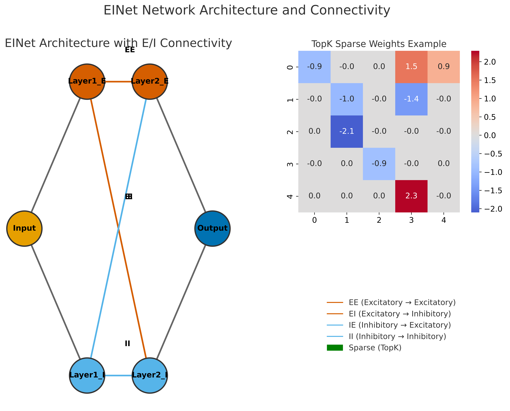

Network Architectures and Design
=================================

This section provides comprehensive guidance on designing and configuring neural networks with the Dendritic Modeling Framework. From simple EINet models to complex hybrid architectures, learn how to build networks that capture sophisticated dendritic computation.

   **Architecture Overview**: The framework supports multiple network types from simple MLPs to complex dendritic networks with E/I dynamics.

Overview
--------

The framework uses a modular design principle with three main components:

* **Encoder Networks**: Input preprocessing and feature extraction
* **Core Networks**: Main computational units (EINet, DendriNet, MLP)
* **Decoder Networks**: Output processing and classification/regression heads

This modularity allows for flexible combination of different architectures to create custom networks optimized for specific tasks.

.. toctree::
   :maxdepth: 2
   :caption: Architecture Topics

   einet
   dendrinet
   mlp_variants
   convolutional
   hybrid_designs
   custom_design

Modular Design Principles
-------------------------

Component Architecture
~~~~~~~~~~~~~~~~~~~~~

Every model in the framework follows this structure:

.. code-block:: python

   # General model structure
   model = Classifier(
       encoder_network=encoder,    # Optional: Input preprocessing
       core_network=core,          # Required: Main computation
       decoder_network=decoder     # Optional: Output processing
   )

**Encoder Networks** (Optional):
- CNNDownsample: Convolutional feature extraction
- MLP: Dense feature transformation
- Custom transforms: User-defined preprocessing

**Core Networks** (Required):
- EINet: Excitation-inhibition networks with dendritic branches
- DendriNet: Pure dendritic computation without explicit E/I
- MLP: Standard multi-layer perceptrons
- Hybrid: Custom combinations

**Decoder Networks** (Optional):
- MLP: Dense classification/regression heads
- CNNUpsample: Deconvolutional output processing
- Custom: Task-specific output layers

Configuration Patterns
~~~~~~~~~~~~~~~~~~~~~~

**Simple Configuration** (Core only):

.. code-block:: yaml

   model:
     task: classification
     core_network:
       type: EINet
       parameters:
         excitatory_layer_sizes: [64, 32]
         inhibitory_layer_sizes: [32, 16]

**Full Pipeline Configuration**:

.. code-block:: yaml

   model:
     task: classification
     encoder_network:
       type: CNNDownsample
       parameters:
         hidden_dims: [32, 64]
     core_network:
       type: EINet
       parameters:
         excitatory_layer_sizes: [128, 64]
         inhibitory_layer_sizes: [64, 32]
     decoder_network:
       type: MLP
       parameters:
         hidden_dims: [32, 16]

EINet (Excitation-Inhibition Networks)
--------------------------------------

The flagship architecture implementing biological E/I dynamics with dendritic computation.

Key Features
~~~~~~~~~~~

* **Separate E/I Populations**: Following Dale's principle
* **Dendritic Branching**: Hierarchical tree structures
* **Shunting Inhibition**: Divisive normalization V = E/(E+I+ε)
* **Sparse Connectivity**: TopK and DeepST selection
* **Parametric Reactivation**: Learnable activation functions

Basic Configuration
~~~~~~~~~~~~~~~~~~

.. code-block:: yaml

   core_network:
     type: EINet
     parameters:
       # Network structure
       excitatory_layer_sizes: [64, 32, 16]    # E-cell counts per layer
       inhibitory_layer_sizes: [32, 16, 8]     # I-cell counts per layer
       
       # Dendritic branching
       excitatory_branch_factors: [2, 2]       # 2 branches per level
       inhibitory_branch_factors: [2, 2]
       
       # Connectivity
       ee_synapses_per_branch: [50, 25]        # E→E connections
       ei_synapses_per_branch: [25, 12]        # E→I connections
       ie_synapses_per_branch: [25, 12]        # I→E connections
       
       # Core features
       use_shunting: true                       # Enable shunting inhibition
       topk_type: "standard"                    # Connectivity selection
       reactivation_type: "param_tanh"          # Activation function

Advanced EINet Features
~~~~~~~~~~~~~~~~~~~~~~

**Sparse Connectivity Options**:

.. code-block:: yaml

   parameters:
     # Standard TopK (deterministic)
     topk_type: "standard"
     topk_k: 50
     
     # Stochastic TopK (probabilistic)
     topk_type: "stochastic" 
     topk_temperature: 0.3
     topk_ultrafast: true
     
     # Variance-based selection
     topk_type: "variance"
     variance_window: 100
     
     # Dynamic sparse training
     topk_type: "deepst"
     target_density: 0.1
     rewiring_mode: "global"
     rewire_frequency: 5

**Input Processing Modes**:

.. code-block:: yaml

   parameters:
     # Mode 0: Raw input to E, none to I
     input_mode: 0
     
     # Mode 1: Independent E/I pathways  
     input_mode: 1
     independent_pathways: true
     
     # Mode 2: Transform networks
     input_mode: 2
     input_net_dict:
       type: "MLPInputTransform"
       excitatory_hidden_dims: [32, 64]
       inhibitory_hidden_dims: [16, 32]

**Gradient Scaling Strategies**:

.. code-block:: yaml

   parameters:
     reactivation_strategy: "inverse"          # Compensate vanishing gradients
     topk_strategy: "conductance_dynamic"      # Bio-motivated scaling
     blocklinear_strategy: "distal_upweight_by_idx"  # Enhance distal learning

Design Patterns for EINet
~~~~~~~~~~~~~~~~~~~~~~~~~

**Small Networks** (< 1M parameters):

.. code-block:: yaml

   excitatory_layer_sizes: [32, 16]
   inhibitory_layer_sizes: [16, 8]
   excitatory_branch_factors: [2]
   use_shunting: true
   topk_type: "standard"

**Medium Networks** (1-100M parameters):

.. code-block:: yaml

   excitatory_layer_sizes: [256, 128, 64]
   inhibitory_layer_sizes: [128, 64, 32]
   excitatory_branch_factors: [4, 2]
   use_shunting: true
   topk_type: "stochastic"
   topk_temperature: 0.3

**Large Networks** (>100M parameters):

.. code-block:: yaml

   excitatory_layer_sizes: [1024, 512, 256]
   inhibitory_layer_sizes: [512, 256, 128]
   excitatory_branch_factors: [8, 4, 2]
   use_shunting: true
   topk_type: "deepst"
   target_density: 0.05

Use Cases for EINet
~~~~~~~~~~~~~~~~~~~

* **Biological modeling**: High biological realism with E/I dynamics
* **Classification tasks**: Vision, text, and tabular data
* **Information processing**: When analyzing neural information flow
* **Sparse learning**: Efficient training with sparse connectivity
* **Research**: Studying dendritic computation mechanisms

DendriNet (Pure Dendritic Networks)
-----------------------------------

Branch-focused architecture without explicit E/I separation.

Key Features
~~~~~~~~~~~

* **Multi-soma Design**: Multiple output units per layer
* **Pure Dendritic Processing**: Focus on branch computation
* **Flexible Branching**: Configurable tree structures
* **Simplified Connectivity**: No E/I constraints

Basic Configuration
~~~~~~~~~~~~~~~~~~

.. code-block:: yaml

   core_network:
     type: DendriNet
     parameters:
       # Network structure
       n_soma: [64, 32, 16]                    # Soma counts per layer
       branch_factors: [4, 2]                  # Branching patterns
       synapses_per_branch: [100, 50]          # Connectivity density
       
       # Dendritic features
       use_branches: true                       # Enable dendritic computation
       reactivation_type: "param_tanh"          # Branch activation
       topk_type: "standard"                   # Sparse connectivity

Advanced DendriNet Features
~~~~~~~~~~~~~~~~~~~~~~~~~~

**Hierarchical Branching**:

.. code-block:: yaml

   parameters:
     # Simple 2-level tree: 4 → 1
     branch_factors: [4]
     
     # Complex 3-level tree: 8 → 4 → 1  
     branch_factors: [8, 4]
     
     # Asymmetric tree: 6 → 2 → 1
     branch_factors: [6, 2]

**Branch-Specific Processing**:

.. code-block:: yaml

   parameters:
     # Different activations per level
     reactivation_per_level: true
     reactivation_types: ["linear", "param_tanh", "relu"]
     
     # Level-specific connectivity
     synapses_per_branch: [200, 100, 50]    # Decreasing connectivity

Use Cases for DendriNet
~~~~~~~~~~~~~~~~~~~~~~~

* **Dendritic research**: Focus on branch computation without E/I complexity
* **Hierarchical processing**: Multi-level feature extraction
* **Custom architectures**: Building blocks for novel designs
* **Computational efficiency**: Simplified training compared to EINet

MLP Variants
-----------

Standard and modified multi-layer perceptrons for comparison and hybrid designs.

Available Types
~~~~~~~~~~~~~~

**Standard MLP**:

.. code-block:: yaml

   core_network:
     type: MLP
     parameters:
       hidden_dims: [256, 128, 64]
       activation: "relu"
       dropout: 0.1

**MatchedParam MLP** (Parameter-matched baselines):

.. code-block:: yaml

   core_network:
     type: MatchedParamMLP  
     parameters:
       reference_network: "EINet"     # Match parameter count
       hidden_dims: [auto]            # Automatically computed
       activation: "relu"

**Sparse MLP** (With TopK connectivity):

.. code-block:: yaml

   core_network:
     type: SparseMLP
     parameters:
       hidden_dims: [256, 128, 64]
       sparsity_ratio: 0.1            # 10% connectivity
       topk_type: "standard"

Use Cases for MLPs
~~~~~~~~~~~~~~~~~~

* **Baselines**: Comparing against dendritic architectures
* **Hybrid designs**: Encoder/decoder components
* **Ablation studies**: Understanding dendritic benefits
* **Simple tasks**: When biological realism isn't needed

Convolutional Networks
---------------------

CNNs for image processing and hybrid vision architectures.

Available Types
~~~~~~~~~~~~~~

**CNN Downsample** (Encoder):

.. code-block:: yaml

   encoder_network:
     type: CNNDownsample
     parameters:
       hidden_dims: [32, 64, 128]
       kernel_sizes: [3, 3, 3]
       strides: [1, 2, 2]
       padding: [1, 1, 1]

**CNN Upsample** (Decoder):

.. code-block:: yaml

   decoder_network:
     type: CNNUpsample
     parameters:
       hidden_dims: [128, 64, 32]
       kernel_sizes: [3, 3, 3]
       strides: [2, 2, 1]

**Dendritic Convolution**:

.. code-block:: yaml

   core_network:
     type: DendriteConv2d
     parameters:
       in_channels: 64
       out_channels: 128
       kernel_size: 3
       branch_factors: [2, 2]
       use_dendritic: true

Hybrid Architecture Designs
---------------------------

Combining different network types for optimal performance.

Common Patterns
~~~~~~~~~~~~~~

**CNN + EINet Pipeline**:

.. code-block:: yaml

   model:
     encoder_network:
       type: CNNDownsample
       parameters:
         hidden_dims: [32, 64]
     core_network:
       type: EINet
       parameters:
         excitatory_layer_sizes: [128, 64]
         inhibitory_layer_sizes: [64, 32]
     decoder_network:
       type: MLP
       parameters:
         hidden_dims: [32, 16]

**Multi-Core Architecture**:

.. code-block:: yaml

   model:
     multi_core: true
     core_networks:
       - type: EINet
         parameters: {...}
       - type: DendriNet  
         parameters: {...}
     fusion_strategy: "concat"  # or "attention", "weighted"

**Ensemble Designs**:

.. code-block:: yaml

   model:
     ensemble: true
     ensemble_networks:
       - type: EINet
       - type: MLP
       - type: DendriNet
     ensemble_method: "voting"  # or "averaging", "stacking"

Custom Architecture Design
--------------------------

Guidelines for creating novel architectures.

Design Principles
~~~~~~~~~~~~~~~~

1. **Start Simple**: Begin with basic configurations
2. **Incremental Complexity**: Add features gradually
3. **Biological Inspiration**: Consider neural mechanisms
4. **Performance Trade-offs**: Balance accuracy vs. efficiency

Creating Custom Networks
~~~~~~~~~~~~~~~~~~~~~~~

**Step 1: Define Architecture**:

.. code-block:: python

   from dendritic_modeling.networks.base import BaseNetwork
   
   class CustomNetwork(BaseNetwork):
       def __init__(self, input_dim, custom_param):
           super().__init__()
           self.custom_param = custom_param
           # Define layers here
           
       def forward(self, x):
           # Implement forward pass
           return output

**Step 2: Register with Factory**:

.. code-block:: python

   from dendritic_modeling.core.factory import register_network
   
   @register_network("CustomNetwork")
   class CustomNetwork(BaseNetwork):
       # Implementation

**Step 3: Configure in YAML**:

.. code-block:: yaml

   core_network:
     type: CustomNetwork
     parameters:
       custom_param: value

Scaling Considerations
---------------------

Architecture scaling guidelines for different model sizes.

Memory and Compute Scaling
~~~~~~~~~~~~~~~~~~~~~~~~~

.. list-table:: Architecture Scaling Guidelines
   :header-rows: 1
   :widths: 20 25 25 30

   * - Model Size
     - Recommended Architecture
     - Key Parameters
     - Optimizations
   * - **Small** (<1M)
     - Simple EINet
     - 1-2 layers, small branches
     - Standard TopK
   * - **Medium** (1-100M)
     - Multi-layer EINet
     - 3-4 layers, moderate branches
     - Stochastic TopK, AMP
   * - **Large** (100M-1B)
     - Deep EINet + CNN
     - 5+ layers, complex branches
     - DeepST, FSDP
   * - **XLarge** (>1B)
     - Hybrid ensemble
     - Multiple cores, sparse
     - Full FSDP, CPU offload

Parameter Estimation
~~~~~~~~~~~~~~~~~~~

.. code-block:: python

   from dendritic_modeling.utils.estimation import estimate_parameters
   
   # Estimate parameters for a configuration
   config = {
       "type": "EINet",
       "parameters": {
           "excitatory_layer_sizes": [256, 128, 64],
           "inhibitory_layer_sizes": [128, 64, 32]
       }
   }
   
   param_count = estimate_parameters(config)
   print(f"Estimated parameters: {param_count:,}")

Best Practices
-------------

Architecture Selection Guidelines
~~~~~~~~~~~~~~~~~~~~~~~~~~~~~~~~

**Choose EINet when**:
- High biological realism required
- Studying E/I dynamics
- Classification/regression tasks
- Sparse connectivity beneficial

**Choose DendriNet when**:
- Focus on dendritic computation
- Simplified training desired
- Hierarchical processing needed
- Building custom architectures

**Choose MLP when**:
- Baseline comparisons needed
- Simple tasks
- Component in hybrid design
- Fast prototyping required

**Choose CNN when**:
- Image/vision tasks
- Spatial feature extraction
- Need for translation invariance
- Large-scale vision problems

Performance Optimization
~~~~~~~~~~~~~~~~~~~~~~~

1. **Start with standard configurations**
2. **Profile bottlenecks** before optimizing
3. **Use appropriate sparsity** for your data size
4. **Enable mixed precision** for large models
5. **Consider gradient checkpointing** for memory

Common Pitfalls
~~~~~~~~~~~~~~

* **Over-parameterization**: Too many branches/connections
* **Under-utilization**: Not using available compute efficiently
* **Mismatched complexity**: Architecture doesn't fit task
* **Ignoring biological constraints**: Unrealistic connectivity patterns

Next Steps
----------

Now that you understand the architecture options:

1. **Start with EINet**: Try the flagship architecture (:doc:`einet`)
2. **Explore configurations**: See :doc:`../configuration/index`
3. **Custom designs**: Learn :doc:`custom_design`
4. **Performance tuning**: Check :doc:`../performance/index`

.. seealso::
   * :doc:`../core_concepts` - Understanding the biological principles
   * :doc:`../configuration/index` - Complete configuration options
   * :doc:`../tutorials/index` - Step-by-step architecture tutorials 