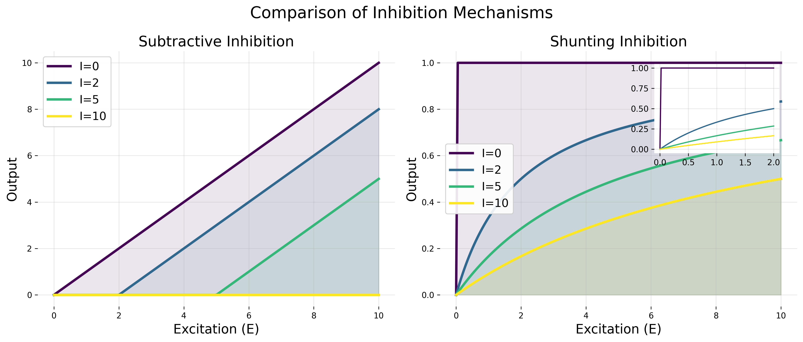
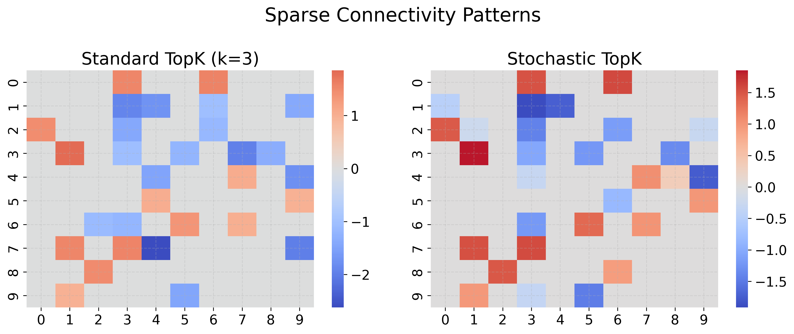
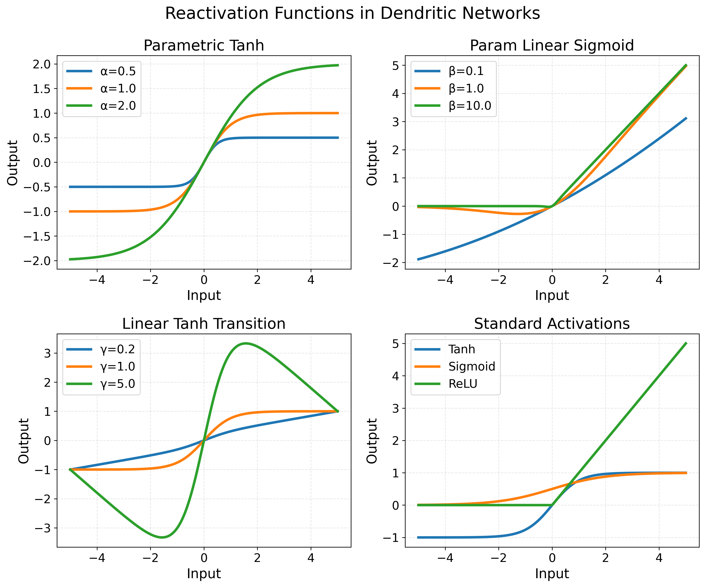
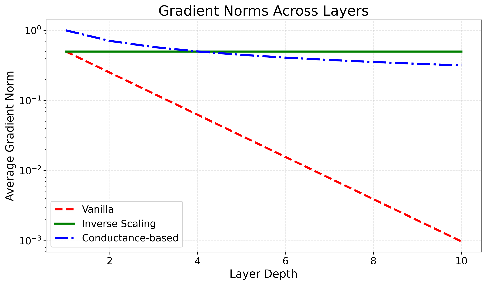

Core Concepts
=============

This section introduces the fundamental computational and biological principles underlying the Dendritic Modeling Framework. Understanding these concepts is essential for effectively using the framework and interpreting results.

   **Shunting Inhibition**: The core computational mechanism implementing divisive normalization through E/(E+I+ε), providing gain control and dynamic range adaptation.

Dendritic Computation
---------------------

Biological Foundation
~~~~~~~~~~~~~~~~~~~~

Real neurons are far more sophisticated than the simple summation units used in traditional artificial neural networks. Biological neurons feature elaborate dendritic trees that perform complex, nonlinear computations:

**Traditional Artificial Neuron:**

.. math::
   y = f\left(\sum_i w_i x_i + b\right)

**Biological Dendritic Neuron:**

1. **Spatial organization**: Synapses distributed across dendritic branches
2. **Local processing**: Each branch performs independent computations  
3. **Nonlinear integration**: Active dendritic properties enable complex operations
4. **Hierarchical structure**: Multi-level branching creates computational hierarchy

Shunting Inhibition
~~~~~~~~~~~~~~~~~~

The cornerstone of dendritic computation in our framework is :term:`shunting inhibition`—a divisive form of inhibition found throughout the nervous system:

.. math::
   V_{out} = \frac{E}{E + I + \varepsilon}

Where:
- :math:`E` = sum of excitatory inputs
- :math:`I` = sum of inhibitory inputs  
- :math:`\varepsilon` = small constant (prevents division by zero)

**Key Properties:**

* **Gain Control**: Response amplitude scales with total input strength
* **Normalization**: Output bounded in range [0, 1] regardless of input magnitude
* **Contrast Enhancement**: Amplifies differences between inputs
* **Dynamic Range**: Adapts to varying input statistics

**Comparison with Subtractive Inhibition:**

.. list-table:: Inhibition Types
   :header-rows: 1
   :widths: 30 35 35

   * - Property
     - Shunting (E/(E+I+ε))
     - Subtractive (E-I)
   * - **Output Range**
     - Bounded [0,1]
     - Unbounded
   * - **Gain Control**
     - Yes (automatic)
     - No
   * - **Biological Realism**
     - High
     - Lower
   * - **Computational Cost**
     - Slightly higher
     - Lower

Dendritic Branch Processing
~~~~~~~~~~~~~~~~~~~~~~~~~~

In our framework, dendritic branches implement hierarchical computation:

.. code-block:: python

   # Example: 3-level dendritic tree
   branch_factors = [4, 2]  # 4 → 2 → 1 branches
   
   # Level 1: 4 distal branches receive raw inputs
   # Level 2: 2 intermediate branches integrate level 1 outputs  
   # Level 3: 1 proximal branch (soma) integrates level 2 outputs

Each level can apply:
- **Sparse connectivity** (TopK selection)
- **Nonlinear reactivation** (parametric functions)
- **E/I integration** (shunting inhibition)

Excitation-Inhibition (E/I) Dynamics
------------------------------------

Dale's Principle
~~~~~~~~~~~~~~~

Following Dale's principle, neurons in biological networks are either purely excitatory or purely inhibitory:

* **Excitatory neurons** (E-cells): Make only excitatory connections
* **Inhibitory neurons** (I-cells): Make only inhibitory connections
* **No mixed neurons**: Each cell has a single neurotransmitter type

Network Organization
~~~~~~~~~~~~~~~~~~~

Our E/I networks implement realistic connectivity patterns:

.. list-table:: Connection Types
   :header-rows: 1
   :widths: 20 40 40

   * - Connection
     - Description
     - Function
   * - **E→E**
     - Excitatory to Excitatory
     - Forward signal propagation
   * - **E→I**
     - Excitatory to Inhibitory
     - Drives inhibitory responses
   * - **I→E**
     - Inhibitory to Excitatory
     - Provides feedback inhibition
   * - **I→I**
     - Inhibitory to Inhibitory
     - Inhibitory control (optional)

**Layer Architecture:**

.. code-block:: yaml

   # Example E/I network configuration
   excitatory_layer_sizes: [256, 128, 64]  # E-cell counts per layer
   inhibitory_layer_sizes: [64, 32, 16]    # I-cell counts per layer
   
   # Connectivity patterns
   ee_synapses_per_branch: [100, 50]       # E→E connections
   ei_synapses_per_branch: [50, 25]        # E→I connections  
   ie_synapses_per_branch: [25, 10]        # I→E connections

E/I Balance Dynamics
~~~~~~~~~~~~~~~~~~~

The balance between excitation and inhibition creates rich dynamics:

**Balanced State** (E ≈ I):
- Sparse, irregular firing
- High sensitivity to inputs
- Efficient information transmission

**Excitation-Dominated** (E >> I):
- High activity, potential runaway
- Reduced selectivity
- Higher energy consumption

**Inhibition-Dominated** (E << I):
- Suppressed activity
- Reduced responsiveness
- Information loss

Sparse Connectivity
-------------------

Biological Motivation
~~~~~~~~~~~~~~~~~~~~

Real neural circuits exhibit highly sparse connectivity:
- **Cortical neurons**: Connect to ~1% of possible targets
- **Efficiency**: Reduces metabolic cost and wiring volume
- **Specialization**: Enables selective information processing

TopK Selection Mechanisms
~~~~~~~~~~~~~~~~~~~~~~~~~

Our framework implements several sparse connectivity strategies:

   **Sparse Connectivity Patterns**: Comparison of deterministic (left) and stochastic (right) TopK selection methods showing different sparsity patterns.

Standard TopK
""""""""""""

Deterministic selection of k strongest connections:

.. code-block:: python

   # Select top 10% of connections by weight magnitude
   topk_type: "standard"
   synapses_per_branch: 100  # Out of 1000 possible

**Advantages:**
- Predictable behavior
- Fast computation
- Stable training

**Use cases:**
- Initial experiments
- Baseline comparisons

Stochastic TopK
""""""""""""""

Probabilistic selection based on weight ranking:

.. math::
   P(\text{select synapse } i) \propto \exp\left(\frac{\text{rank}(w_i)}{T}\right)

.. code-block:: yaml

   topk_type: "stochastic"
   topk_temperature: 0.3      # Lower = more deterministic
   topk_ultrafast: true       # Enable optimized implementation

**Advantages:**
- Exploration during training
- Robustness to local minima
- Biological realism

**Use cases:**
- Large models requiring exploration
- Noisy environments

Variance-Based Selection
"""""""""""""""""""""""

Selection based on input variance patterns:

.. code-block:: yaml

   topk_type: "variance"
   variance_window: 100       # Samples for variance estimation

**Advantages:**
- Adapts to input statistics
- Emphasizes informative connections
- Self-organizing behavior

Dynamic Sparse Training (DeepST)
""""""""""""""""""""""""""""""""

Evolving connectivity with Brownian motion:

.. code-block:: yaml

   topk_type: "deepst"
   target_density: 0.1        # Maintain 10% connectivity
   rewiring_mode: "global"    # Rewiring strategy
   rewire_frequency: 5        # Every 5 training steps
   use_noise: true           # Brownian motion exploration
   sigma: 0.05               # Noise magnitude

**Advantages:**
- Continuously evolving connectivity
- Discovers optimal wiring patterns  
- Prevents connectivity stagnation

**Use cases:**
- Long training runs
- Complex, changing environments

Reactivation Functions
---------------------

Biological Motivation
~~~~~~~~~~~~~~~~~~~~

Dendritic branches contain voltage-gated ion channels that create nonlinear input-output relationships. Our framework captures this through parametric reactivation functions applied after branch integration.

   **Reactivation Functions**: Comparison of parametric and standard activation functions available for dendritic branch processing, showing how parameters control function shape and behavior.

Available Functions
~~~~~~~~~~~~~~~~~~

Standard Functions
"""""""""""""""""

.. code-block:: yaml

   reactivation_type: "relu"      # Standard ReLU
   reactivation_type: "sigmoid"   # Standard sigmoid  
   reactivation_type: "tanh"      # Standard tanh

Parametric Functions
"""""""""""""""""""

**Parametric Tanh:**

.. math::
   f(x) = m \cdot \tanh(x) + b

.. code-block:: yaml

   reactivation_type: "param_tanh"
   reactivation_init_m: 1.5        # Initial slope
   reactivation_init_b: 0.5        # Initial bias

**Linear-Sigmoid Interpolation:**

.. math::
   f(x) = \alpha \cdot x + (1-\alpha) \cdot \sigma(x)

.. code-block:: yaml

   reactivation_type: "param_linear_sigmoid"
   reactivation_init_m: 0.7        # Interpolation weight

**Transition Functions:**

.. code-block:: yaml

   reactivation_type: "param_linear_tanh_transition"
   reactivation_init_threshold: 0.5
   reactivation_init_slope: 2.0

Branch-Specific Activation
~~~~~~~~~~~~~~~~~~~~~~~~~

Different dendritic branches can use different activation functions:

.. code-block:: python

   # Example: Proximal vs. distal branch specialization
   proximal_branches: "linear"        # Simple integration
   distal_branches: "param_tanh"      # Nonlinear processing

Gradient Scaling Strategies
---------------------------

Challenge: Vanishing Gradients
~~~~~~~~~~~~~~~~~~~~~~~~~~~~~

Deep dendritic trees can suffer from vanishing gradients, especially in distal branches. Our framework provides several strategies to address this:

   **Gradient Scaling Strategies**: Comparison of gradient norms across network layers for different scaling approaches, showing how specialized methods prevent vanishing gradients.

Inverse Scaling
~~~~~~~~~~~~~~

Compensates for gradient attenuation by distance:

.. code-block:: yaml

   reactivation_strategy: "inverse"

.. math::
   \nabla_{\text{scaled}} = \frac{\nabla}{\text{depth\_factor}}

Conductance-Based Scaling
~~~~~~~~~~~~~~~~~~~~~~~

Biologically-motivated scaling based on synaptic conductance:

.. code-block:: yaml

   topk_strategy: "conductance_dynamic"
   blocklinear_strategy: "conductance_dynamic"

Distal Upweighting
~~~~~~~~~~~~~~~~~

Enhanced learning for distal dendritic branches:

.. code-block:: yaml

   blocklinear_strategy: "distal_upweight_by_idx"

Custom Scaling
~~~~~~~~~~~~~

.. code-block:: python

   # Implement custom gradient scaling
   def custom_gradient_hook(grad):
       return grad * scaling_factor

Input Processing Modes
---------------------

The framework supports multiple input processing strategies to optimize E/I separation:

Mode 0: Raw Input to E, None to I
~~~~~~~~~~~~~~~~~~~~~~~~~~~~~~~~~

.. code-block:: yaml

   input_mode: 0

- Excitatory pathway receives raw input
- Inhibitory pathway receives no direct input
- I-cells activated only through E→I connections
- **Use case**: Simple architectures, shared inhibition

Mode 1: Independent Pathways
~~~~~~~~~~~~~~~~~~~~~~~~~~~

.. code-block:: yaml

   input_mode: 1
   independent_pathways: true

- Separate input streams for E and I pathways
- Each pathway processes different input features
- Layer-specific inhibition
- **Use case**: Complex architectures requiring specialized processing

Mode 2: Input Network Transform
~~~~~~~~~~~~~~~~~~~~~~~~~~~~~~

.. code-block:: yaml

   input_mode: 2
   input_net_dict:
     type: "CNNInputTransform"
     excitatory_hidden_dims: [32, 64]
     inhibitory_hidden_dims: [16, 32]

- Sophisticated input preprocessing
- Separate transformation networks for E and I
- Learnable feature extraction
- **Use case**: Complex data requiring preprocessing

Transform Network Types
~~~~~~~~~~~~~~~~~~~~~~

.. list-table:: Input Transform Networks
   :header-rows: 1
   :widths: 30 70

   * - Type
     - Description
   * - **IndexInputTransform**
     - Random index-based splitting
   * - **MLPInputTransform**  
     - Multi-layer perceptron transformation
   * - **CNNInputTransform**
     - Convolutional feature extraction
   * - **AlexNetTransform**
     - Pre-trained AlexNet features

Scalability Considerations
-------------------------

The framework supports scaling from small experiments to large-scale distributed training:

Small Models and Datasets
~~~~~~~~~~~~~~~~~~~~~~~~~

**Characteristics:**
- Single GPU training
- Standard precision
- Simple connectivity patterns

**Recommended Settings:**

.. code-block:: yaml

   # Small model configuration
   use_fsdp: false
   enable_amp: false
   batch_size: 128
   
   # Simple connectivity
   topk_type: "standard"
   excitatory_layer_sizes: [64, 32]

**Performance Optimizations:**
- Disable expensive analysis during training
- Use efficient_blocklinear: true
- Small batch sizes for memory efficiency

Large Models and Datasets  
~~~~~~~~~~~~~~~~~~~~~~~~~

**Characteristics:**
- Multi-GPU/multi-node training
- Billions of parameters
- Complex connectivity patterns

**Recommended Settings:**

.. code-block:: yaml

   # Large model configuration
   use_fsdp: true
   fsdp_config:
     mixed_precision: true
     cpu_offload: true
     sharding_strategy: "full"
   
   # Advanced connectivity
   topk_type: "deepst"
   target_density: 0.1

**Performance Optimizations:**
- FSDP for model sharding
- Mixed precision training (AMP)
- Gradient checkpointing
- CPU offloading for memory management

Memory and Compute Scaling
~~~~~~~~~~~~~~~~~~~~~~~~~

.. list-table:: Scaling Guidelines
   :header-rows: 1
   :widths: 25 25 25 25

   * - Model Size
     - Memory (GB)
     - GPUs
     - Techniques
   * - **Small** (<1M params)
     - 2-4
     - 1
     - Standard training
   * - **Medium** (1-100M)
     - 8-16
     - 1-2
     - Mixed precision
   * - **Large** (100M-1B)
     - 32-64
     - 4-8
     - FSDP, checkpointing
   * - **XLarge** (>1B)
     - 64+
     - 8+
     - Full FSDP, CPU offload

Efficiency Best Practices
~~~~~~~~~~~~~~~~~~~~~~~~~

**For All Scales:**
- Use appropriate batch sizes for your hardware
- Enable mixed precision when beneficial
- Monitor GPU utilization and memory usage
- Profile bottlenecks with performance tools

**For Large Scale:**
- Pre-validate configurations on smaller datasets
- Use gradient accumulation for effective large batches
- Implement checkpointing for fault tolerance
- Monitor distributed communication efficiency

.. note::
   The framework automatically detects available hardware and suggests optimal settings. See :doc:`performance/index` for detailed optimization guides.

Next Steps
----------

Now that you understand the core concepts:

1. **Architecture Design**: Learn how to configure networks in :doc:`architectures/index`
2. **Training Strategies**: Explore different learning approaches in :doc:`training/index`  
3. **Configuration Guide**: Master all options in :doc:`configuration/index`
4. **Performance Optimization**: Scale effectively with :doc:`performance/index`
5. **Key Terms**: Reference definitions in :doc:`glossary`
6. **Common Issues**: Get help from :doc:`faq`

.. seealso::
   * :doc:`architectures/einet` - Detailed EINet architecture guide
   * :doc:`training/strategies` - Comprehensive training strategy reference
   * :doc:`analysis/information_theory` - Information-theoretic analysis tools 