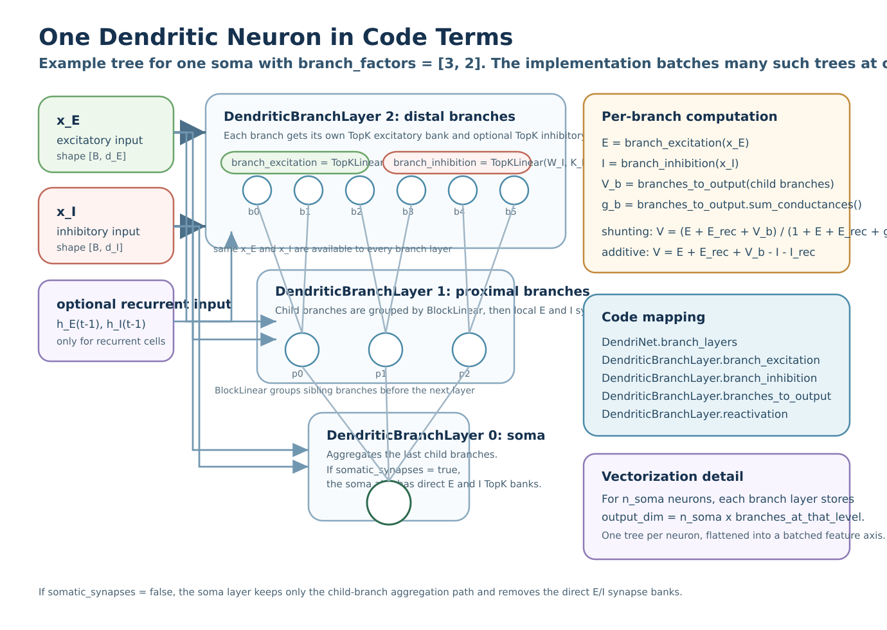
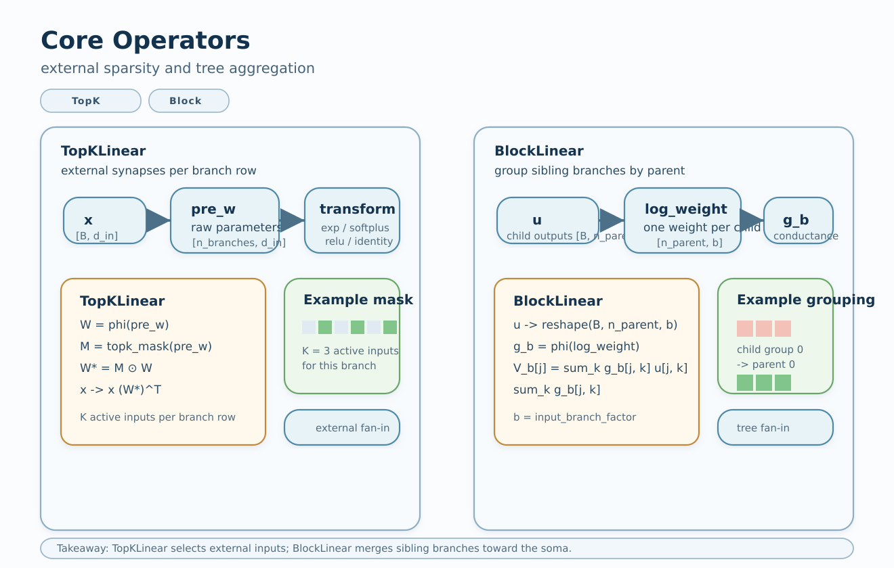

Dendritic neurons
=================

A dendritic neuron in DendriNet is a tree of compartments: a soma and one or
more levels of dendritic branches. Every compartment integrates sparse
excitatory and inhibitory synaptic input and the current of its child
branches into a voltage, by shunting (divisive) or additive integration, and
passes the voltage through a gate. This page describes the tree, the branch
layer that computes one level, the integration rules, the gate types and how
the gates are initialized and maintained during training. The synapses
themselves are described in :doc:`synapses`.

.. contents:: On this page
   :local:
   :depth: 1

.. _dendritic-neuron-options:

Configuration keys
------------------

Structured E/I cores read the neuron options from ``model.core.morphology``
and ``model.core.reactivation``. Population networks read the same options as
population fields, in ``model.core.population_network.layers[].population_defaults``
or in a population's ``population`` block; unified E/I cores use the same
population fields in ``model.core.unified_ei.layers[].excitatory`` and
``.inhibitory``. The table lists both spellings with their defaults:

.. list-table::
   :header-rows: 1
   :widths: 38 34 28

   * - Structured E/I core (``model.core.``)
     - Population field
     - Default
   * - ``morphology.use_shunting`` (set by most core types)
     - ``use_shunting``
     - ``true``
   * - ``morphology.use_additive_normalization``
     - ``use_additive_normalization``
     - ``false``
   * - ``morphology.additive_mode``
     - ``additive_mode``
     - ``raw``
   * - ``morphology.leak_conductance``, ``learnable_leak``
     - ``leak_conductance``, ``learnable_leak``
     - ``1.0``, ``false``
   * - ``morphology.additive_tangent_n0``, ``additive_tangent_t0``,
       ``additive_tangent_n0_by_depth``, ``additive_tangent_t0_by_depth``
     - same names
     - unset
   * - ``morphology.somatic_synapses``
     - ``somatic_synapses``
     - ``false`` (structured), ``true`` (population)
   * - (fixed at ``1e-8``)
     - ``epsilon``
     - ``1e-8``
   * - ``reactivation.enabled``, ``reactivation.type``
     - ``reactivate``, ``reactivation_type``
     - ``true``, ``param_tanh``
   * - ``reactivation.init_policy``
     - ``reactivation_init_policy``
     - ``analytical`` (see :ref:`gate-initialization`)
   * - ``reactivation.init_m``, ``init_b``
     - ``reactivation_init_m``, ``reactivation_init_b``
     - ``1.5``, ``0.5`` (structured); ``1.0``, ``0.5`` (population)
   * - ``reactivation.occupancy_quantile_low``, ``_high``,
       ``occupancy_target_low``, ``_high``
     - ``reactivation_occupancy_quantile_low``, ... (same suffixes)
     - unset (``0.1``, ``0.9``, ``0.1``, ``0.9``)
   * - ``reactivation.calibration_min_quantile_width``, ``calibration_max_m``,
       ``calibration_revert_on_invalid``
     - ``reactivation_calibration_min_quantile_width``, ... (same suffixes)
     - ``0.001``, ``50.0``, ``true``
   * - ``reactivation.sigma_aware_k``
     - ``reactivation_sigma_aware_k``
     - ``0.25``
   * - ``reactivation.memory_efficient``
     - ``reactivation_memory_efficient``
     - ``false``
   * - ``reactivation.gradient_scaling``
     - ``reactivation_gradient_scaling``
     - ``none``
   * - ``reactivation.soma_type``, ``soma_init_m``, ``soma_init_b``
     - (not available)
     - unset, ``1.0``, ``0.0``

The synapse options (sparse synapse type, weight transform, initializers and
connectivity masks) have the same two spellings; see :doc:`synapses`.

.. _dendritic-tree:

The dendritic tree
------------------

``branch_factors`` defines the tree of each neuron, listed from the soma
outwards: ``[3, 2]`` gives the soma three proximal branches and each proximal
branch two distal branches, six distal branches in all. ``branch_factors: []``
gives a point neuron that has only a soma. The class ``DendriNet`` builds a
population of ``n_soma`` such trees.

   One neuron with ``branch_factors: [3, 2]``, its levels labelled by depth
   from the soma. Every dendritic level has its own excitatory and inhibitory
   synapse banks, which read the same inputs; the soma has them only with
   ``somatic_synapses``. Each parent level also receives the output of its
   children through ``BlockLinear``. In code, all compartments of one depth
   share one feature axis of a ``DendriticBranchLayer``.

The tree is computed level by level, from the distal branches to the soma:

- every level is a ``DendriticBranchLayer`` (:ref:`dendritic-branch-layer`);
- the most distal level receives only synaptic input;
- every other level receives its synaptic input and the outputs of its child
  branches, aggregated by ``BlockLinear`` (:ref:`blocklinear`);
- the soma level produces the neuron output. It receives direct synapses only
  when ``somatic_synapses`` is true; a point neuron (``branch_factors: []``)
  requires it.

Each level reads the same excitatory input ``x_E`` and inhibitory input
``x_I``, so direct synapses are not restricted to the most distal level. The
number of synapses per compartment is the same at every level of a structured
E/I core (``connectivity.*_synapses_per_branch_per_layer``, one value per
network layer); population networks can set one count per level
(``ff_excitatory_synapses_by_level`` and the other ``*_by_level`` fields).

The tree is vectorized across neurons: all compartments of one depth form one
feature axis, so the output size of a level is ``n_soma`` times the number of
branches at that depth, and the children of one parent are consecutive
features. Lists that refer to levels use two conventions:

- ``DendriNet.branch_layers`` and ``DendriNet.layer_sizes`` run from the most
  distal level to the soma, and so do the ``*_by_level`` population fields and
  the ``ranges_by_level`` of a structured connectivity rule;
- a layer's ``layer_idx``, the ``*_by_depth`` fields and a connection's
  ``target_levels`` count depth from the soma (``0`` is the soma).

``flat_shunting``, ``flat_additive`` and the other ``flat_*`` structured core
types flatten the excitatory tree into one dendritic level holding all of its
branches: ``excitatory_branch_factors: [3, 3]`` becomes one level of
``3 + 9 = 12`` compartments.

How the tree options are written:

.. list-table::
   :header-rows: 1
   :widths: 26 37 37

   * - Option
     - Structured E/I core (``model.core.``)
     - Population network
   * - Neurons per population
     - ``architecture.excitatory_layer_sizes``,
       ``inhibitory_layer_sizes`` (one entry per layer)
     - ``populations[].n_neurons``
   * - Tree
     - ``architecture.excitatory_branch_factors`` (default
       ``[3, 3, 3, 3]``), ``inhibitory_branch_factors`` (default ``[1]``)
     - ``populations[].branch_factors`` (default ``[1]``); only on the
       population definition
   * - Synapses per compartment
     - ``connectivity.ee_synapses_per_branch_per_layer`` and the other
       counts (:ref:`synapse-options`)
     - ``ff_excitatory_synapses``, ``ff_inhibitory_synapses`` or their
       ``*_by_level`` lists
   * - Direct somatic synapses
     - ``morphology.somatic_synapses`` (default ``false``)
     - ``somatic_synapses`` (default ``true``)

In Python, ``DendriNet`` takes the same geometry as keyword arguments or as a
``DendriNetConfig``. The constructor builds the gates only with
``reactivate=True`` and uses ``somatic_synapses=True`` and
``weight_transform="exp"`` by default:

.. code-block:: python

   import torch
   from dendritic_modeling.networks import DendriNet

   neurons = DendriNet(
       n_soma=4,
       branch_factors=[3, 2],
       excitatory_input_dim=20,
       excitatory_synapses_per_branch=5,
       inhibitory_input_dim=8,
       inhibitory_synapses_per_branch=2,
       reactivate=True,
   )
   soma_output = neurons(torch.rand(2, 20), torch.rand(2, 8))  # shape [2, 4]
   neurons.layer_sizes  # [24, 12, 4]: distal branches, proximal branches, soma

``DendriNet(config=DendriNetConfig.from_kwargs(...))`` groups the geometry,
optional structured connectivity and the shared synapse settings
(``DendriticSynapseConfig``). Keyword arguments passed together with a typed
config must agree with it; a contradicting value raises, and an argument passed
with its default value counts as omitted.

.. _dendritic-branch-layer:

Branch layers
-------------

``DendriticBranchLayer`` computes one level of the trees. Its forward pass,
``layer(x, inhibitory_input, branch_input, recurrent_input,
rec_inhibitory_input)``, returns the gated output of every compartment of the
level. It contains:

.. list-table::
   :header-rows: 1
   :widths: 28 72

   * - Submodule
     - Role
   * - ``branch_excitation``
     - Excitatory synapses on the input ``x`` (a sparse synapse layer, by
       default ``TopKLinear``; see :doc:`synapses`).
   * - ``branch_inhibition``
     - Inhibitory synapses on ``inhibitory_input`` (only when the layer has
       inhibitory synapses).
   * - ``branch_recurrent``, ``branch_rec_inhibition``
     - Recurrent excitatory and inhibitory synapses (recurrent networks only).
   * - ``branches_to_output``
     - ``BlockLinear`` or ``EfficientBlockLinear`` aggregation of the child
       branches (every level except the most distal).
   * - ``reactivation``
     - The gate applied to the voltage (``nn.Identity`` without a gate).

   ``TopKLinear`` keeps ``K`` external synapses per branch, selected from the
   raw parameters. ``BlockLinear`` adds the outputs of sibling branches to
   their parent with one coupling conductance per child.

The two operators are independent controls: ``K`` sets how many external
inputs each compartment uses, and the branch factor sets how many child
branches each parent aggregates.

.. _integration-modes:

Integration modes
-----------------

A compartment combines four quantities: the excitatory synaptic current
:math:`E` (feedforward plus recurrent), the inhibitory current :math:`I`
(feedforward plus recurrent), the current from its child branches
:math:`C = \sum_k g_k u_k` (child outputs :math:`u_k` weighted by the
``BlockLinear`` couplings :math:`g_k`) and the total child coupling
:math:`G = \sum_k g_k`. Two derived quantities are the numerator
:math:`N = E + C` and the conductance without the leak, :math:`T = E + I + G`. The
compartment output is :math:`f(V)`, where :math:`f` is the gate and :math:`V`
the voltage given by the integration rule.

**Shunting** (``use_shunting: true``) divides by the total conductance:

.. math::

   V = \frac{E + C}{L + E + I + G + \epsilon} = \frac{N}{L + T + \epsilon}

where :math:`L` is the leak conductance (``leak_conductance``, ``1.0`` by
default; ``learnable_leak: true`` learns one leak per compartment) and
:math:`\epsilon = 10^{-8}`. With nonnegative weights and inputs and child
outputs in ``[0, 1]`` the voltage stays in ``[0, 1)``: inhibition and the leak
scale the voltage down instead of subtracting from it.

**Additive** integration (``use_shunting: false``) has three rules, selected
by ``additive_mode``:

.. list-table::
   :header-rows: 1
   :widths: 30 70

   * - ``additive_mode``
     - Voltage
   * - ``raw`` (default)
     - :math:`V = E - I + C`. With ``use_additive_normalization: true`` the
       voltage is then standardized across the compartments of the level, for
       every sample: :math:`V \leftarrow (V - \bar V) / \max(s_V, \epsilon)`,
       where :math:`\bar V` and :math:`s_V` are the mean and the population
       standard deviation over the level's outputs. This is a z-score, not a
       conductance normalization.
   * - ``conductance_normalized``
     - :math:`V = (E - I + C) / (1 + T + \epsilon)`: the additive numerator
       with the shunting denominator at unit leak.
   * - ``tangent_matched``
     - The first-order expansion of the unit-leak shunting rule around a
       fixed operating point :math:`(N_0, T_0)`:
       :math:`V = V_0 + \big((N - N_0) - V_0\,(T - T_0)\big) / D_0`, with
       :math:`D_0 = 1 + T_0 + \epsilon` and :math:`V_0 = N_0 / D_0`. It has
       the value and the derivatives of the shunting voltage at that point.

Plugins can register further additive rules; ``additive_mode`` names one and
``additive_options`` sets its options (:ref:`plugin-additive-rules`). The
built-in rules take no ``additive_options``.

Selecting the rule
~~~~~~~~~~~~~~~~~~

A structured E/I core type fixes the rule: ``dendritic_shunting`` and
``flat_shunting`` integrate by shunting, ``dendritic_additive`` and
``flat_additive`` by the raw additive rule, and
``dendritic_normalized_additive`` and ``flat_normalized_additive`` by the raw
additive rule with the z-score. ``einet`` reads ``morphology.use_shunting``
and ``morphology.use_additive_normalization``. A written value that
contradicts the type raises when the configuration loads; :ref:`core-types`
lists every type. ``model.core.morphology.additive_mode`` then selects the
additive rule. Note that ``dendritic_normalized_additive`` selects the z-score,
not ``conductance_normalized``, and the two cannot be combined.

In a population network (and a unified E/I core) every population chooses its
own rule with ``use_shunting``, ``use_additive_normalization`` and
``additive_mode``. For example, these population defaults select the
conductance-normalized additive rule:

.. code-block:: yaml

   population_defaults:
     use_shunting: false
     additive_mode: conductance_normalized

The layer raises when it is built for a combination it would not apply:

- ``additive_mode`` other than ``raw``, or ``use_additive_normalization:
  true``, on a shunting layer;
- ``use_additive_normalization: true`` with ``conductance_normalized`` or
  ``tangent_matched``;
- tangent anchors with any rule other than ``tangent_matched``;
- a leak other than ``1`` or a learnable leak with additive integration;
- conductance-scaled gradient options on an additive layer
  (``gradient_scaling: conductance_dynamic`` for the synapses,
  ``straight_through`` for the gate), and ``conductance_dynamic`` for
  ``BlockLinear`` with ``relu`` weights. On an additive layer
  ``BlockLinear``'s ``conductance_dynamic`` divides each child's gradient by
  its coupling weight (:ref:`BlockLinear gradient scaling
  <blocklinear-gradient-scaling>`).

A configurable leak (like ``endpoint_tanh`` gates, ``indexed_release``
synapses and signal rounding; see :ref:`conductance-options`) is available only
in feedforward rate populations: receptor synapse types, spiking somas,
dendritic spikes, soma feedback, recurrent inputs and a ``cross_level_mode``
other than ``hierarchical`` reject it. With receptor synapse types
(:ref:`synapse-types`) an additive population accepts only
``additive_mode: raw``.

Tangent anchors
~~~~~~~~~~~~~~~

``tangent_matched`` needs its operating point :math:`(N_0, T_0)` before the
first forward pass; a layer without one raises when it runs. The anchor is
never estimated or updated during the forward pass, and it is saved in the
state dict. Set it in one of two ways:

- one pair for every compartment: ``additive_tangent_n0`` and
  ``additive_tangent_t0`` (both or neither);
- one pair per level: ``additive_tangent_n0_by_depth`` and
  ``additive_tangent_t0_by_depth``, each with one value per level, soma first.
  These exclude the scalar fields. Each list must have as many entries as the
  population has levels; in a population network set them in each
  population's ``population`` block when the populations differ in depth. The
  inhibitory cells of a structured E/I core read the same lists, so their tree
  must have the same number of levels (or the core has no inhibitory cells).

A structured E/I core without inhibitory cells, with one anchor per level:

.. code-block:: yaml

   model:
     core:
       type: einet
       architecture:
         excitatory_layer_sizes: [32]
         inhibitory_layer_sizes: []
         excitatory_branch_factors: [2, 2]
       connectivity:
         ee_synapses_per_branch_per_layer: [16]
         ie_synapses_per_branch_per_layer: [4]
       morphology:
         use_shunting: false
         additive_mode: tangent_matched
         additive_tangent_n0_by_depth: [0.5, 0.4, 0.3]   # soma, proximal, distal
         additive_tangent_t0_by_depth: [2.0, 1.5, 1.0]

The anchor can also be measured on a shunting reference layer with unit leak
and frozen in Python:

.. code-block:: python

   reference_layer.set_branch_diagnostics(True)
   reference_layer(calibration_input, inhibitory_input)
   diagnostics = reference_layer.get_branch_diagnostics()

   n0, t0 = tangent_layer.calibrate_additive_operating_point(diagnostics)
   # The means of N and T become the frozen operating point of tangent_layer.

Calibration rejects diagnostics from a reference whose leak is not ``1``,
because the tangent expands the unit-leak rule.
``set_additive_operating_point(n0, t0)`` sets a known anchor, and
``clear_additive_operating_point()`` removes it.
For a trained shunting network with unit leak, the
``branch_local_sensitivity`` analyzer reports the means of :math:`E`,
:math:`I`, :math:`C` and :math:`G` at every depth (``include_soma: true`` adds
the soma), from which per-depth anchors follow as
:math:`N_0 = \bar E + \bar C` and :math:`T_0 = \bar E + \bar I + \bar G`; see
:ref:`analyzer-catalogue`. Measure anchors on data that is not used for the
final evaluation.

Branch diagnostics
~~~~~~~~~~~~~~~~~~

``layer.set_branch_diagnostics(True)`` makes a branch layer keep detached
copies of its decomposition on every forward pass. ``get_branch_diagnostics()``
returns them as a dictionary with ``E``, ``I``, ``C``, ``G``, ``N``, ``T`` and
the voltage ``V`` (all broadcast to the shape of ``V``), the ``leak``, the rule
(``mode``: ``shunting`` or the additive mode) and ``realized_K``: the number
of active synapses per compartment of each pathway (``E``, ``I``, ``E_rec``,
``I_rec``) on that forward pass. ``realized_K`` can be smaller than the
configured count when a connectivity mask or a dynamic synapse type leaves
fewer active contacts.

Analysis-only rule overrides
~~~~~~~~~~~~~~~~~~~~~~~~~~~~

Rule overrides replace the voltage algebra of trained shunting layers while
keeping every synapse, coupling and gate, to test which part of the rule a
trained network relies on. They hold no parameters, leave the state dict
unchanged and apply only inside the ``with`` block:

.. code-block:: python

   from dendritic_modeling.networks import DendriticBranchLayer
   from dendritic_modeling.networks.architectures.excitation_inhibition.dendritic import (
       BranchRuleOverride,
       override_branch_rules,
   )

   layers = {
       name: module
       for name, module in model.named_modules()
       if isinstance(module, DendriticBranchLayer)
   }
   # t0[name]: a floating-point tensor with the anchor conductance of that layer
   overrides = {
       layer: BranchRuleOverride("frozen_denominator", anchor_conductance=t0[name])
       for name, layer in layers.items()
   }
   with override_branch_rules(overrides):
       logits = model(test_inputs)

With :math:`N` and :math:`T` as above, anchors :math:`(n_0, t_0)`,
:math:`d_0 = 1 + t_0` and :math:`v_0 = n_0 / d_0`, the rules are:

.. list-table::
   :header-rows: 1
   :widths: 32 68

   * - Rule
     - Voltage
   * - ``anchor_tangent``
     - :math:`v_0 + ((N - n_0) - v_0 (T - t_0)) / d_0`
   * - ``sample_rolled_tangent``
     - the same, with :math:`T` of the previous sample in the batch
   * - ``frozen_denominator``
     - :math:`N / d_0`
   * - ``sample_rolled_denominator``
     - :math:`N / (1 + T)` with :math:`T` of the previous sample
   * - ``external_denominator``
     - :math:`N / (1 + T_{ext})` for a given conductance :math:`T_{ext}`
   * - ``permuted_current_denominator``
     - :math:`N / (1 + T[p])` for a batch permutation :math:`p` (enter one
       block per batch)
   * - ``raw_additive``
     - :math:`E - I + C` (with the layer's z-score, if it has one)
   * - ``raw_additive_moment_matched``
     - :math:`E - I + C`, standardized with given raw moments and rescaled to
       given voltage moments

Each rule takes exactly the tensors it reads (``anchor_numerator``,
``anchor_conductance``, ``external_conductance``, ``denominator_permutation``,
``raw_mean``, ``raw_std``, ``voltage_mean``, ``voltage_std``) and raises for
the others. Overrides need shunting layers with a fixed unit leak and apply to
the feedforward pass; computing voltages from currents (recurrent and stateful
layers) raises while an override is active.

Training support
~~~~~~~~~~~~~~~~

Every rule supports backpropagation. The local learning rules of
``local_ca`` (:ref:`local-credit-assignment`) support shunting, raw additive
and raw additive integration with the z-score; for the z-score the local
update omits the derivative of the normalization, so it is not the exact
gradient. ``local_ca`` rejects ``conductance_normalized`` and
``tangent_matched`` layers, a leak other than ``1``, ``endpoint_tanh`` gates
and ``indexed_release`` synapses.

.. _activation-types:

Activation functions
--------------------

The gate :math:`f` turns the voltage of every compartment into its output.
Structured E/I cores set it with ``model.core.reactivation.type``
(``enabled: false`` removes every gate). Population networks and unified E/I
cores use the population fields ``reactivation_type`` and ``reactivate``.
``reactivation.dendritic_activation`` is an alias of ``type`` (``none`` or
``identity`` removes the gates); writing both with different values raises.
The registered types are:

.. list-table::
   :header-rows: 1
   :widths: 25 45 30

   * - Type
     - Output :math:`f(V)`
     - Learned parameters
   * - ``param_tanh`` (default)
     - :math:`\tfrac12\,(\tanh(m\,(V - b)) + 1)`, in ``(0, 1)``
     - slope :math:`m > 0` and midpoint :math:`b` per compartment
   * - ``param_tanh_only_m``
     - as ``param_tanh``
     - :math:`m`; :math:`b` is one value per layer, set by the initialization
       policy and not trained
   * - ``param_relu``
     - :math:`m \max(V - b, 0)`
     - :math:`m > 0` and :math:`b`
   * - ``param_linear_sigmoid``
     - :math:`g V + (1 - g)\,\sigma(m V + b)` with :math:`g = e^{-3V}`
       (exponent capped at 20)
     - :math:`m`; the offset :math:`b` is not trained
   * - ``param_linear_tanh``
     - :math:`g V + (1 - g)\,\tfrac12(\tanh(m V + b) + 1)`, same :math:`g`
     - :math:`m`; :math:`b` is not trained
   * - ``param_linear_tanh_transition``
     - :math:`V` below the threshold :math:`\theta`, then
       :math:`(1 - \theta)\tanh\!\big(s\,(V - \theta)/(1 - \theta)\big) + \theta`,
       which saturates at 1
     - threshold :math:`\theta < 1` (started from :math:`b`) and slope
       :math:`s > 0` (started from :math:`m`)
   * - ``linear_sigmoid``, ``linear_tanh``, ``linear_tanh_transition``
     - as their ``param_`` forms
     - none: :math:`m` and :math:`b` keep their initial values
   * - ``endpoint_tanh``
     - :math:`\dfrac{\tanh(m V - b) - \tanh(-b)}{\tanh(m - b) - \tanh(-b)}`,
       with :math:`f(0) = 0` and :math:`f(1) = 1`
     - :math:`m > 0` and the offset :math:`b` (the midpoint is :math:`b/m`)
   * - ``residual_silu``
     - :math:`V + a\,(\mathrm{silu}(V) - V)`
     - mixing weight :math:`a` per compartment, starting at 0 (identity)
   * - ``relu``, ``sigmoid``, ``tanh``, ``softplus``, ``gelu``, ``silu``
       (alias ``swish``)
     - the PyTorch function
     - none
   * - ``none``
     - :math:`V` (no gate; the same as ``reactivate: false``)
     - none

Notes on the types:

- The initialization policy sets :math:`m` and :math:`b` of every type that
  has them (:ref:`gate-initialization`). The data-driven policies fit
  :math:`(m, b)` for the ``param_tanh`` shape and write the result into any
  gate. For the other shapes the values mean something else (for the
  ``*linear_sigmoid`` and ``*linear_tanh`` types :math:`b` is an offset, for
  the transition types a threshold); structured E/I cores log a warning when
  ``occupancy_quantile`` is used with such a gate.
- ``endpoint_tanh`` requires shunting integration and
  ``init_policy: fixed`` (it starts from ``init_m`` and ``init_b``); other
  combinations raise. It supports backpropagation only.
- ``residual_silu`` has no slope or midpoint: the initialization policies
  leave it at the identity, and the data-driven policies raise.
- ``reactivation.memory_efficient: true`` (population
  ``reactivation_memory_efficient``) selects a lower-memory implementation of
  ``param_tanh`` and ``param_tanh_only_m`` (:doc:`performance_kernels`); the
  other types ignore it.
- ``reactivation.soma_type`` gives the soma level of each excitatory neuron of
  a feedforward structured E/I core a different gate type, while the branches
  and the inhibitory cells keep ``type``; with ``init_policy: fixed`` it starts
  from ``soma_init_m`` and ``soma_init_b``. Recurrent cores and population
  networks do not have this option.
- The same registry provides the ``activation`` of ``MLP`` decoders and the
  ``router_activation`` of the pathway router.
  ``dendritic_modeling.networks.activations.register_activation_builder``
  adds a type (:ref:`extension-registries`).

.. _gate-initialization:

Gate initialization and maintenance
-----------------------------------

The slope :math:`m` and midpoint :math:`b` of the gates decide where the gate
is sensitive at the start of training. ``reactivation.init_policy``
(population field ``reactivation_init_policy``) selects how they are set:

.. list-table::
   :header-rows: 1
   :widths: 34 66

   * - ``init_policy``
     - Initial :math:`(m, b)`
   * - ``analytical`` (alias ``auto``)
     - The slope and midpoint that the branch-layer initializer
       (``dbl_init_method``, :ref:`synapse-initialization`) derives from the
       expected synaptic and child conductances; the default initializer uses
       :math:`m = 1.5` with :math:`b` at the expected voltage for shunting
       layers and :math:`m = 0.1` for additive layers. Uses no data.
   * - ``fixed`` (alias ``manual``)
     - ``init_m`` and ``init_b`` (population ``reactivation_init_m`` and
       ``reactivation_init_b``). Only this policy reads them; written values
       under another policy produce a warning. A saved ``config.json``, which
       lists every field, warns only for values other than the defaults.
   * - ``occupancy_quantile`` (deprecated alias ``quantile``)
     - Fitted to the measured voltages so that two voltage quantiles land on
       two target gate outputs (below).
   * - ``empirical``
     - :math:`b = \operatorname{median}(V)` and
       :math:`m = k / (1.4826\,\operatorname{MAD}(V))`, with
       :math:`k` = ``sigma_aware_k``.
   * - ``analytical_slope_occupancy_center``
     - The analytical :math:`m` with the occupancy :math:`b`.
   * - ``occupancy_slope_analytical_center``
     - The occupancy :math:`m` with the analytical :math:`b`.

The last four policies are data-driven: they measure the voltages of the
built model on training inputs (:ref:`gate-calibration`).

Default policy
~~~~~~~~~~~~~~

The default is ``analytical``. When ``init_policy`` is not written, additive
cores use ``occupancy_quantile`` instead:

- the structured E/I types ``dendritic_additive``, ``flat_additive``,
  ``dendritic_normalized_additive`` and ``flat_normalized_additive``, and
  ``einet`` with ``morphology.use_shunting: false``;
- population-network populations with ``use_shunting: false`` (after
  ``population_defaults`` and the population's ``population`` block are
  merged).

Unified E/I populations (also under the additive ``rnn_*`` aliases), the
``*_signed`` and ``*_mlp`` structured types and all shunting cores keep
``analytical``. A written policy is always kept. The policy each gate was
given is recorded per layer in the run's ``init_gate_stats.json`` (below).
Additive layers with positive weights under a policy that does not calibrate
both :math:`m` and :math:`b` on measured voltages (``analytical``, ``fixed`` or
a component policy, with ``additive_mode`` ``raw`` without the z-score or
``conductance_normalized``) log a warning, because the summed drive has a
nonzero mean and a scale set by fan-in and depth, so the gate can start
saturated or flat.

Occupancy fit
~~~~~~~~~~~~~

``occupancy_quantile`` measures the quantiles :math:`q_{lo}` and
:math:`q_{hi}` of a layer's voltages at the probabilities
``occupancy_quantile_low`` and ``occupancy_quantile_high`` (default ``0.1``
and ``0.9``) and places them at the gate outputs ``occupancy_target_low`` and
``occupancy_target_high`` (default ``0.1`` and ``0.9``). With
:math:`z = \operatorname{artanh}(2r - 1)` for each target output :math:`r`:

.. math::

   m = \frac{z_{hi} - z_{lo}}{q_{hi} - q_{lo}}, \qquad
   b = q_{lo} - \frac{z_{lo}}{m}

With the default targets this is :math:`b = (q_{10} + q_{90}) / 2` and
:math:`m = \operatorname{artanh}(0.8) / ((q_{90} - q_{10}) / 2)`. The bulk of the
voltage distribution falls in the sensitive range of the gate, and the tails
saturate. The fit works for shunting and additive layers alike because it
uses the measured voltages, whose scales differ between the two rules.

When the quantile span is below ``calibration_min_quantile_width`` (default
``0.001``), when the slope would exceed ``calibration_max_m`` (default
``50``) or when the quantiles are not finite, the layer keeps its previous gate
(``calibration_revert_on_invalid: true``, the default); with ``false`` the
span is floored and the slope clamped instead. The two component policies use
the same fit and keep one of its two values; ``analytical_slope_occupancy_center``
keeps a finite occupancy midpoint even when the occupancy slope is rejected.

.. _gate-calibration:

Calibration at the start of training
~~~~~~~~~~~~~~~~~~~~~~~~~~~~~~~~~~~~

When a data-driven policy is selected, the training command calibrates the
gates after building the model and before the first epoch:

- it draws ``training.main.common.reactivation_initialization_num_batches``
  (default ``3``) shuffled training batches of
  ``reactivation_initialization_batch_size`` (default ``256``) samples and runs
  the model on them without gradients. Only complete batches are used, so a
  training split smaller than one batch raises with an error that names the
  split size and the batch size; lower the batch size for small datasets;
- every layer with a data-driven policy gets one :math:`(m, b)` shared by its
  compartments;
- because a new gate in one layer changes the voltages of the layers after
  it, the fit is repeated until no layer's :math:`m` or :math:`b` changes by
  more than ``1e-3``, at most 50 times
  (``reactivation_initialization_max_iterations`` sets another limit).

Calibration is skipped when ``model.initial_checkpoint`` provides the gates,
and the ``presentation_stream`` strategy rejects data-driven policies. In
multi-process runs the gates calibrated on rank 0 are given to every rank.

Every run writes ``init_gate_stats.json`` with the gate parameters after the
model is built. Runs with a data-driven policy also write
``reactivation_calibration.json`` (the policies, the number of passes, whether
they converged and the fit of every layer) and
``post_calibration_gate_stats.json`` (the gates after calibration). Each
gate-statistics file records, for the gate of every dendritic layer, the
``init_policy`` the layer applied and whether it is ``data_driven``, counts
the gates per policy under ``init_policies``, summarizes :math:`m` and
:math:`b` per layer and lists
warnings for slopes of 40 or more and for midpoints near the ends of the
shunting voltage range (a mean :math:`b` of at least 0.95, or at most 0.05
with a slope of 5 or more); the run log repeats them. Additive layers, whose
voltages are not limited to ``[0, 1]``, can receive these warnings for healthy
midpoints. Check these files before relying on a run.

Gate updates during training
~~~~~~~~~~~~~~~~~~~~~~~~~~~~

Initialization and training-time gate updates are separate controls. These
options of ``training.main.common`` select how :math:`(m, b)` change during
training:

``reactivation_update_mode`` (default ``backprop``)
   ``backprop`` lets the optimizer or the local learning rule update
   :math:`(m, b)`. ``quantile`` freezes those updates and changes the gates
   only by periodic recalibration, so it requires
   ``recalibrate_reactivation_every > 0``. ``frozen`` keeps the initial
   values. The spellings ``bp``, ``backpropagation``, ``quantile_only``,
   ``quantile_rule`` and ``freeze`` load with a deprecation warning.

``recalibrate_reactivation_every`` (default ``0``, off)
   Recalibration period in epochs.

``reactivation_recalibration_start_epoch`` (default ``1``)
   First epoch, counted from 1, at whose start a recalibration runs; with
   start epoch ``s`` and period ``n``, recalibration runs at the start of
   epochs ``s``, ``s + n``, ``s + 2n`` and so on. ``1`` recalibrates before
   any training.

``reactivation_recalibration_num_batches`` (default ``3``)
   Training batches used for each recalibration.

``reactivation_recalibration_ema_alpha`` (default ``1.0``)
   Step towards the newly fitted values, in ``(0, 1]``: ``1.0`` overwrites
   :math:`(m, b)`, smaller values move them part of the way.

``reactivation_recalibration_mode`` (default ``from_init_policy``)
   The fit used by recalibration. ``from_init_policy`` refits each layer that
   has a data-driven initialization policy with that policy and leaves layers
   with ``analytical`` or ``fixed`` gates unchanged; under
   ``reactivation_update_mode: quantile`` it refits every gated layer with
   ``occupancy_quantile``. ``occupancy_quantile``, ``median_mad`` (the
   ``empirical`` fit) and ``mean_std`` (:math:`b` the mean and
   :math:`m = k / \mathrm{std}(V)`) refit every gated layer. The spellings
   ``auto``, ``init_policy``, ``quantile`` and ``empirical`` load with a
   deprecation warning.

When periodic recalibration would refit no gate, because
``from_init_policy`` finds only ``analytical`` or ``fixed`` gates or the
model has no parametric gate, the trainer logs one warning when training
starts and the run proceeds unchanged. Each scheduled recalibration still
draws training batches, which advances the training data loader's random
stream, so setting ``recalibrate_reactivation_every`` to ``0`` can change
the data order of later epochs; keep the setting to reproduce an earlier run.

The ``presentation_stream`` strategy does not support periodic recalibration,
and the FSDP entry point (:ref:`distributed-training`) accepts only
``reactivation_update_mode: backprop`` without recalibration. A pretraining
phase that centres the gates on their voltages before the main training is
available as the ``voltage_stabilization`` strategy with
``stabilize_mode: gate_occupancy`` (:ref:`training-strategies`).

Starting points
~~~~~~~~~~~~~~~

Without a validation search over gate settings, these settings place the gates
at the measured voltages:

.. list-table::
   :header-rows: 1
   :widths: 20 80

   * - Training
     - Settings
   * - Backpropagation
     - ``init_policy: occupancy_quantile`` with the default quantiles,
       ``reactivation_update_mode: backprop``, no periodic recalibration and a
       small ``reactivation_lr`` (the default ``1e-4``, or ``1e-5``).
   * - ``local_ca``
     - ``init_policy: occupancy_quantile`` with the wider mapping
       ``occupancy_quantile_low: 0.05``, ``occupancy_quantile_high: 0.95``,
       ``occupancy_target_low: 0.2`` and ``occupancy_target_high: 0.8``, local
       updates of :math:`(m, b)` and ``reactivation_lr: 1e-3``.

A structured core with the ``local_ca`` gate settings:

.. code-block:: yaml

   model:
     core:
       type: dendritic_shunting
       architecture:
         excitatory_layer_sizes: [32]
         excitatory_branch_factors: [2, 2]
       reactivation:
         type: param_tanh
         init_policy: occupancy_quantile
         occupancy_quantile_low: 0.05
         occupancy_quantile_high: 0.95
         occupancy_target_low: 0.2
         occupancy_target_high: 0.8
   training:
     main:
       common:
         param_groups:
           reactivation_lr: 0.001

The same gate settings as population fields:

.. code-block:: yaml

   population_defaults:
     reactivation_type: param_tanh
     reactivation_init_policy: occupancy_quantile
     reactivation_occupancy_quantile_low: 0.05
     reactivation_occupancy_quantile_high: 0.95
     reactivation_occupancy_target_low: 0.2
     reactivation_occupancy_target_high: 0.8

.. _comparing-integration-rules:

Comparing integration rules
---------------------------

Shunting and additive layers produce voltages on different scales, so an
initializer of the same name does not place their gates at the same operating
point. A comparison between rules therefore has to state which question it
answers:

- **Best attainable system.** Select the initialization policy, learning rates
  and other settings separately for each rule, with the same validation data,
  search space, budget and seeds for every rule. The result compares trained
  systems under that budget, not the integration rules alone.
- **Same settings.** Give both rules the same named initializer and optimizer
  settings. This measures how sensitive the comparison is to these settings.
- **Rule only.** Keep the initial state, connectivity, data order and
  optimizer fixed and change only the voltage equation.
  ``dbl_init_method: mechanism_neutral`` initializes shunting and additive
  models identically for the same seed (:ref:`synapse-initialization`);
  ``conductance_normalized`` and ``tangent_matched`` and the analysis-only rule
  overrides isolate parts of the shunting rule.

The gate policies give a 2-by-2 design over the gate slope and midpoint:
``analytical`` :math:`(m_a, b_a)`, ``analytical_slope_occupancy_center``
:math:`(m_a, b_o)`, ``occupancy_slope_analytical_center`` :math:`(m_o, b_a)`
and ``occupancy_quantile`` :math:`(m_o, b_o)`. Comparing the four separates a
mismatch of the gate centre from a mismatch of its scale.

In every case, select settings on validation data only, evaluate the test split
once for the selected settings, pair seeds across the rules so that differences
can be computed per seed, and keep the gate records
(``init_gate_stats.json``, ``reactivation_calibration.json`` and
``post_calibration_gate_stats.json``) with the results.
