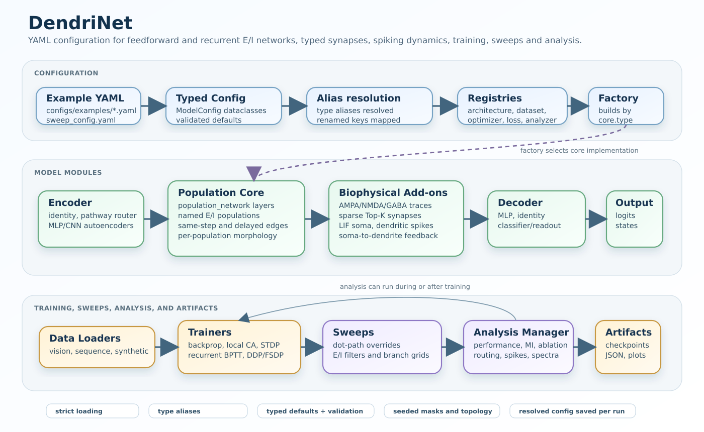
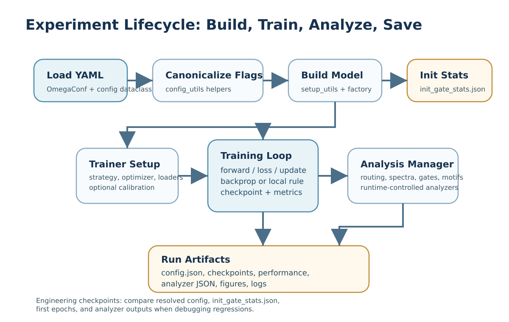

Engineering architecture
========================

This page is for developers who change the library. It maps the package,
follows a training run from the YAML file to the run directory, and names the
modules to read when tracing a bug or adding a component.

   The configuration is loaded into typed settings, the factory builds the
   encoder, core and decoder through the registries, and the trainers,
   sweeps and analysis manager produce the run's artifacts.

For the structure of the dendritic neurons themselves, see
:doc:`network_architectures` and :doc:`dendritic_neurons`.

Package layout
--------------

The Python package ``dendritic_modeling`` lives in ``src/dendritic_modeling``:

.. list-table::
   :header-rows: 1
   :widths: 30 70

   * - Subpackage
     - Contents
   * - ``config``
     - Typed configuration dataclasses, the strict loader (``load_config``,
       ``config_from_mapping``), retired and renamed keys (``keys.py``), the
       rules for which ``model.core`` sections and encoder/decoder options each
       type reads (``core_sections.py``, ``io_params.py``) and core-type alias
       semantics (``model_aliases.py``).
   * - ``datasets``
     - Vision, synthetic and sequence datasets, the dataset registry and the
       data-root resolution (``paths.py``).
   * - ``networks.architectures``
     - The architecture factory and registry, and the cores:
       ``excitation_inhibition`` (structured E/I networks, dendritic trees,
       sparse synapses and their kernels), ``recurrent`` (population networks,
       unified E/I networks, baseline recurrent networks), ``classical``
       (MLP, CNN, autoencoder and pathway-router building blocks and the
       matched controls), ``vision`` (dendritic AlexNet), ``replacement``
       (input and output adapters that place a dendritic core inside another
       network) and ``transformer`` (dendritic replacements of transformer
       feed-forward blocks).
   * - ``networks`` (other)
     - Activation and reactivation-gate builders (``activations``), weight
       transforms, sparse-maintenance and readout helpers (``utils``), the
       parameter-budget model families (``benchmarks``) and checkpoint helpers
       (``checkpoints.py``).
   * - ``models``
     - The wrappers that combine encoder, core and decoder: ``Classifier``,
       ``RecurrentClassifier`` and ``Regressor``, with parameter groups for the
       optimizer.
   * - ``training``
     - The trainer factory and strategies (``strategies``; the local-learning
       implementation is split into mixins under
       ``strategies/local_learning_parts``), optimizers, losses,
       regularization and pruning, data loaders and FSDP helpers.
   * - ``analysis``
     - The analysis manager (``managers``), the analyzer registry, and the
       analyzers (``core``, ``metrics``, ``tools``) with shared helpers
       (``utils``).
   * - ``deployment``
     - Compact export of trained models with frozen sparse topology
       (``compression.py``) and the optional torchao backends.
   * - ``kernels``
     - Triton kernels for indexed synapses (``triton_ell.py``).
   * - ``plotting``
     - Plotting helpers used by the analyzers.
   * - ``scripts``
     - The command-line programs: ``training``, ``sweeps``, ``analysis``,
       ``deployment``, ``tools`` (Slurm job writers, GPU memory estimates),
       ``benchmarks``, ``verification`` and ``docs``, with shared helpers in
       ``script_utils``.
   * - ``utils``
     - Logging setup, seeds and reproducibility records, the runtime
       environment record, information-estimation utilities
       (``utils/information``) and general helpers.

Outside the package, the repository holds ``configs/`` (example and reference
YAML files; see :doc:`examples`), ``docs/`` (these pages), ``tests/``,
``setup/`` (environment file, constraints files and
``freeze_constraints.py``) and ``scripts/train_fsdp.sh`` (a Slurm launcher
for FSDP training).

How a training run executes
---------------------------

``dendritic-train`` calls ``dendritic_modeling.scripts.training.train_experiments.main``,
which runs these steps:

#. **Load the configuration.** ``dendritic_modeling.config.load_config``
   applies the command-line options as dot-path overrides and builds the
   typed configuration. Unknown keys raise; retired and renamed keys produce
   a warning or an error that names the replacement (see
   :ref:`strict-loader`).
   ``utils.training_stability_validator.validate_training_stability`` then
   rejects configurations with known critical problems.
#. **Start distributed training**, when launched by ``torchrun``, and check
   ``distributed.mode`` against the launcher.
#. **Set up the run** (``scripts.script_utils.setup_utils.setup_environment``):
   resolve the seed streams and numerics settings, create the run directory
   and its log files, write ``resolved_seeds.json`` and
   ``runtime_environment.json``, load the datasets
   (``datasets.get_unified_datasets``: registered datasets first, then the
   built-in loaders) and build the model.
#. **Build the model** (``setup_utils.initialize_model``): the encoder, the
   core through ``networks.architectures.factory.get_architecture`` and the
   decoder, wrapped in a ``Classifier``, ``RecurrentClassifier`` or
   ``Regressor``. Structured E/I cores resolve their type aliases
   (``config.model_aliases``) while they are built.
#. **Record the start state**: wrap the model for DDP when there are several
   processes, write ``init_gate_stats.json`` and ``config.json``.
#. **Prepare training**: create the analysis manager
   (``analysis.AnalysisManager``), calibrate data-driven reactivation gates
   (``reactivation_calibration.json``), create the optimizer from the
   model's parameter groups and the trainer from
   ``training.factory.get_trainer``. ``--validate-only`` stops here, after
   writing ``nparams``, ``model_resources.json`` and
   ``operator_card.json``.
#. **Train**, then apply pruning when it is configured.
#. **Write the results**: ``nparams``, ``model_resources.json``,
   ``operator_card.json``, ``training_summary.json``, ``final_model.pt``,
   and the outputs of the final analysis.

:ref:`run-outputs` describes every file. The FSDP entry point
(``train_experiments_fsdp``) follows the same order with an FSDP-wrapped
model and its own trainer.

   The resolved configuration drives model construction, gate
   initialization, training, analysis and the saved artifacts.

Feedforward and recurrent E/I layers
------------------------------------

The feedforward and recurrent E/I layers use the same branch-level building
blocks (``DendriticBranchLayer`` and the initialization in
``dendritic/initialize*.py``). The recurrent layers add temporal state and
recurrent synapses; they do not change how a branch integrates its inputs.

.. figure:: _static/architecture/recurrent-ei-flow.svg
   :alt: One time step t of a recurrent unified E/I layer. The inhibitory population updates first from the excitatory stream x_ff, the inhibitory stream x_I and the previous-step outputs, and produces h_I(t). The excitatory population then reads x_ff, the same-step h_I(t) and the previous-step outputs, and produces s_E(t). Only s_E(t) goes to the next layer or the decoder. The layer state holds s_E(t-1) and h_I(t-1) and is replaced by s_E(t) and h_I(t).
   :width: 100%

   One time step of a recurrent unified E/I layer (``EILayerConfig`` with an
   excitatory and an inhibitory ``PopulationConfig``).

At each time step the inhibitory population updates first, from the
feedforward excitatory and inhibitory streams and the previous-step outputs
of both populations. The excitatory population then reads the feedforward
stream, the same-step inhibitory output and the previous-step outputs. Only
the excitatory output goes to the next layer or to the decoder.
``allow_self_recurrence: false`` removes the previous-step input of each
population to itself and keeps the recurrence between the two populations.
See :ref:`unified-ei`.

Recurrent module boundaries
---------------------------

The recurrent dendritic implementation in
``networks/architectures/recurrent`` is split by responsibility:

* network orchestration: ``population_network.py`` builds the ordered
  population-network layers, manages the sequence state and reduces the
  readout;
* layer routing: ``population_layer.py`` maps named populations and directed
  connections onto ``StatefulDendriNet`` modules;
* configuration and state: ``population_configs.py``,
  ``population_common.py``, ``population_sources.py``,
  ``population_state.py`` and ``population_constants.py`` hold the
  dataclasses, source-name normalization and runtime state;
* population options: ``ei_config.py`` defines ``PopulationConfig``
  (synapse counts, morphology, time constants, synapse types, soma dynamics,
  dendritic spikes, soma feedback);
* temporal execution: ``stateful_dendrinet.py`` owns the branch layers and
  the per-step update, with helpers in ``stateful_layers.py``,
  ``stateful_setup.py``, ``stateful_step.py`` and ``stateful_feedback.py``;
* typed synapse dynamics: ``stateful_typed_dynamics.py`` integrates
  receptor traces, short-term plasticity, voltage gates and typed shunting
  or additive currents;
* soma and branch events: ``spiking_soma.py`` (leaky integrate-and-fire
  somas) and ``dendritic_spikes.py`` (branch spikes and plateaus);
* morphology: ``dendritic_geometry.py`` (level sizes and synapse budgets);
* structured recurrent cores: the ``structured_*`` modules translate the
  structured E/I sections into recurrent networks;
* unified E/I networks: ``ei_layer.py``, ``ei_network.py`` and
  ``ei_state.py``; baselines: ``baseline_rnn.py``,
  ``heterogeneous_leak_ctrnn.py`` and ``legendre_memory.py``.

A new recurrent feature puts its standalone dynamics in a focused helper
module and leaves the branch construction and the ordered step in
``StatefulDendriNet``.

Key modules
-----------

* ``scripts/training/train_experiments.py``: the training entry point.
* ``scripts/script_utils/setup_utils.py``: run setup and ``initialize_model``.
* ``config/config.py``: ``load_config``, ``config_from_mapping`` and
  ``load_analysis_config``.
* ``networks/architectures/factory.py``: ``get_architecture`` and the
  built-in core builders (with ``factory_recurrent.py``,
  ``factory_spatial.py`` and ``factory_unified.py``);
  ``networks/architectures/registry.py``: registered architectures.
* ``networks/architectures/excitation_inhibition/ei_network.py``:
  ``ConfigurableEINetwork``, the structured E/I core.
* ``networks/architectures/excitation_inhibition/dendritic/``: ``DendriNet``,
  ``DendriticBranchLayer``, ``BlockLinear`` and the initialization methods
  (``initialize.py`` re-exports the ``initialize_*`` modules).
* ``networks/architectures/excitation_inhibition/synapse/``: the sparse
  synapse classes, their registry (``factory.py``), the indexed synapses
  (``indexed.py`` re-exports the fixed, rewiring and candidate-pool
  variants) and the projection backends (``kernels/backend.py``).
* ``models/base.py``: parameter groups and the training hooks shared by the
  model wrappers.
* ``training/factory.py``: ``get_trainer`` and the strategy registry;
  ``training/strategies/``: the trainers; ``training/optimizers/`` and
  ``training/loss/``: optimizer and loss registries.
* ``datasets/standard_datasets.py``: ``get_unified_datasets``;
  ``datasets/registry.py``: registered datasets; ``datasets/sequence/``:
  sequence tasks, with the builder registry in ``sequence/builders``.
* ``analysis/managers/analysis_manager.py``: runs the analyzers;
  ``analysis/registry.py``: analyzer metadata (configuration field, class,
  output directory) from which the manager builds the built-in analyzers.
* ``analysis/core/information.py``: ``InformationAnalyzer``; its
  implementation mixins live in ``analysis/core/information_parts/``.
* ``networks/architectures/classical/pretrained.py``: a torchvision backbone
  splitter (``list_backbone_layers``), a Python API that the training entry
  points do not use.
* ``utils/runtime_environment.py`` and ``utils/logging_config.py``: the
  environment record and the logging setup.

Adding a component
------------------

#. Add or extend the typed configuration field in
   ``src/dendritic_modeling/config``, with validation, so the loader accepts
   and checks it.
#. Implement the component and register it where a registry exists (see
   :ref:`extension-registries`), or add it to the built-in dispatch.
#. Keep the default behaviour unchanged: a new option is off by default, and
   a test shows that the default output does not change.
#. Add focused tests next to the changed subsystem (see :doc:`contributing`).
#. Document the option on the page that explains its topic, and add an
   example configuration when it helps.

Debugging a run
---------------

When a result changes unexpectedly, compare the run directories in this
order: ``config.json``, ``resolved_seeds.json``, ``runtime_environment.json``
(library commit, dependency versions, devices), ``init_gate_stats.json``,
the first epochs in ``training_summary.json`` and the logs, then the outputs
of the analyzers for the affected subsystem. See :ref:`run-outputs` and
:ref:`run-reproducibility`.
