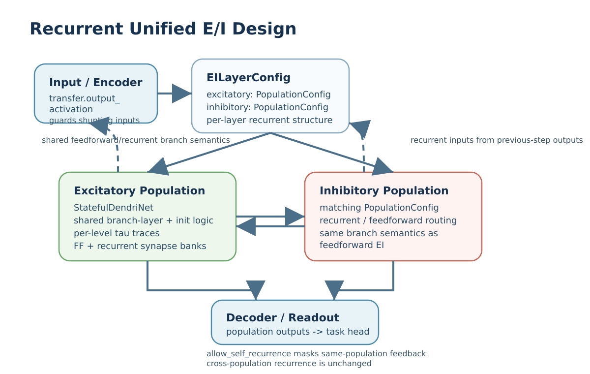

Engineering Architecture
========================

This page is for engineers working inside the repository. It focuses on how
the codebase is organized, where the main control points live, and how a run
moves from YAML to artifacts.

System Overview
---------------

The framework has a small number of stable layers:

.. image:: _static/architecture/system-overview.svg
   :alt: System overview of configs, datasets, model factory, training, analysis, and artifacts.
   :width: 100%

For neuron-level and operator-level diagrams of the dendritic core itself, see
:doc:`network_architectures`. That page now shows the actual ``DendriNet`` tree
layout, ``TopKLinear`` synapse banks, ``BlockLinear`` branch aggregation, and
the E/I layer stack used by the factory.

The practical rule of thumb is:

- ``config/`` and ``configs/`` define intent.
- ``src/dendritic_modeling/networks`` defines model behavior.
- ``src/dendritic_modeling/scripts`` turns config into a runnable experiment.
- ``src/dendritic_modeling/training`` defines update rules and training loops.
- ``src/dendritic_modeling/analysis`` turns checkpoints and trajectories into diagnostics.

Repository Layout
-----------------

The main directories are:

.. list-table::
   :header-rows: 1
   :widths: 20 80

   * - Path
     - Responsibility
   * - ``src/dendritic_modeling/config``
     - Structured config dataclasses and config-facing defaults.
   * - ``src/dendritic_modeling/datasets``
     - Standard dataset loaders, synthetic tasks, and dataset utilities.
   * - ``src/dendritic_modeling/networks/architectures``
     - Feedforward E/I cores, recurrent E/I cores, dendritic operators, and baselines.
   * - ``src/dendritic_modeling/training``
     - Training strategies such as backprop and local learning variants.
   * - ``src/dendritic_modeling/analysis``
     - Reusable analyzers and the analysis manager used by training and evaluation scripts.
   * - ``src/dendritic_modeling/scripts``
     - Top-level experiment entry points, environment setup, and config canonicalization.
   * - ``configs/``
     - Example and experiment YAMLs.
   * - ``docs/``
     - User-facing and engineering-facing documentation.

Build Path: From YAML to Model
------------------------------

Most experiment entry points follow the same build sequence:

.. image:: _static/architecture/training-analysis-flow.svg
   :alt: Experiment build and training flow from YAML through canonicalization, model init, training, analysis, and saved artifacts.
   :width: 100%

The important engineering points are:

- ``config_utils.canonicalize_model_core_flags`` and
  ``canonicalize_rnn_core_flags`` normalize alias-driven settings before model
  construction.
- ``setup_utils.initialize_model`` is the standard entry point for creating a
  model from the resolved config.
- ``networks.architectures.factory.get_architecture`` is the central dispatch
  point from config type strings to actual modules.
- post-build gate diagnostics write ``init_gate_stats.json`` when learnable
  reactivation gates are present.

Feedforward and Recurrent E/I Consistency
-----------------------------------------

The feedforward and recurrent E/I stacks intentionally share the same
branch-level building blocks. The recurrent stack adds temporal state and
recurrent routing, but it does not redefine the dendritic branch semantics.

The consistency contract is:

- both feedforward and recurrent E/I models use the same branch-layer logic
  for dendritic integration and reactivation-gate initialization
- recurrent aliases only add type-implied flags and recurrent connectivity;
  they do not change the underlying dendritic branch implementation
- ``allow_self_recurrence`` is a recurrent-only extension that masks
  same-population self-feedback while preserving other recurrent connectivity
- positive shunting safety is enforced at the transfer-layer boundary, so raw
  inputs may be normalized as long as the transfer output is clamped back to a
  non-negative range before the first shunting layer

Key Runtime Objects
-------------------

When you are tracing a bug or extending the code, these are the most useful
landmarks to keep in mind:

- ``src/dendritic_modeling/scripts/training/train_experiments.py``
  : experiment entry point for standard training
- ``src/dendritic_modeling/scripts/script_utils/setup_utils.py``
  : environment setup and model initialization
- ``src/dendritic_modeling/scripts/script_utils/config_utils.py``
  : config alias canonicalization and compatibility helpers
- ``src/dendritic_modeling/networks/architectures/factory.py``
  : model factory and architecture dispatch
- ``src/dendritic_modeling/networks/architectures/excitation_inhibition``
  : feedforward E/I implementation
- ``src/dendritic_modeling/networks/architectures/recurrent``
  : recurrent unified-EI implementation
- ``src/dendritic_modeling/analysis/managers/analysis_manager.py``
  : lifecycle coordinator for analyzers

Artifacts and Outputs
---------------------

A normal run can produce:

- resolved ``config.json``
- checkpoints and optimizer state
- ``performance`` summaries
- ``init_gate_stats.json`` for gate-aware models
- analyzer-specific JSON, tensors, and figures

When debugging reproducibility or regressions, the first artifacts to compare
are usually:

1. ``config.json``
2. ``init_gate_stats.json``
3. the first few epoch metrics
4. analyzer outputs tied to the affected subsystem

How To Extend Safely
--------------------

For new model or analysis work, the safest extension pattern is:

1. add or extend a config field in ``src/dendritic_modeling/config``
2. normalize any alias behavior in ``config_utils.py``
3. wire the behavior into the relevant factory or training entry point
4. add at least one focused test near the changed subsystem
5. document the new control point in the relevant doc page

That sequence keeps feedforward and recurrent behavior aligned and reduces the
chance of config-only drift.
