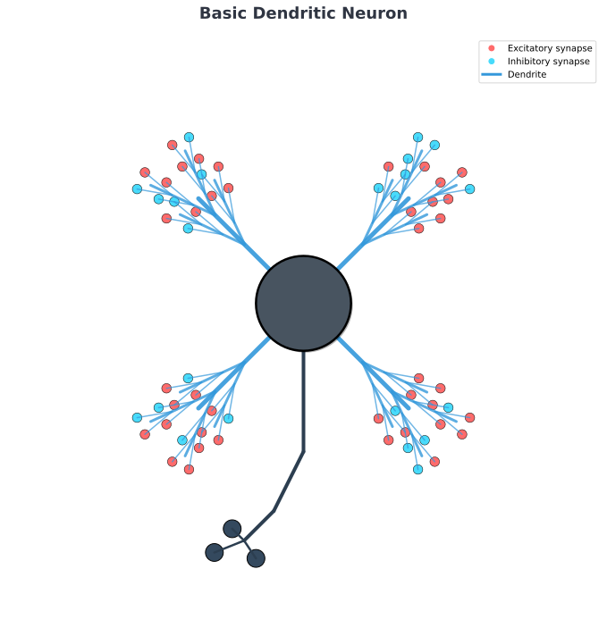

Dendritic Modeling Framework
============================

A PyTorch framework for biologically-inspired neural networks with dendritic computation



   Dendritic neuron structure with excitatory and inhibitory synapses, the biological inspiration for the framework

.. note::

   All diagrams and placeholder images in the documentation are generated automatically by the helper script ``docs/make.py``.  
   If you update the code that produces a new visual or change the styling, remember to rerun:

   ````bash
   python docs/make.py
   ````

   before rebuilding the documentation (``make html`` or equivalent).  This guarantees that the HTML/PDF output always ships with the latest, high-resolution figures (both PNG and SVG).  Vector ``.svg`` versions are preferred for crisp rendering at any zoom level.

Overview
--------

The Dendritic Modeling Framework implements neural networks inspired by the dendritic computations in biological neurons. Key features include:

- **Shunting Inhibition**: Divisive normalization through E/(E+I+ε) computation
- **Multi-layer E/I Networks**: Separate excitatory and inhibitory populations
- **Flexible Architectures**: Support for MLPs, CNNs, and Vision Transformers
- **Biological Plausibility**: Branching patterns, synaptic constraints, and Dale's principle
- **Comprehensive Analysis**: Information theory, ablation studies, and visualization tools

.. toctree::
   :maxdepth: 2
   :caption: Getting Started
   
   source/getting_started/installation
   source/getting_started/quickstart
   source/getting_started/tutorials/index

.. toctree::
   :maxdepth: 2
   :caption: User Guide
   
   source/user_guide/architecture
   source/user_guide/configuration
   source/user_guide/training
   source/user_guide/analysis
   source/user_guide/visualization

.. toctree::
   :maxdepth: 2
   :caption: API Reference
   
   source/api/networks
   source/api/models
   source/api/training
   source/api/analysis
   source/api/datasets
   source/api/utils

.. toctree::
   :maxdepth: 2
   :caption: Advanced Topics
   
   source/advanced/network_structures/index
   source/advanced/learning/index
   source/advanced/analysis/index
   source/advanced/visualization/index
   source/advanced/configuration/index

.. toctree::
   :maxdepth: 1
   :caption: Examples
   
   source/examples/mnist_classification
   source/examples/visual_neuron_modeling
   source/examples/custom_architectures
   source/examples/analysis_workflows

.. toctree::
   :maxdepth: 1
   :caption: Development
   
   source/development/contributing
   source/development/architecture
   source/development/testing
   source/development/release

.. toctree::
   :maxdepth: 1
   :caption: Reference
   
   source/reference/publications
   source/reference/theory
   source/reference/glossary
   source/reference/faq
   about

Key Concepts
------------

Shunting Inhibition
~~~~~~~~~~~~~~~~~~~

The core computation implements divisive normalization:

.. figure:: _static/shunting_inhibition_diagram.png
   :align: center
   :width: 60%
   :alt: Shunting Inhibition

   Shunting inhibition provides gain control and normalization

Dendritic Branches
~~~~~~~~~~~~~~~~~~

Neurons have hierarchical dendritic branches:

.. figure:: _static/basic_dendritic_neuron.png
   :align: center
   :width: 50%
   :alt: Dendritic Neuron

   Dendritic branches receive excitatory and inhibitory inputs

Quick Example
-------------

.. code-block:: python

   from dendritic_modeling.models import DendriticClassifier
   
   # Create a dendritic network for MNIST
   model = DendriticClassifier(
       network_config={
           "name": "ExcitationInhibitionNetwork",
           "params": {
               "input_dim": 784,
               "n_layers": 2,
               "n_excitatory": [100, 10],
               "n_inhibitory": [20, 0],
               "n_branches": [10, 5]
           }
       },
       num_classes=10
   )
   
   # Train and evaluate
   trainer.fit(model, train_loader, val_loader)
   accuracy = trainer.test(model, test_loader)

Citing
------

If you use this framework in your research, please cite:

.. code-block:: bibtex

   @software{dendritic_modeling,
     title = {Dendritic Modeling Framework},
     author = {Your Lab},
     year = {2024},
     url = {https://github.com/yourusername/dendritic-modeling}
   }

Indices and Tables
==================

* :ref:`genindex`
* :ref:`modindex`
* :ref:`search`
