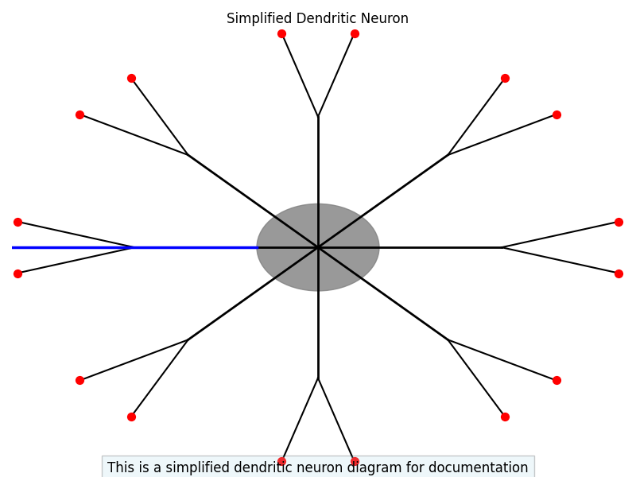

Dendritic Modeling Framework
============================
*A Python framework for creating, training, and analyzing neural networks with dendritic-inspired architectures*

This documentation provides comprehensive information about the dendritic modeling framework, its theoretical foundations, implementation details, and practical usage guides.

.. toctree::
   :maxdepth: 2
   :caption: Introduction

   about

Getting Started
---------------

.. toctree::
   :maxdepth: 2
   :caption: Contents

   source/getting_started/index
   source/user_guide/index

Advanced Topics
--------------

.. toctree::
   :maxdepth: 2
   :caption: Contents

   source/advanced/network_structures/index
   source/advanced/learning/index
   source/advanced/visualization/index
   source/advanced/analysis/index

API Reference
------------

.. toctree::
   :maxdepth: 2
   :caption: Contents

   source/api/index

Deployment
----------

.. toctree::
   :maxdepth: 2
   :caption: Contents

   source/deployment/index

Development
-----------

.. toctree::
   :maxdepth: 2
   :caption: Contents

   source/development/index

Reference
---------

.. toctree::
   :maxdepth: 2
   :caption: Contents

   source/reference/index

Indices and tables
==================

* :ref:`genindex`
* :ref:`modindex`
* :ref:`search`

