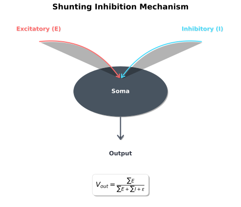

Dendritic Modeling Framework
============================

A comprehensive PyTorch framework for biologically-inspired neural networks implementing dendritic computation with excitation-inhibition dynamics

   Multi-dendrite neuron implementing shunting inhibition through divisive normalization. Each dendrite receives excitatory and inhibitory inputs, performs local E/(E+I+ε) computation, and the soma integrates outputs from all dendrites.

.. note::

   All diagrams in this documentation are generated automatically by the helper script ``docs/make.py``.  
   If you update the code or styling, remember to rerun:

   .. code-block:: bash

      python docs/make.py

   before rebuilding the documentation to ensure the latest high-resolution figures are included.

Framework Overview
------------------

The Dendritic Modeling Framework implements neural networks inspired by biological dendritic computation, specifically focusing on shunting inhibition mechanisms. The framework provides a complete toolkit for building, training, and analyzing biologically-plausible neural networks.

**Core Features:**

* **Biologically-Inspired Architecture**: Multi-dendrite neurons with excitatory/inhibitory input separation and divisive normalization
* **Shunting Inhibition**: Implements E/(E+I+ε) computation for gain control and normalization
* **Flexible Network Types**: Support for MLPs, CNNs, Vision Transformers, and custom architectures
* **Comprehensive Training**: Multiple learning strategies including branch-wise training and voltage stabilization
* **Advanced Analysis**: Information theory metrics, ablation studies, and visualization tools
* **Configuration System**: YAML-based configuration for reproducible experiments
* **Experiment Tracking**: Integration with Weights & Biases for experiment management

**Key Components:**

* **Networks**: Core neural network architectures implementing dendritic computation
* **Models**: High-level model wrappers with task-specific heads for classification and regression
* **Training**: Comprehensive training utilities with multiple learning strategies
* **Analysis**: Tools for analyzing network behavior, information flow, and biological plausibility
* **Configuration**: Type-safe configuration system for experiment reproducibility
* **Datasets**: Synthetic and real datasets for dendritic modeling research

.. toctree::
   :maxdepth: 3
   :caption: Documentation

   source/user_guide/index
   source/api/index
   source/advanced/index
   source/examples/index

Quick Start Example
------------------

.. code-block:: python

   from dendritic_modeling.models import Classifier
   from dendritic_modeling.networks import ExcitationInhibitionNetwork
   from dendritic_modeling.config import TransferFunctionParams
   from dendritic_modeling.datasets import get_unified_datasets
   
   # Create transfer function parameters
   transfer_params = TransferFunctionParams(
       input_mode=0,
       multiplicative=True,
       shunting_inhibition=True
   )
   
   # Create excitation-inhibition network
   ei_network = ExcitationInhibitionNetwork(
       input_dim=784,
       transfer_params=transfer_params.asdict(),
       excitatory_layer_sizes=[100, 10],
       inhibitory_layer_sizes=[50, 0],
       excitatory_branch_factors=[5, 1],
       inhibitory_branch_factors=[3, 0],
       ee_synapses_per_branch_per_layer=[10, 1],
       ei_synapses_per_branch_per_layer=[5, 0],
       ie_synapses_per_branch_per_layer=[2, 0],
       ii_synapses_per_branch_per_layer=[]
   )
   
   # Create classifier model
   model = Classifier(
       core_network=ei_network,
       encoder_network=None,
       decoder_network=None
   )
   
   # Load dataset
   train_dataset, val_dataset, test_dataset = get_unified_datasets(
       dataset_name="mnist",
       data_path="./data"
   )
   
   # Train model
   from dendritic_modeling.training.utils import train_model
   train_model(model, train_dataset, val_dataset, epochs=50)

Architecture Overview
--------------------

The framework implements a hierarchical architecture where biological dendritic computation is embedded at multiple levels:

**Neuron Level**: Individual neurons implement multi-dendrite computation with excitatory/inhibitory input separation and shunting inhibition.

**Layer Level**: Layers coordinate excitatory and inhibitory populations following Dale's principle and biological connectivity patterns.

**Network Level**: Complete networks stack multiple layers with flexible architectures supporting various computational tasks.

**Model Level**: High-level models combine networks with task-specific components for classification, regression, and other applications.

Biological Foundations
---------------------

The framework is grounded in several key biological principles:

**Shunting Inhibition**: The core computation E/(E+I+ε) implements divisive normalization found throughout the nervous system, providing gain control and dynamic range adaptation.

**Dendritic Integration**: Multi-dendrite neurons perform local computations on dendritic branches before somatic integration, mirroring biological neural computation.

**Dale's Principle**: Separate excitatory and inhibitory populations maintain biological plausibility and enable complex E/I dynamics.

**Synaptic Constraints**: Realistic connectivity patterns and synaptic densities based on neurobiological measurements.

Research Applications
--------------------

The framework supports research in:

* **Computational Neuroscience**: Modeling dendritic computation and E/I dynamics
* **Machine Learning**: Biologically-inspired architectures for improved performance
* **Neuomorphic Computing**: Hardware-efficient implementations of neural computation
* **Interpretability**: Understanding neural computation through biological analogies

Installation and Setup
----------------------

Install the framework using pip:

.. code-block:: bash

   pip install dendritic-modeling

Or install from source:

.. code-block:: bash

   git clone https://github.com/your-org/dendritic-modeling.git
   cd dendritic-modeling
   pip install -e .

Citation
--------

If you use this framework in your research, please cite:

.. code-block:: bibtex

   @software{dendritic_modeling,
     title = {Dendritic Modeling Framework: Biologically-Inspired Neural Networks},
     author = {Your Research Group},
     year = {2024},
     url = {https://github.com/your-org/dendritic-modeling},
     version = {1.0.0}
   }

Contributing
-----------

We welcome contributions to the framework! Please see the development guide for details on:

* Code style and standards
* Testing requirements
* Documentation guidelines
* Issue reporting and feature requests

License
-------

This project is licensed under the MIT License. See the LICENSE file for details.

Indices and Search
==================

* :ref:`genindex`
* :ref:`modindex`
* :ref:`search`
