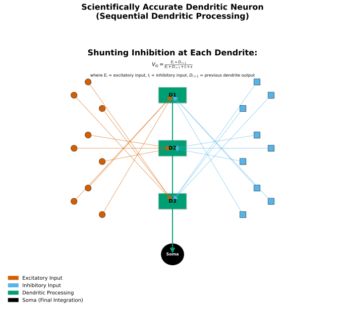
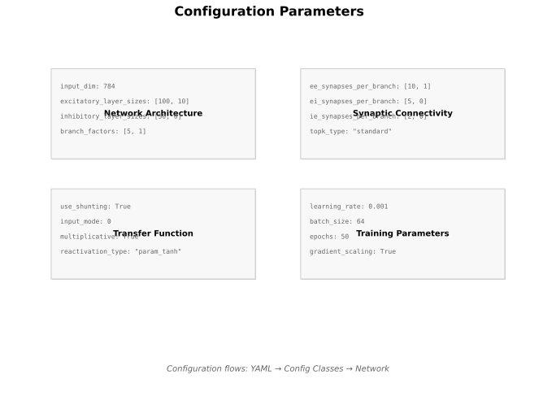
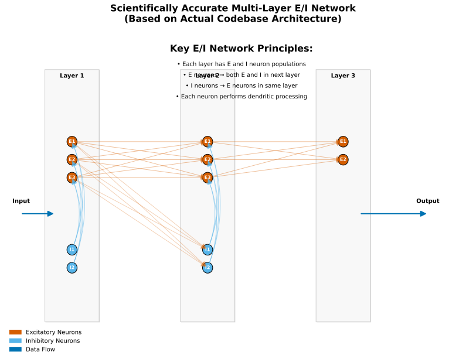
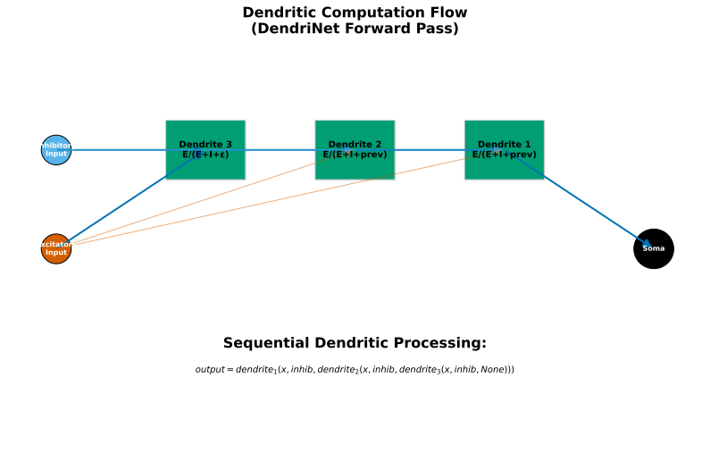

Dendritic Modeling Framework
============================

A comprehensive PyTorch framework for biologically-inspired neural networks implementing dendritic computation with excitation-inhibition dynamics and shunting inhibition mechanisms.

   **Dendritic Neuron Architecture**: Sequential dendritic processing where each dendrite receives excitatory inputs, inhibitory inputs, AND outputs from previous dendrites. Each dendrite computes E/(E+I+D_prev+ε) before passing to the next dendrite, with the final dendrite feeding the soma.

.. note::

   **Documentation Figures**: All diagrams are automatically generated with professional styling by our enhanced figure generation system. To regenerate with the latest updates:

   .. code-block:: bash

      python scripts/documentation_tools/generate_documentation_figures.py

   This generates both high-resolution PNG (300 DPI) and vector SVG formats for publication-quality documentation.

Overview
--------

The Dendritic Modeling Framework represents a paradigm shift in neural network architectures, drawing inspiration from the sophisticated dendritic computation mechanisms observed in biological neurons. Our framework implements **shunting inhibition** as the core computational principle, where dendrites perform sequential processing through the mathematical operation:

.. math::

   V_{d_i} = \frac{E_i + D_{i+1}}{E_i + D_{i+1} + I_i + \epsilon}

where :math:`E_i` represents excitatory inputs to dendrite i, :math:`I_i` represents inhibitory inputs to dendrite i, :math:`D_{i+1}` represents the output from the previous dendrite (dendrite i+1), and :math:`\epsilon` is a small constant preventing division by zero. This creates a sequential processing chain: dendrite_n → dendrite_{n-1} → ... → dendrite_1 → soma.

Key Innovation: Biologically-Inspired Architecture
~~~~~~~~~~~~~~~~~~~~~~~~~~~~~~~~~~~~~~~~~~~~~~~~~~

**Dendritic Computation**: Unlike traditional artificial neurons that simply sum weighted inputs, our framework implements sequential dendritic processing where each dendrite receives excitatory inputs, inhibitory inputs, AND outputs from the previous dendrite. This creates a processing chain where information flows through dendrites sequentially before reaching the soma, mirroring biological dendritic integration.

**Shunting Inhibition**: The framework implements divisive normalization through shunting inhibition, providing natural gain control and dynamic range adaptation. This mechanism is ubiquitous in biological nervous systems and provides superior stability compared to subtractive inhibition.

**Excitation-Inhibition Balance**: Following Dale's principle, each layer maintains separate excitatory and inhibitory populations. Excitatory neurons project to both excitatory and inhibitory populations in the next layer, while inhibitory neurons modulate excitatory neurons within the same layer, enabling complex dynamics and homeostatic regulation.

**Synaptic Sparsity**: The framework incorporates biologically-realistic sparse connectivity through TopK mechanisms, reducing computational overhead while maintaining biological plausibility.

Core Framework Components
~~~~~~~~~~~~~~~~~~~~~~~~~

   **Configuration System**: Comprehensive parameter management for network architecture, synaptic connectivity, transfer functions, training strategies, sparsity control, and regularization.

**Networks** (``dendritic_modeling.networks``)
   Core neural network architectures implementing dendritic computation:
   
   - **ExcitationInhibitionNetwork**: Multi-layer networks with E/I separation
   - **DendriticBranchLayer**: Individual dendritic processing units
   - **TopKLinear**: Sparse connectivity with multiple selection strategies
   - **Classical Networks**: MLPs, CNNs, and Vision Transformers for comparison

**Models** (``dendritic_modeling.models``)
   High-level model interfaces combining networks with task-specific components:
   
   - **Classifier**: Multi-class classification with dendritic computation
   - **Regressor**: Regression tasks with continuous outputs
   - **BaseModel**: Extensible foundation for custom applications

**Configuration** (``dendritic_modeling.config``)
   Type-safe configuration system enabling reproducible experiments:
   
   - **Network Architecture**: Layer sizes, branch factors, connectivity patterns
   - **Transfer Functions**: Shunting inhibition parameters, input modes
   - **Training Strategy**: Learning rates, optimization algorithms, regularization
   - **Sparsity Control**: TopK strategies, density targets, rewiring mechanisms

**Training** (``dendritic_modeling.training``)
   Comprehensive training utilities designed for dendritic networks:
   
   - **Branch-wise Training**: Individual dendrite optimization
   - **Voltage Stabilization**: Membrane potential regulation
   - **Gradient Scaling**: Adaptive normalization for stable learning
   - **Distributed Training**: Multi-GPU and cluster support

**Analysis** (``dendritic_modeling.analysis``)
   Specialized tools for understanding dendritic network behavior:
   
   - **Information Theory**: Mutual information, entropy measures
   - **Ablation Studies**: Systematic component analysis
   - **Biological Plausibility**: Comparison with neuroscience data
   - **Performance Metrics**: Classification, regression, and efficiency measures

Architecture Variants
~~~~~~~~~~~~~~~~~~~~

   **Multi-layer E/I Network**: Each layer contains excitatory and inhibitory neuron populations. Excitatory neurons project to both E and I populations in the next layer, while inhibitory neurons modulate excitatory neurons within the same layer. Each neuron internally implements sequential dendritic processing.

**Standard Networks**
   - **MLP**: Traditional multi-layer perceptrons for baseline comparison
   - **CNN**: Convolutional networks for spatial data processing
   - **Vision Transformer**: Attention-based architectures

**Dendritic Networks**
   - **EINet**: Excitation-inhibition networks with shunting inhibition
   - **DendriNet**: Multi-dendrite networks with hierarchical processing
   - **Hybrid Models**: Combinations of conventional and dendritic components

**Sparsity Patterns**
   - **TopK Standard**: Deterministic top-K weight selection
   - **Stochastic TopK**: Temperature-controlled probabilistic selection
   - **Variance TopK**: Hebbian-inspired activity-dependent selection

Training Methodologies
~~~~~~~~~~~~~~~~~~~~~

   **Dendritic Computation Flow**: Sequential processing through dendritic layers showing the actual DendriNet forward pass. Each dendrite receives excitatory inputs, inhibitory inputs, and outputs from the previous dendrite, implementing E/(E+I+D_prev+ε) computation.

**Training Strategies**
   - **Standard Backpropagation**: End-to-end gradient descent
   - **Branch-wise Training**: Individual dendrite optimization
   - **Hybrid Training**: Combined approaches for optimal performance
   - **Voltage Stabilization**: Membrane potential regulation
   - **Gradient Scaling**: Adaptive normalization techniques
   - **Synaptic Plasticity**: Hebbian-like adaptation mechanisms

**Optimization Features**
   - **Adaptive Learning Rates**: Dynamic adjustment based on network state
   - **Regularization**: L1/L2 penalties, dropout, weight decay
   - **Batch Normalization**: Specialized techniques for dendritic networks
   - **Mixed Precision**: Efficient training with automatic precision scaling

Quick Start Guide
-----------------

Installation
~~~~~~~~~~~~

The framework can be installed using pip or conda:

.. code-block:: bash

   # Install from PyPI
   pip install dendritic-modeling

   # Or install from source for development
   git clone https://github.com/your-org/dendritic-modeling.git
   cd dendritic-modeling
   pip install -e .

Basic Usage Example
~~~~~~~~~~~~~~~~~

.. code-block:: python

   from dendritic_modeling.models import Classifier
   from dendritic_modeling.networks import ExcitationInhibitionNetwork
   from dendritic_modeling.config import TransferFunctionParams
   from dendritic_modeling.datasets import get_unified_datasets
   from dendritic_modeling.training.utils import train_model
   
   # Configure transfer function with shunting inhibition
   transfer_params = TransferFunctionParams(
       input_mode=0,                    # Direct input mode
       multiplicative=True,             # Enable multiplicative interactions
       shunting_inhibition=True,        # Enable shunting inhibition
       use_shunting=True,              # Apply shunting mechanism
       reactivation_type="param_tanh"   # Parameterized tanh activation
   )
   
   # Create excitation-inhibition network
   ei_network = ExcitationInhibitionNetwork(
       input_dim=784,                   # MNIST image dimensions
       transfer_params=transfer_params.asdict(),
       excitatory_layer_sizes=[128, 64, 10],        # E-population sizes
       inhibitory_layer_sizes=[64, 32, 0],          # I-population sizes
       excitatory_branch_factors=[5, 3, 1],         # Dendrites per E-neuron
       inhibitory_branch_factors=[3, 2, 0],         # Dendrites per I-neuron
       ee_synapses_per_branch_per_layer=[20, 10, 1], # E→E connections
       ei_synapses_per_branch_per_layer=[10, 5, 0],  # E→I connections
       ie_synapses_per_branch_per_layer=[5, 3, 0],   # I→E connections
       topk_type="standard",            # Sparse connectivity strategy
       use_shunting=True,               # Enable shunting inhibition
       gradient_scaling=True            # Adaptive gradient normalization
   )
   
   # Create classifier model
   model = Classifier(
       core_network=ei_network,
       encoder_network=None,            # Optional input preprocessing
       decoder_network=None             # Optional output postprocessing
   )
   
   # Load dataset
   train_dataset, val_dataset, test_dataset = get_unified_datasets(
       dataset_name="mnist",
       data_path="./data",
       train_valid_split=0.8
   )
   
   # Train with advanced configuration
   train_model(
       model=model,
       train_dataset=train_dataset,
       val_dataset=val_dataset,
       epochs=100,
       batch_size=64,
       learning_rate=1e-3,
       optimizer="AdamW",
       scheduler="CosineAnnealingLR",
       branch_wise_training=True,       # Enable branch-wise optimization
       voltage_stabilization=True,      # Enable membrane potential regulation
       gradient_scaling=True,           # Enable adaptive gradient scaling
       use_wandb=True                   # Enable experiment tracking
   )

Configuration-Based Experiments
~~~~~~~~~~~~~~~~~~~~~~~~~~~~~~

For reproducible research, use YAML configuration files:

.. code-block:: yaml

   # config.yaml
   model:
     task: classification
     core_network:
       type: EINet
       parameters:
         input_dim: 784
         excitatory_layer_sizes: [128, 64, 10]
         inhibitory_layer_sizes: [64, 32, 0]
         excitatory_branch_factors: [5, 3, 1]
         inhibitory_branch_factors: [3, 2, 0]
         ee_synapses_per_branch_per_layer: [20, 10, 1]
         ei_synapses_per_branch_per_layer: [10, 5, 0]
         ie_synapses_per_branch_per_layer: [5, 3, 0]
         topk_type: "standard"
         use_shunting: true
         gradient_scaling: true
         transfer_params:
           input_mode: 0
           multiplicative: true
           shunting_inhibition: true
           reactivation_type: "param_tanh"
   
   train:
     learning_strategy: "mle"
     optimizer: "AdamW"
     lr: 1e-3
     epochs: 100
     batch_size: 64
     scheduler: "CosineAnnealingLR"
     branch_wise_training: true
     voltage_stabilization: true
     gradient_scaling: true
   
   task:
     dataset: "mnist"
     data_path: "./data"
   
   analysis:
     information_analysis: true
     ablation_studies: true
     biological_plausibility: true

Run experiments with:

.. code-block:: bash

   python src/dendritic_modeling/scripts/train_experiments.py config.yaml

Advanced Features
----------------

Network Data Flow
~~~~~~~~~~~~~~~~~

.. figure:: figures/architecture/network_architecture_overview.svg
   :align: center
   :width: 95%
   :alt: Network Architecture Overview

   **Network Architecture Overview**: Comprehensive overview of data processing through the dendritic network, showing input transformation, E/I separation, dendritic processing, somatic integration, and output generation.

The framework implements a sophisticated data processing pipeline:

1. **Input Transformation**: Raw data is preprocessed and optionally transformed through input networks
2. **E/I Separation**: Inputs are split into excitatory and inhibitory pathways
3. **Dendritic Processing**: Each dendrite performs local shunting inhibition computation
4. **Somatic Integration**: The soma integrates outputs from all dendritic branches
5. **Output Generation**: Final outputs are produced through task-specific heads

Biological Foundations
~~~~~~~~~~~~~~~~~~~~~

The framework is grounded in fundamental neuroscience principles:

**Shunting Inhibition**: The core E/(E+I+ε) computation implements divisive normalization ubiquitous in biological systems, providing gain control and dynamic range adaptation.

**Dendritic Integration**: Multi-dendrite neurons perform local computations on dendritic branches before somatic integration, mirroring biological neural computation.

**Dale's Principle**: Separate excitatory and inhibitory populations maintain biological plausibility and enable complex E/I dynamics.

**Synaptic Sparsity**: Realistic connectivity patterns based on neurobiological measurements, with TopK mechanisms providing computational efficiency.

**Homeostatic Regulation**: Built-in mechanisms for maintaining network stability and preventing pathological activity states.

Research Applications
~~~~~~~~~~~~~~~~~~~~

The framework enables research across multiple domains:

**Computational Neuroscience**
   - Modeling dendritic computation mechanisms
   - Understanding E/I balance in neural circuits
   - Investigating synaptic plasticity and learning
   - Simulating pathological conditions and interventions

**Machine Learning**
   - Biologically-inspired architectures for improved performance
   - Sparse neural networks with natural regularization
   - Robust learning algorithms with homeostatic properties
   - Novel optimization strategies based on biological principles

**Neuomorphic Computing**
   - Hardware-efficient implementations of neural computation
   - Low-power neuromorphic chip design
   - Event-driven processing paradigms
   - Spike-based communication protocols

**Interpretable AI**
   - Understanding neural computation through biological analogies
   - Explainable AI systems based on dendritic processing
   - Visualization of hierarchical information processing
   - Biological constraints for model interpretability

Documentation Structure
-----------------------

.. toctree::
   :maxdepth: 2
   :caption: Getting Started

   source/user_guide/getting_started
   source/user_guide/architecture_and_models
   source/user_guide/configuration_system

.. toctree::
   :maxdepth: 2
   :caption: Core Concepts

   source/core_concepts/neuron_and_dendrite
   source/core_concepts/shunting_inhibition
   source/core_concepts/network_construction
   source/core_concepts/connectivity_sparsity
   source/core_concepts/training_pipeline

.. toctree::
   :maxdepth: 2
   :caption: Advanced Topics

   source/advanced/training_strategies
   source/advanced/biological_plausibility
   source/advanced/performance_optimization
   source/advanced/custom_architectures

.. toctree::
   :maxdepth: 2
   :caption: API Reference

   source/api/networks
   source/api/models
   source/api/training
   source/api/analysis
   source/api/config

.. toctree::
   :maxdepth: 2
   :caption: Examples and Tutorials

   source/examples/basic_usage
   source/examples/advanced_configurations
   source/examples/research_applications
   source/examples/custom_extensions

Community and Support
---------------------

**Contributing**: We welcome contributions from the community! Please see our contributing guidelines for information on code style, testing requirements, and submission procedures.

**Citation**: If you use this framework in your research, please cite our work:

.. code-block:: bibtex

   @software{dendritic_modeling_framework,
     title = {Dendritic Modeling Framework: Biologically-Inspired Neural Networks with Shunting Inhibition},
     author = {Your Research Team},
     year = {2024},
     url = {https://github.com/your-org/dendritic-modeling},
     version = {1.0.0},
     doi = {10.5281/zenodo.xxxxx}
   }

**Support**: For questions, bug reports, and feature requests, please use our GitHub issues page or contact the development team.

**License**: This project is licensed under the MIT License, allowing for both academic and commercial use.

Indices and Search
==================

* :ref:`genindex`
* :ref:`modindex`
* :ref:`search`
