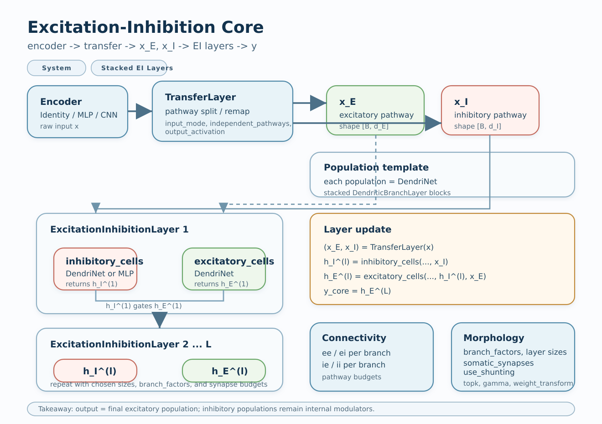
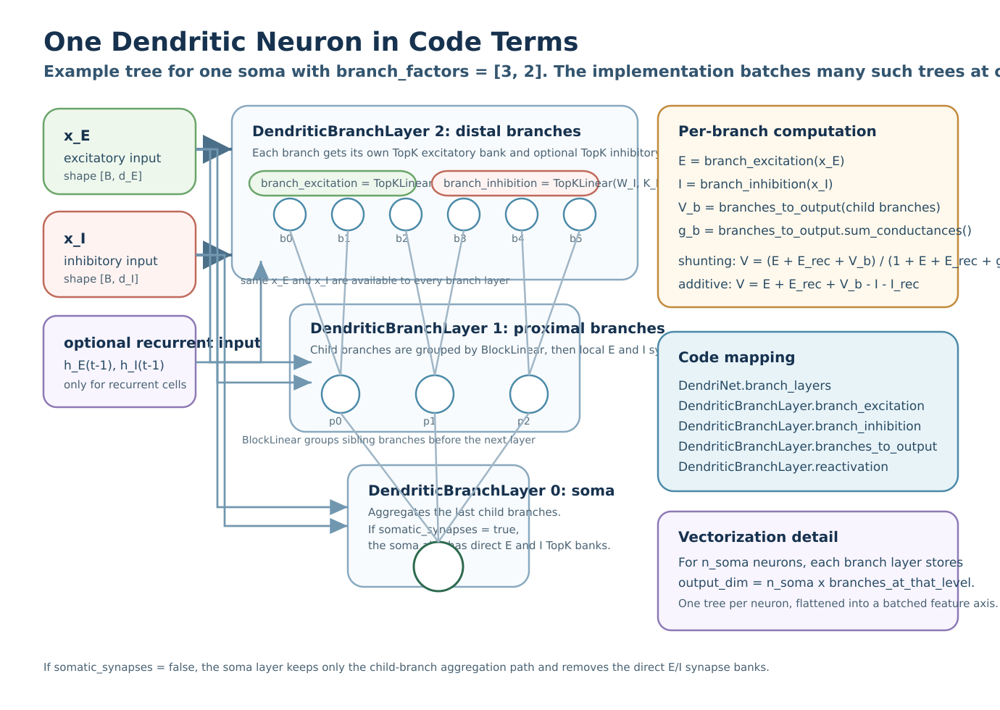
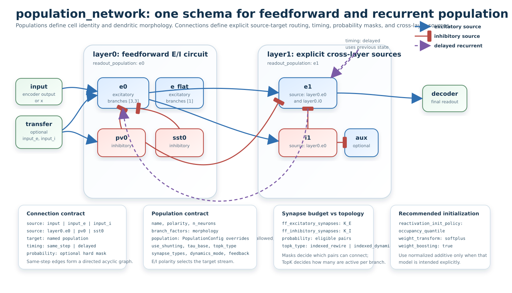
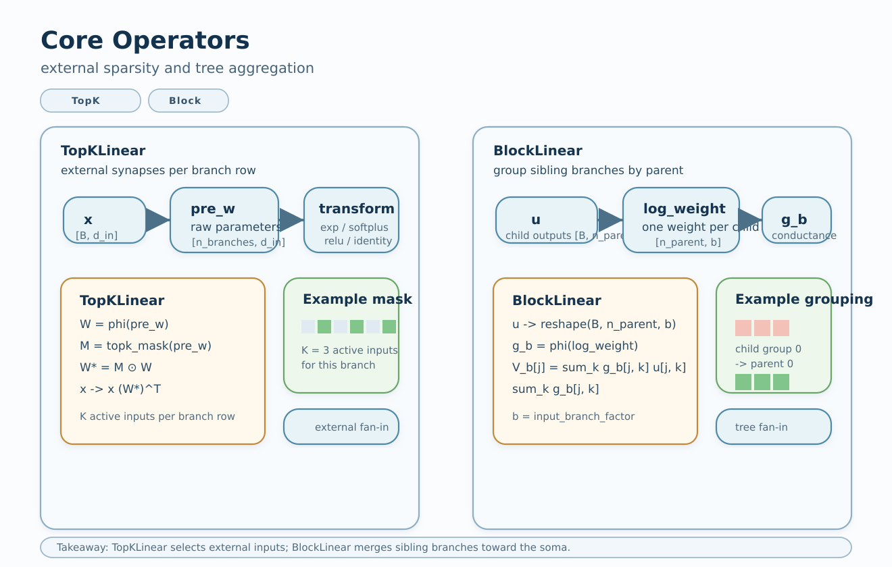
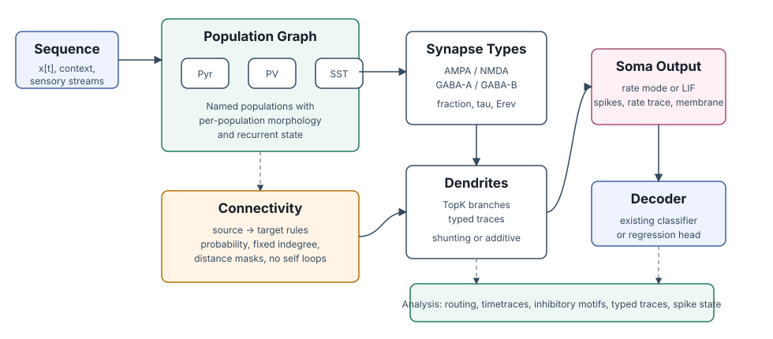
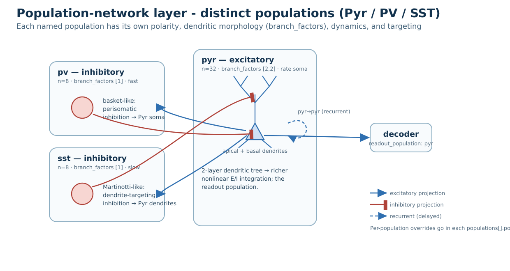
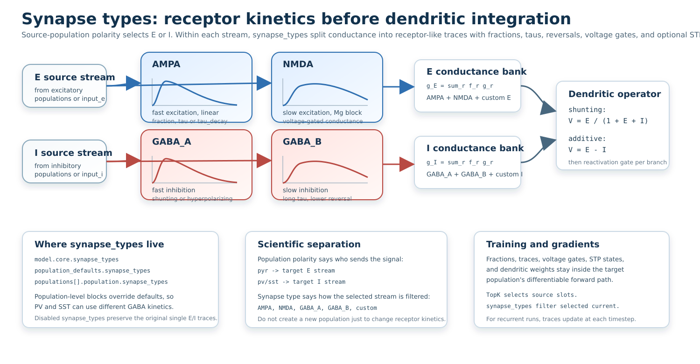
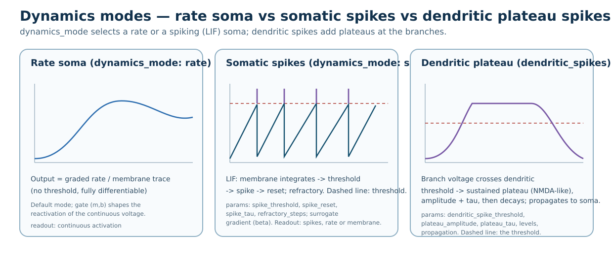
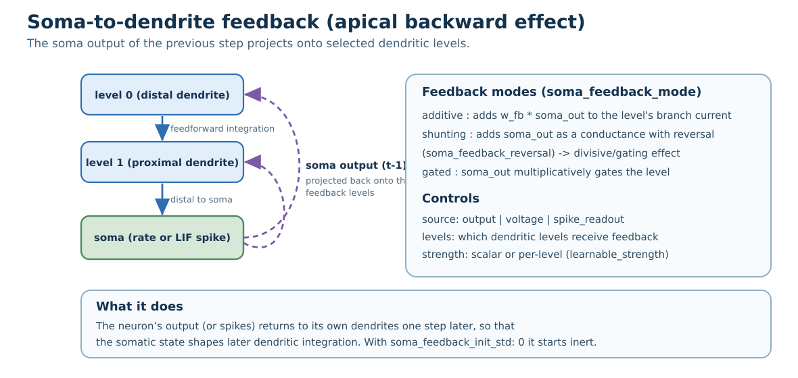

Network Architectures
=====================

The framework implements a three-part model: **encoder** (input processing),
**core network** (computation), and **decoder** (output mapping). This page
documents all core network types and their configuration.

.. contents:: On this page
   :local:
   :depth: 2

Architecture Pipeline
---------------------

Every model follows the encoder-core-decoder pattern:

1. **Encoder**: processes raw input (Identity, MLP, or CNN)
2. **Core network**: main computational unit (documented below)
3. **Decoder**: maps to output space (Identity or MLP)

The core network type is set via ``model.core.type`` in the YAML config file.

Visual Overview
---------------

The diagrams below are meant to answer the first engineering question people
usually have about this codebase: what exactly is a dendritic neuron here, and
how do ``TopKLinear``, branch factors, E/I routing, and somatic synapses fit
together?

   Network-level view of the feedforward E/I core. ``TransferLayer`` produces
   ``(x_E, x_I)``. Each ``ExcitationInhibitionLayer`` updates the inhibitory
   population first and then feeds that output into the excitatory population.
   The core network output is always the final excitatory state.

   Single-neuron view of one dendritic tree. Every ``DendriticBranchLayer`` can
   receive direct excitatory and inhibitory synapses, and parent layers also
   receive aggregated child-branch input through ``BlockLinear``.

The most important config-to-code mapping is:

- ``excitatory_layer_sizes`` and ``inhibitory_layer_sizes`` choose how many
  dendritic trees exist in each population
- ``excitatory_branch_factors`` and ``inhibitory_branch_factors`` choose the
  branching pattern inside each tree
- ``*_synapses_per_branch`` chooses the row-wise ``K`` used by each
  ``TopKLinear`` bank
- ``somatic_synapses`` decides whether the soma layer also has direct E/I
  synapses
- ``use_shunting`` chooses divisive versus additive integration inside each
  ``DendriticBranchLayer``

Core Network Types
------------------

.. list-table::
   :header-rows: 1
   :widths: 25 50 25

   * - Type string
     - Description
     - Aliases
   * - ``dendritic_shunting``
     - E-I network with shunting (divisive) inhibition
     -
   * - ``dendritic_additive``
     - E-I network with raw additive (subtractive) inhibition, ``V = E - I``
     -
   * - ``dendritic_normalized_additive``
     - E-I network with additive inhibition plus explicit voltage normalization
     -
   * - ``flat_shunting``
     - Flattened dendrites with shunting inhibition
     -
   * - ``flat_additive``
     - Flattened dendrites with raw additive inhibition
     -
   * - ``flat_normalized_additive``
     - Flattened dendrites with normalized additive inhibition
     -
   * - ``einet``
     - Generic E-I; reads ``use_shunting`` from morphology config
     -
   * - ``dendritic_mlp``
     - E-I with signed weights, ``synapse_mode="mlp"``
     -
   * - ``ei_unified``
     - Unified E-I, supports feedforward and recurrent
     - ``unified_ei``, ``rnn_dendritic_shunting``, ``rnn_dendritic_additive``, ``rnn_dendritic_normalized_additive``, ``rnn_flat_shunting``, ``rnn_flat_additive``, ``rnn_flat_normalized_additive``
   * - ``population_network``
     - Canonical feedforward/recurrent layers with multiple named
       populations, per-population morphology, and directed edges
     -
   * - ``gru``
     - Gated Recurrent Unit
     -
   * - ``lstm``
     - Long Short-Term Memory
     -
   * - ``vanilla_rnn``
     - Standard RNN
     - ``rnn``
   * - ``mlp``
     - Multi-layer perceptron baseline
     - ``point_mlp``

Shunting/additive mode selection
~~~~~~~~~~~~~~~~~~~~~~~~~~~~~~~~

For structured feedforward E-I networks, ``model.core.type`` is the canonical
selector. ``dendritic_shunting`` and ``flat_shunting`` run divisive shunting;
``dendritic_additive`` and ``flat_additive`` run raw additive/subtractive
integration. ``dendritic_normalized_additive`` and
``flat_normalized_additive`` opt into additive voltage normalization. If the
morphology block contains a contradictory ``use_shunting`` or
``use_additive_normalization``
value, the builder emits a warning and the type alias wins. Use the generic
``einet`` type when you intentionally want ``morphology.use_shunting`` to be
the selector. For additive modes without validation tuning, prefer
``reactivation.init_policy: "occupancy_quantile"`` as a stability fallback;
additive YAML configs that omit ``init_policy`` use this data-driven policy by
default, while explicit policies remain reproducible.

For recurrent unified E-I networks, plain ``ei_unified`` keeps the
population-level fields as the source of truth. The convenience aliases
``rnn_dendritic_shunting``, ``rnn_dendritic_additive``,
``rnn_dendritic_normalized_additive``, ``rnn_flat_shunting``,
``rnn_flat_additive``, and ``rnn_flat_normalized_additive`` rewrite every
excitatory and inhibitory
population to the alias contract; the flat aliases force
``branch_factors: [1]``. The
``population_network`` likewise uses ``population_defaults`` and per-population
``population`` blocks as the source of truth rather than inheriting top-level
morphology fields.

``population_network`` is the canonical layer schema for feedforward or
recurrent E/I composition. The classical feedforward E/I layer is represented
as two populations plus directional same-step edges:

   A two-layer ``population_network`` example. Each layer holds named populations
   (``e0``/``i0``, ``e1``/``i1``). Solid edges are *same-step* and must form an
   acyclic DAG within a timestep (``input->i0``, ``input->e0``, ``i0->e0``;
   cross-layer ``layer0.e0->layer1`` and ``layer0.i0->e1``). Dashed edges are
   *delayed* (read the previous timestep), enabling recurrence and later->earlier
   feedback (``e1->e1`` and ``layer1.e1->layer0.e0``). The readout population of
   the final layer feeds the decoder.

.. code-block:: yaml

   model:
     core:
       type: population_network
       population_network:
         layers:
           - name: layer0
             readout_population: e
             populations:
               - name: i
                 polarity: inhibitory
                 n_neurons: 32
                 branch_factors: [1]
               - name: e
                 polarity: excitatory
                 n_neurons: 128
                 branch_factors: [4, 4]
             connections:
               - source: input
                 target: i
               - source: input
                 target: e
               - source: i
                 target: e

Connections are directed records with ``source`` and ``target`` population
names. ``timing: same_step`` is the feedforward/default edge and is validated
as an acyclic directed graph within each layer. ``timing: delayed`` is the
recurrent edge and reads the source population's previous-timestep output, so
bidirectional E/I interactions are possible without an instantaneous
algebraic loop. ``probability`` optionally samples a frozen structural mask;
the target population's E/I synapse-count fields determine how many active
synapses per branch are selected inside the allowed mask. Pathway polarity is
inferred from the source population or named input stream.

External sources are named. ``source: input`` is the compatibility stream and
matches the default input stream. When ``population_network.use_transfer: true`` is set,
``source: input_e`` receives the excitatory stream returned by
``TransferLayer`` and ``source: input_i`` receives the inhibitory stream. This
represents independent-pathway transfer splits explicitly:

.. code-block:: yaml

   model:
     core:
       type: population_network
       population_network:
         use_transfer: true
         transfer_params:
           input_mode: 0
           independent_pathways: true
           excitatory_dim: 392
           inhibitory_dim: 392
         layers:
           - name: layer0
             readout_population: e
             populations:
               - name: i
                 polarity: inhibitory
                 n_neurons: 32
                 branch_factors: [1]
               - name: e
                 polarity: excitatory
                 n_neurons: 128
                 branch_factors: [4, 4]
             connections:
               - source: input_e
                 target: i
               - source: input_e
                 target: e
               - source: input_i
                 target: e
               - source: i
                 target: e

If ``use_transfer`` is false, ``input``, ``input_e``, and ``input_i`` all
refer to the same projected input tensor. In stacked population networks,
``source: input`` remains a compatibility shorthand for the previous layer
readout stream. For explicit cross-layer routing, use qualified sources of the
form ``source: layer_name.population_name``:

.. code-block:: yaml

   layers:
     - name: layer0
       readout_population: e0
       populations:
         - name: i0
           polarity: inhibitory
           n_neurons: 32
           branch_factors: [1]
         - name: e0
           polarity: excitatory
           n_neurons: 128
           branch_factors: [3, 3, 3]
       connections:
         - source: input
           target: i0
         - source: input
           target: e0
     - name: layer1
       readout_population: e1
       populations:
         - name: i1
           polarity: inhibitory
           n_neurons: 16
           branch_factors: [1]
         - name: e1
           polarity: excitatory
           n_neurons: 64
           branch_factors: [3, 3, 3]
       connections:
         - source: layer0.e0
           target: i1
         - source: layer0.e0
           target: e1
         - source: layer0.i0
           target: e1
         - source: i1
           target: e1

Same-step qualified sources must point from earlier layers to later layers.
Delayed qualified sources are allowed on recurrent target layers and use the
source population's previous-timestep output, so they do not create an
instantaneous algebraic loop.

For feedforward examples, see
``configs/examples/population_network_feedforward.yaml``,
``configs/examples/population_network_cifar10.yaml``,
``configs/examples/population_network_dense_to_sparse_cifar10.yaml``,
``configs/examples/population_network_normalized_additive_mnist.yaml``, and
``configs/examples/population_network_two_layer.yaml``.

When ``input_projection_dims`` is used together with ``use_transfer: true``,
the projection is applied to the compatibility/excitatory stream
(``input``/``input_e``). The inhibitory transfer stream (``input_i``) keeps the
dimension produced by ``TransferLayer``, matching the unified E/I stack's
existing convention.

Canonical examples are
``configs/examples/population_network_feedforward.yaml``,
``configs/examples/population_network_heterogeneous_feedforward.yaml``,
``configs/examples/population_network_recurrent_pyr_pv_sst.yaml``,
``configs/examples/population_network_taus_and_delays.yaml``,
``configs/examples/population_network_synapse_types_ampa_nmda_gaba.yaml``,
``configs/examples/population_network_spiking.yaml``, and
``configs/examples/population_network_soma_feedback.yaml``.

Transformer MLP/FFN replacement follows the same shared ``model.core.type``
aliases when a shunting/additive alias is present. If ``model.core.type`` is a
generic replacement type such as ``dendritic_ffn``, the transformer builder
reads ``model.core.morphology.use_shunting`` directly.

ExcitationInhibitionNetwork
---------------------------

The primary architecture. Each network consists of a TransferLayer followed by
one or more ExcitationInhibitionLayer instances. Each layer pairs an excitatory
DendriNet population with an inhibitory population (DendriNet or MLP).

**Forward pass**: input passes through the TransferLayer, producing separate
excitatory and inhibitory signals. At each layer, the inhibitory population
processes the excitatory input first; its output then modulates the excitatory
population via shunting or additive inhibition. The final layer's excitatory
output is the network output.

In code terms, the main forward rule is:

.. code-block:: text

   (x_E, x_I) = TransferLayer(x)
   h_I^(l) = inhibitory_cells(h_E^(l-1), h_I^(l-1))
   h_E^(l) = excitatory_cells(h_E^(l-1), h_I^(l))

This is implemented by ``ExcitationInhibitionNetwork.forward`` calling
``ExcitationInhibitionLayer.forward`` layer by layer.

TransferLayer
~~~~~~~~~~~~~

Controls how input is routed to the E and I pathways.

``input_mode``
   Selects the inhibitory-input convention used by the feedforward E/I
   builder. ``input_mode: 0`` builds explicit inhibitory cells whenever
   ``architecture.inhibitory_layer_sizes`` contains positive sizes.
   ``input_mode: 1`` uses the direct-inhibition path: the
   ``TransferLayer`` inhibitory stream is fed directly into E dendrites and
   explicit I cells are not built by default, even if stale inhibitory sizes
   remain in the config.

``input_mode1_build_inhibitory_population``
   Optional feedforward opt-in for configs that use
   ``input_mode: 1`` plus explicit inhibitory cells. The default is ``false``.

The same conventions can be written explicitly in ``population_network`` by
declaring named populations and ``connections``.

``require_explicit_direct_inhibitory_stream``
   Optional safety flag. When ``true``, direct input-mode-1 inhibition requires
   ``allow_direct_inhibitory_stream: true``. The deprecated
   ``allow_direct_inhibitory_input`` spelling is still normalized by the
   config adapter. The default is ``false``
   for compatibility with existing configs.

``independent_pathways``
   Controls raw input routing independently of inhibitory-population
   existence. If ``True``, input dimensions are split between E and I streams.
   If ``False``, the full input is duplicated to both streams.

``excitatory_dim``, ``inhibitory_dim``
   Explicit dimension split. Defaults to ``input_dim / 2`` each.

``output_activation``
   Optional nonlinearity on the split outputs: ``"sigmoid"``, ``"relu"``,
   ``"tanh"``, ``"softplus"``, or ``None``.

   For shunting E-I models with positive weight transforms, this is also the
   recommended place to clamp normalized raw inputs back to a nonnegative
   range, e.g. ``output_activation: "relu"``.

Config path: ``model.core.transfer``.

.. code-block:: yaml

   model:
     core:
       transfer:
         input_mode: 1
         independent_pathways: false
         output_activation: null

E-I Network Configuration
~~~~~~~~~~~~~~~~~~~~~~~~~~

.. code-block:: yaml

   model:
     core:
       type: dendritic_shunting
       architecture:
         excitatory_layer_sizes: [100, 50]
         inhibitory_layer_sizes: [20, 10]
         excitatory_branch_factors: [3, 3, 3, 3]
         inhibitory_branch_factors: [1]
         inhibitory_network_type: "dendritic"
       connectivity:
         ee_synapses_per_branch_per_layer: [40]
         ei_synapses_per_branch_per_layer: [0]
         ie_synapses_per_branch_per_layer: [10]
         ii_synapses_per_branch_per_layer: [0]
       morphology:
         somatic_synapses: false
         use_shunting: true
         weight_transform: "softplus"
         dbl_init_method: "analytical_expectation"
       sparsity:
         init_method: "xavier_normal"
         type: "indexed_rewire"
         indexed:
           seed: 42
           rewire_frequency: 100
           rewire_quantile: 0.05
           rewire_until_step: null
           output_chunk_size: 2048
         gamma: 1.0
       reactivation:
         enabled: true
         type: "param_tanh"
         init_m: 1.5
         init_b: 0.5

DendriNet
---------

A single-population dendritic network with hierarchical branching. Used as the
building block within each E-I layer.

``branch_factors`` defines the dendritic tree. For example, ``[3, 2]`` creates
two levels of branching: 3 branches at the first level, each splitting into 2,
giving 6 distal branches per soma neuron.

The architecture is built from distal to soma:

- **Level 0** (most distal): receives synaptic input from external sources
- **Intermediate levels**: aggregate child branches via BlockLinear
- **Soma level**: final aggregation, produces the layer output

If ``somatic_synapses`` is ``True``, the soma level also receives direct
synaptic input in addition to branch aggregation.

Programmatic construction can use either the historical keyword arguments or
``DendriNetConfig``.  The config object groups tree geometry, optional structured
connectivity metadata, and the shared ``DendriticSynapseConfig`` used by all
branch layers; both entry points normalize through the same branch-layer builder.

Two implementation details are easy to miss:

- each branch layer receives the same external ``x_E`` and optional ``x_I``;
  direct synapses are not restricted to the most distal level
- the tree is vectorized across neurons by flattening all branches at a given
  depth into one feature axis, so ``output_dim`` at a branch layer is
  ``n_soma * branches_at_that_level``

Key parameters:

``n_soma``
   Number of output neurons.

``branch_factors``
   List of integers defining the branching tree structure.

``excitatory_input_dim``, ``excitatory_synapses_per_branch``
   Excitatory input specification per branch.

``inhibitory_input_dim``, ``inhibitory_synapses_per_branch``
   Inhibitory input specification per branch.

``somatic_synapses``
   Whether the soma level receives direct synaptic input.

``use_shunting``
   ``True`` for shunting (divisive) inhibition; ``False`` for additive.

DendriticBranchLayer
--------------------

The core computation unit. Each branch layer contains synaptic input layers,
optional branch aggregation, and a post-voltage nonlinearity.

Shunting Mode
~~~~~~~~~~~~~

When ``use_shunting=True``, the voltage is computed as a normalized ratio:

.. code-block:: text

   numerator   = E + E_rec + V_branch
   denominator = 1 + E + E_rec + g_branch + I + I_rec

   V = numerator / (denominator + epsilon)
   output = reactivation(V)

Where ``E`` is the excitatory synaptic current (TopKLinear), ``I`` is
inhibitory, ``V_branch`` is aggregated child-branch input (BlockLinear),
``g_branch`` is the branch conductance, and ``E_rec``, ``I_rec`` are recurrent
inputs (used only in recurrent mode). The current implementation uses these raw
terms directly in the denominator. Epsilon defaults to ``1e-8``.

Additive Mode
~~~~~~~~~~~~~

When ``use_shunting=False``:

.. code-block:: text

   V = E + E_rec + V_branch - I - I_rec
   output = reactivation(V)

Optional legacy additive normalization is a per-sample, across-output scale
control: ``V = (V - mean_output) / (std_output + epsilon)``. It is not
conductance normalization and does not normalize each feature across a batch.

Components
~~~~~~~~~~

``branch_excitation``
   TopKLinear -- excitatory synaptic input.

``branch_inhibition``
   TopKLinear -- inhibitory synaptic input (optional).

``branch_recurrent``
   TopKLinear -- recurrent excitatory input (recurrent mode only).

``branch_rec_inhibition``
   TopKLinear -- recurrent inhibitory input (recurrent mode only).

``branches_to_output``
   BlockLinear or EfficientBlockLinear -- aggregates child branches.

``reactivation``
   Parametric nonlinearity applied to the voltage output.

Operator-Level View
~~~~~~~~~~~~~~~~~~~

   ``TopKLinear`` and ``BlockLinear`` control different kinds of structure.
   ``TopKLinear`` enforces sparse external synapses per branch. ``BlockLinear``
   enforces tree-structured aggregation from sibling branches to their parent.

For engineering work, the key distinction is:

- ``K`` controls how many external inputs each branch keeps
- ``branch_factor`` controls how many child branches are grouped by the next
  parent branch
- these are independent controls and they act at different points in the
  forward pass

TopKLinear
----------

Sparse synaptic layer. For each output neuron, only the ``K`` largest-weight
connections are active; all others are masked to zero.

``K``
   Number of active synapses per output neuron.

``weight_transform``
   Transformation applied to raw parameters before masking.
   ``"exp"`` (default) -- always positive.
   ``"softplus"`` -- always positive, smoother gradient.
   ``"relu"`` -- non-negative, can be exactly zero.
   ``"identity"`` -- signed weights (used by ``dendritic_mlp``).

``init_method``
   Weight initialization: ``"xavier_normal"``, ``"xavier_uniform"``,
   ``"kaiming_normal"``, ``"kaiming_uniform"``, ``"orthogonal"``,
   ``"normal"``, ``"uniform"``, ``"eye"``.

``noise_level``
   Gaussian noise added during top-K selection (default: 0.0).

``weight_norm_order``
   Optional L-p normalization per output neuron.

``gamma``
   Post-normalization scaling factor (default: 1.0).

Config path: ``model.core.sparsity``.

TopK Variants
~~~~~~~~~~~~~

Set via ``model.core.sparsity.type``:

``standard``, ``stochastic``, ``variance``, and ``dense_to_sparse`` all keep a
dense trainable score/weight matrix and apply sparse selection on top of it.
They are biologically useful sparse-selection models, but they do not reduce
the underlying matrix-multiply memory/compute in proportion to ``K``. For very
large, high-sparsity networks where memory is the bottleneck, prefer
``indexed``, ``indexed_dynamic``, or ``indexed_rewire``.

``standard``
   Dense-score deterministic TopK (default).  Stores an
   ``out_features x in_features`` trainable score/weight matrix and selects
   the current top ``K`` entries per output on each forward pass.  The active
   set can change over training because selection is recomputed from the dense
   score matrix.

``stochastic``
   Dense-score stochastic TopK.  It stores the same dense score matrix as
   ``standard``, but samples active synapses from a rank-probabilistic rule
   controlled by ``sparsity.temperature``.  ``sparsity.ultrafast: true`` uses a
   faster noisy-TopK approximation.

``variance``
   Dense-score variance-aware TopK.  It tracks input activation variance and
   ranks synapses by weight strength times input variance.

``dense_to_sparse`` / ``annealed_topk``
   Developmental pruning TopK. It stores the same dense score matrix as
   ``standard``, starts with a dense or high-``K`` active set, and gradually
   anneals to the configured synapse count ``K``. This lets all allowed
   synapses receive gradients early before the model commits to a sparse
   morphology. Additional parameters live under ``sparsity.dense_to_sparse``:
   ``initial_density`` or ``initial_k``, ``start_step``, ``end_step``,
   ``update_interval``, ``schedule`` (``"linear"``, ``"cubic"``, ``"cosine"``,
   or ``"step"``), ``freeze_on_end``, ``advance_on_forward``, and
   ``prune_metric``.

``deepst``
   Dynamic rewiring with density targets. Additional parameters under
   ``sparsity.deepst``: ``excitatory_target_density``,
   ``inhibitory_target_density``, ``sigma``, ``rewiring_mode``
   (``"global"``/``"local"``), ``rewire_frequency``.

``indexed``
   Fixed-index sparse synapses. Unlike ``standard`` TopK, this layer does not
   store a dense ``out_features x in_features`` trainable matrix. It stores
   exactly ``out_features x K`` trainable weights plus fixed presynaptic
   integer indices. The topology is fixed: non-indexed synapses do not exist
   and cannot later enter the active set.

``indexed_dynamic``
   Candidate-pool sparse TopK. It stores ``out_features x C`` candidate
   synapses, where ``C = sparsity.indexed.candidate_size`` and ``C >= K``.
   Each forward pass selects ``K`` active candidates, so inactive candidates
   can later become active without storing the full dense matrix.  Set
   ``sparsity.indexed.selection: stochastic`` to use rank-probabilistic
   selection inside the candidate pool. If ``candidate_size`` is omitted and a
   hard connection mask is present, the automatic candidate pool is capped to
   the largest size supported by every masked output row.

``indexed_rewire``
   Adaptive-quantile indexed rewiring. It stores only
   ``out_features x K`` sparse weights plus integer input indices, like
   ``indexed``, but periodically replaces the weakest fraction of same-row
   synapses with newly sampled allowed inputs. This is the memory-efficient
   version of "weak synapses disappear and fresh random synapses appear on the
   same dendrite." It is different from ``indexed_dynamic``: the candidate
   pool itself changes over training rather than remaining fixed.

Example low-parameter dynamic sparse config:

.. code-block:: yaml

   model:
     core:
       sparsity:
         type: indexed_dynamic
         temperature: 0.5
         indexed:
           candidate_size: 256
           selection: stochastic     # standard or stochastic
           seed: 42
           output_chunk_size: 2048

Example indexed rewiring config:

.. code-block:: yaml

   model:
     core:
       sparsity:
         type: indexed_rewire
         indexed:
           seed: 42
           rewire_frequency: 100
           rewire_quantile: 0.05
           rewire_until_step: 10000

In population-network configs the same settings can also be placed directly in
``population_defaults`` or a per-population ``population:`` override as
``topk_type: indexed_rewire``, ``indexed_rewire_frequency``,
``indexed_rewire_quantile``, and ``indexed_rewire_until_step``.

Example dense-to-sparse developmental pruning config:

.. code-block:: yaml

   model:
     core:
       sparsity:
         type: dense_to_sparse
         dense_to_sparse:
           initial_density: 1.0
           start_step: 0
           end_step: 4000
           update_interval: 50
           schedule: cubic
           freeze_on_end: true
           prune_metric: weight

BlockLinear
-----------

Block-diagonal linear layer for aggregating child-branch activations. Each
output neuron receives exactly ``block_size`` inputs from consecutive positions,
where ``block_size = in_features / out_features``.

``EfficientBlockLinear`` is a memory-efficient variant that uses reshape
operations instead of a sparse matrix. Same API and behavior.

Config paths: ``model.core.blocklinear.efficient`` for structured EINet-style
cores, and ``efficient_blocklinear`` under
``population_network.layers[].population_defaults`` or an individual
population override for population-network cores and transformer/vision
replacement cores that use the population-network schema.

Shared Replacement Cells
------------------------

Replacement experiments use a common cell contract:

.. code-block:: text

   input adapter -> dendritic core -> output adapter

The shared implementation lives in
``dendritic_modeling.networks.architectures.replacement``.  Input adapters such
as ``signed_split`` and ``relu`` map source-network activity into the
non-negative domain expected by positive-conductance dendritic cores.  The core
then runs a DendriNet, E/I population stack, or spatial dendritic module.  The
output adapter maps the dendritic activity back to the tensor contract expected
by the source model.

Placement remains domain-specific:

- vision replacement uses ``classical.pretrained`` to split a torchvision
  backbone into prefix / replacement core / suffix segments
- transformer replacement uses ``transformer.patching`` to patch a target
  module inside each decoder block while preserving residual, cache, and
  Hugging Face model contracts

This separation keeps the biological/dendritic computation reusable without
forcing every source model into the same surgery mechanism.

Vision Backbone Replacement
---------------------------

Vision replacement uses ``model.vision_replacement`` to split a torchvision
backbone into three parts: a pretrained prefix, a dendritic replacement core,
and a pretrained or trainable suffix. This is the image-model analogue of the
transformer replacement path, but the target modules are named layers in a
sequential vision backbone such as AlexNet or VGG.
Older ``model.pretrained_replacement`` configs remain supported as aliases.

Two dendritic core styles are supported:

``hierarchical_dendritic_tensor_map``
   Flattens the prefix feature tensor, applies a hierarchical dendritic core,
   and projects to the flat suffix input when needed. Use this for classifier
   replacements such as AlexNet ``fc7``.

``hierarchical_dendritic_conv``
   Applies a shared dendritic core over local spatial patches and preserves a
   spatial tensor for convolutional suffixes. Use ``model.core.spatial`` to set
   ``kernel_size``, ``stride``, and ``padding``.

``sparse_active_matched_point_conv``
   Applies one fixed-index sparse affine control to every shared local patch.
   Its trainable scalar count is derived from the same structured E/I config as
   ``hierarchical_dendritic_conv``, so it provides an active-parameter-matched
   spatial control without dendritic branch dynamics.

Core options are the same dendritic options used elsewhere: shunting/additive
mode, branch factors, synapse counts, reactivation initialization, and sparse
synapse type. Example configs live in ``configs/vision/``:

.. list-table::
   :header-rows: 1
   :widths: 42 58

   * - Config
     - Purpose
   * - ``configs/vision/alexnet_fc7_dendritic_500.yaml``
     - AlexNet ``fc7`` replacement with a 500-unit dendritic tensor-map core.
   * - ``configs/vision/alexnet_k1_einet_single.yaml``
     - K=1 AlexNet classifier replacement for single-GPU runs.
   * - ``configs/vision/alexnet_k1_einet_ddp.yaml``
     - Same replacement configured for DDP launch.
   * - ``configs/vision/pretrained_alexnet_fc.yaml``
     - Tensor-map replacement around AlexNet fully connected layers.
   * - ``configs/vision/pretrained_alexnet_conv.yaml``
     - Spatial dendritic convolution replacement for the exact AlexNet conv5
       plus ReLU span.
   * - ``configs/vision/alexnet_conv5_replacement_benchmark.yaml``
     - Matched AlexNet conv5 comparison of shunting and additive dendritic
       operators, a fixed-index sparse point convolution, and the retained
       pretrained span.
   * - ``configs/vision/alexnet_fc6_replacement_benchmark.yaml``
     - Matched AlexNet fc6 comparison of global indexed, random-local,
       tree-aligned local, fixed-index sparse point, factorized dense MLP, and
       retained pretrained-span cores.
   * - ``configs/vision/alexnet_fc6_learned_topk.yaml``
     - Full learned-TopK companion using the same fc6 boundary and optimization
       protocol; report its stored and active parameter counts separately.

Minimal skeleton:

.. code-block:: yaml

   model:
     vision_replacement:
       enabled: true
       backbone: alexnet
       weights: IMAGENET1K_V1
       core_source: configured
       input_shape: [3, 224, 224]
       target_modules: [classifier.4, classifier.5]
       omit_layers: [classifier.0, classifier.3]
       trainability:
         encoder: {mode: frozen}
         decoder: {mode: trainable}
     core:
       type: hierarchical_dendritic_tensor_map
       architecture:
         excitatory_layer_sizes: [500]
         excitatory_branch_factors: [3, 3]
       connectivity:
         ee_synapses_per_branch_per_layer: [40]
       morphology:
         use_shunting: true
         weight_transform: softplus
       reactivation:
         init_policy: occupancy_quantile

``target_modules`` must resolve to one contiguous span in the flattened
backbone order.  This is what lets the runtime construct a single
encoder-core-decoder tensor contract.  Fully supervised training uses the
standard trainer; block-output distillation from cached tensors uses
``training.vision_replacement``. Distillation can train only the replacement
core, the replacement plus decoder, or the full student model; saved artifacts
include the parameters required by the selected train target.

For a training-matched dense reference, set
``vision_replacement.core_source: pretrained_span``. The runtime then keeps the
original target modules and their pretrained weights as the trainable core,
while retaining the same prefix, suffix, boundaries, data path, and trainer.
This reference is dense and therefore should not be described as
parameter-matched to a sparse or dendritic replacement.

Fixed spatial routing can also act on a flattened feature map when its native
CHW geometry is known. For example, replacing AlexNet fc6 exposes the
``[256, 6, 6]`` tensor entering that layer. Declare
``connectivity.structured.pathways.ee`` and ``.ei`` as
``spatial_morphology`` to constrain only the two direct feature-map pathways;
leave ``ie`` undeclared so local inhibitory-population outputs are sampled in
their own non-spatial index space. The fc6 benchmark configs above demonstrate
global, random-window, and morphology-aligned routing under one tensor
boundary.

Transformer FFN Replacement
---------------------------

The AlexNet/VGG replacement path and the transformer replacement path share the
same conceptual split: choose a backbone, choose the layers/modules to replace,
and describe the dendritic replacement with ``model.core``.  The difference is
mechanical: AlexNet/VGG are sequential torchvision modules, while transformer
targets sit inside decoder blocks.  For transformers the target is described by
``model.transformer_replacement`` and the dendritic FFN is described by the
shared ``model.core.population_network`` schema.  ``target_module`` may be a
simple name such as ``mlp`` or a dotted path relative to each decoder layer,
such as ``self_attn.o_proj``.  Generic replacement currently expects a
tensor-in/tensor-out module with the same final hidden dimension; modules with
tuple outputs or multi-input attention APIs need a small adapter before they can
be replaced safely.

The implementation is split across ``transformer.modules`` for replacement
modules, ``transformer.config_translation`` for config-to-constructor mapping,
and ``transformer.patching`` for Hugging Face module replacement.  Public
imports remain available from
``dendritic_modeling.networks.architectures.transformer``.
The token-wise transformer modules use the shared replacement-cell components
internally while preserving the historical ``core`` and ``output_projection``
state-dict keys.

The replacement module preserves the transformer MLP contract

.. math::

   X \in \mathbb{R}^{B \times T \times d}
   \longmapsto
   Y \in \mathbb{R}^{B \times T \times d}.

The experimental ``DendriticFFNReplacement`` module implements this token-wise
contract:

.. math::

   U = \phi_{\mathrm{in}}(X),
   \qquad
   Z = \mathrm{DendriNet}(U),
   \qquad
   Y = Z W_{\mathrm{out}} + b_{\mathrm{out}}.

``DendriNet`` supplies sparse hierarchical branch computation, and the final
linear projection maps the dendritic soma population back to the transformer
hidden dimension.  For a DeepSeek/Llama-style gated FFN,

.. math::

   \mathrm{FFN}(x)
      = W_{\mathrm{down}}
        \left(\mathrm{SiLU}(W_{\mathrm{gate}}x) \odot W_{\mathrm{up}}x\right),

the dense parameter count is approximately

.. math::

   3 d d_{\mathrm{ff}}.

For DeepSeek-V3 public configs, ``d = 7168`` and
``d_ff = 18432``, so one dense FFN has about 396M parameters.  A dendritic
replacement with 512 soma units, morphology ``[3, 3]``, and 40 indexed
synapses per branch stores only the active indexed synapses plus the output
projection.

.. code-block:: yaml

   model:
     transformer_replacement:
       enabled: true
       model_name: deepseek-ai/DeepSeek-V3
       layers: [0, 1, 2]
       target_module: mlp
       layers_attr: model.layers
       input_transform: signed_split
       model_kwargs:
         device_map: auto
         torch_dtype: auto

     core:
       type: dendritic_ffn
       population_network:
         input_transform: signed_split
         layers:
           - name: transformer_mlp
             readout_population: ffn
             population_defaults:
               ff_excitatory_synapses: 40
               ff_inhibitory_synapses: 0
               somatic_synapses: true
               use_shunting: true
               reactivate: true
               reactivation_type: param_tanh
               weight_transform: softplus
               topk_type: indexed_rewire
               indexed_seed: 42
               indexed_rewire_frequency: 100
               indexed_rewire_quantile: 0.05
               indexed_rewire_until_step: null
               indexed_output_chunk_size: 2048
               efficient_blocklinear: true
             populations:
               - name: ffn
                 polarity: excitatory
                 n_neurons: 512
                 branch_factors: [3, 3]
             connections:
               - source: input
                 target: ffn

The YAML can be applied to a loaded Hugging Face model with:

.. code-block:: python

   from dendritic_modeling.networks.architectures.transformer import (
       apply_transformer_replacement_config,
       load_transformer_with_dendritic_replacements,
   )

   model, records = load_transformer_with_dendritic_replacements(
       config.model.transformer_replacement,
       config.model.core,
   )

   # Or, if the model has already been loaded:
   records = apply_transformer_replacement_config(
       model,
       config.model.transformer_replacement,
       config.model.core,
   )

Scientific caveat: transformer residual streams, FFN hidden activations, and
FFN outputs are signed.  A conductance-style DendriNet with positive synaptic
weights is most biologically interpretable when its presynaptic activities are
non-negative.  ``input_transform="signed_split"`` converts a signed vector
``x`` into ``[ReLU(x), ReLU(-x)]`` so positive conductances can still represent
both polarities.  The final ``W_out`` is signed, because the transformer block
must return a signed residual update.

This replacement path should be trained first by block-output distillation:
freeze the original transformer, collect inputs and original target-module
outputs for the selected layers, and train the dendritic replacement to match
those outputs before evaluating full language-model perplexity.  After that
smoke test, ``joint_lm_distillation`` can train the patched causal LM directly
with either ``train_target: replacement_only`` or ``train_target: full_model``.

The dedicated trainer is selected by ``training.transformer_replacement`` and
currently supports three teacher-data sources:

``synthetic_mlp``
   Generates random transformer hidden states and a small teacher MLP.  This is
   the smoke-test path used to confirm that the dendritic FFN can learn a
   token-wise MLP map.

``hidden_cache``
   Reads saved tensors of hidden states and teacher MLP outputs.  This is the
   most memory-efficient route when a large teacher such as DeepSeek-V3 is run
   once to build an activation cache.

``hf_text``
   Loads a Hugging Face causal LM, registers hooks on the selected target
   modules, samples token windows from a text file or Hugging Face dataset, and
   trains the dendritic replacement from the captured input/output pairs.

.. code-block:: bash

   PYTHONPATH=src:$PYTHONPATH python -m \
     dendritic_modeling.scripts.training.train_transformer_replacement \
     configs/examples/transformer_replacement_synthetic_distillation.yaml

The saved replacement files contain one state dict per layer and can be loaded
back into a patched model with the same ``model.transformer_replacement`` and
``model.core`` settings.

Activation Functions
--------------------

Post-voltage nonlinearities applied at each branch layer. Set via
``model.core.reactivation.type``.

``param_tanh`` (default)
   ``(tanh(m * (V - b)) + 1) / 2`` with learnable slope ``m`` and midpoint
   ``b``. Output range is [0, 1]. Initialized with ``init_m`` and ``init_b``.

``param_tanh_only_m``
   Same as ``param_tanh`` but ``b`` is fixed (not trainable).

``param_linear_sigmoid``, ``param_linear_tanh``, ``param_linear_tanh_transition``
   Blended activations combining a linear region with a saturating function.

``relu``, ``sigmoid``, ``tanh``, ``leaky_relu``, ``elu``, ``selu``, ``softplus``
   Standard PyTorch activations (no learnable parameters).

.. code-block:: yaml

   model:
     core:
       reactivation:
         enabled: true
         type: "param_tanh"
         init_m: 1.5
         init_b: 0.5

Reactivation Gate Initialization
~~~~~~~~~~~~~~~~~~~~~~~~~~~~~~~~

The reactivation gate ``(tanh(m * (V - b)) + 1) / 2`` has two learnable
parameters: the slope ``m`` and the midpoint ``b``. How these are initialized
determines the gate's operating point at the start of training.

Reactivation policies can initialize the gate from analytical branch
statistics, sampled branch-voltage statistics, or deterministic center/slope
combinations of the two. The data-driven policies place the gate using the observed voltage
distribution ``V``, which keeps the same interface usable across shunting and
additive morphologies. This common interface does not imply that the two
mechanisms should have identical numerical ``(m, b)`` values: their raw
voltages have different scales.

``init_policy`` selects the initialization strategy:

``occupancy_quantile`` **(recommended data-driven default)**
   This is a two-stage analytical-weight/empirical-gate initializer, rather
   than an input-only alternative to analytical initialization. Synaptic
   weights are initialized first from the analytical morphology/contact prior.
   After the model is built, a few unlabeled training batches are run through
   those realized weights. For each reactivation layer, the low/high
   percentiles of the pre-reactivation voltage ``V`` are measured, and
   ``(m, b)`` are set to pin those quantiles to target gate-output occupancies.
   It therefore combines weight statistics, morphology, and input statistics
   without fitting a supervised parameter or mixing coefficient. By default
   this maps q10/q90 to [0.1, 0.9]:

   - ``b = (q10 + q90) / 2``
   - ``m = atanh(0.8) / ((q90 - q10) / 2)``

   This is morphology-invariant by construction: it places the gate's active
   region around the observed voltage distribution regardless of whether the
   network uses shunting (V bounded in [0, 1]) or additive (V unbounded)
   morphology. Production data-driven initialization iterates until the
   layer-wise ``(m, b)`` chain changes by less than ``1e-3`` (with a 50-pass
   safety cap), because updating upstream layers reshapes downstream voltage
   distributions. An explicit iteration count is available only as a
   deterministic test/debug override.

   The outer tails are allowed to saturate on purpose. This policy is not
   trying to use the entire gate range uniformly; it is trying to place the
   bulk of the observed voltage mass into the gate's sensitive region while
   keeping the tails as margin.

   Quantile-based calibration includes safeguards for ill-conditioned
   upper-layer fits. If the observed quantile span is too small or the fitted
   slope would have to exceed the configured ``calibration_max_m``, the layer
   falls back to its pre-calibration gate state instead of forcing a saturated
   occupancy fit.

   The fitted ``(m, b)`` are layer-specific by design. Different dendritic
   depths see different voltage statistics, so forcing one shared gate slope
   across depth is usually a worse calibration. For depth analysis, compare
   normalized gate coordinates or occupancy statistics rather than raw
   voltages across layers.

   Pair with a validation-tuned ``reactivation_lr`` to keep gate slope drift
   under control. For data-driven init policies, check the automatically
   written ``reactivation_calibration.json`` and
   ``post_calibration_gate_stats.json`` artifacts before treating a run as
   healthy.

   ``quantile`` is accepted as an alias and is normalized to
   ``occupancy_quantile``. Prefer ``occupancy_quantile`` in YAML configs.

   For local learning, use ``q_low=0.05, q_high=0.95`` mapping to gate outputs
   ``r_low=0.2, r_high=0.8``. This gives the gate a wider active region and
   room to self-organize under noisier local credit signals.

``empirical``
   Robust median/MAD calibration from sampled voltages.

``analytical_slope_occupancy_center``
   A deterministic component policy with ``m=m_a`` and ``b=b_o``. It retains
   the analytical mechanism-aware slope and uses the robust occupancy center
   measured on unlabeled training inputs. A finite center remains usable when
   the occupancy slope alone exceeds the configured slope safeguard.

``occupancy_slope_analytical_center``
   The complementary deterministic component policy with ``m=m_o`` and
   ``b=b_a``. If the occupancy slope is invalid, the complete gate falls back
   to the analytical state. Neither component policy has a mixing coefficient.

``analytical`` (default)
   Analytical initialization derived from the weight-init statistics by the
   chosen ``dbl_init_method`` and the branch morphology. No sampled data is
   required. The resulting values are generally different for additive and
   shunting voltage rules.

``fixed``
   Uses the YAML-supplied ``init_m`` and ``init_b`` verbatim, ignoring all
   calibration.

Strategy-Specific Recommendations
^^^^^^^^^^^^^^^^^^^^^^^^^^^^^^^^^

Operational fallback choices when no validation sweep is available are:

.. list-table::
   :header-rows: 1
   :widths: 15 25 60

   * - Regime
     - Default
     - Settings
   * - **Backprop**
     - ``occupancy_quantile``
     - ``reactivation_lr = 1e-4`` or ``1e-5``; standard optimizer recipe
   * - **Local CA**
     - ``occupancy_quantile``
     - ``q_low=0.05, q_high=0.95, r_low=0.2, r_high=0.8``; ``reactivation_lr = 1e-3``

These are stability defaults, not claims of universal optimality. For a
best-attainable trained-system comparison, give each architecture the same
validation budget over initializer and optimizer recipes. For a causal
integration-rule swap, instead match the effective operating point or use a
mechanism-neutral passive initializer.

Init diagnostics
^^^^^^^^^^^^^^^^

When a model contains learnable reactivation gates, the training script writes
``init_gate_stats.json`` immediately after model build. Data-driven policies
also write ``reactivation_calibration.json`` and
``post_calibration_gate_stats.json`` after the executed calibration. These
artifacts summarize the requested policy, convergence, fitted and applied
``(m,b)``, and suspicious patterns such as:

- slopes near the calibration clip
- repeated identical values across a full layer combined with saturation
- gate centers pushed to the voltage-range edge

This diagnostic is especially useful when using ``occupancy_quantile`` on
unfamiliar datasets or recurrent settings.

**Standard backprop** (both morphologies):

.. code-block:: yaml

   model:
     core:
       reactivation:
         init_policy: "occupancy_quantile"
   training:
     main:
       common:
         param_groups:
           reactivation_lr: 0.0001

**Local learning** (both morphologies):

.. code-block:: yaml

   model:
     core:
       reactivation:
         init_policy: "occupancy_quantile"
         occupancy_quantile_low: 0.05
         occupancy_quantile_high: 0.95
         occupancy_target_low: 0.2
         occupancy_target_high: 0.8
   training:
     main:
       common:
         param_groups:
           reactivation_lr: 0.001

Gate-occupancy warmup in a ``multi_stage`` pipeline is available when a staged
training setup is desired, but it is separate from the default local-learning
configuration shown above.

Operational fallbacks
^^^^^^^^^^^^^^^^^^^^^

- ``occupancy_quantile`` for backprop, with a small ``reactivation_lr``
- ``occupancy_quantile`` for local CA, using q05/q95 -> 0.2/0.8

These fallbacks apply across both shunting and additive settings, but a
validation-selected capacity comparison may choose different recipes under an
equal search budget.

Training-Time Gate Maintenance
^^^^^^^^^^^^^^^^^^^^^^^^^^^^^^

Initialization and training-time gate updates are separate controls.

For the paper-facing backprop settings, the recommended default is:

- use ``init_policy: "occupancy_quantile"`` once at the start of training
- keep ``reactivation_update_mode: "backprop"``
- leave ``recalibrate_reactivation_every: 0``

This uses occupancy-quantile calibration only to place the gate initially.
After that, ``(m, b)`` continue to learn through the optimizer like the rest of
the model.

For local learning, the recommended default is:

- use ``init_policy: "occupancy_quantile"``
- keep Local CA updates enabled for ``(m, b)``
- do not enable periodic quantile refresh unless the experiment is explicitly
  about comparing local gate updates against quantile-maintained gates

Optional periodic quantile maintenance is available for controlled ablations
and diagnostics. The relevant trainer fields live under
``training.<strategy>.common``:

``reactivation_update_mode``
   ``"backprop"`` keeps optimizer or local-rule learning of ``(m, b)``.
   ``"quantile"`` freezes those direct updates and refreshes ``(m, b)``
   from the observed voltage distribution during training.

``recalibrate_reactivation_every``
   Refresh period in epochs. ``0`` disables training-time refresh.

``reactivation_recalibration_mode``
   Calibration rule used for periodic refresh. ``"from_init_policy"``
   reuses the configured initialization rule; ``"occupancy_quantile"``
   is the most common explicit choice for quantile-maintained gates.

``reactivation_recalibration_start_epoch``
   First epoch at which periodic refresh is allowed. Setting this to ``2``
   or later preserves the chosen initialization through the first training
   epoch.

``reactivation_recalibration_num_batches``
   Number of training batches used to estimate the live voltage distribution
   for each refresh.

``reactivation_recalibration_ema_alpha``
   Blend factor for periodic refresh. ``1.0`` means hard overwrite with the
   newly calibrated ``(m, b)``. Values in ``(0, 1)`` apply an EMA-style
   update toward the calibrated target.

In short: ``occupancy_quantile`` initialization is the default paper recipe
for backprop, while periodic quantile maintenance is a supported experimental
option for studying simplified gate learning.

Recurrent E-I Network
---------------------

Any E-I architecture (``dendritic_shunting``, ``dendritic_additive``,
``einet``) becomes recurrent when ``connectivity.rec_*`` synapse counts are
nonzero.  Recurrence is controlled **solely** by these synapse counts;
any layer with at least one nonzero ``rec_*`` value becomes recurrent.
The existing ``architecture``, ``connectivity``, ``morphology``,
``sparsity``, ``reactivation``, and ``blocklinear`` sections are reused;
a small ``recurrent_ei`` block provides only the temporal parameters.
The factory translates this to an ``EINetwork`` internally.

Alternatively, use ``core.type: ei_unified`` with the ``unified_ei`` config
for full per-layer, per-population control.

Making an E-I core recurrent
~~~~~~~~~~~~~~~~~~~~~~~~~~~~

.. code-block:: yaml

   model:
     core:
       type: dendritic_shunting          # same type as feedforward
       architecture:
         excitatory_layer_sizes: [64]
         excitatory_branch_factors: [3, 3]
       connectivity:
         ee_synapses_per_branch_per_layer: [12]
         ie_synapses_per_branch_per_layer: [6]
         # Nonzero rec counts trigger recurrent mode
         rec_ee_synapses_per_branch: [8]   # E->E recurrent
         rec_ie_synapses_per_branch: [4]   # I->E recurrent
         rec_ei_synapses_per_branch: [8]   # E->I recurrent
         rec_ii_synapses_per_branch: [4]   # I->I recurrent
       transfer:
         input_mode: 1
         inhibitory_mode: "first"        # none, first, all
       # morphology, sparsity, reactivation, blocklinear as usual...

       recurrent_ei:                     # temporal params only
         output_mode: last               # "last", "all", "mean"
         use_transfer: true              # default true (set false to bypass TransferLayer)
         dt: 1.0                         # timestep (scalar or per-layer list)
         tau_base: 50.0                  # base time constant (scalar or per-layer list)
         tau_ratio: 3.0                  # geometric ratio between levels (scalar or per-layer list)

   training:
     main:
       strategy: recurrent

For recurrent ``einet``-style configs, ``use_transfer`` defaults to ``true``,
so a TransferLayer is built for both ``input_mode=1`` and ``input_mode=0``.
Set ``recurrent_ei.use_transfer: false`` to disable it explicitly.

Population Network / Named Populations
--------------------------------------

   Recurrent population features are opt-in layers around the dendritic
   computation path. Named populations feed source-target masks, typed synapse
   traces feed dendritic integration, and the soma can remain rate-valued or
   emit LIF spikes with a decoder-compatible readout.

Terminology and computation boundaries:

.. list-table::
   :header-rows: 1
   :widths: 22 28 50

   * - Concept
     - Config object
     - Computation it controls
   * - Population network
     - ``PopulationNetwork``
     - The full feedforward or recurrent circuit. It constructs named
       populations inside ordered layers, manages recurrent state when enabled,
       applies source-target masks, chooses the readout population, and returns
       feedforward outputs or ``last``, ``mean``, or ``all`` sequence output.
   * - Named population
     - ``PopulationDefinitionConfig``
     - One named dendritic population inside a layer. It sets neuron count,
       polarity, morphology, and optional population-specific overrides.
   * - Population connection
     - ``PopulationProjectionConfig``
     - A directed source-target rule between named populations. Same-step edges
       define feedforward/local layer flow; delayed edges define recurrent flow.
   * - Structured mask
     - ``StructuredConnectivityConfig``
     - A hard mask over individual presynaptic indices for TopK/DeepST
       pathways such as ``ee``, ``ie``, ``rec_ee``, and ``rec_ie``.
   * - Synapse type
     - ``SynapseTypeConfig``
     - A conductance subtype within an E or I stream. It controls fractions,
       kinetic traces, voltage gates, reversal potentials, nonlinearities, and
       short-term plasticity.
   * - Soma dynamics
     - ``LIFSoma`` or rate output
     - The final population output rule after dendritic integration.

These concepts compose but do not replace each other. A PV population can send
inhibitory input to a pyramidal population; that pathway can be
restricted by a population-level connection and by a lower-level structured
mask; once the signal arrives, it can be split into ``GABA_A`` and ``GABA_B``
synapse types; the target soma can still output either a rate value or spikes.

``core.type: population_network`` is the canonical backend for named
populations. It supports feedforward stacks and recurrent layers with the same
``layers[].populations`` and ``layers[].connections`` notation. Recurrent
layers use delayed edges so every population reads previous-timestep recurrent
state; same-step edges must form a directed acyclic graph within a layer, which
keeps local E/I wiring explicit and prevents hidden algebraic loops.

   A population-network layer with three **distinct populations**. ``pyr`` is the
   excitatory readout population with a two-layer dendritic tree
   (``branch_factors: [2, 2]``); ``pv`` and ``sst`` are inhibitory populations
   with flat morphology (``branch_factors: [1]``). Each population carries its own
   polarity, neuron count, dendritic morphology, dynamics, and projection pattern
   (PV perisomatic vs. SST dendrite-targeting inhibition onto ``pyr``), plus a
   delayed recurrent ``pyr->pyr`` pathway. Per-population overrides live in each
   ``populations[].population`` block.

.. code-block:: yaml

   model:
     core:
       type: population_network
       population_network:
         output_mode: last          # last, mean, all for recurrent layers
         connection_seed: 123
         layers:
           - name: microcircuit
             recurrent: true
             readout_population: pyr
             dt: 1.0
             population_defaults:
               ff_excitatory_synapses: 12
               rec_excitatory_synapses: 8
               rec_inhibitory_synapses: 4
               branch_factors: [1]
               somatic_synapses: true
               reactivate: true
             populations:
               - name: pyr
                 polarity: excitatory
                 n_neurons: 64
                 branch_factors: [3, 3]
               - name: pv
                 polarity: inhibitory
                 n_neurons: 16
                 branch_factors: [1]
               - name: sst
                 polarity: inhibitory
                 n_neurons: 16
                 branch_factors: [1]
             connections:
               - source: input
                 target: pyr
               - source: input
                 target: pv
               - source: input
                 target: sst
               - source: pv
                 target: pyr
                 probability: 0.45
               - source: sst
                 target: pyr
                 probability: 0.25
               - source: pyr
                 target: pyr
                 timing: delayed
                 probability: 0.75

   training:
     main:
       strategy: recurrent

Each ``populations`` entry has:

``name``
   Stable population name used by ``readout_population``, ``connections``,
   recurrent state dictionaries, routing metadata, and analysis outputs.

``polarity``
   ``"excitatory"`` or ``"inhibitory"``. This determines whether outgoing
   connections enter the target's excitatory or inhibitory stream. It is not
   the same as a synapse type: polarity says whether the source population is
   E or I, while synapse
   types say how the source current is filtered after it is selected.

``n_neurons``
   Number of dendritic neurons in the population.

``branch_factors``
   Morphology for that population. Population-level values override
   ``population_defaults``.

``population``
   Optional nested dict of any ``PopulationConfig`` field, such as
   ``rec_excitatory_synapses``, ``rec_inhibitory_synapses``, ``tau_base``,
   ``weight_transform``, or reactivation settings.

Use the per-population ``population`` block to make each named population a
genuinely distinct population — its own dendritic morphology, time constant, synapse counts,
and integration. For example, a pyramidal cell with rich dendrites and a slow
time constant, a fast perisomatic PV interneuron, and a slower dendrite-targeting
SST interneuron:

.. code-block:: yaml

   populations:
     - name: pyr            # excitatory pyramidal: rich dendrites, slow integration
       polarity: excitatory
       n_neurons: 64
       branch_factors: [3, 3]
       population:
         tau_base: 20.0
         rec_excitatory_synapses: 8
         rec_inhibitory_synapses: 4
     - name: pv             # fast perisomatic interneuron: flat, fast
       polarity: inhibitory
       n_neurons: 16
       branch_factors: [1]
       population:
         tau_base: 5.0
         rec_excitatory_synapses: 6
     - name: sst            # dendrite-targeting interneuron: slower
       polarity: inhibitory
       n_neurons: 16
       branch_factors: [1]
       population:
         tau_base: 12.0
         rec_excitatory_synapses: 4

The population-network backend uses ``population_defaults`` and per-population
``population`` blocks as the population source of truth. Top-level feedforward
fields such as ``model.core.morphology.use_shunting`` are not automatically
inherited; set the corresponding ``PopulationConfig`` fields directly in
``population_defaults`` when they should apply to every named population.

``populations`` describes neuron populations, not receptor mechanisms. If two
populations should share the same morphology but differ only in receptor
kinetics, keep one population definition pattern and put different
``synapse_types`` blocks in their ``population`` overrides. If two populations
should differ in neuron count, polarity, morphology, recurrent sources, or
analysis identity, define separate populations.

``connections``
   List of directed source-target rules between named populations or from
   ``input``/``input_e``/``input_i``. Same-step connections drive the current
   layer in topological order; delayed connections drive recurrent layers from
   previous state. Set ``enabled: false`` to remove a pair, or set
   ``probability`` / ``p_connect`` to sample a fixed hard mask within that
   source-target block. Use ``connection_seed`` to choose the reproducible mask
   family. If no seed is supplied, probabilistic masks still use a deterministic
   internal seed and a stable source-target offset; they do not consume
   PyTorch's global RNG during model construction.

Temporal Constants and Delays
~~~~~~~~~~~~~~~~~~~~~~~~~~~~~

Population-network timing is split into three independent pieces:

``layers[].dt``
   The recurrent integration step for every population in that layer. Decays
   are computed as ``exp(-dt / tau)``.

``population_defaults.tau_base`` / ``tau_ratio``
   The default dendritic trace constants for each ``StatefulDendriNet``
   population. If ``level_taus`` is omitted, the code uses geometrically spaced
   constants: distal levels are slower and the soma level equals
   ``tau_base``. For a three-level population, ``tau_base: 20`` and
   ``tau_ratio: 2`` produce ``[80, 40, 20]`` from distal to soma.

``population.level_taus``
   Optional explicit per-level taus for one population. The list length must
   match the number of dendritic levels for that population.

``connections[].timing``
   ``same_step`` is the default and uses the current timestep source. These
   edges must be directional/acyclic within a layer. ``delayed`` reads the
   previous-timestep output of the source population and is the way to express
   recurrent loops or delayed cross-layer feedback.

``synapse_types.*.tau`` / ``tau_rise`` / ``tau_decay``
   Optional receptor/conductance trace constants. These are separate from the
   population dendritic taus: they filter the selected E/I current before it is
   combined into the branch conductance.

``dynamics_mode: spike`` and ``spike_tau``
   Optional LIF soma dynamics. ``spike_tau`` controls the soma membrane/spike
   trace, while the dendritic ``tau_*`` fields above still control dendritic
   integration.

See ``configs/examples/population_network_taus_and_delays.yaml`` for a compact
configuration that uses all of these fields together.

Component summary
~~~~~~~~~~~~~~~~~

.. list-table::
   :header-rows: 1
   :widths: 24 30 46

   * - Component
     - Config location
     - What it changes
   * - Named populations
     - ``population_network.layers[].populations``
     - Creates one dendritic population per named type, such as ``pyr``,
       ``pv``, ``sst``, or ``vip``.
   * - Source-target masks
     - ``population_network.layers[].connections``
     - Adds pair-specific same-step or delayed topology inside the grouped E/I
       streams.
   * - Structured masks
     - ``connectivity.structured``
     - Adds hard allowed-connection masks to TopK, stochastic TopK, variance
       TopK, and DeepST layers.
   * - Synapse types
     - ``synapse_types`` or ``population.synapse_types``
     - Splits E/I conductances into named traces with fractions, rise/decay
       kinetics, voltage gates, short-term plasticity, and reversal potentials.
   * - Spiking soma
     - ``dynamics`` or ``population.dynamics_mode``
     - Replaces the rate-valued soma output with LIF spikes, a leaky spike
       trace, or membrane readout.
   * - Analysis compatibility
     - ``analysis.routing``, ``analysis.dendritic_timetraces``,
       ``analysis.inhibitory_specialization``, ``analysis.spike_train``
     - Structured E/I keys remain valid; named-population cores expose additional
       population keys.
   * - Recurrent protocol
     - ``dendritic_modeling.networks.RecurrentCore``
     - Lightweight trainer-facing sequence interface plus
       ``SteppableRecurrentCore`` for one-step dendritic populations.

This backend is separate from ``EILayer`` so structured E/I configs and
analysis assumptions remain stable. The implementation keeps inputs grouped by
polarity, while ``connections`` adds pair-specific hard masks inside those
grouped streams.

Config-to-code map
~~~~~~~~~~~~~~~~~~

.. list-table::
   :header-rows: 1
   :widths: 26 34 40

   * - Config path
     - Implementation
     - Notes
   * - ``population_network.layers[].populations``
     - ``recurrent.population_network.PopulationNetwork`` plus
       ``recurrent.population_layer.PopulationLayer``
     - Builds ordered population-network layers and one ``StatefulDendriNet``
       per named population.
   * - ``population_network.layers[].connections``
     - ``PopulationLayer`` connection routing, ``population_sources.py``, and
       ``population_configs.py``
     - Adds deterministic source-target masks inside grouped E/I streams.
   * - ``population_defaults.synapse_types`` or
       ``model.core.synapse_types``
     - ``recurrent.synapse_types.TypedSynapseBank`` and
       ``recurrent.stateful_typed_dynamics.StatefulTypedDynamicsMixin``
     - Splits raw E/I currents into typed conductance traces before dendritic
       voltage integration.
   * - ``connectivity.structured``
     - ``structured_mask.sample_*`` plus sparse synapse ``connection_mask``
     - Restricts which presynaptic indices TopK, indexed TopK, stochastic
       TopK, variance TopK, and DeepST can select or rewire.
   * - ``sparsity.type: indexed_rewire`` / ``indexed`` /
       ``indexed_dynamic``
     - ``synapse.factory`` sparse-layer lookup and ``synapse.indexed`` public
       facade, backed by ``indexed_sparse``, ``indexed_rewire``,
       ``indexed_dynamic``, and ``indexed_common``
     - Keeps the historical import path while separating fixed-index,
       adaptive-rewire, and candidate-pool behavior.
   * - ``dynamics_mode: spike`` / ``model.core.dynamics.mode``
     - ``recurrent.spiking_soma.LIFSoma``
     - Replaces rate-valued soma output with spikes, spike traces, or membrane
       readout without changing the trainer-facing sequence API.
   * - ``dendritic_spikes_enabled`` /
       ``model.core.dynamics.dendritic_spikes``
     - ``recurrent.dendritic_spikes.DendriticSpikeDynamics``
     - Applies optional local branch threshold or plateau events before the
       final soma readout.
   * - ``model.transformer_replacement.replacement_kwargs.kind``
     - ``transformer.modules``, ``transformer.config_translation``,
       ``transformer.config_translation_population``,
       ``transformer.patching``, and
       ``training.transformer_replacement``
     - ``dendritic_ffn`` builds per-layer token-wise dendritic FFNs;
       ``ei_stack`` builds ``LayerwiseEIStackReplacement`` slots. Joint and
       layerwise distillation use the same kind dispatch.

Synapse Types / Receptor Kinetics
---------------------------------

   Receptor kinetics of the named synapse types. AMPA (fast excitatory), NMDA
   (slow, voltage-gated excitatory), GABA-A (fast inhibitory) and GABA-B (slow
   inhibitory) each carry their own ``tau``, reversal potential, and fraction;
   per-branch conductance is the fraction-weighted sum of the typed traces, and
   the shunting/additive voltage uses the summed E vs I conductances.

The recurrent dendritic backend supports optional named synapse types inside a
population. This extends the base E/I distinction: E and I
still define the sign/polarity and source streams, while named synapse types
define the conductance mixture, time constants, and reversal potentials within
each polarity.

Definition levels:

.. list-table::
   :header-rows: 1
   :widths: 22 38 40

   * - Level
     - Defines
     - Does not define
   * - Population
     - A neuron population: name, polarity, neuron count, morphology, and
       population-level integration parameters.
     - Receptor kinetics or the fraction of AMPA vs NMDA conductance.
   * - Synapse polarity
     - Whether a source stream is excitatory or inhibitory, and therefore
       whether it enters the E or I conductance path.
     - A named receptor subtype.
   * - Synapse type
     - A named component within a polarity: fraction, rise/decay kinetics,
       reversal potential, optional voltage gate, nonlinearity, and STP.
     - A separate population, recurrent source, or readout target.
   * - Structured mask
     - Which presynaptic indices are allowed to form sparse synapses.
     - Kinetics, reversal potential, or biological receptor identity.

Important fields on each synapse type:

``name``
   Label for analysis and configuration, such as ``AMPA``, ``NMDA``,
   ``GABA_A``, ``GABA_B``, or a custom abstract class.

``fraction``
   Mixture weight within the excitatory or inhibitory polarity. Fractions are
   normalized separately for E and I types.

``tau`` / ``tau_rise`` / ``tau_decay``
   Temporal filtering. ``tau`` is a single decay trace. ``tau_rise`` and
   ``tau_decay`` create a double-exponential trace.

``reversal_potential``
   Driving-force target for shunting/conductance integration. This is the main
   field for continuous conductance classes that are not tied to a named
   receptor. Values use the model's normalized conductance convention and must
   lie in ``[-1.0, 2.0]``.

``magnesium_block`` / ``voltage_gate``
   Optional voltage-dependent gating, most commonly for NMDA-like conductance.
   Branch voltages are unitless; the gate computes
   ``V_mV = voltage_scale_mv * V + mg_v_offset`` before applying the Mg-block
   or sigmoid formula.

``stp``
   Optional short-term utilization/resource dynamics applied to the aggregate
   typed trace.

.. code-block:: yaml

   model:
     core:
       synapse_types:
         enabled: true
         excitatory:
           - name: AMPA
             fraction: 0.8
             tau_rise: 0.5
             tau_decay: 2.0
             reversal_potential: 1.0
           - name: NMDA
             fraction: 0.2
             tau_rise: 3.0
             tau_decay: 70.0
             reversal_potential: 1.0
             magnesium_block: true
             voltage_scale_mv: 100.0
         inhibitory:
           - name: GABA_A
             fraction: 0.9
             tau_rise: 1.0
             tau_decay: 7.0
             reversal_potential: 0.0
           - name: GABA_B
             fraction: 0.1
             tau_rise: 20.0
             tau_decay: 150.0
             reversal_potential: -0.25

For ``population_network`` models, the same block can live in a layer's
``population_defaults`` or inside an individual population's ``population``
block, allowing different named populations to use different receptor mixtures.

When ``enabled`` is false, the code uses the single-trace path. When enabled,
both ``excitatory`` and ``inhibitory`` lists must be configured explicitly, and
each raw E/I current is split by ``fraction`` into per-type traces. A synapse
type with ``tau: null`` inherits the population's existing per-level tau, which
makes the single-type AMPA/GABA-A configuration numerically equivalent to the
standard recurrent dynamics. In shunting mode, ``reversal_potential`` sets the
conductance numerator directly. This supports both biologically named receptor
types and more abstract continuous conductance classes parameterized by their
effective reversal potential. In additive mode, typed synapses are restricted to
the normalized additive convention: excitatory reversal ``1.0`` and inhibitory
reversal ``0.0``. Use shunting mode for continuous or biophysical reversal
potentials.

The kinetics block supports both compact and biophysical-style forms:
``tau`` gives a single filtered trace, while ``tau_rise``/``tau_decay`` create
a double-exponential conductance. NMDA-like voltage dependence is enabled with
``magnesium_block: true`` or ``voltage_gate: nmda_magnesium``. The default
``voltage_scale_mv: 100.0`` maps normalized branch voltages into a mV-like
range so the canonical Mg-block constants change appreciably across the
model's usual ``0`` to ``1`` branch-voltage range. Optional ``nonlinearity``
and ``conductance_power`` fields let abstract conductance classes be
parameterized continuously. A small aggregate ``stp`` block can be enabled for
short-term utilization/resource dynamics when a rate trace is used as a proxy
for presynaptic events. STP uses a detached activity proxy by default, so the
current multiplicative gate remains differentiable while its state history is
updated as a fixed dynamical state. Set ``stp.differentiable_state: true`` when
an experiment should backpropagate through the STP state history.

Spiking Soma Dynamics
---------------------

   The three dynamics modes. **Rate** soma emits a graded, differentiable
   activation (default). **Somatic spikes** (``dynamics_mode: spike``) integrate
   the membrane to ``spike_threshold``, emit a (surrogate-gradient) spike, and
   reset. **Dendritic plateau spikes** (``dendritic_spikes``) are a *different
   locus*: a branch voltage crossing ``dendritic_spike_threshold`` triggers a
   sustained NMDA-like plateau that propagates to the soma. Soma and dendritic
   spikes are independent and can be combined.

Set ``dynamics_mode: spike`` on a recurrent ``PopulationConfig`` to route the
post-dendritic soma voltage through a leaky integrate-and-fire soma. This is
opt-in; ``dynamics_mode: rate`` is the default and preserves the original
rate-valued recurrent dynamics.

.. code-block:: yaml

   model:
     core:
       type: population_network
       population_network:
         layers:
           - name: recurrent_layer
             recurrent: true
             readout_population: pyr
             population_defaults:
               dynamics_mode: spike
               spike_threshold: 0.6
               spike_reset: 0.0
               spike_tau: 20.0
               spike_refractory_steps: 2
               spike_surrogate_beta: 10.0
               spike_readout: rate       # spikes, rate, membrane
               spike_readout_tau: 20.0

For recurrent EINet-family configs translated from the structured core config,
the same fields can be supplied under ``model.core.dynamics``:

.. code-block:: yaml

   model:
     core:
       type: dendritic_shunting
       dynamics:
         mode: spike
         threshold: 0.6
         tau: 20.0
         readout: rate
         refractory_steps: 2

``spike_readout: spikes`` returns binary spikes with a fast-sigmoid surrogate
gradient. ``spike_readout: rate`` returns a leaky spike trace that can be passed
to the existing decoder and trainer without a separate loss function.
``spike_readout: membrane`` returns the LIF membrane before thresholding for
diagnostic rate-vs-spike ablations.

Dendritic spike / plateau dynamics
~~~~~~~~~~~~~~~~~~~~~~~~~~~~~~~~~~

Dendritic spikes are implemented as optional local branch events, separate from
the LIF soma.  They are applied after a dendritic level computes its voltage and
before that voltage is sent to the parent branch level.  In other words, soma
spiking controls the model output; dendritic spiking controls local nonlinear
events inside the tree.

The main mode is ``plateau``:

.. math::

   z_\ell(t) = H(V_\ell(t) - \theta_\ell),
   \qquad
   p_\ell(t+\Delta t)
      = \alpha_p p_\ell(t) + (1-\alpha_p) z_\ell(t),
   \qquad
   \alpha_p = \exp(-\Delta t / \tau_p).

The branch output is then modified by one of three propagation rules:

.. math::

   V_\ell^{\mathrm{add}} = V_\ell + A p_\ell,
   \qquad
   V_\ell^{\mathrm{replace}} = V_\ell(1-p_\ell) + A p_\ell,
   \qquad
   V_\ell^{\mathrm{gated}} = V_\ell(1 + A p_\ell).

``threshold`` mode uses the event ``z_\ell`` directly instead of a persistent
plateau trace.  Both modes use the same fast-sigmoid surrogate gradient as the
soma spike and can enforce a local refractory counter.

.. code-block:: yaml

   model:
     core:
       type: population_network
       population_network:
         layers:
           - name: recurrent_layer
             recurrent: true
             readout_population: pyr
             population_defaults:
               dendritic_spikes_enabled: true
               dendritic_spike_mode: plateau
               dendritic_spike_levels: non_soma    # all dendritic levels, no soma
               dendritic_spike_threshold: 0.7
               dendritic_spike_plateau_amplitude: 1.0
               dendritic_spike_plateau_tau: 20.0
               dendritic_spike_refractory_steps: 5
               dendritic_spike_surrogate_beta: 10.0
               dendritic_spike_propagation: additive

``dendritic_spike_levels`` accepts ``non_soma``/``all``, ``distal``,
``proximal``, ``none``, or a list of distal-to-soma non-soma level indices.  The
soma level is intentionally excluded from dendritic spike levels; use
``dynamics_mode: spike`` for a spiking soma.

Spike-train metrics are provided by ``analysis.spike_train``. The analyzer
hooks ``LIFSoma`` modules and reports compact raster events, mean firing rate,
silent-unit/trial fractions, spike-count Fano factors, and ISI statistics. It
is analysis-only and does not change training or recurrent state updates.

Soma-to-Dendrite Feedback
~~~~~~~~~~~~~~~~~~~~~~~~~

   The apical backward effect: the soma output (or spike readout) at timestep
   ``t-1`` projects back onto selected dendritic levels, modulating their
   integration at ``t`` via ``additive`` (extra current), ``shunting`` (a
   conductance with ``soma_feedback_reversal``), or ``gated`` (multiplicative)
   mode. Source, levels, and (optionally learnable) per-level strength are
   configurable; ``init_std=0`` keeps the loop inert at initialization.

Recurrent ``StatefulDendriNet`` populations can optionally send a delayed soma
signal back into dendritic branch levels. This is disabled by default and uses
the previous timestep's soma state, so there is no same-timestep algebraic loop:
dendrites still update first, the soma updates last, and that soma signal can
modulate dendrites on the next recurrent step.

.. code-block:: yaml

   model:
     core:
       type: population_network
       population_network:
         layers:
           - name: recurrent_layer
             recurrent: true
             readout_population: pyr
             population_defaults:
               soma_feedback_enabled: true
               soma_feedback_mode: additive      # additive, shunting, gated
               soma_feedback_source: output      # output, voltage, spike_readout
               soma_feedback_levels: non_soma    # non_soma, all, distal, proximal, soma, none
               soma_feedback_strength: 0.15
               soma_feedback_learnable_strength: true
               soma_feedback_per_level: true
               soma_feedback_init_std: 0.01

For recurrent EINet-style configs translated through the factory, use
``model.core.soma_feedback``. The
``model.core.recurrent_ei.soma_feedback`` location is also accepted:

.. code-block:: yaml

   model:
     core:
       type: dendritic_shunting
       soma_feedback:
         enabled: true
         mode: gated
         source: voltage
         levels: distal
         strength: 0.1

``additive`` mode adds the projected soma signal as delayed branch current.
``shunting`` mode rectifies the projected signal into a nonnegative feedback
conductance and adds ``conductance * reversal`` to the current numerator.
``gated`` mode multiplies the branch output by ``1 + tanh(feedback)``. The
projection is zero-initialized by default (``soma_feedback_init_std: 0.0``), so
turning the component on can be made initially no-op and learnable; set a small
nonzero init standard deviation for an immediate feedback perturbation.

Recurrent connectivity parameters
~~~~~~~~~~~~~~~~~~~~~~~~~~~~~~~~~~

These go in the ``connectivity:`` section alongside the feedforward synapse
counts, as per-layer lists (repeat-last semantics):

``rec_ee_synapses_per_branch``
   E->E recurrent synapses per branch (applied to E population).

``rec_ie_synapses_per_branch``
   I->E recurrent synapses per branch (applied to E population).

``rec_ei_synapses_per_branch``
   E->I recurrent synapses per branch (applied to I population, defaults to ``rec_ee``).

``rec_ii_synapses_per_branch``
   I->I recurrent synapses per branch (applied to I population, defaults to ``rec_ie``).

A layer is recurrent if any of its rec synapse counts are > 0.

Structured connectivity masks
~~~~~~~~~~~~~~~~~~~~~~~~~~~~~

``connectivity.structured`` optionally adds hard topology constraints on top of
the usual synapse-count fields. The synapse counts remain the per-branch TopK
budget. The structured mask defines the set of allowed presynaptic cells; TopK
selection, stochastic TopK, variance TopK, and DeepST operate only inside that
allowed set.

.. code-block:: yaml

   connectivity:
     ee_synapses_per_branch_per_layer: [12]
     ie_synapses_per_branch_per_layer: [6]
     rec_ee_synapses_per_branch: [8]

     structured:
       enabled: true
       seed: 123
       pathways:
         ee:
           method: fixed_indegree
           indegree: 24
         ie:
           method: bernoulli
           probability: 0.35
         rec_ee:
           method: fixed_indegree
           indegree: 16

Supported pathway keys:

``ee``
   E input onto E target cells.

``ie``
   I input onto E target cells.

``ei``
   E input onto I target cells.

``ii``
   I input onto I target cells.

``rec_ee``, ``rec_ie``, ``rec_ei``, ``rec_ii``
   Recurrent variants of the same source-target convention.

Supported methods:

``fixed_indegree``
   Samples exactly ``indegree`` allowed inputs per target branch. If
   ``indegree`` is smaller than the TopK synapse count, the branch has fewer
   active synapses than K.

``bernoulli``
   Samples each possible connection independently with ``probability``.

``distance``
   Samples from a distance-dependent probability kernel. This requires explicit
   ``pre_positions`` and ``post_positions`` arrays and supports
   ``distance_kernel: gaussian`` or ``exponential``.

``spatial_morphology``
   Generates compact fixed indices instead of a dense mask. Every soma maps
   its complete dendritic tree onto a ``(C, H, W)`` input. Root-to-leaf paths
   recursively divide the image along ``spatial.split_axes``, and each branch
   samples exactly its configured synapse count from the rectangle it owns.
   There is no spatial weight sharing, so this is not a convolution.

   .. code-block:: yaml

      architecture:
        excitatory_layer_sizes: [9916]
        excitatory_branch_factors: [3, 3, 3, 3]
      connectivity:
        ee_synapses_per_branch_per_layer: [32]
        ie_synapses_per_branch_per_layer: [8]
        structured:
          enabled: true
          method: spatial_morphology
          seed: 42
          spatial:
            input_shape: [3, 224, 224]
            # Anatomical order: soma toward distal leaves.
            split_axes: [height, width, height, width]
      sparsity:
        type: indexed
        indexed:
          index_dtype: int32
          recompute_backward: true
          persistent_indices: false

   The input is flattened in CHW order only at execution time. The configured
   ``input_shape`` must multiply to the pathway input dimension, and
   ``split_axes`` must contain one entry per branch factor. Supported axes are
   ``height``/``y`` and ``width``/``x``. Sampling is deterministic under
   ``structured.seed`` and unique within each branch.

   ``spatial.region_mode`` can be ``partition`` (disjoint recursive regions),
   ``overlapping_grid`` (nested aligned windows with an optional
   ``minimum_window_shape``), or ``random_windows``. The random-window control
   preserves every aligned branch window's height and width but relocates each
   one independently and uniformly, thereby preserving local fan-in and the
   per-depth size distribution without preserving tree alignment. Set
   ``spatial.region_seed`` to control window placement independently from the
   pathway-specific contact seed. E and I pathways share the region geometry
   and independently sample fixed contacts inside it. Indices do not change
   during training in any of these modes.

   This method currently requires ``sparsity.type: indexed``. Global adaptive
   rewiring is rejected because it could move a synapse outside the branch's
   spatial region. No dense ``[branches, pixels]`` tensor is created. Fixed
   indexed synapses also expose compact 3F/4F/5F local-credit gradients, so
   ``local_ca`` does not construct that dense tensor during an update.

   ``population_network`` exposes the same option as
   ``population_defaults.structured_connectivity`` (or as a per-population
   override), together with ``topk_type: indexed``. It applies to active
   feedforward E and I image pathways at every configured dendritic depth. A
   root-level rule applies to both banks; a ``pathways`` mapping can select one
   bank or give them distinct seeds. Spatial image routing on active recurrent
   pathways is rejected because recurrent population coordinates do not carry
   a ``(C,H,W)`` image geometry.

Scalar and list-valued ``probability``/``indegree`` use repeat-last semantics
over network layers. With DeepST, rewiring stays inside the allowed mask.

Temporal parameters (``recurrent_ei``)
~~~~~~~~~~~~~~~~~~~~~~~~~~~~~~~~~~~~~~

``output_mode``
   ``"last"``, ``"mean"``, ``"all"`` (default: ``"last"``).

``use_transfer``
   Whether to build a TransferLayer before recurrent E-I layers.
   Default: ``true`` for recurrent ``einet`` path (set ``false`` to bypass).

``dt``
   Integration timestep. Scalar or per-layer list (default: 1.0).

``tau_base``, ``tau_ratio``
   Base time constant and geometric ratio between dendritic levels.
   Scalar or per-layer list. Distal levels get longer time constants:
   ``tau[i] = tau_base * tau_ratio^(n_levels - 1 - i)``.

``level_taus``
   Explicit per-level time constants. If set, overrides ``tau_base``/``tau_ratio``.

Other parameters
~~~~~~~~~~~~~~~~

``transfer.inhibitory_mode``
   Controls which layers receive the transfer layer's inhibitory stream
   when ``input_mode=1``.  ``"none"`` - no layer receives it.
   ``"first"`` (default) - only the first layer.  ``"all"`` - every layer.
   This is strictly enforced: layers not selected receive ``None`` as
   inhibitory input.

``architecture.input_projection_dims``
   Optional MLP dims before the E-I layers.

``implementation.store_routing``
   Record per-level routing info for analysis.

Using ``ei_unified`` directly
~~~~~~~~~~~~~~~~~~~~~~~~~~~~~

For full per-layer, per-population control, use ``core.type: ei_unified``
with the ``unified_ei`` config. Each layer is an ``EILayerConfig`` containing
``excitatory`` and ``inhibitory`` ``PopulationConfig`` objects.

The recurrent unified-EI path reuses the same ``DendriticBranchLayer`` and
dendritic initialization modules as the feedforward EI stack. ``initialize.py``
is the compatibility facade; expectation math, reactivation calibration,
scaling, and named initialization methods live in adjacent ``initialize_*``
modules. Recurrent populations then wrap those branch layers with per-level
temporal traces and optional recurrent synapse banks.

PopulationConfig fields
^^^^^^^^^^^^^^^^^^^^^^^

Synapse counts:
   ``ff_excitatory_synapses``, ``ff_inhibitory_synapses`` (feedforward),
   ``rec_excitatory_synapses``, ``rec_inhibitory_synapses`` (recurrent, 0 for FF).

Dendritic structure:
   ``n_neurons``, ``branch_factors``.

TopK sparsity:
   ``topk_init_method``, ``topk_noise_level``, ``topk_type``
   (``"standard"``, ``"stochastic"``, ``"variance"``, ``"deepst"``,
   ``"indexed"``, ``"indexed_dynamic"``, ``"indexed_rewire"``,
   ``"dense_to_sparse"``),
   ``topk_weight_norm_order``, ``topk_gamma``, ``topk_temperature``,
   ``topk_ultrafast``, ``topk_strategy`` (``"none"``, ``"conductance_dynamic"``).

Dendritic computation:
   ``weight_transform`` (``"exp"``, ``"relu"``, ``"softplus"``, ``"identity"``),
   ``use_shunting``, ``use_additive_normalization``, ``allow_self_recurrence``,
   ``somatic_synapses``, ``dbl_init_method``, ``efficient_blocklinear``,
   ``blocklinear_strategy``.

Reactivation:
   ``reactivate``, ``reactivation_type`` (``"param_tanh"``, ``"tanh"``,
   ``"sigmoid"``), ``reactivation_init_m``, ``reactivation_init_b``,
   ``reactivation_strategy``.

Temporal:
   ``tau_base``, ``tau_ratio``, ``level_taus``, ``epsilon``.

Soma feedback:
   ``soma_feedback_enabled``, ``soma_feedback_mode``,
   ``soma_feedback_source``, ``soma_feedback_levels``,
   ``soma_feedback_strength``, ``soma_feedback_learnable_strength``,
   ``soma_feedback_per_level``, ``soma_feedback_init_std``,
   ``soma_feedback_reversal``.

Recurrent structure:
   ``allow_self_recurrence`` controls whether same-population recurrent synapses
   may read from the previous-timestep soma/output state of the same neuron.
   When set to ``False``, self-feedback is masked for E->E and I->I recurrent
   synapses while cross-population recurrence remains unchanged. This flag is
   only meaningful when the corresponding recurrent synapse count is nonzero.

Implementation:
   ``print_hooks``, ``adaptive_initialization``.

EILayerConfig fields
^^^^^^^^^^^^^^^^^^^^

``excitatory``
   PopulationConfig for the excitatory population.

``inhibitory``
   PopulationConfig for the inhibitory population (``null`` to omit).

``recurrent``
   ``True`` to enable recurrent dynamics; ``False`` for feedforward.

``dt``
   Integration timestep (default: 1.0).

``direct_ff_inhibitory_to_excitatory``
   If ``True``, excitatory population receives external inhibitory input
   directly (e.g., from transfer layer) even without a local inhibitory
   population.

EINetworkConfig fields
^^^^^^^^^^^^^^^^^^^^^^

``layers``
   List of EILayerConfig instances.

``use_transfer``
   Use TransferLayer for input routing (default: ``False``).

``transfer_params``
   TransferLayer parameters (``input_mode``, ``independent_pathways``, etc.).
   The first population-network layer may reference the resulting streams as
   ``source: input_e`` and ``source: input_i``. ``source: input`` remains the
   compatibility stream and maps to the excitatory/projected stream when a
   transfer layer is enabled.

``input_projection_dims``
   Optional MLP dims before the E-I stack.

``output_mode``
   ``"last"`` -- final timestep ``[B, C]``.
   ``"mean"`` -- temporal average ``[B, C]``.
   ``"all"`` -- all timesteps ``[B, T, C]``.

``store_routing``
   Record routing info for analysis.

**Recurrent dynamics**: at each timestep, raw synaptic currents are computed
per dendritic level, then integrated with leaky dynamics:
``trace' = decay * trace + (1 - decay) * raw``, where
``decay = exp(-dt / tau)``. The shunting (or additive) computation is applied
to the integrated traces. Five trace types are maintained per level:
feedforward E, feedforward I, recurrent E, recurrent I, and branch aggregation.

.. code-block:: yaml

   model:
     core:
       type: ei_unified
       unified_ei:
         output_mode: last
         use_transfer: false
         layers:
           - recurrent: true
             dt: 1.0
             excitatory:
               n_neurons: 64
               branch_factors: [3, 3]
               ff_excitatory_synapses: 12
               ff_inhibitory_synapses: 6
               rec_excitatory_synapses: 8
               rec_inhibitory_synapses: 4
               allow_self_recurrence: false
               tau_base: 50.0
               tau_ratio: 3.0
             inhibitory:
               n_neurons: 16
               branch_factors: [3, 3]
               ff_excitatory_synapses: 8
               ff_inhibitory_synapses: 4
               rec_excitatory_synapses: 4
               rec_inhibitory_synapses: 2
               allow_self_recurrence: false

Baseline RNN Cores
------------------

Standard recurrent architectures for comparison: ``gru``, ``lstm``,
``vanilla_rnn``.

.. code-block:: yaml

   model:
     core:
       type: gru
       baseline_rnn:
         hidden_dim: 128
         num_layers: 1
         dropout: 0.0
         output_mode: last
         input_projection_dims: []

MLP Baseline
------------

Standard multi-layer perceptron. Variants include ``PointMatchedParamMLP``,
``MatchedTotalParamMLP``, ``MatchedActiveParamMLP``, and
``SparseStructuredMLP`` for controlled parameter-count comparisons.

.. code-block:: yaml

   model:
     core:
       type: mlp
       parameters:
         hidden_dims: [128, 64, 32]
         activation: relu

Configuration Reference
-----------------------

ArchitectureConfig
~~~~~~~~~~~~~~~~~~

.. list-table::
   :header-rows: 1
   :widths: 35 15 15 35

   * - Parameter
     - Type
     - Default
     - Description
   * - ``excitatory_layer_sizes``
     - list[int]
     - ``[20]``
     - Neurons per excitatory layer
   * - ``inhibitory_layer_sizes``
     - list[int]
     - ``[]``
     - Neurons per inhibitory layer
   * - ``excitatory_branch_factors``
     - list[int]
     - ``[3,3,3,3]``
     - Branching factors for excitatory dendrites
   * - ``inhibitory_branch_factors``
     - list[int]
     - ``[1]``
     - Branching factors for inhibitory dendrites
   * - ``inhibitory_network_type``
     - str
     - ``"dendritic"``
     - ``"dendritic"`` or ``"mlp"``
   * - ``input_projection_dims``
     - list[int]
     - ``[]``
     - MLP dims before first E-I layer (empty = none)

ConnectivityConfig
~~~~~~~~~~~~~~~~~~

.. list-table::
   :header-rows: 1
   :widths: 40 15 15 30

   * - Parameter
     - Type
     - Default
     - Description
   * - ``ee_synapses_per_branch_per_layer``
     - list[int]
     - ``[40]``
     - Excitatory-to-excitatory synapses per branch
   * - ``ei_synapses_per_branch_per_layer``
     - list[int]
     - ``[0]``
     - Excitatory-to-inhibitory synapses per branch
   * - ``ie_synapses_per_branch_per_layer``
     - list[int]
     - ``[10]``
     - Inhibitory-to-excitatory synapses per branch
   * - ``ii_synapses_per_branch_per_layer``
     - list[int]
     - ``[0]``
     - Inhibitory-to-inhibitory synapses per branch
   * - ``rec_ee_synapses_per_branch``
     - list[int]
     - ``[0]``
     - E->E recurrent synapses per branch (nonzero = recurrent)
   * - ``rec_ie_synapses_per_branch``
     - list[int]
     - ``[0]``
     - I->E recurrent synapses per branch
   * - ``rec_ei_synapses_per_branch``
     - list[int]
     - ``[0]``
     - E->I recurrent synapses (defaults to ``rec_ee``)
   * - ``rec_ii_synapses_per_branch``
     - list[int]
     - ``[0]``
     - I->I recurrent synapses (defaults to ``rec_ie``)
   * - ``structured``
     - dict
     - disabled
     - Optional hard topology masks by pathway

MorphologyConfig
~~~~~~~~~~~~~~~~

.. list-table::
   :header-rows: 1
   :widths: 35 15 15 35

   * - Parameter
     - Type
     - Default
     - Description
   * - ``somatic_synapses``
     - bool
     - ``False``
     - Direct synaptic input at soma level
   * - ``use_shunting``
     - bool
     - ``True``
     - Shunting (divisive) vs additive inhibition
   * - ``use_additive_normalization``
     - bool
     - ``False``
     - Legacy per-sample z-score across output units in raw additive mode
   * - ``weight_transform``
     - str
     - ``"softplus"``
     - Weight transform: exp, softplus, relu, identity
   * - ``dbl_init_method``
     - str
     - ``"analytical_expectation"``
     - BlockLinear initialization method

SparsityConfig
~~~~~~~~~~~~~~

.. list-table::
   :header-rows: 1
   :widths: 30 15 15 40

   * - Parameter
     - Type
     - Default
     - Description
   * - ``init_method``
     - str
     - ``"xavier_normal"``
     - TopK weight initialization
   * - ``noise_level``
     - float
     - ``0.0``
     - Noise during top-K selection
   * - ``type``
     - str
     - ``"standard"``
     - standard, stochastic, variance, deepst, dense_to_sparse, indexed,
       indexed_dynamic, indexed_rewire
   * - ``weight_norm_order``
     - int/None
     - ``None``
     - L-p normalization order
   * - ``gamma``
     - float
     - ``1.0``
     - Post-normalization scale
   * - ``temperature``
     - float
     - ``0.5``
     - Stochastic TopK temperature; set ``0.0`` for hard deterministic TopK

ReactivationConfig
~~~~~~~~~~~~~~~~~~

.. list-table::
   :header-rows: 1
   :widths: 30 15 15 40

   * - Parameter
     - Type
     - Default
     - Description
   * - ``enabled``
     - bool
     - ``True``
     - Apply reactivation nonlinearity
   * - ``type``
     - str
     - ``"param_tanh"``
     - Activation type
   * - ``init_m``
     - float
     - ``1.5``
     - Initial slope parameter
   * - ``init_b``
     - float
     - ``0.5``
     - Initial midpoint parameter
   * - ``init_policy``
     - str
     - ``"analytical"``
     - ``analytical``, ``occupancy_quantile``, the two center/slope component policies, ``empirical``, or ``fixed``

TransferFunctionConfig
~~~~~~~~~~~~~~~~~~~~~~

.. list-table::
   :header-rows: 1
   :widths: 30 15 15 40

   * - Parameter
     - Type
     - Default
     - Description
   * - ``input_mode``
     - int
     - ``0``
     - 0: both get full input; 1: split
   * - ``independent_pathways``
     - bool
     - ``False``
     - Split input dims between E and I
   * - ``excitatory_dim``
     - int/None
     - ``None``
     - Explicit E pathway dimension
   * - ``inhibitory_dim``
     - int/None
     - ``None``
     - Explicit I pathway dimension
   * - ``output_activation``
     - str/None
     - ``None``
     - Post-split activation
   * - ``inhibitory_mode``
     - str
     - ``"first"``
     - Recurrent I routing: ``"none"``, ``"first"``, ``"all"``

ImplementationConfig
~~~~~~~~~~~~~~~~~~~~

.. list-table::
   :header-rows: 1
   :widths: 35 15 15 35

   * - Parameter
     - Type
     - Default
     - Description
   * - ``adaptive_initialization``
     - bool
     - ``True``
     - Network-aware weight scaling
   * - ``print_hooks``
     - bool
     - ``False``
     - Print gradient statistics
   * - ``store_routing``
     - bool
     - ``False``
     - Store per-timestep routing info for analysis
   * - ``compile_forward``
     - bool
     - ``False``
     - Optional ``torch.compile`` on the E-I core forward path; enable explicitly
       in performance configs after checking platform reliability
