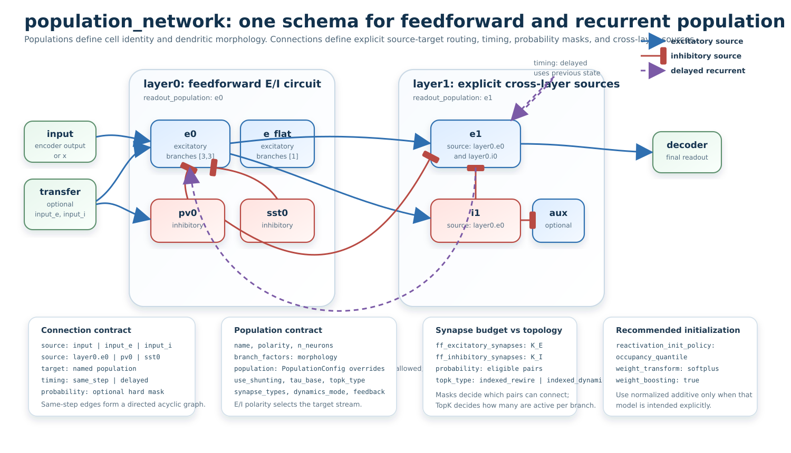
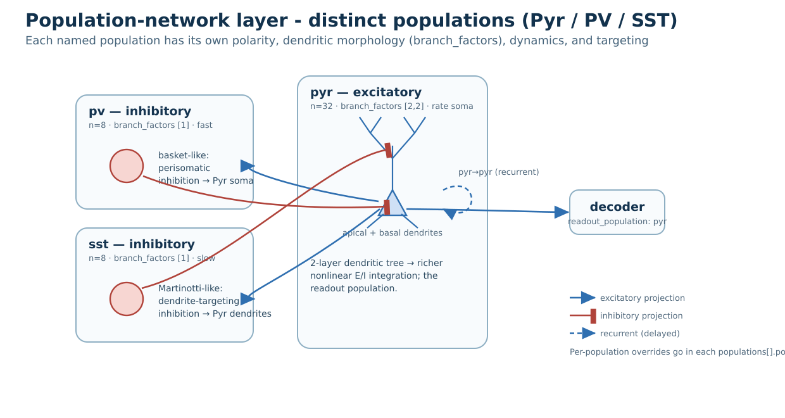
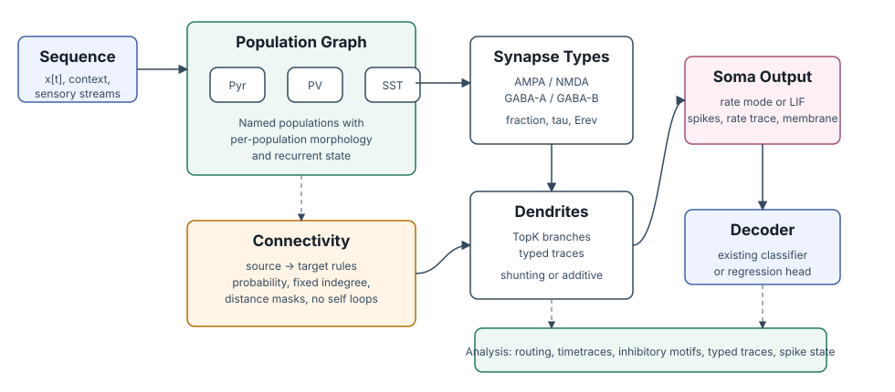

.. _population-networks:

Population networks
===================

A population network (``model.core.type: population_network``) builds the
model core from ordered layers of named dendritic populations that are joined
by explicit, directed connections. The same notation describes a single
feedforward E/I layer, several cell classes with their own morphologies,
multilayer routing and recurrent microcircuits. This page covers the schema,
the connection rules, every population option and the timing controls.
Receptor kinetics, spiking somata, dendritic spikes and soma-to-dendrite
feedback are described in :doc:`temporal_dynamics`.

Layers, populations and connections
-----------------------------------

A population-network core reads only ``model.core.population_network``, apart
from ``model.core.type``, ``model.core.initialization_seed`` and
``model.core.biological_neuron`` (see :ref:`biological-constraints`). Any other
``model.core`` section written with a non-default value, for example
``model.core.morphology`` or ``model.core.sparsity``, raises when the
configuration loads; the corresponding settings are population options (see
:ref:`population-options`). The network has four kinds of parts:

``layers[]``
   Layers run in order. Each layer contains populations and the connections
   into them, and outputs the activity of its readout population.

``layers[].populations[]``
   Named groups of dendritic neurons. Each population has a polarity
   (``excitatory`` or ``inhibitory``), a number of neurons and a dendritic
   morphology (``branch_factors``, see :ref:`dendritic-tree`).

``layers[].connections[]``
   Directed records from a source (the network input, a population of the same
   layer or a population of another layer) to a population of the layer, read
   either in the same timestep or from the previous timestep.

``layers[].population_defaults`` and ``layers[].populations[].population``
   Population options: synapse counts, integration rule, reactivation gates,
   sparse synapse type, time constants and temporal dynamics.

The feedforward E/I layer consists of one inhibitory and one excitatory
population. The input drives both, and the inhibitory population inhibits the
excitatory one:

.. code-block:: yaml

   model:
     core:
       type: population_network
       population_network:
         layers:
           - name: layer0
             readout_population: e
             population_defaults:
               ff_excitatory_synapses: 8
               ff_inhibitory_synapses: 4
             populations:
               - {name: i, polarity: inhibitory, n_neurons: 32, branch_factors: [1]}
               - {name: e, polarity: excitatory, n_neurons: 128, branch_factors: [4, 4]}
             connections:
               - {source: input, target: i}
               - {source: input, target: e}
               - {source: i, target: e}

   A two-layer population network. ``layer0`` holds two excitatory populations
   (``e0`` with ``branch_factors: [3, 3]`` and ``e_flat`` with ``[1]``) and two
   inhibitory populations (``pv0`` and ``sst0``); the network input, or the
   transfer streams ``input_e`` and ``input_i``, drives it. ``layer1`` reads
   ``layer0`` populations through qualified sources. Lines ending in an
   arrowhead are excitatory connections, lines ending in a bar are inhibitory
   connections, and the dashed line is a delayed connection from ``e1`` back to
   ``e0``, which requires ``recurrent: true`` on ``layer0``. The readout
   population of the last layer feeds the decoder. The panels below the
   diagram summarize the connection fields, the population fields and how
   synapse counts and masks combine; the last panel lists settings that several
   examples use, not the defaults.

How a layer computes
~~~~~~~~~~~~~~~~~~~~

Each population has up to four input streams: the same-step streams
``ff_excitatory`` and ``ff_inhibitory``, and the delayed (previous-timestep)
streams ``rec_excitatory`` and ``rec_inhibitory``. A connection adds its source
to one stream of its target: the network input and excitatory populations
enter an excitatory stream, inhibitory populations an inhibitory stream. The
sources of a stream are concatenated, and every dendritic compartment of the
target selects a fixed number of synapses from them, set by
``ff_excitatory_synapses``, ``ff_inhibitory_synapses``,
``rec_excitatory_synapses`` and ``rec_inhibitory_synapses``. The sparse synapse
type (``topk_type``, see :ref:`synapse-variants`) decides how the synapses are
chosen; connection masks decide which source units are eligible.

The populations of a layer run in the order of their same-step connections,
sources before targets. The output of a layer is the output of its readout
population (``readout_population``, by default the first excitatory
population), and the next layer receives it as ``input``. The network output
is the readout population of the readout layer (``readout_layer``, by default
the last layer), which feeds the decoder.

When the configuration loads, the structure of the network is checked: every
layer needs an excitatory population, every population needs at least one
enabled same-step connection into its ``ff_excitatory`` stream, names must be
unique (population names within their layer) and must not contain a dot, and
connection sources, targets, timing, pathways and probabilities must be valid.
The keys and values of layers, populations, connections and population options
are checked when the model is built, so a misspelled key there fails only at
build time. ``dendritic-train config.yaml --validate-only`` builds the model,
datasets and trainer without training and reports these errors early (see
:ref:`strict-loader`).

Several mechanisms restrict or shape the input of a population. They act at
different levels and combine:

.. list-table::
   :header-rows: 1
   :widths: 22 30 48

   * - Mechanism
     - Where it is set
     - What it decides
   * - Population
     - ``layers[].populations[]``
     - Who the neurons are: polarity, number, morphology and options.
   * - Connection
     - ``layers[].connections[]``
     - Which source may drive which population, in which timestep, and an
       optional probability mask over source-target pairs.
   * - Structured connectivity
     - ``structured_connectivity`` population option
     - Masks over individual presynaptic units of a pathway, independent of
       population names (see :ref:`structured-connectivity`).
   * - Receptor (synapse) type
     - ``synapse_types`` population option
     - How the selected excitatory or inhibitory input is filtered in time
       (see :ref:`synapse-types`). It does not create a population.
   * - Soma dynamics
     - ``dynamics_mode`` population option
     - Whether a population emits a rate or spikes (see :ref:`spiking-soma`).

.. _population-connections:

Connections
-----------

Each entry of ``model.core.population_network.layers[].connections`` is one
directed connection into a population of that layer:

.. list-table::
   :header-rows: 1
   :widths: 18 20 62

   * - Field
     - Default
     - Meaning
   * - ``source``
     - ``input``
     - ``input``, ``input_e``, ``input_i``, the name of a population of the
       same layer, or ``layer_name.population_name`` for a population of
       another layer.
   * - ``target``
     - required
     - Name of a population of this layer.
   * - ``timing``
     - ``same_step``
     - ``same_step`` reads the source in the current timestep; ``delayed``
       reads its output from the previous timestep.
   * - ``pathway``
     - from the source
     - Input stream of the target: ``ff_excitatory`` or ``ff_inhibitory`` for
       same-step connections, ``rec_excitatory`` or ``rec_inhibitory`` for
       delayed ones. When omitted, the polarity of the source decides.
   * - ``enabled``
     - ``true``
     - ``false`` removes the connection; it is still checked.
   * - ``probability``
     - ``null`` (all pairs)
     - Probability of each compartment-source pair in a fixed random mask.
       ``p_connect`` is accepted as another name.
   * - ``seed``
     - ``null``
     - Seed of this connection's mask; overrides the layer's
       ``connection_seed``.
   * - ``target_levels``
     - ``null`` (all levels)
     - Dendritic levels of the target that the connection may contact:
       ``soma``, ``primary``, ``distal``, or depths counted from the soma
       (``0`` is the soma).

A connection whose ``source``, ``target``, ``timing`` and ``pathway`` repeat an
earlier connection of the layer raises.

External input streams
~~~~~~~~~~~~~~~~~~~~~~

The first layer reads the network input through three source names:

- Without a transfer layer (``use_transfer: false``, the default) ``input``,
  ``input_e`` and ``input_i`` are the same tensor. ``input`` and ``input_e``
  enter the target's excitatory stream and ``input_i`` its inhibitory stream,
  so a population that reads ``input`` and ``input_i`` receives every input
  channel as both excitation and inhibition.
- With ``use_transfer: true`` the transfer layer turns the input into an
  excitatory and an inhibitory stream (see :ref:`transfer-layer`).
  ``input_e`` is the excitatory stream and ``input_i`` the inhibitory stream;
  ``input`` is the same as ``input_e``.

``input_exc`` and ``input_excitatory`` are accepted for ``input_e``, and
``input_inh`` and ``input_inhibitory`` for ``input_i``. ``input_e`` and
``input_i`` reach only the first layer, and naming them in a later layer
raises. In a later layer, ``input`` is the readout population of the previous
layer, and its synapses take that population's polarity: an inhibitory readout
population drives ``ff_inhibitory`` synapses. External sources cannot use
``timing: delayed``.

This first layer reads independent excitatory and inhibitory halves of a
784-dimensional input:

.. code-block:: yaml

   model:
     core:
       type: population_network
       population_network:
         use_transfer: true
         transfer_params:
           independent_pathways: true
           excitatory_dim: 392
           inhibitory_dim: 392
         layers:
           - name: layer0
             readout_population: e
             populations:
               - {name: i, polarity: inhibitory, n_neurons: 32, branch_factors: [1]}
               - {name: e, polarity: excitatory, n_neurons: 128, branch_factors: [4, 4]}
             connections:
               - {source: input_e, target: i}
               - {source: input_e, target: e}
               - {source: input_i, target: e}
               - {source: i, target: e}

The input passes through three optional stages before it reaches the first
layer, in this order:

1. ``input_transform`` adapts the encoder output: ``identity`` (default),
   ``nonnegative`` (checked identity), ``relu``, or ``signed_split``, which writes the positive and negative parts
   of each feature as separate non-negative channels and doubles the input
   width.
2. The transfer layer (``use_transfer`` and ``transfer_params``).
3. ``input_projection_dims`` adds linear layers, each followed by a ReLU. With
   a transfer layer they project ``input`` and ``input_e`` only; ``input_i``
   keeps the width produced by the transfer layer. Set
   ``input_projection_weight_transform: softplus`` for positive afferent weights;
   the default ``identity`` retains the historical signed Linear layers.
   Positive projections check that their inputs are nonnegative and change
   the model and its initialization (see :ref:`biological-constraints`).

Shunting populations with a positive weight transform treat their input as
non-negative rates. When the first batch shows signed input reaching such a
first-layer population (for example images normalized with
``data.processing.normalize: true``), the network logs a warning once. Use
``input_transform: relu`` or ``signed_split``, a transfer layer with a
non-negative ``output_activation``, ``input_projection_dims``, or
non-normalized data.

Cross-layer sources
~~~~~~~~~~~~~~~~~~~

A source of the form ``layer_name.population_name`` (a qualified source) reads
a population of another layer. Same-step qualified sources must come from
earlier layers. Delayed qualified sources may come from any other layer,
including later layers, and read that population's previous-timestep output;
the target layer must set ``recurrent: true``. A qualified source that names
its own layer raises; use the plain population name instead.

In this excerpt of ``model.core.population_network``, the second layer reads
both populations of the first layer instead of only its readout population:

.. code-block:: yaml

   layers:
     - name: layer0
       readout_population: e0
       populations:
         - {name: i0, polarity: inhibitory, n_neurons: 32, branch_factors: [1]}
         - {name: e0, polarity: excitatory, n_neurons: 128, branch_factors: [3, 3, 3]}
       connections:
         - {source: input, target: i0}
         - {source: input, target: e0}
     - name: layer1
       readout_population: e1
       populations:
         - {name: i1, polarity: inhibitory, n_neurons: 16, branch_factors: [1]}
         - {name: e1, polarity: excitatory, n_neurons: 64, branch_factors: [3, 3, 3]}
       connections:
         - {source: layer0.e0, target: i1}
         - {source: layer0.e0, target: e1}
         - {source: layer0.i0, target: e1}
         - {source: i1, target: e1}

Timing
~~~~~~

Same-step connections between populations of a layer must form a directed
acyclic graph; a cycle such as ``i -> e`` together with ``e -> i`` raises when
the configuration loads. Delayed connections (``timing: delayed``) read the
source's output from the previous timestep, so they may form cycles, including
a population connected to itself. They require ``recurrent: true`` on the
layer, and at the first timestep they read zeros. Mutual E/I interaction is
therefore written as one same-step direction and one delayed direction, or as
two delayed connections.

Pathways and synapse counts
~~~~~~~~~~~~~~~~~~~~~~~~~~~

The ``pathway`` of a connection is the input stream it feeds. It follows the
polarity of the source unless written explicitly, and it must match the
timing. Each compartment of the target selects ``<pathway>_synapses`` contacts
(or the per-level ``<pathway>_synapses_by_level``) from the eligible units of
all sources of that stream. When a mask leaves a compartment fewer eligible
units than this count, the Top-K selection types (``standard``,
``stochastic``, ``variance``, ``dense_to_sparse``) use only the eligible ones,
and the indexed types raise.

Every enabled connection must be able to reach a synapse: its pathway needs a
positive count at a depth the connection targets, where the soma counts only
with ``somatic_synapses: true``. The ``rec_*`` counts default to 0, so a
delayed connection raises, naming the field, until
``rec_excitatory_synapses`` or ``rec_inhibitory_synapses`` is written. A count
written as 0 keeps the connection as a lesion and logs a message. A synapse
count for a stream that no connection feeds is unused.

Probability masks and seeds
~~~~~~~~~~~~~~~~~~~~~~~~~~~

``probability: p`` samples, at each dendritic level, a fixed Boolean mask over
the target's compartments and the source's units, keeping each pair with
probability ``p``. A compartment left without any eligible unit of a source
receives one unit drawn from that source, so a mask never disconnects a
compartment from a source completely. Synapses are then selected only among
the eligible pairs. Masks are sampled once, when the model is built.

The mask of a connection is seeded by its ``seed``, otherwise by the layer's
``connection_seed``, otherwise by 0; ``dendritic-train`` fills an unset
``connection_seed`` from ``experiment.topology_seed`` (see
:ref:`random-seeds`). The seed is offset by the layer, source, target, timing,
pathway, level and shapes, so different connections draw different masks, and
sampling uses its own generator, so it does not change PyTorch's global random
stream.

With ``allow_self_recurrence: false``, a delayed connection from a population
to itself excludes each neuron's own output from its compartments.

Dendritic target levels
~~~~~~~~~~~~~~~~~~~~~~~

``target_levels`` restricts a connection to some depths of the target's
dendritic tree: ``soma`` (depth 0), ``primary`` (the children of the soma,
depth 1), ``distal`` (the outermost level) or explicit depths from the soma.
Synapses at other depths are drawn only from the stream's other sources. Each
depth that has synapses of a stream must be allowed by at least one of that
stream's connections; otherwise the build raises. To leave a depth without
synapses, set its count to 0 with ``*_synapses_by_level``. Contacts that
rewiring replaces are drawn within the same restriction. The microcircuit in
:ref:`population-network-populations` uses ``target_levels`` to separate
soma-targeting from dendrite-targeting inhibition.

Connection masks and structured connectivity
~~~~~~~~~~~~~~~~~~~~~~~~~~~~~~~~~~~~~~~~~~~~

The population option ``structured_connectivity`` applies a structured mask to
a pathway (see :ref:`structured-connectivity`). A stream can also have a
connection mask, because one of its connections sets ``probability`` below 1
or ``target_levels``, or because ``allow_self_recurrence: false`` applies to
it. Both masks then restrict the stream: a compartment receives only contacts
that both allow, and a combination that leaves a compartment without any
allowed input raises. Structured rules that place exact contacts
(``spatial_morphology`` and index manifests) cannot also follow a connection
mask, so combining them with one raises.

List-valued ``probability`` and ``indegree`` of a structured rule are indexed
by the network layer (``layers[i]``), and each layer draws its own seeded
masks. Layer ``0`` draws the masks of earlier versions; before 2026-10-11
every layer used the population's position in its layer for both, so a
population at the same position in each layer read the same list entry and
drew the same mask. Training fills an unset seed of a structured rule from
``experiment.topology_seed`` (since config_version 3; earlier, unseeded masks
drew from the global random stream, which ``seed: global_rng`` keeps; see
:ref:`structured-connectivity`).

.. _population-network-populations:

Named populations
-----------------

Each entry of ``model.core.population_network.layers[].populations`` defines
one named population:

.. list-table::
   :header-rows: 1
   :widths: 18 20 62

   * - Field
     - Default
     - Meaning
   * - ``name``
     - required
     - Name used by ``readout_population``, connections, qualified sources,
       recurrent state and analysis output, for example ``pyr``, ``pv`` or
       ``sst``.
   * - ``polarity``
     - ``excitatory``
     - ``excitatory`` or ``inhibitory``. It decides which stream of a target
       the population's output enters; it is not a receptor type.
   * - ``n_neurons``
     - required
     - Number of neurons (somata).
   * - ``branch_factors``
     - ``[1]``
     - Dendritic morphology, from the soma outward: ``[3, 3]`` gives each
       neuron 3 primary branches with 3 children each (three levels including
       the soma); ``[]`` is a point neuron whose only level is the soma.
   * - ``population``
     - ``{}``
     - Population options for this population only (see
       :ref:`population-options`).

``population_defaults`` is merged into every population of the layer, and the
population's own ``population`` block is merged on top of it (nested mappings
such as ``synapse_types`` are merged key by key). ``n_neurons`` and
``branch_factors`` are set only on the population definition: writing them in
``population_defaults`` or in a ``population`` block raises. When a population
sets ``use_shunting: false`` and no ``reactivation_init_policy``, it uses
``occupancy_quantile`` (see :ref:`gate-initialization`).

Distinct populations can differ in morphology, time constants, synapse counts
and dynamics. A population is a group of neurons, not a receptor mechanism: to
give a population AMPA and NMDA inputs, add receptor types to its options (see
:ref:`synapse-types`) instead of defining a population per receptor.
Populations that differ only in receptor kinetics share their other options
and set different ``synapse_types`` blocks in their ``population`` overrides.

   A layer with three populations. ``pyr`` is the excitatory readout
   population with a two-level dendritic tree; ``pv`` and ``sst`` are
   inhibitory populations with one dendritic compartment per neuron. ``pv``
   inhibits the soma and proximal dendrites of ``pyr``, ``sst`` its distal
   dendrites, and ``pyr`` excites itself through a delayed connection. Lines
   ending in an arrowhead are excitatory, lines ending in a bar inhibitory, and
   the dashed line is delayed. The excitation from ``pyr`` to ``pv`` and
   ``sst`` must be delayed, because same-step connections cannot form a cycle.

The configuration below builds this microcircuit. The ``population`` blocks
give the three populations different dendritic time constants, and
``target_levels`` separates the two kinds of inhibition:

.. code-block:: yaml

   model:
     core:
       type: population_network
       population_network:
         layers:
           - name: microcircuit
             recurrent: true
             readout_population: pyr
             connection_seed: 123
             population_defaults:
               ff_excitatory_synapses: 12
               ff_inhibitory_synapses: 4
               rec_excitatory_synapses: 8
             populations:
               - name: pyr
                 polarity: excitatory
                 n_neurons: 32
                 branch_factors: [2, 2]
                 population: {tau_base: 20.0}
               - name: pv
                 polarity: inhibitory
                 n_neurons: 8
                 branch_factors: [1]
                 population: {tau_base: 5.0}
               - name: sst
                 polarity: inhibitory
                 n_neurons: 8
                 branch_factors: [1]
                 population: {tau_base: 12.0}
             connections:
               - {source: input, target: pyr}
               - {source: input, target: pv}
               - {source: input, target: sst}
               - {source: pv, target: pyr, probability: 0.45, target_levels: [soma, primary]}
               - {source: sst, target: pyr, probability: 0.25, target_levels: [distal]}
               - {source: pyr, target: pyr, timing: delayed, probability: 0.75}
               - {source: pyr, target: pv, timing: delayed}
               - {source: pyr, target: sst, timing: delayed}
   training:
     main:
       strategy: recurrent

The populations ``pv`` and ``sst`` receive no inhibitory input, so their
``ff_inhibitory_synapses`` count is unused.

.. _temporal-constants:

Temporal constants and delays
-----------------------------

A layer steps through time when it sets ``recurrent: true``, when it has a
delayed connection (which requires ``recurrent: true``), or when one of its
populations uses a temporal feature: a spiking soma, receptor synapse types,
dendritic spikes or soma feedback (see :doc:`temporal_dynamics`). The whole
network then processes sequences ``[batch, time, features]``; a
two-dimensional input is treated as a single timestep. ``output_mode: mean``
or ``all`` also makes the network process sequences, with feedforward layers
applied at every timestep.

In a layer that steps through time, every dendritic level ``l`` of a population
keeps leaky traces of its raw synaptic currents ``u`` (the four input streams
and the input from child branches) and computes its voltage from the traces:

.. math::

   x_l(t) = \alpha_l\, x_l(t - \Delta t) + (1 - \alpha_l)\, u_l(t),
   \qquad \alpha_l = e^{-\Delta t / \tau_l} .

Layers that do not step through time compute the voltage from the currents
directly, and the time constants have no effect. Timing has these independent
controls:

``model.core.population_network.layers[].dt``
   The integration step :math:`\Delta t` of every population in the layer
   (default 1.0). A delayed connection always reads the previous step.

``tau_base`` and ``tau_ratio``
   Per-level time constants when ``level_taus`` is empty:
   :math:`\tau_l = \tau_{\text{base}}\, r^{\,n - 1 - l}` for levels
   ``l = 0`` (most distal) to ``n - 1`` (soma). The soma level uses
   ``tau_base`` and each level further out is ``tau_ratio`` times slower. The
   defaults ``tau_base: 50`` and ``tau_ratio: 3`` give ``[450, 150, 50]`` for a
   three-level population; ``tau_base: 20`` and ``tau_ratio: 2`` give
   ``[80, 40, 20]``.

``level_taus``
   Explicit time constants, from the most distal level to the soma. The list
   length must equal the number of levels (``len(branch_factors) + 1``).

``learnable_tau``
   Learns one time constant per level, stored as its logarithm.

``connections[].timing``
   ``delayed`` connections read the source output of the previous step;
   ``same_step`` connections read the current step.

Receptor traces (``synapse_types``), the spiking soma (``spike_tau``,
``spike_readout_tau``) and dendritic plateaus (``dendritic_spike_plateau_tau``)
have their own time constants, which use the same ``dt``; see
:doc:`temporal_dynamics`.

In this excerpt of ``model.core.population_network``, the layer integrates
with a half step, ``pyr`` uses geometric time constants ``[80, 40, 20]``, and
``pv`` sets and learns its own:

.. code-block:: yaml

   layers:
     - name: circuit
       recurrent: true
       dt: 0.5
       readout_population: pyr
       population_defaults:
         ff_excitatory_synapses: 8
         ff_inhibitory_synapses: 2
         rec_excitatory_synapses: 4
         tau_base: 20.0
         tau_ratio: 2.0
       populations:
         - {name: pyr, polarity: excitatory, n_neurons: 32, branch_factors: [2, 2]}
         - name: pv
           polarity: inhibitory
           n_neurons: 8
           branch_factors: [1]
           population: {level_taus: [5.0, 5.0], learnable_tau: true}
       connections:
         - {source: input, target: pyr}
         - {source: input, target: pv}
         - {source: pv, target: pyr}
         - {source: pyr, target: pyr, timing: delayed}
         - {source: pyr, target: pv, timing: delayed}

.. _population-options:

Options reference
-----------------

This section lists every field of a population network: the network fields,
the layer fields and the population options. The connection fields are listed
under :ref:`population-connections` and the population definition fields under
:ref:`population-network-populations`.

Network fields
~~~~~~~~~~~~~~

Fields of ``model.core.population_network``:

.. list-table::
   :header-rows: 1
   :widths: 24 14 16 46

   * - Field
     - Type
     - Default
     - Meaning
   * - ``layers``
     - list
     - required
     - Layer definitions, in order (at least one).
   * - ``input_dim``
     - int
     - encoder output
     - Set from the encoder output dimension; a different written value raises.
   * - ``input_transform``
     - str
     - ``identity``
     - Input adapter: ``identity``, ``relu`` or ``signed_split`` (doubles the
       input width).
   * - ``use_transfer``
     - bool
     - ``false``
     - Split the input into the ``input_e`` and ``input_i`` streams with a
       transfer layer.
   * - ``transfer_params``
     - mapping
     - ``{}``
     - Transfer-layer options (see :ref:`transfer-layer`), including
       ``input_normalization`` (``mode: global_l1`` or ``group_l1`` with
       ``group_ranges``). Options other than seeds require
       ``use_transfer: true``.
   * - ``input_projection_dims``
     - list[int]
     - ``[]``
     - Widths of linear-plus-ReLU layers applied to the input (to ``input_e``
       when a transfer layer is used).
   * - ``input_projection_weight_transform``
     - str
     - ``identity``
     - ``identity`` builds signed Linear projections; ``softplus`` builds
       positive projections with checked nonnegative inputs. Requires nonempty
       ``input_projection_dims`` when set to ``softplus``.
   * - ``readout_layer``
     - str or null
     - last layer
     - Layer whose readout population is the network output.
   * - ``readout_population``
     - str or null
     - ``null``
     - Readout population of the readout layer; it must agree with that
       layer's ``readout_population`` when both are written.
   * - ``output_mode``
     - str
     - ``last``
     - Output of a network that processes sequences: ``last`` (last step, or
       the last valid step of each sequence), ``mean`` (mean over valid steps)
       or ``all`` (every step). See :ref:`temporal-output-mode`.
   * - ``store_routing``
     - bool
     - ``false``
     - Record per-level routing information at every timestep of layers that
       step through time. ``analysis.routing`` enables it by itself.
   * - ``compile_step``
     - bool
     - ``false``
     - Compile each layer with ``torch.compile``. A network that processes
       sequences runs every layer once per timestep, so this mainly speeds up
       recurrent networks; the first steps pay the compilation time. Compiled
       kernels can change results at floating-point rounding level, and random
       draws inside a compiled layer (stochastic synapse selection) differ from
       eager execution. Copies and pickles of the network run the uncompiled
       layers. Shunting populations with ``conductance_dynamic``
       ``topk_gradient_scaling`` or ``blocklinear_gradient_scaling`` reject
       it, because the compiled steps do not apply those gradient scales.

Layer fields
~~~~~~~~~~~~

Fields of ``model.core.population_network.layers[]``:

.. list-table::
   :header-rows: 1
   :widths: 24 14 16 46

   * - Field
     - Type
     - Default
     - Meaning
   * - ``name``
     - str
     - ``layer0``
     - Layer name, used by qualified sources and ``readout_layer``; unique and
       without a dot. Every unnamed layer is called ``layer0``, so name all
       layers of a multilayer network.
   * - ``populations``
     - list
     - required
     - Population definitions (see :ref:`population-network-populations`).
   * - ``connections``
     - list
     - ``[]``
     - Connections into this layer (see :ref:`population-connections`).
   * - ``population_defaults``
     - mapping
     - ``{}``
     - Population options shared by every population of the layer.
   * - ``readout_population``
     - str or null
     - first excitatory population
     - Population whose output is the layer output.
   * - ``recurrent``
     - bool
     - ``false``
     - Step the layer through time and allow delayed connections.
   * - ``dt``
     - float
     - 1.0
     - Integration step of the layer (see :ref:`temporal-constants`).
   * - ``connection_seed``
     - int or null
     - ``null``
     - Seed of the layer's connection masks; ``dendritic-train`` fills it
       from ``experiment.topology_seed``.
   * - ``store_routing``
     - bool
     - ``false``
     - Record routing information for this layer only.

Population options
~~~~~~~~~~~~~~~~~~

Population options are set in
``model.core.population_network.layers[].population_defaults`` for every
population of a layer, or in ``layers[].populations[].population`` for one
population. The tables group them by topic. Several defaults differ from the
corresponding ``model.core`` sections of structured E/I cores
(:doc:`structured_ei_cores`): ``weight_transform`` defaults to ``exp`` here and
to ``softplus`` in ``model.core.morphology``, ``somatic_synapses`` to ``true``
here and to ``false`` there, and ``reactivation_init_m`` to 1.0 here and
``model.core.reactivation.init_m`` to 1.5. Write these options explicitly when
results are compared across the two core families.

**Synapse counts.** Counts are per dendritic compartment. The ``*_by_level``
lists give one count per level, from the most distal level to the soma, and
replace the scalar count when they are not empty.

.. list-table::
   :header-rows: 1
   :widths: 34 12 12 42

   * - Field
     - Type
     - Default
     - Meaning
   * - ``ff_excitatory_synapses``
     - int
     - 8
     - Same-step excitatory synapses per compartment.
   * - ``ff_inhibitory_synapses``
     - int
     - 4
     - Same-step inhibitory synapses per compartment.
   * - ``rec_excitatory_synapses``
     - int
     - 0
     - Delayed excitatory synapses per compartment.
   * - ``rec_inhibitory_synapses``
     - int
     - 0
     - Delayed inhibitory synapses per compartment.
   * - ``ff_excitatory_synapses_by_level``
     - list[int]
     - ``[]``
     - Per-level same-step excitatory counts.
   * - ``ff_inhibitory_synapses_by_level``
     - list[int]
     - ``[]``
     - Per-level same-step inhibitory counts.
   * - ``rec_excitatory_synapses_by_level``
     - list[int]
     - ``[]``
     - Per-level delayed excitatory counts.
   * - ``rec_inhibitory_synapses_by_level``
     - list[int]
     - ``[]``
     - Per-level delayed inhibitory counts.
   * - ``somatic_synapses``
     - bool
     - ``true``
     - The soma level receives synapses directly. With ``false`` the soma
       entries of the counts are ignored, and a point neuron
       (``branch_factors: []``) has no synapses and raises.

**Integration.** See :ref:`integration-modes` for the equations.

.. list-table::
   :header-rows: 1
   :widths: 34 12 12 42

   * - Field
     - Type
     - Default
     - Meaning
   * - ``use_shunting``
     - bool
     - ``true``
     - Shunting (conductance) integration; ``false`` selects additive
       integration.
   * - ``use_additive_normalization``
     - bool
     - ``false``
     - Additive only: normalize the raw additive voltage across the outputs
       of each sample. Requires ``additive_mode: raw``.
   * - ``additive_mode``
     - str
     - ``raw``
     - Additive rule: ``raw``, ``conductance_normalized``,
       ``tangent_matched`` or a rule registered by a plugin.
   * - ``additive_options``
     - mapping
     - ``{}``
     - Options of a rule registered by a plugin
       (:ref:`plugin-additive-rules`).
   * - ``additive_tangent_n0``
     - float or null
     - ``null``
     - Operating-point numerator of ``tangent_matched``; set together with
       ``additive_tangent_t0``.
   * - ``additive_tangent_t0``
     - float or null
     - ``null``
     - Operating-point total conductance of ``tangent_matched``.
   * - ``additive_tangent_n0_by_depth``
     - list[float]
     - ``[]``
     - Per-depth ``n0`` values, from the soma (depth 0) outward; set together
       with ``additive_tangent_t0_by_depth`` and not with the scalar anchors.
   * - ``additive_tangent_t0_by_depth``
     - list[float]
     - ``[]``
     - Per-depth ``t0`` values, from the soma outward.
   * - ``weight_transform``
     - str
     - ``exp``
     - Map from stored parameters to synaptic weights (see
       :ref:`weight-transforms`).
   * - ``leak_conductance``
     - float
     - 1.0
     - Leak conductance in the shunting denominator. Values other than 1
       require shunting, feedforward rate populations (see
       :ref:`conductance-options`).
   * - ``learnable_leak``
     - bool
     - ``false``
     - Learn the leak of every compartment; same restrictions as
       ``leak_conductance``.
   * - ``signal_rounding``
     - str
     - ``none``
     - ``float16`` or ``bfloat16`` rounds dendritic signals and conductances;
       requires shunting ``indexed_release`` synapses in feedforward rate
       populations.
   * - ``epsilon``
     - float
     - 1e-8
     - Constant added to voltage denominators for numerical stability.
   * - ``cross_level_mode``
     - str
     - ``hierarchical``
     - How levels reach the soma: ``hierarchical`` (each level drives its
       parent), ``parallel_readout`` (every non-soma level projects directly
       to the soma) or ``all_active_star`` (child traces stay separate arms
       that are pooled at the soma). The last two require shunting rate
       populations without temporal features and a positive weight transform.
   * - ``autograd_credit_mode``
     - str
     - ``exact``
     - ``soma_broadcast`` keeps the forward pass and replaces each dendritic
       compartment's output derivative by that of its soma; feedforward
       hierarchical rate populations only.

**Reactivation gates.** See :ref:`activation-types` for the gate functions and
:ref:`gate-initialization` for the initialization policies.

.. list-table::
   :header-rows: 1
   :widths: 34 12 12 42

   * - Field
     - Type
     - Default
     - Meaning
   * - ``reactivate``
     - bool
     - ``true``
     - Apply a reactivation gate to every compartment's voltage.
   * - ``reactivation_type``
     - str
     - ``param_tanh``
     - Gate function.
   * - ``reactivation_init_policy``
     - str
     - ``analytical``
     - How the gate slope and midpoint start; ``occupancy_quantile`` when
       ``use_shunting: false`` and the field is not written.
   * - ``reactivation_init_m``
     - float
     - 1.0
     - Start slope, read only by the ``fixed`` policy.
   * - ``reactivation_init_b``
     - float
     - 0.5
     - Start midpoint, read only by the ``fixed`` policy.
   * - ``reactivation_occupancy_quantile_low``
     - float or null
     - ``null`` (0.1)
     - Lower voltage quantile used by occupancy calibration.
   * - ``reactivation_occupancy_quantile_high``
     - float or null
     - ``null`` (0.9)
     - Upper voltage quantile used by occupancy calibration.
   * - ``reactivation_occupancy_target_low``
     - float or null
     - ``null`` (0.1)
     - Gate output targeted at the lower quantile.
   * - ``reactivation_occupancy_target_high``
     - float or null
     - ``null`` (0.9)
     - Gate output targeted at the upper quantile.
   * - ``reactivation_calibration_min_quantile_width``
     - float
     - 0.001
     - Smallest voltage spread between the two quantiles that calibration
       accepts.
   * - ``reactivation_calibration_max_m``
     - float
     - 50.0
     - Largest calibrated slope.
   * - ``reactivation_calibration_revert_on_invalid``
     - bool
     - ``true``
     - Keep the previous gate when a calibration is invalid, instead of
       clamping the fit.
   * - ``reactivation_sigma_aware_k``
     - float
     - 0.25
     - Scale from the robust voltage spread to the slope in the
       ``empirical`` policy.
   * - ``reactivation_gradient_scaling``
     - str
     - ``none``
     - ``straight_through`` passes the gate's output gradient to its input
       during training; shunting populations only.
   * - ``reactivation_memory_efficient``
     - bool
     - ``false``
     - Compute ``param_tanh`` and ``param_tanh_only_m`` gates with a
       memory-saving backward pass (same values); other gate types ignore it.

**Initialization.** See :ref:`synapse-initialization` for the initializers.

.. list-table::
   :header-rows: 1
   :widths: 34 12 12 42

   * - Field
     - Type
     - Default
     - Meaning
   * - ``dbl_init_method``
     - str
     - ``analytical_expectation``
     - Initializer of the dendritic synaptic weights and child couplings.
   * - ``topk_init_method``
     - str
     - ``xavier_normal``
     - Constructor initializer of the sparse weights; ``dbl_init_method``
       overwrites them, so it changes only the discarded draw (and, without
       ``initialization_seed``, later draws of the global random stream).
       ``indexed_rewire`` regrows a contact with the weight of the contact it
       replaces.
   * - ``adaptive_initialization``
     - bool
     - ``true``
     - In the ``analytical_expectation`` initializer, scale the expected
       conductances of large trees down toward
       ``adaptive_target_conductance``.
   * - ``adaptive_initialization_policy``
     - str
     - ``preserve_shunting_center``
     - ``preserve_shunting_center`` keeps the initial shunting voltage while
       scaling; ``legacy_scale`` scales the weight distribution.
   * - ``adaptive_target_conductance``
     - float
     - 5.0
     - Total conductance targeted by the adaptive scaling.
   * - ``initial_child_conductance``
     - float
     - 1.0
     - Mean child-to-parent coupling at initialization; other values require
       ``mechanism_neutral`` or ``fan_in_lognormal`` with a positive weight
       transform.
   * - ``initial_conductance_scale``
     - float
     - 1.0
     - Multiplier of the initial conductances; other values require
       ``fan_in_lognormal``.
   * - ``initial_child_conductance_log_sd``
     - float
     - 0.0
     - Log-normal spread of the child couplings; positive values require
       ``fan_in_lognormal``.
   * - ``initialization_seed``
     - int or null
     - ``null``
     - Seed of the population's initialization streams; ``dendritic-train``
       fills it from ``model.core.initialization_seed``, which defaults to
       ``experiment.model_seed``.
   * - ``initialization_namespace``
     - str
     - ``""``
     - Name of the population's initialization stream; filled as
       ``population_network.<layer>.<population>`` when a seed is set.

**Sparse synapse selection.** ``topk_type`` selects the sparse synapse type of
every synapse bank of the population; :ref:`synapse-variants` lists the types
and their options.

.. list-table::
   :header-rows: 1
   :widths: 34 12 12 42

   * - Field
     - Type
     - Default
     - Meaning
   * - ``topk_type``
     - str
     - ``standard``
     - Sparse synapse type.
   * - ``topk_noise_level``
     - float
     - 0.0
     - Standard deviation of Gaussian noise added to the selection scores
       during training.
   * - ``topk_weight_norm_order``
     - int or null
     - ``null``
     - Divide each output's selected weights by their norm of this order.
   * - ``topk_gamma``
     - float
     - 1.0
     - Scale applied after that normalization.
   * - ``topk_temperature``
     - float
     - 0.5
     - Noise or sampling temperature of stochastic selection
       (``topk_type: stochastic``, ``indexed_selection: stochastic``).
   * - ``topk_ultrafast``
     - bool
     - ``true``
     - Stochastic selection by noisy Top-K (``true``) or by rank-based
       sampling (``false``).
   * - ``topk_variance_score``
     - str
     - ``absolute``
     - Input statistic of ``variance`` selection: ``absolute`` (variance) or
       ``relative`` (variance divided by the second moment).
   * - ``topk_gradient_scaling``
     - str
     - ``none``
     - ``conductance_dynamic`` multiplies synaptic weight gradients by the
       branch's total conductance; shunting populations only.

**Indexed synapses.** These fields apply to the indexed sparse types
(``indexed``, ``indexed_dynamic``, ``indexed_rewire`` and ``indexed_release``).
See :ref:`indexed-backends` for the projection backends.

.. list-table::
   :header-rows: 1
   :widths: 34 12 12 42

   * - Field
     - Type
     - Default
     - Meaning
   * - ``indexed_seed``
     - int or null
     - ``null``
     - Seed of the sampled contacts; ``dendritic-train`` fills it from
       ``experiment.topology_seed``, and each population receives its own
       offset.
   * - ``indexed_candidate_size``
     - int or null
     - ``null``
     - Candidate pool per output of ``indexed_dynamic``; ``null`` uses
       ``min(inputs, 4 K)``.
   * - ``indexed_selection``
     - str
     - ``standard``
     - Selection within the ``indexed_dynamic`` pool: ``standard`` or
       ``stochastic``.
   * - ``indexed_output_chunk_size``
     - int
     - 2048
     - Output rows per chunk of the portable gather; changes memory use only.
   * - ``indexed_rewire_frequency``
     - int
     - 100
     - Optimizer steps between ``indexed_rewire`` rewiring events.
   * - ``indexed_rewire_quantile``
     - float
     - 0.05
     - Fraction of each output's weakest contacts replaced at a rewiring
       event.
   * - ``indexed_rewire_until_step``
     - int or null
     - ``null``
     - Last step at which ``indexed_rewire`` rewires; ``null`` sets no limit.
   * - ``indexed_index_dtype``
     - str
     - ``int64``
     - Storage of contact indices: ``int64``, ``int32`` or ``auto``.
   * - ``indexed_workspace_mb``
     - float or null
     - ``null``
     - Memory budget of the portable gather workspace.
   * - ``indexed_cache_transformed_weights``
     - bool
     - ``false``
     - Transform the weights once per recurrent unroll instead of every step.
   * - ``indexed_recompute_backward``
     - bool
     - ``false``
     - Another spelling of ``indexed_projection_backend: recompute``; cannot
       be combined with other backends.
   * - ``indexed_persistent_indices``
     - bool
     - ``true``
     - Save contact indices in checkpoints; ``false`` regenerates them from
       the seed.
   * - ``indexed_init_mode``
     - str
     - ``per_rank``
     - Contact sampling with data parallelism: ``per_rank`` or
       ``rank0_broadcast``.
   * - ``indexed_projection_backend``
     - str
     - ``eager``
     - Projection kernel of indexed synapses.

**Indexed release.** These fields apply to ``topk_type: indexed_release``; see
:ref:`conductance-options`.

.. list-table::
   :header-rows: 1
   :widths: 34 12 12 42

   * - Field
     - Type
     - Default
     - Meaning
   * - ``release_p_min``
     - float
     - 0.5
     - Lowest release probability.
   * - ``release_p_max``
     - float
     - 1.0
     - Highest release probability.
   * - ``release_weight_scale``
     - float or null
     - ``null``
     - Weight scale of the release curve
       ``p(w) = p_min + (p_max - p_min) w / (w + 0.25 scale)``.
   * - ``release_impact_decay``
     - float
     - 0.99
     - Decay of the running average of contact impact.
   * - ``release_impact_metric``
     - str
     - ``drive``
     - Contact impact statistic: ``drive``, ``active_drive``, ``weight`` or
       ``saliency``.
   * - ``release_max_conductance``
     - float or null
     - ``null``
     - Optional cap on each effective conductance.
   * - ``release_track_source_activity``
     - bool
     - ``false``
     - Track presynaptic activity for activity-aware regrowth.

**Dense-to-sparse schedule.** These fields apply to
``topk_type: dense_to_sparse``, which starts with more active synapses and
reduces them to the configured count.

.. list-table::
   :header-rows: 1
   :widths: 34 12 12 42

   * - Field
     - Type
     - Default
     - Meaning
   * - ``dense_to_sparse_initial_density``
     - float
     - 1.0
     - Fraction of candidate inputs active at the start.
   * - ``dense_to_sparse_initial_k``
     - int or null
     - ``null``
     - Number of active inputs at the start; replaces the density.
   * - ``dense_to_sparse_start_step``
     - int
     - 0
     - Step at which the reduction starts.
   * - ``dense_to_sparse_end_step``
     - int
     - 1000
     - Step at which the target count is reached.
   * - ``dense_to_sparse_update_interval``
     - int
     - 1
     - Steps between updates of the active count.
   * - ``dense_to_sparse_schedule``
     - str
     - ``cubic``
     - Shape of the reduction: ``linear``, ``cubic``, ``cosine`` or ``step``.
   * - ``dense_to_sparse_freeze_on_end``
     - bool
     - ``false``
     - Keep the active set fixed after the end step.
   * - ``dense_to_sparse_advance_on_forward``
     - bool
     - ``true``
     - Advance the schedule once per training forward pass (once per unroll
       in recurrent networks); ``false`` advances it once per optimizer step.
   * - ``dense_to_sparse_prune_metric``
     - str
     - ``weight``
     - Score that decides which inputs stay active: ``weight``,
       ``magnitude``, ``transformed_weight``, ``pre_w`` or ``raw``.

**DeepST.** These fields apply to ``topk_type: deepst`` and ``credit_deepst``;
the ``credit_*`` fields apply to ``credit_deepst`` only.

.. list-table::
   :header-rows: 1
   :widths: 34 12 12 42

   * - Field
     - Type
     - Default
     - Meaning
   * - ``excitatory_target_density``
     - float
     - 0.1
     - Fraction of excitatory inputs connected to each output.
   * - ``inhibitory_target_density``
     - float
     - 0.1
     - Fraction of inhibitory inputs connected to each output.
   * - ``use_noise``
     - bool
     - ``true``
     - Add Gaussian noise to the pruning test.
   * - ``sigma``
     - float
     - 0.05
     - Standard deviation of that noise.
   * - ``rewiring_mode``
     - str
     - ``global``
     - ``global``, ``local`` or ``constant_branch``.
   * - ``rewire_frequency``
     - int
     - 1
     - Optimizer steps between rewiring events.
   * - ``synapses_per_branch``
     - int or null
     - ``null``
     - Not read: ``constant_branch`` keeps each pathway's synapse count
       (``ff_excitatory_synapses``, ...) active per branch. A value other
       than the count of a ``constant_branch`` bank, or any value with
       another rewiring mode or synapse type, raises when the model is built.
   * - ``freeze_excitatory_connectivity``
     - bool
     - ``false``
     - Keep the excitatory contacts fixed.
   * - ``freeze_inhibitory_connectivity``
     - bool
     - ``false``
     - Keep the inhibitory contacts fixed.
   * - ``init_method``
     - str or null
     - ``xavier_normal``
     - Regrowth initializer; ``null`` regrows uniformly, every registered
       method regrows at ``weight_threshold``.
   * - ``weight_threshold``
     - float
     - 1e-6
     - Weight at or below which a contact is pruned.
   * - ``credit_trace_decay``
     - float
     - 0.95
     - Decay of the gradient trace that scores contacts.
   * - ``credit_candidate_pool_size``
     - int
     - 8
     - Inactive candidate contacts observed per branch.
   * - ``credit_turnover_fraction``
     - float
     - 0.1
     - Largest fraction of active contacts replaced per event.
   * - ``credit_weak_active_pool_fraction``
     - float
     - 0.5
     - Fraction of weakest active contacts considered for replacement.
   * - ``credit_min_observations``
     - int
     - 5
     - Observations a candidate needs before it can replace a contact.
   * - ``credit_swap_margin``
     - float
     - 0.0
     - Predicted improvement a swap must exceed.
   * - ``credit_force_turnover``
     - bool
     - ``false``
     - Replace contacts even without a predicted improvement.
   * - ``credit_selection``
     - str
     - ``credit``
     - Swap selection: ``credit``, ``random`` or ``shuffled_credit``.
   * - ``credit_warmup_steps``
     - int
     - 5
     - Steps of recorded credit before swaps start.

**Connectivity.**

.. list-table::
   :header-rows: 1
   :widths: 34 12 12 42

   * - Field
     - Type
     - Default
     - Meaning
   * - ``structured_connectivity``
     - mapping
     - ``{}``
     - Structured masks of the population's pathways (see
       :ref:`structured-connectivity` and the interaction with connection
       masks above).
   * - ``structured_layer_idx``
     - int
     - position in the layer
     - The population's position in its layer, used in the seed offsets and
       index-manifest keys of ``structured_connectivity``.
   * - ``structured_network_layer_idx``
     - int
     - index of the layer
     - The layer's index in the network: list-valued options of
       ``structured_connectivity`` take this entry, and layers after the
       first add it to seed offsets and index-manifest keys.
   * - ``ff_excitatory_pathway``
     - str
     - ``ee``
     - Pathway name of the same-step excitatory synapses in
       ``structured_connectivity``.
   * - ``ff_inhibitory_pathway``
     - str
     - ``ie``
     - Pathway name of the same-step inhibitory synapses.
   * - ``rec_excitatory_pathway``
     - str
     - ``rec_ee``
     - Pathway name of the delayed excitatory synapses.
   * - ``rec_inhibitory_pathway``
     - str
     - ``rec_ie``
     - Pathway name of the delayed inhibitory synapses.
   * - ``allow_self_recurrence``
     - bool
     - ``true``
     - ``false`` excludes each neuron's own output on a delayed connection
       from the population to itself.

**Temporal constants.** See :ref:`temporal-constants`.

.. list-table::
   :header-rows: 1
   :widths: 34 12 12 42

   * - Field
     - Type
     - Default
     - Meaning
   * - ``tau_base``
     - float
     - 50.0
     - Time constant of the soma level when ``level_taus`` is empty.
   * - ``tau_ratio``
     - float
     - 3.0
     - Ratio between the time constants of adjacent levels.
   * - ``level_taus``
     - list[float]
     - ``[]``
     - Explicit time constants, from the most distal level to the soma.
   * - ``learnable_tau``
     - bool
     - ``false``
     - Learn one time constant per level.

**Receptor types and spiking soma.** See :ref:`synapse-types` and
:ref:`spiking-soma`.

.. list-table::
   :header-rows: 1
   :widths: 34 12 12 42

   * - Field
     - Type
     - Default
     - Meaning
   * - ``synapse_types``
     - mapping
     - ``{}``
     - Receptor types of the excitatory and inhibitory inputs; disabled when
       empty.
   * - ``dynamics_mode``
     - str
     - ``rate``
     - Soma output: ``rate`` or ``spike`` (leaky integrate-and-fire).
   * - ``spike_threshold``
     - float
     - 1.0
     - Membrane threshold of a spike.
   * - ``spike_reset``
     - float
     - 0.0
     - Membrane value after a spike.
   * - ``spike_tau``
     - float
     - 20.0
     - Membrane time constant.
   * - ``spike_refractory_steps``
     - int
     - 0
     - Steps after a spike during which the neuron cannot spike.
   * - ``spike_surrogate_beta``
     - float
     - 10.0
     - Steepness of the surrogate gradient.
   * - ``spike_readout``
     - str
     - ``spikes``
     - Population output: ``spikes``, ``rate`` (spike trace) or
       ``membrane``.
   * - ``spike_readout_tau``
     - float
     - 20.0
     - Time constant of the spike trace.

**Dendritic spikes.** See :ref:`dendritic-spikes`.

.. list-table::
   :header-rows: 1
   :widths: 34 12 12 42

   * - Field
     - Type
     - Default
     - Meaning
   * - ``dendritic_spikes_enabled``
     - bool
     - ``false``
     - Enable dendritic spike or plateau events.
   * - ``dendritic_spike_mode``
     - str
     - ``plateau``
     - ``plateau`` (leaky plateau trace) or ``threshold`` (event only).
   * - ``dendritic_spike_levels``
     - str or list[int]
     - ``non_soma``
     - Levels with events: ``non_soma`` or ``all`` (every dendritic level),
       ``distal``, ``proximal``, ``none``, or level indices.
   * - ``dendritic_spike_threshold``
     - float
     - 0.7
     - Branch voltage that triggers an event.
   * - ``dendritic_spike_plateau_amplitude``
     - float
     - 1.0
     - Amplitude of the plateau's effect on the branch output.
   * - ``dendritic_spike_plateau_tau``
     - float
     - 20.0
     - Time constant of the plateau trace.
   * - ``dendritic_spike_refractory_steps``
     - int
     - 0
     - Steps after an event during which the branch cannot fire.
   * - ``dendritic_spike_surrogate_beta``
     - float
     - 10.0
     - Steepness of the surrogate gradient.
   * - ``dendritic_spike_propagation``
     - str
     - ``additive``
     - How the plateau changes the branch output: ``additive``, ``replace``
       or ``gated``.

**Soma feedback.** See :ref:`soma-feedback`.

.. list-table::
   :header-rows: 1
   :widths: 34 12 12 42

   * - Field
     - Type
     - Default
     - Meaning
   * - ``soma_feedback_enabled``
     - bool
     - ``false``
     - Send the previous step's soma signal back to dendritic levels.
   * - ``soma_feedback_mode``
     - str
     - ``additive``
     - ``additive``, ``shunting`` or ``gated``.
   * - ``soma_feedback_source``
     - str
     - ``output``
     - Fed-back signal: ``output``, ``voltage`` or ``spike_readout``.
   * - ``soma_feedback_levels``
     - str or list[int]
     - ``non_soma``
     - Receiving levels: ``non_soma``, ``all`` (including the soma),
       ``distal``, ``proximal``, ``soma``, ``none``, or level indices.
   * - ``soma_feedback_strength``
     - float
     - 0.1
     - Initial strength of the feedback.
   * - ``soma_feedback_learnable_strength``
     - bool
     - ``false``
     - Learn the strength.
   * - ``soma_feedback_per_level``
     - bool
     - ``true``
     - One strength per receiving level instead of one shared strength.
   * - ``soma_feedback_init_std``
     - float
     - 0.0
     - Standard deviation of the initial feedback projection; 0 starts it at
       zero.
   * - ``soma_feedback_reversal``
     - float
     - 1.0
     - Reversal potential of ``shunting`` feedback.

**Implementation.**

.. list-table::
   :header-rows: 1
   :widths: 34 12 12 42

   * - Field
     - Type
     - Default
     - Meaning
   * - ``efficient_blocklinear``
     - bool
     - ``false``
     - Compute the child-to-parent couplings without building the dense
       block-diagonal matrix (same values, less memory).
   * - ``blocklinear_gradient_scaling``
     - str
     - ``none``
     - Gradient scaling of the child-to-parent couplings: ``none``,
       ``conductance_dynamic`` (by the total conductance in shunting
       populations; additive populations divide each child's gradient by its
       coupling weight, see :ref:`BlockLinear gradient scaling
       <blocklinear-gradient-scaling>`) or ``distal_upweight_by_idx`` (by
       level index).
   * - ``print_hooks``
     - bool
     - ``false``
     - Log the activity of the gradient-scaling hooks.

The renamed fields ``topk_strategy``, ``reactivation_strategy`` and
``blocklinear_strategy`` still load, with a warning, as
``topk_gradient_scaling``, ``reactivation_gradient_scaling`` and
``blocklinear_gradient_scaling``.

A population that is stepped through time (in a recurrent layer, or with
synapse types, a spiking soma, dendritic spikes or soma feedback) runs each
branch layer once per time step before one backward pass. Its
``conductance_dynamic`` scales are then registered on the tensors of each
step, so every step's gradients are scaled by that step's scales; with
``topk_gradient_scaling: none`` only the couplings keep their per-step
tensors. A feedforward population applies the scales of its single forward
pass through backward hooks.

Configuration choices
---------------------

The table lists common choices, the library default and what to consider.

.. list-table::
   :header-rows: 1
   :widths: 20 24 56

   * - Choice
     - Default
     - Recommendation
   * - Integration rule
     - ``use_shunting: true``
     - Set ``use_shunting`` per population. For additive populations, set
       ``use_additive_normalization: true`` only when across-output
       normalization of the voltage is part of the model, and choose the
       additive rule with ``additive_mode`` (see :ref:`integration-modes`).
   * - Gate initialization
     - ``analytical`` (``occupancy_quantile`` when ``use_shunting: false``)
     - ``occupancy_quantile`` calibrates each gate's slope and midpoint on
       measured voltages before training, so the gate starts at the operating
       point of the data in every population and depth (see
       :ref:`gate-initialization`).
   * - Positive conductances
     - ``weight_transform: exp``
     - ``softplus`` also keeps conductances positive and grows linearly
       instead of exponentially in the stored parameter. Structured E/I cores
       default to ``softplus``, so write the transform explicitly when the two
       families are compared.
   * - Developmental sparsity
     - ``topk_type: standard``
     - ``dense_to_sparse`` trains with more active synapses at first and
       reduces them to the target count on a schedule.
   * - Multilayer routing
     - ``input`` is the previous readout population
     - Qualified sources (``layer0.e0``, ``layer0.i0``) make cross-layer
       routing explicit and can read several populations of earlier layers.
   * - Recurrence
     - feedforward layers
     - Set ``recurrent: true`` and add ``timing: delayed`` connections; write
       the ``rec_*_synapses`` counts they need.

Because layer, population and connection keys are checked only when the model
is built, run ``dendritic-train config.yaml --validate-only`` after editing a
population network. Sweep axes address population fields by dotted paths with
list indices, for example
``model.core.population_network.layers.0.population_defaults.tau_base`` (see
:ref:`sweeps`).

Components and code map
-----------------------

   The components that act on a population's input, in processing order:
   connections and connectivity masks decide which presynaptic units can
   contact a population, receptor types filter the selected input, the
   dendritic tree integrates it with shunting or additive rules, and the soma
   emits a rate or spikes for the decoder. Analyzers read the intermediate
   signals.

.. list-table::
   :header-rows: 1
   :widths: 34 66

   * - Configuration
     - Implementation
   * - ``model.core.population_network``
     - ``dendritic_modeling.networks.PopulationNetwork``, configured by
       ``PopulationNetworkConfig``. It applies the input adapter
       (``dendritic_modeling.networks.NonNegativeInputAdapter``), the transfer
       layer (``dendritic_modeling.networks.TransferLayer``) and the input
       projection, runs the layers and reduces sequences.
   * - ``layers[]``
     - ``dendritic_modeling.networks.PopulationLayer`` (``PopulationLayerConfig``):
       connection routing, connection masks and the order of same-step
       populations.
   * - ``layers[].populations[]``
     - ``PopulationDefinitionConfig``; one
       ``dendritic_modeling.networks.StatefulDendriNet`` per population,
       configured by ``PopulationConfig``.
   * - ``layers[].connections[]``
     - ``PopulationProjectionConfig``.
   * - ``structured_connectivity``
     - ``dendritic_modeling.networks.architectures.excitation_inhibition.synapse.structured_mask``.
   * - ``topk_type``
     - Sparse synapse classes registered in
       ``dendritic_modeling.networks.architectures.excitation_inhibition.synapse.factory``.
   * - ``synapse_types``
     - ``dendritic_modeling.networks.build_synapse_type_set`` (``SynapseTypeSet``,
       ``SynapseTypeConfig``) and
       ``dendritic_modeling.networks.architectures.recurrent.stateful_typed_dynamics.StatefulTypedDynamicsMixin``.
   * - ``dynamics_mode: spike``
     - ``dendritic_modeling.networks.LIFSoma``.
   * - ``dendritic_spikes_enabled``
     - ``dendritic_modeling.networks.architectures.recurrent.DendriticSpikeDynamics``.
   * - ``soma_feedback_enabled``
     - ``dendritic_modeling.networks.architectures.recurrent.stateful_feedback``.
   * - Sequence interface
     - The protocols ``dendritic_modeling.networks.RecurrentCore`` (the
       sequence interface that recurrent trainers use) and
       ``dendritic_modeling.networks.SteppableRecurrentCore`` (one-step
       populations).

All configuration classes above are importable from
``dendritic_modeling.networks``. Structured and unified E/I cores build the
same ``StatefulDendriNet`` populations from their own configuration sections
(see :doc:`structured_ei_cores`).

Examples
--------

``configs/examples/population_network_feedforward.yaml`` is the smallest
complete training configuration of a population network, and
``configs/examples/population_network_recurrent_pyr_pv_sst.yaml`` a recurrent
microcircuit. The table in :ref:`examples-map` lists every shipped example,
including multilayer, heterogeneous, CIFAR-10, local-learning and temporal
dynamics configurations.
