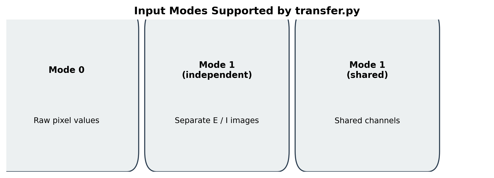

.. _visualization_guide:

Network Visualization Guide
===========================
Overview
--------

This guide provides detailed information on visualizing dendritic networks, their architectures, and training dynamics.
The visualization tools in the dendritic modeling framework allow researchers to gain insights into network behavior,
analyze computational mechanisms, and create publication-quality figures.

Network Architecture Visualizations
-----------------------------------

Excitation-Inhibition Network (EINet)
~~~~~~~~~~~~~~~~~~~~~~~~~~~~~~~~~~~~~

The EINet architecture combines excitatory and inhibitory pathways in a biologically-inspired neural network design.
Key components to visualize include:

* **Excitatory pathways**: Forward-propagating activations
* **Inhibitory pathways**: Regulatory connections that modulate excitatory signals
* **Dendritic branches**: Hierarchical processing units within each layer
* **Sparse connectivity**: Visualizing the TopK connection patterns

.. code-block:: python

    import matplotlib.pyplot as plt
    from dendritic_modeling.plot_utils import plot_einet_params

    # Visualize the network parameters
    plot_einet_params(
        einet=model.net,
        save_root="visualization_outputs/architecture",
        reshape_fn=lambda x: x.view(28, 28),  # For MNIST reshape
        reshape_exc_syn=True,
        logspace=True
    )

Input Transformation Networks
~~~~~~~~~~~~~~~~~~~~~~~~~~~~~

Input transformation networks preprocess data before it enters the dendritic network.
Visualizing these components helps understand how information is transformed and separated
into excitatory and inhibitory pathways.

.. code-block:: python

    # Visualize the input network architecture with excitatory and inhibitory paths
    def visualize_input_network(model, input_example):
        """Create visualization of input transformation network structure"""
        fig, axes = plt.subplots(1, 3, figsize=(15, 5))

        # Original input
        axes[0].imshow(input_example.reshape(28, 28), cmap='gray')
        axes[0].set_title("Original Input")

        # Get transformed inputs
        with torch.no_grad():
            exc_input, inh_input = model.net.input_transform(input_example.unsqueeze(0))

        # Excitatory path output
        exc_img = exc_input[0].cpu().reshape(-1, 1).numpy()
        axes[1].imshow(exc_img, cmap='hot', aspect='auto')
        axes[1].set_title("Excitatory Path Output")

        # Inhibitory path output
        inh_img = inh_input[0].cpu().reshape(-1, 1).numpy()
        axes[2].imshow(inh_img, cmap='cool', aspect='auto')
        axes[2].set_title("Inhibitory Path Output")

        plt.tight_layout()
        return fig

Input Modes Comparison
~~~~~~~~~~~~~~~~~~~~~~

The framework supports different input transformation modes that can be visualized for comparison:

   **Input Modes Comparison**: Visual comparison of different input transformation modes showing how inputs are processed differently in each mode.

* **Mode 0**: Original input directly fed to the network
* **Mode 1**: Same input used for both excitatory and inhibitory pathways
* **Mode 2**: Separate transformation network for excitatory and inhibitory inputs

.. code-block:: python

    # Example code to visualize different input modes
    def compare_input_modes(input_sample):
        """Compare the different input transformation modes"""
        models = [
            create_model(input_mode=0, config=config),
            create_model(input_mode=1, config=config),
            create_model(input_mode=2, config=config)
        ]

        fig, axes = plt.subplots(3, 3, figsize=(12, 12))

        for i, model in enumerate(models):
            # Original input visualization
            axes[i, 0].imshow(input_sample.reshape(28, 28), cmap='gray')
            axes[i, 0].set_title(f"Mode {i}: Original")

            # Get transformed inputs
            with torch.no_grad():
                exc_input, inh_input = get_network_inputs(model, input_sample)

            # Visualize excitatory input
            exc_vis = visualize_tensor(exc_input)
            axes[i, 1].imshow(exc_vis, cmap='hot')
            axes[i, 1].set_title(f"Mode {i}: Excitatory")

            # Visualize inhibitory input
            inh_vis = visualize_tensor(inh_input)
            axes[i, 2].imshow(inh_vis, cmap='cool')
            axes[i, 2].set_title(f"Mode {i}: Inhibitory")

        plt.tight_layout()
        return fig

Training Visualizations
-----------------------

Accuracy and Loss Curves
~~~~~~~~~~~~~~~~~~~~~~~~

The most basic visualization for training is plotting accuracy and loss curves over epochs.

.. code-block:: python

    # Plot accuracy and loss curves
    import matplotlib.pyplot as plt

    def plot_training_metrics(train_losses, val_losses, train_accs, val_accs):
        fig, (ax1, ax2) = plt.subplots(1, 2, figsize=(15, 5))

        # Plot losses
        ax1.plot(train_losses, label='Train Loss')
        ax1.plot(val_losses, label='Validation Loss')
        ax1.set_xlabel('Epochs')
        ax1.set_ylabel('Loss')
        ax1.legend()
        ax1.set_title('Training and Validation Loss')

        # Plot accuracies
        ax2.plot(train_accs, label='Train Accuracy')
        ax2.plot(val_accs, label='Validation Accuracy')
        ax2.set_xlabel('Epochs')
        ax2.set_ylabel('Accuracy')
        ax2.legend()
        ax2.set_title('Training and Validation Accuracy')

        plt.tight_layout()
        return fig

Computational Mechanism Visualizations
--------------------------------------

Branch Activation Patterns
~~~~~~~~~~~~~~~~~~~~~~~~~

Visualize how branches activate for different inputs to understand their specialization.

.. code-block:: python

    # Visualizing branch activation patterns
    from dendritic_modeling.utils import record_branch_activations
    import numpy as np

    def visualize_branch_activations(model, dataset, device='cpu'):
        # Record branch activations for the dataset
        activations, labels = record_branch_activations(model, dataset, device=device)

        # Create average activation maps per class
        n_classes = len(set(labels.tolist()))
        fig, axes = plt.subplots(2, 5, figsize=(15, 6))
        axes = axes.flatten()

        for class_idx in range(n_classes):
            # Get activations for this class
            class_mask = labels == class_idx
            class_activations = activations[class_mask]
            mean_activations = class_activations.mean(dim=0).cpu().numpy()

            # Create heatmap
            im = axes[class_idx].imshow(mean_activations, cmap='viridis')
            axes[class_idx].set_title(f'Class {class_idx}')
            axes[class_idx].set_xlabel('Branches')
            axes[class_idx].set_ylabel('Layers')

        plt.colorbar(im, ax=axes)
        plt.tight_layout()
        return fig

Branch Ablation Analysis
~~~~~~~~~~~~~~~~~~~~~~~

Visualize the impact of ablating individual branches on network performance.

.. code-block:: python

    # Visualizing branch ablation effects
    from dendritic_modeling.utils import analyze_branch_ablation

    def visualize_branch_ablation(model, dataset, device='cpu'):
        # Run branch ablation analysis
        results = analyze_branch_ablation(model, dataset, device=device)

        # Extract results
        branch_importances = results['branch_importances']
        baseline_acc = results['baseline_acc']

        # Visualize branch importances
        fig, ax = plt.subplots(figsize=(10, 6))
        im = ax.imshow(branch_importances, cmap='RdBu_r', aspect='auto')
        ax.set_title('Branch Importance (Accuracy Drop)')
        ax.set_xlabel('Branch Index')
        ax.set_ylabel('Layer Index')
        plt.colorbar(im, ax=ax)

        plt.tight_layout()
        return fig

Layer Ablation Analysis
~~~~~~~~~~~~~~~~~~~~~

Visualize the impact of ablating entire layers on network performance.

.. code-block:: python

    # Visualizing layer ablation effects
    from dendritic_modeling.utils import analyze_layerwise_ablation

    def visualize_layer_ablation(model, dataset, device='cpu'):
        # Run layer ablation analysis
        results = analyze_layerwise_ablation(model, dataset, ablation_mode='direct', device=device)

        # Extract results
        layer_importances = np.array(results['accuracy_drops'])
        baseline_acc = results['baseline_acc']

        # Visualize layer importances
        fig, ax = plt.subplots(figsize=(10, 6))
        bars = ax.bar(range(len(layer_importances)), layer_importances)
        ax.set_title('Layer Importance (Accuracy Drop)')
        ax.set_xlabel('Layer Index')
        ax.set_ylabel('Accuracy Drop')
        ax.set_ylim(0, max(layer_importances) * 1.2)

        # Add value labels
        for bar in bars:
            height = bar.get_height()
            ax.text(bar.get_x() + bar.get_width()/2., height + 0.01,
                   f'{height:.3f}', ha='center', va='bottom')

        plt.tight_layout()
        return fig

Model Weights Visualization
--------------------------

Visualizing model weights helps understand what features different parts of the network have learned.

.. code-block:: python

    from dendritic_modeling.plot_utils import plot_einet_params

    # Visualize weights of the network
    plot_einet_params(
        einet=model.net,
        save_root="visualization_outputs/weights",
        reshape_fn=lambda x: x.view(28, 28),  # For MNIST reshape
        reshape_exc_syn=True,
        logspace=True
    )

Network Activations Visualization
--------------------------------

Visualizing activations helps understand how the network processes different inputs.

.. code-block:: python

    from dendritic_modeling.plot_utils import plot_einet_activations

    # Visualize activations for a batch of inputs
    plot_einet_activations(
        einet=model.net,
        input_list=test_data[:10][0],
        save_root="visualization_outputs/activations",
        save_in_dir=True,
        filename='digit_activations'
    )

Using the Visualization Manager
------------------------------

The framework provides a PlotManager class that can automate many of these visualizations:

.. code-block:: python

    from dendritic_modeling.plotting.managers import PlotManager

    # Create a plot manager
    plot_manager = PlotManager(
        model=model,
        data={'train': train_data, 'valid': valid_data, 'test': test_data},
        save_path="visualization_outputs",
        device='cuda',
        plots=['weights', 'activations', 'branch_info', 'ablation']
    )

    # Generate all plots
    plot_manager.generate_plots()

    # Generate plots for specific epoch
    plot_manager.generate_plots(epoch=10)

Configuration-Based Visualization
--------------------------------

You can also enable visualizations through the configuration system:

.. code-block:: yaml

    visualization:
      enabled: true
      visualize_epochs: [1, 10, 50]  # Epochs at which to visualize
      plots:
        - weights
        - activations
        - branch_info
        - ablation
      parameters:
        save_figures: true
        figure_format: "png"

Recommended Visualization Practices
----------------------------------

1. **Start Simple**: Begin with weights and activation visualizations
2. **Track Progress**: Generate visualizations at multiple epochs to track learning progress
3. **Compare Strategies**: Use similar visualizations when comparing different learning strategies
4. **Interactive Exploration**: Use interactive plots when possible for deeper analysis
5. **Combine with Analysis**: Pair visualizations with quantitative analysis for deeper insights

The visualizations described in this guide help gain insights into how dendritic networks learn and process information differently from traditional neural networks.
