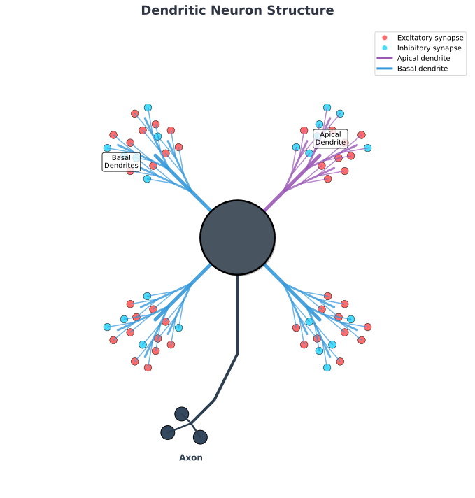

Neuron & Dendrite Model
========================

   Each dendrite executes a local non-linear operation before contributing to the soma.

Computation
-----------
Given excitatory input \(E\) and inhibitory input \(I\) to a branch, the post-synaptic response is

.. math::

   D(E, I) \;=\; \frac{E}{E + I + \varepsilon},

where \(\varepsilon\) prevents division by zero and can be tuned as a learnable parameter.

Implementation
--------------
The class :pyclass:`dendritic_modeling.networks.dendrites.ShuntingDendrite` encapsulates this behaviour.
Key arguments:

* ``nonlinearity`` – optional additional activation after the ratio.
* ``gradient_scaling`` – apply magnitude scaling to stabilise back-prop.
* ``epsilon`` – small constant or learnable tensor.

Morphology
~~~~~~~~~~
Dendrite counts and branch factors per layer are passed when constructing networks:

.. code-block:: python

   ExcitationInhibitionNetwork(
       excitatory_branch_factors=[5, 1],
       inhibitory_branch_factors=[3, 0],
       ...
   )

This gives 5 branches per excitatory neuron in layer 1, one branch in layer 2, etc.

Inspection Utilities
~~~~~~~~~~~~~~~~~~~~
Useful helpers for visualising dendritic behaviour:

* :pyfunc:`dendritic_modeling.plotting.analysis.plot_dendrinet_activations` – branch activations for a Dendrinet model.
* :pyfunc:`dendritic_modeling.plotting.network.plot_branch_weights` – per-branch weight distributions.
* :pyfunc:`dendritic_modeling.plotting.network.plot_branch_gradients` – gradient magnitudes across branches. 