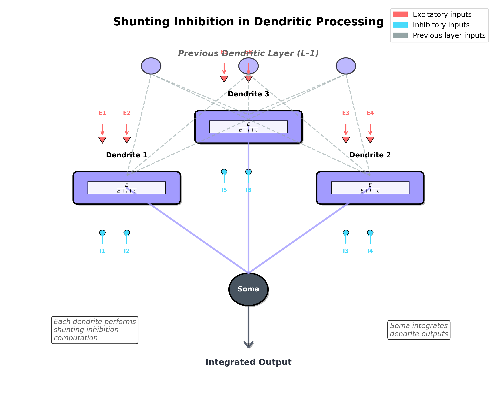

Shunting Inhibition: The Core Computational Mechanism
====================================================

Shunting inhibition represents the fundamental computational principle underlying the Dendritic Modeling Framework. Unlike traditional neural networks that rely on simple weighted summation, our framework implements divisive normalization through the biologically-inspired shunting inhibition mechanism.

   **Shunting Inhibition in Dendritic Processing**: Multiple dendrites receive excitatory and inhibitory inputs, perform local shunting inhibition computation, and integrate at the soma. Each dendrite normalizes its inputs through the E/(E+I+ε) operation.

Mathematical Foundation
----------------------

The core mathematical operation in shunting inhibition is sequential dendritic processing:

.. math::

   V_{d_i} = \frac{E_i + D_{i+1}}{E_i + D_{i+1} + I_i + \epsilon}

where:

- :math:`E_i` represents excitatory inputs to dendrite i
- :math:`I_i` represents inhibitory inputs to dendrite i
- :math:`D_{i+1}` represents the output from the previous dendrite (dendrite i+1)
- :math:`\epsilon` is a small positive constant preventing division by zero
- :math:`V_{d_i} \in [0, 1]` is the normalized output of dendrite i

This creates a sequential processing chain: dendrite_n → dendrite_{n-1} → ... → dendrite_1 → soma.

Properties of Shunting Inhibition
~~~~~~~~~~~~~~~~~~~~~~~~~~~~~~~~~

**Bounded Output**: The shunting inhibition operation naturally bounds outputs between 0 and 1, providing automatic gain control without requiring explicit normalization layers.

**Divisive Normalization**: Unlike subtractive inhibition (E - I), shunting inhibition provides divisive normalization, which is more stable and biologically realistic.

**Gain Control**: The mechanism provides adaptive gain control where strong inhibition reduces the effective gain of excitatory inputs, preventing saturation.

**Contrast Enhancement**: In sensory processing, shunting inhibition enhances contrast by suppressing uniform background activity while preserving signal differences.

Biological Basis
----------------

Shunting inhibition is ubiquitous in biological nervous systems and serves multiple computational functions:

Synaptic Mechanisms
~~~~~~~~~~~~~~~~~~

**GABA-A Receptors**: Fast inhibitory synapses mediated by GABA-A receptors provide chloride conductance that shunts excitatory currents.

**Dendritic Location**: Inhibitory synapses located on dendritic branches can selectively gate excitatory inputs through local shunting.

**Temporal Dynamics**: The temporal overlap of excitatory and inhibitory inputs determines the strength of shunting inhibition.

Neural Circuit Functions
~~~~~~~~~~~~~~~~~~~~~~~

**Lateral Inhibition**: In sensory systems, lateral inhibition through shunting mechanisms enhances edge detection and contrast.

**Gain Control**: Visual cortex neurons use shunting inhibition to adapt their gain based on stimulus contrast and attention.

**Oscillation Control**: Shunting inhibition helps regulate neural oscillations by controlling the excitability of neural populations.

**Homeostatic Regulation**: The mechanism provides homeostatic regulation of neural activity, preventing runaway excitation.

Implementation in the Framework
-------------------------------

The Dendritic Modeling Framework implements shunting inhibition at multiple levels:

Dendritic Level
~~~~~~~~~~~~~~

Each dendritic layer performs sequential shunting inhibition computation:

.. code-block:: python

   class DendriticBranchLayer(nn.Module):
       def __init__(self, output_dim, excitatory_input_dim, inhibitory_input_dim, epsilon=1e-6):
           super().__init__()
           self.excitatory_weights = nn.Parameter(torch.randn(excitatory_input_dim, output_dim))
           self.inhibitory_weights = nn.Parameter(torch.randn(inhibitory_input_dim, output_dim))
           self.epsilon = epsilon
           
       def forward(self, x, inhibitory_input=None, branch_input=None):
           # Compute excitatory activation
           E = torch.matmul(x, self.excitatory_weights)
           
           # Compute inhibitory activation
           I = torch.matmul(inhibitory_input, self.inhibitory_weights) if inhibitory_input is not None else 0
           
           # Include previous dendrite output
           D_prev = branch_input if branch_input is not None else 0
           
           # Apply shunting inhibition: E/(E+I+D_prev+ε)
           numerator = E + D_prev
           denominator = E + D_prev + I + self.epsilon
           output = numerator / denominator
           return output

Network Level
~~~~~~~~~~~~

The framework implements shunting inhibition across network layers:

.. code-block:: python

   from dendritic_modeling.networks import ExcitationInhibitionNetwork
   from dendritic_modeling.config import TransferFunctionParams
   
   # Configure shunting inhibition parameters
   transfer_params = TransferFunctionParams(
       input_mode=0,                    # Direct input mode
       multiplicative=True,             # Enable multiplicative interactions
       shunting_inhibition=True,        # Enable shunting inhibition
       use_shunting=True,              # Apply shunting mechanism
       epsilon=1e-6                     # Small constant for numerical stability
   )
   
   # Create network with shunting inhibition
   network = ExcitationInhibitionNetwork(
       input_dim=784,
       transfer_params=transfer_params.asdict(),
       excitatory_layer_sizes=[128, 64, 10],
       inhibitory_layer_sizes=[64, 32, 0],
       use_shunting=True
   )

Configuration Parameters
~~~~~~~~~~~~~~~~~~~~~~~

The framework provides extensive configuration options for shunting inhibition:

.. code-block:: yaml

   # Configuration example
   model:
     core_network:
       type: EINet
       parameters:
         # Enable shunting inhibition
         use_shunting: true
         
         # Transfer function parameters
         transfer_params:
           input_mode: 0
           multiplicative: true
           shunting_inhibition: true
           epsilon: 1e-6
           
         # Network architecture
         excitatory_layer_sizes: [128, 64, 10]
         inhibitory_layer_sizes: [64, 32, 0]
         
         # Connectivity patterns
         ee_synapses_per_branch_per_layer: [20, 10, 1]
         ei_synapses_per_branch_per_layer: [10, 5, 0]
         ie_synapses_per_branch_per_layer: [5, 3, 0]

Advanced Features
----------------

Input Modes
~~~~~~~~~~~

The framework supports multiple input modes for shunting inhibition:

**Mode 0 (Direct)**: Both excitatory and inhibitory pathways receive the same input:

.. math::

   E_i = \sum_j w_{ij}^E x_j, \quad I_i = \sum_j w_{ij}^I x_j

**Mode 1 (Independent)**: Separate input channels for excitatory and inhibitory pathways:

.. math::

   E_i = \sum_j w_{ij}^E x_j^E, \quad I_i = \sum_j w_{ij}^I x_j^I

**Mode 2 (Shared Preprocessing)**: Shared preprocessing followed by E/I separation:

.. math::

   E_i = f_E(\sum_j w_{ij} x_j), \quad I_i = f_I(\sum_j w_{ij} x_j)

Multiplicative Interactions
~~~~~~~~~~~~~~~~~~~~~~~~~~

The framework supports multiplicative interactions within the shunting inhibition mechanism:

.. math::

   V_{out} = \frac{\sum_i E_i \odot G_i}{\sum_i E_i \odot G_i + \sum_j I_j \odot H_j + \epsilon}

where :math:`G_i` and :math:`H_j` are learned gating functions.

Adaptive Epsilon
~~~~~~~~~~~~~~~

The framework allows for learnable epsilon parameters that adapt during training:

.. code-block:: python

   class AdaptiveShuntingInhibition(nn.Module):
       def __init__(self, input_dim, initial_epsilon=1e-6):
           super().__init__()
           self.epsilon = nn.Parameter(torch.full((input_dim,), initial_epsilon))
           
       def forward(self, E, I):
           # Adaptive epsilon per neuron
           output = E / (E + I + self.epsilon)
           return output

Comparison with Other Mechanisms
-------------------------------

Shunting vs. Subtractive Inhibition
~~~~~~~~~~~~~~~~~~~~~~~~~~~~~~~~~~

.. list-table::
   :header-rows: 1
   :widths: 30 35 35

   * - Aspect
     - Shunting Inhibition (E/(E+I+ε))
     - Subtractive Inhibition (E-I)
   * - Output Range
     - Bounded [0,1]
     - Unbounded
   * - Stability
     - Naturally stable
     - Requires careful tuning
   * - Biological Realism
     - High (GABA-A receptors)
     - Moderate
   * - Gain Control
     - Adaptive
     - Fixed
   * - Computational Cost
     - Slightly higher
     - Lower

Shunting vs. Batch Normalization
~~~~~~~~~~~~~~~~~~~~~~~~~~~~~~~

.. list-table::
   :header-rows: 1
   :widths: 30 35 35

   * - Aspect
     - Shunting Inhibition
     - Batch Normalization
   * - Normalization Type
     - Divisive (per neuron)
     - Standardization (per feature)
   * - Biological Basis
     - Strong
     - None
   * - Local Computation
     - Yes
     - No (requires batch statistics)
   * - Online Learning
     - Suitable
     - Requires adaptation
   * - Interpretability
     - High
     - Low

Performance Characteristics
--------------------------

Training Dynamics
~~~~~~~~~~~~~~~~

Shunting inhibition provides several advantages for training:

**Gradient Stability**: The bounded output range prevents gradient explosion while maintaining non-zero gradients.

**Faster Convergence**: The adaptive gain control mechanism often leads to faster convergence compared to traditional normalization methods.

**Reduced Overfitting**: The natural regularization effect of shunting inhibition helps prevent overfitting.

Computational Efficiency
~~~~~~~~~~~~~~~~~~~~~~~

**Memory Usage**: Shunting inhibition requires separate storage for excitatory and inhibitory weights, increasing memory usage by approximately 2x.

**Computational Overhead**: The division operation adds minimal computational overhead compared to the matrix multiplications.

**Parallelization**: The operation is highly parallelizable across neurons and batches.

Biological Plausibility
~~~~~~~~~~~~~~~~~~~~~~

**Realistic Dynamics**: The mechanism closely matches biological neural dynamics observed in cortical circuits.

**Energy Efficiency**: Similar to biological systems, shunting inhibition provides energy-efficient computation through sparse activity patterns.

**Robustness**: The mechanism provides robustness to noise and perturbations, similar to biological neural networks.

Research Applications
--------------------

The shunting inhibition mechanism has been successfully applied to various research domains:

Computer Vision
~~~~~~~~~~~~~~

- **Edge Detection**: Enhanced contrast detection in visual processing
- **Attention Mechanisms**: Biologically-inspired attention models
- **Object Recognition**: Improved feature extraction in visual recognition tasks

Natural Language Processing
~~~~~~~~~~~~~~~~~~~~~~~~~

- **Sequence Modeling**: Better handling of long-term dependencies
- **Attention Models**: More biologically-plausible attention mechanisms
- **Language Understanding**: Enhanced representation learning

Neuroscience Modeling
~~~~~~~~~~~~~~~~~~~

- **Cortical Circuits**: Realistic modeling of cortical column dynamics
- **Sensory Processing**: Simulation of sensory adaptation mechanisms
- **Pathological Conditions**: Modeling of various neurological disorders

Practical Guidelines
-------------------

Best Practices
~~~~~~~~~~~~~

1. **Epsilon Selection**: Choose epsilon values between 1e-6 and 1e-4 for numerical stability
2. **Learning Rate**: Use slightly lower learning rates for shunting inhibition networks
3. **Initialization**: Initialize excitatory weights larger than inhibitory weights
4. **Monitoring**: Track E/I ratios during training to ensure healthy dynamics

Common Pitfalls
~~~~~~~~~~~~~~

1. **Vanishing Gradients**: Excessive inhibition can lead to vanishing gradients
2. **Numerical Instability**: Very small epsilon values can cause numerical issues
3. **Imbalanced E/I**: Poor initialization can lead to dominated excitation or inhibition
4. **Convergence Issues**: Improper learning rate scheduling can slow convergence

Troubleshooting
~~~~~~~~~~~~~

**Problem**: Network outputs are too small
**Solution**: Increase excitatory weights initialization or decrease inhibitory weights

**Problem**: Training is unstable
**Solution**: Increase epsilon value or use gradient clipping

**Problem**: Poor performance compared to standard networks
**Solution**: Adjust E/I balance and ensure proper hyperparameter tuning

Future Directions
----------------

The shunting inhibition mechanism continues to evolve with ongoing research in:

- **Adaptive Mechanisms**: Self-adjusting epsilon and gain parameters
- **Temporal Dynamics**: Incorporating time-dependent shunting inhibition
- **Hierarchical Processing**: Multi-scale shunting inhibition across network layers
- **Hardware Implementation**: Neuromorphic chip implementations of shunting inhibition

Conclusion
----------

Shunting inhibition represents a fundamental advance in neural network design, providing a biologically-inspired mechanism for divisive normalization and gain control. The Dendritic Modeling Framework's implementation of this mechanism offers researchers and practitioners a powerful tool for building more robust, interpretable, and biologically-plausible neural networks.

The mathematical elegance of the E/(E+I+ε) operation, combined with its biological realism and computational advantages, makes shunting inhibition a compelling alternative to traditional normalization mechanisms in deep learning.

References
----------

.. [1] Torre, V., & Poggio, T. (1978). A synaptic mechanism possibly underlying directional selectivity to motion. Proceedings of the Royal Society of London, 202(1148), 409-416.

.. [2] Carandini, M., & Heeger, D. J. (2012). Normalization as a canonical neural computation. Nature Reviews Neuroscience, 13(1), 51-62.

.. [3] Grossberg, S. (1973). Contour enhancement, short term memory, and constancies in reverberating neural networks. Studies in Applied Mathematics, 52(3), 213-257.

.. [4] Douglas, R. J., & Martin, K. A. (2004). Neuronal circuits of the neocortex. Annual Review of Neuroscience, 27, 419-451. 