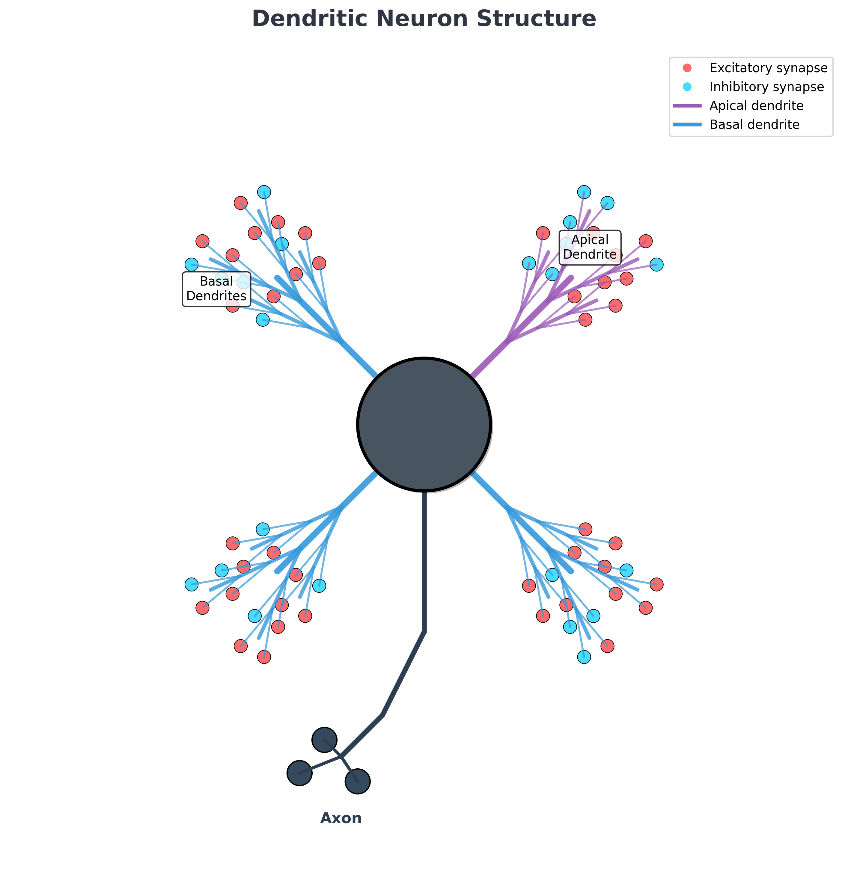

Quick Start Guide
=================

This guide will help you get started with the Dendritic Modeling Framework quickly.

Installation
------------

Install the framework using pip:

.. code-block:: bash

   pip install -e .

Or with development dependencies:

.. code-block:: bash

   pip install -e ".[dev]"

Basic Example
-------------

Here's a simple example training a dendritic network on MNIST:

.. code-block:: python

   import torch
   from torch.utils.data import DataLoader
   from torchvision import datasets, transforms
   
   from dendritic_modeling.models import DendriticClassifier
   from dendritic_modeling.training import Trainer
   
   # Load MNIST dataset
   transform = transforms.Compose([
       transforms.ToTensor(),
       transforms.Normalize((0.1307,), (0.3081,))
   ])
   
   train_dataset = datasets.MNIST('./data', train=True, download=True, transform=transform)
   test_dataset = datasets.MNIST('./data', train=False, transform=transform)
   
   train_loader = DataLoader(train_dataset, batch_size=64, shuffle=True)
   test_loader = DataLoader(test_dataset, batch_size=1000, shuffle=False)
   
   # Create model
   model = DendriticClassifier(
       network_config={
           "name": "ExcitationInhibitionNetwork",
           "params": {
               "input_dim": 784,
               "n_layers": 2,
               "n_excitatory": [100, 10],
               "n_inhibitory": [20, 0],
               "n_branches": [10, 5]
           }
       },
       num_classes=10
   )
   
   # Train model
   trainer = Trainer(max_epochs=10)
   trainer.fit(model, train_loader, test_loader)
   
   # Evaluate
   accuracy = trainer.test(model, test_loader)
   print(f"Test accuracy: {accuracy:.2%}")

Using Configuration Files
-------------------------

For more complex experiments, use YAML configuration files:

**config.yaml:**

.. code-block:: yaml

   experiment:
     name: mnist_dendritic
     seed: 42
   
   data:
     dataset: MNIST
     batch_size: 64
     num_workers: 4
   
   model:
     name: DendriticClassifier
     params:
       network_config:
         name: ExcitationInhibitionNetwork
         params:
           input_dim: 784
           n_layers: 3
           n_excitatory: [200, 100, 10]
           n_inhibitory: [50, 25, 0]
           n_branches: [20, 15, 10]
           connectivity: sparse
           sparsity: 0.2
       
       num_classes: 10
   
   training:
     max_epochs: 50
     optimizer:
       name: Adam
       lr: 0.001
       weight_decay: 0.0001
     
     scheduler:
       name: CosineAnnealingLR
       T_max: 50
   
   logging:
     use_wandb: true
     project: dendritic-modeling

Run with configuration:

.. code-block:: python

   from dendritic_modeling import run_experiment
   
   run_experiment("config.yaml")

Or from command line:

.. code-block:: bash

   python -m dendritic_modeling.train --config config.yaml

Key Concepts
------------

Dendritic Computation
~~~~~~~~~~~~~~~~~~~~~

The core computation in dendritic networks is divisive normalization:

.. math::

   V_{out} = \frac{E}{E + I + \epsilon}

This implements:

- **Gain control**: Response scaling based on context
- **Normalization**: Bounded outputs
- **Competition**: Between excitation and inhibition

Network Architecture
~~~~~~~~~~~~~~~~~~~~

   Basic dendritic neuron with excitatory and inhibitory inputs

E/I Networks
~~~~~~~~~~~~

Multi-layer networks with excitatory and inhibitory populations:

.. code-block:: python

   from dendritic_modeling.networks import ExcitationInhibitionNetwork
   
   network = ExcitationInhibitionNetwork(
       input_dim=784,
       n_layers=3,
       n_excitatory=[200, 100, 10],  # E neurons per layer
       n_inhibitory=[50, 25, 0],      # I neurons per layer
       n_branches=[20, 15, 10]        # Branches per neuron
   )

Common Tasks
------------

Image Classification
~~~~~~~~~~~~~~~~~~~~

.. code-block:: python

   # CNN with dendritic layers
   from dendritic_modeling.models import CNNClassifier
   
   model = CNNClassifier(
       input_channels=3,
       num_classes=10,
       channels=[32, 64, 128],
       n_branches=[10, 8, 6]
   )

Custom Input Transforms
~~~~~~~~~~~~~~~~~~~~~~~

.. code-block:: python

   from dendritic_modeling.networks.input_network import InputNetwork
   
   # Gabor filter preprocessing
   input_net = InputNetwork(
       input_transform_name="gabor",
       n_orientations=8,
       n_scales=4
   )
   
   # Use with model
   model = DendriticClassifier(
       input_network=input_net,
       network_config={...}
   )

Analyzing Trained Models
~~~~~~~~~~~~~~~~~~~~~~~~

.. code-block:: python

   from dendritic_modeling.analysis import (
       AblationAnalyzer,
       InformationAnalyzer,
       BranchActivationAnalyzer
   )
   
   # Ablation analysis
   ablation = AblationAnalyzer()
   results = ablation.analyze(model, test_dataset)
   
   # Information analysis
   info = InformationAnalyzer()
   mi_results = info.analyze(model, test_dataset)
   
   # Branch activation patterns
   activation = BranchActivationAnalyzer()
   patterns = activation.analyze(model, test_dataset)

Visualization
~~~~~~~~~~~~~

.. code-block:: python

   from dendritic_modeling.plotting import (
       plot_weight_distributions,
       plot_branch_activations,
       plot_ei_balance
   )
   
   # Visualize learned weights
   plot_weight_distributions(model)
   
   # Show activation patterns
   plot_branch_activations(model, sample_input)
   
   # E/I balance over training
   plot_ei_balance(training_history)

Next Steps
----------

- :doc:`tutorials/index` - Detailed tutorials
- :doc:`/user_guide/index` - User guide
- :doc:`/api/index` - API reference
- :doc:`/examples/index` - Example scripts

Tips for Success
----------------

1. **Start Simple**: Begin with small networks and gradually increase complexity
2. **Monitor E/I Balance**: Use tensorboard/wandb to track E/I ratios
3. **Regularization**: Apply sparsity constraints for biological plausibility
4. **Hyperparameters**: Key parameters are n_branches, E/I ratios, and connectivity
5. **Initialization**: Proper weight initialization is crucial for convergence

Common Issues
-------------

**Numerical Instability**
   Increase epsilon value or use gradient clipping

**Poor Convergence**
   Check E/I balance, reduce learning rate, or adjust branch numbers

**Memory Issues**
   Reduce batch size or use sparse connectivity

**Slow Training**
   Enable mixed precision training or reduce number of branches

Getting Help
------------

- GitHub Issues: Report bugs or request features
- Documentation: Full guides and API reference
- Examples: Working code examples in ``examples/`` directory
