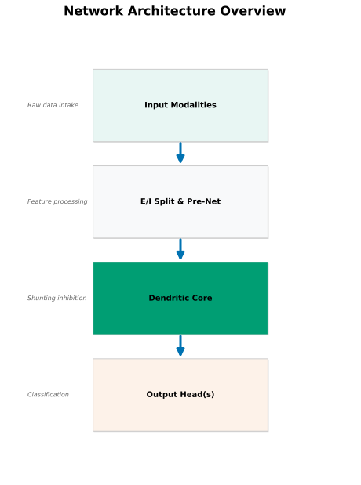

Overview
========

   High-level architecture of the Dendritic Modeling Framework. A multi-dendrite neuron performs local shunting-inhibition computation before somatic integration; layers organise excitatory and inhibitory populations following Dale’s principle; full networks stack these layers for end-to-end learning.

Motivation
----------
Modern deep-learning models excel at pattern recognition but diverge from the biophysics of real neurons.  The Dendritic Modeling Framework bridges this gap by:

* Embedding dendritic processing and shunting-inhibition directly into PyTorch modules.
* Preserving biological constraints such as Dale’s principle and realistic sparsity.
* Providing tooling to analyse biological plausibility and machine-learning performance side-by-side.

Key Biological Principles
-------------------------
1. **Shunting Inhibition** – Divisive normalisation \(\frac{E}{E+I+\varepsilon}\) offers gain control and dynamic-range adaptation.
2. **Dendritic Integration** – Local non-linear computations occur on branch tips before contributing to the soma.
3. **Dale’s Principle** – Neurons are either purely excitatory or inhibitory, enforced throughout the network.

Framework Layers
-----------------
Neuron   →  Layer   →  Network   →  Model

* **Neuron** – Multi-dendrite computation, morphology configurable.
* **Layer** – Organises E/I populations, internal I→E inhibition.
* **Network** – Stacks layers; supports MLP, CNN, Vision Transformers, etc.
* **Model** – Adds task-specific heads (classification, regression) and training utilities.

Why Use This Framework?
-----------------------
* **Research** – Explore hypotheses about dendritic computation at scale.
* **Performance** – Leverage biologically-inspired inductive biases for improved generalisation.
* **Interpretability** – Inspect dendrite activations, analyse synaptic sparsity, and visualise information flow.

Next Steps
----------
Continue with :doc:`quick_start` to install the package and train your first dendritic network. 