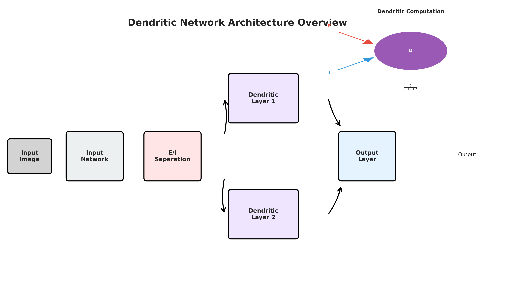
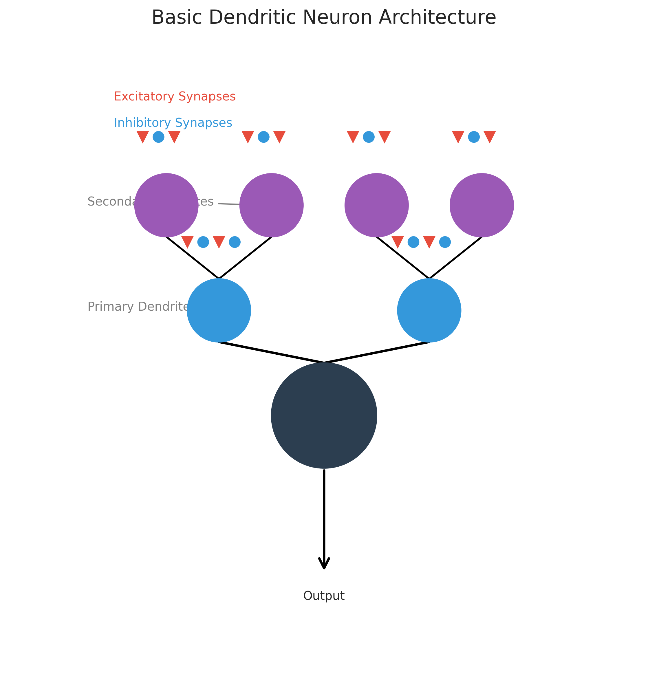
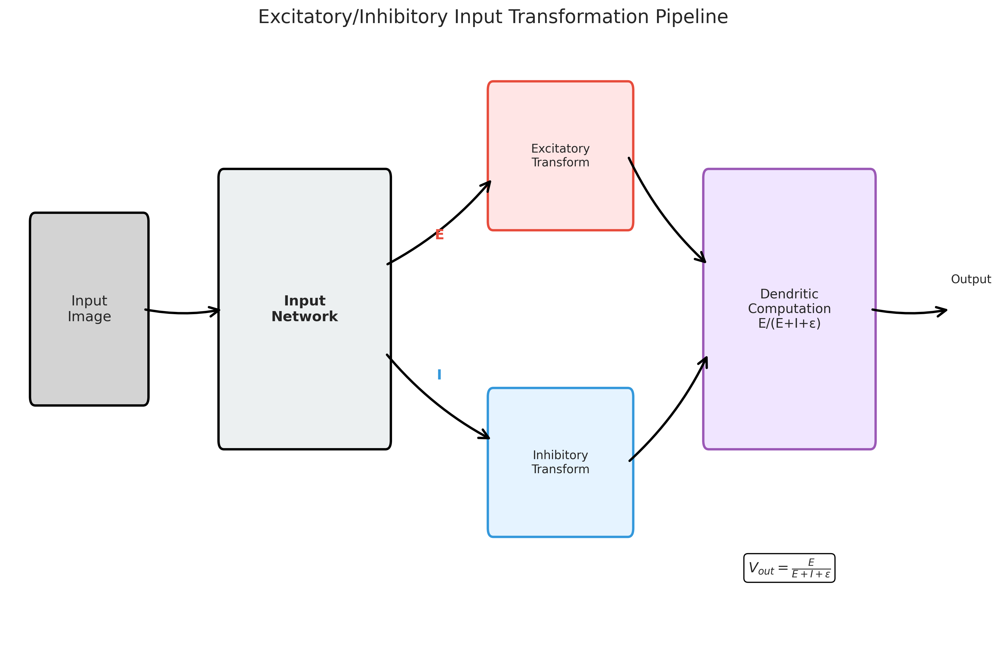
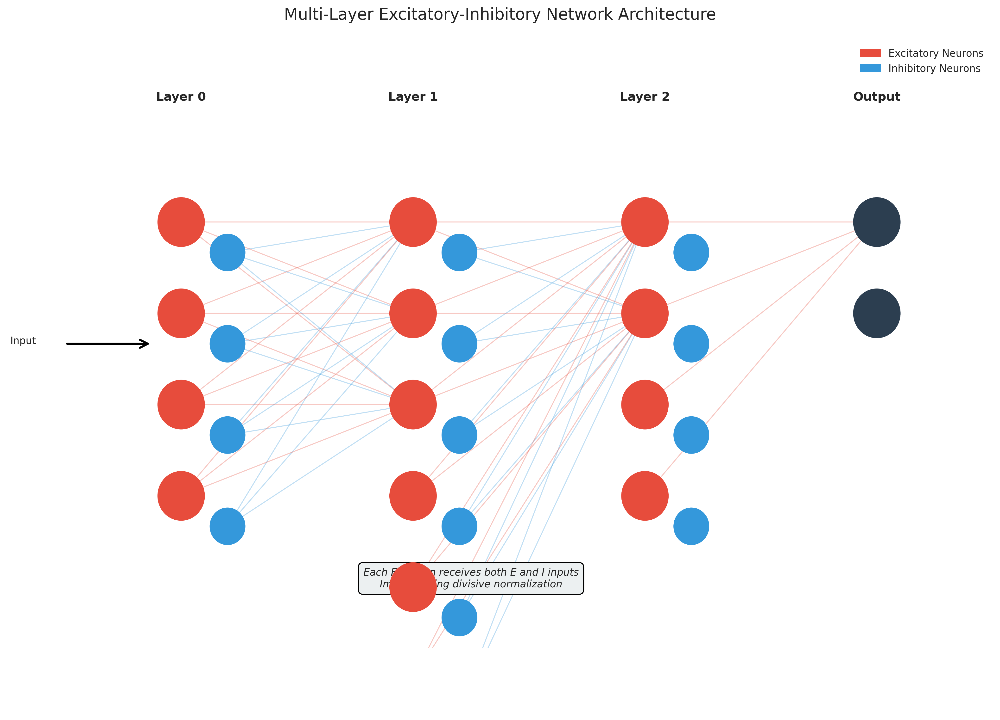
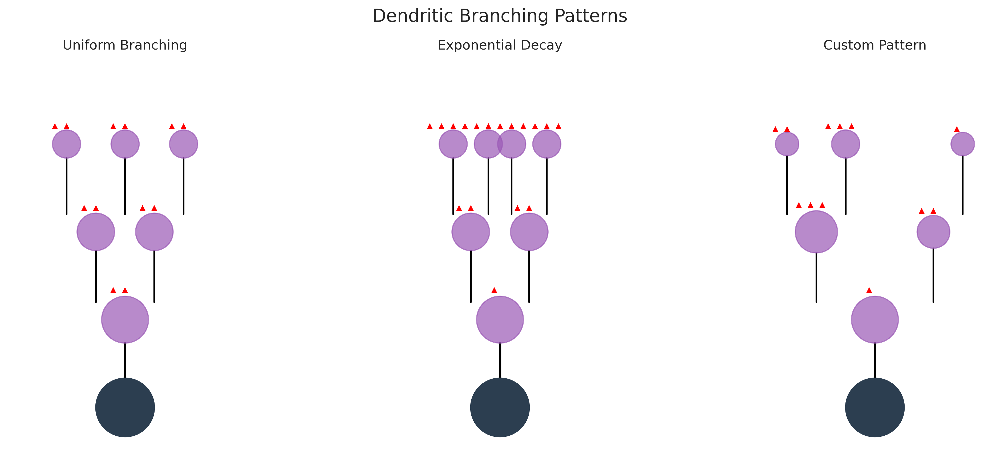
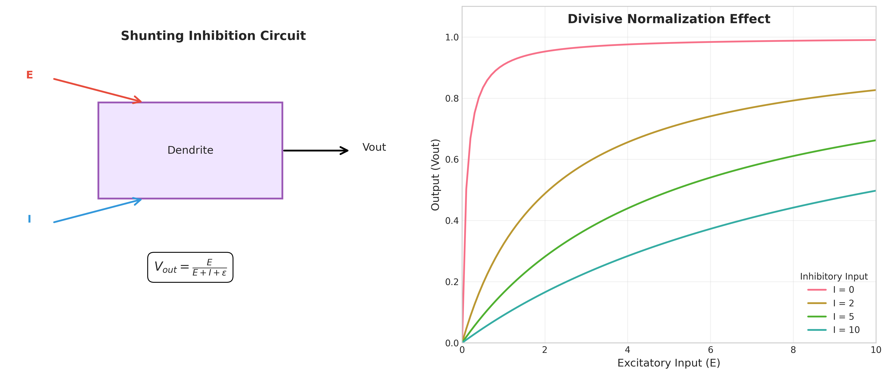

Architecture Overview
====================

The Dendritic Modeling Framework implements biologically-inspired neural networks with dendritic computation based on shunting inhibition (divisive normalization). This guide provides a comprehensive overview of the architecture and its components.

   Complete overview of the dendritic network architecture showing the flow from input images through E/I separation to multi-layer dendritic computation.

Core Concepts
-------------

Dendritic Neurons
~~~~~~~~~~~~~~~~~

At the heart of our framework are dendritic neurons that implement divisive normalization through shunting inhibition:

   Basic dendritic neuron architecture showing primary and secondary dendrites with excitatory (red triangles) and inhibitory (blue circles) synaptic inputs.

Each dendritic branch computes:

.. math::

   V_{out} = \frac{E}{E + I + \epsilon}

where:

- **E**: Excitatory input
- **I**: Inhibitory input  
- **ε**: Small constant for numerical stability

This divisive normalization implements gain control and response normalization observed in biological neurons.

Excitatory/Inhibitory Input Transformation
~~~~~~~~~~~~~~~~~~~~~~~~~~~~~~~~~~~~~~~~~~~

Input images are transformed into separate excitatory and inhibitory pathways:

   The input transformation pipeline showing how images are processed through an input network to generate separate excitatory and inhibitory inputs for dendritic computation.

The transformation pipeline consists of:

1. **Input Network**: Processes raw images (can be identity, convolutional, or custom)
2. **E/I Separation**: Splits processed inputs into excitatory and inhibitory channels
3. **Dendritic Computation**: Applies divisive normalization

Multi-Layer Networks
~~~~~~~~~~~~~~~~~~~~

The framework supports multi-layer architectures with both excitatory and inhibitory neuron populations:

   Multi-layer excitatory-inhibitory network showing how E and I populations interact across layers to implement complex computations.

Key features:

- Each layer contains both E and I populations
- E neurons receive inputs from both E and I neurons of previous layer
- Implements recurrent E/I balance
- Output layer typically contains only E neurons

Network Components
------------------

Input Networks
~~~~~~~~~~~~~~

Input networks transform raw data into formats suitable for dendritic processing:

.. code-block:: python

   from dendritic_modeling.networks.input_network import InputNetwork
   
   # Identity transformation
   input_net = InputNetwork(input_transform_name="identity")
   
   # Convolutional preprocessing
   input_net = InputNetwork(
       input_transform_name="conv2d",
       input_shape=(1, 28, 28),
       output_channels=32
   )

Supported input transforms:

- ``identity``: Direct pass-through
- ``conv2d``: Convolutional preprocessing
- ``mlp``: Fully connected preprocessing
- ``gabor``: Gabor filter banks
- ``dog``: Difference of Gaussians

Dendritic Layers
~~~~~~~~~~~~~~~~

The core computational unit implementing shunting inhibition:

.. code-block:: python

   from dendritic_modeling.networks.layers import DendriticLayer
   
   layer = DendriticLayer(
       n_branches=100,
       input_dim=784,
       n_neurons=10,
       connectivity="full"
   )

Key parameters:

- ``n_branches``: Number of dendritic branches per neuron
- ``input_dim``: Dimension of input
- ``n_neurons``: Number of neurons in layer
- ``connectivity``: Connection pattern (``"full"``, ``"sparse"``, ``"local"``)

E/I Networks
~~~~~~~~~~~~

Complete excitatory-inhibitory networks:

.. code-block:: python

   from dendritic_modeling.networks import ExcitationInhibitionNetwork
   
   ei_net = ExcitationInhibitionNetwork(
       input_dim=784,
       n_layers=3,
       n_excitatory=[100, 50, 10],
       n_inhibitory=[20, 10, 0],
       n_branches=[10, 8, 5]
   )

Branching Patterns
------------------

The framework supports various dendritic branching patterns:

   Different dendritic branching patterns: uniform (equal branches per level), exponential decay (decreasing branches), and custom patterns.

Configure branching with:

.. code-block:: python

   # Uniform branching
   branch_config = {
       "pattern": "uniform",
       "n_levels": 3,
       "branches_per_level": 4
   }
   
   # Exponential decay
   branch_config = {
       "pattern": "exponential",
       "n_levels": 3,
       "decay_rate": 0.5
   }

Shunting Inhibition
-------------------

The biological basis of our computation:

   Left: Circuit diagram of shunting inhibition. Right: Effect of varying inhibitory input on the input-output relationship.

Shunting inhibition provides:

- **Gain control**: Inhibition scales the response
- **Normalization**: Output bounded between 0 and 1
- **Contrast enhancement**: Improves signal discrimination
- **Noise suppression**: Reduces impact of weak inputs

Implementation Details
----------------------

Network Architecture Classes
~~~~~~~~~~~~~~~~~~~~~~~~~~~~

The framework provides several architecture classes:

1. **DendriticNetwork**: Basic dendritic network
2. **ExcitationInhibitionNetwork**: E/I balanced network
3. **DendriticCNN**: CNN with dendritic layers
4. **ViT_Dendrite**: Vision Transformer with dendritic attention

Model Wrappers
~~~~~~~~~~~~~~

Models are wrapped for consistent interface:

.. code-block:: python

   from dendritic_modeling.models import DendriticModel
   
   model = DendriticModel(
       network_name="ExcitationInhibitionNetwork",
       network_params={
           "input_dim": 784,
           "n_layers": 2,
           "n_excitatory": [100, 10],
           "n_inhibitory": [20, 0]
       }
   )

Training Strategies
~~~~~~~~~~~~~~~~~~~

Specialized training strategies for dendritic networks:

.. code-block:: python

   from dendritic_modeling.training.strategies import DendriticTrainingStrategy
   
   strategy = DendriticTrainingStrategy(
       scale_e_weights=True,
       scale_i_weights=True,
       balance_ei_ratio=True,
       sparsity_penalty=0.01
   )

Best Practices
--------------

1. **E/I Balance**: Maintain reasonable ratios between excitatory and inhibitory populations
2. **Branch Scaling**: More branches provide greater expressivity but increase computation
3. **Connectivity**: Start with full connectivity, then experiment with sparse patterns
4. **Initialization**: Use proper weight initialization for E and I pathways
5. **Regularization**: Apply sparsity constraints to encourage efficient representations

Example Configuration
---------------------

Complete example configuration:

.. code-block:: yaml

   model:
     name: ExcitationInhibitionNetwork
     params:
       input_dim: 784
       n_layers: 3
       n_excitatory: [200, 100, 10]
       n_inhibitory: [50, 25, 0]
       n_branches: [20, 15, 10]
       connectivity: "sparse"
       sparsity: 0.2
       
   input_network:
     name: conv2d
     params:
       in_channels: 1
       out_channels: 32
       kernel_size: 5
       
   training:
     strategy: "dendritic"
     scale_weights: true
     balance_ei: true
     sparsity_penalty: 0.01

See Also
--------

- :doc:`/api/networks` - Detailed API documentation
- :doc:`/advanced/network_structures/index` - Advanced network configurations  
- :doc:`/getting_started/quickstart` - Getting started guide 