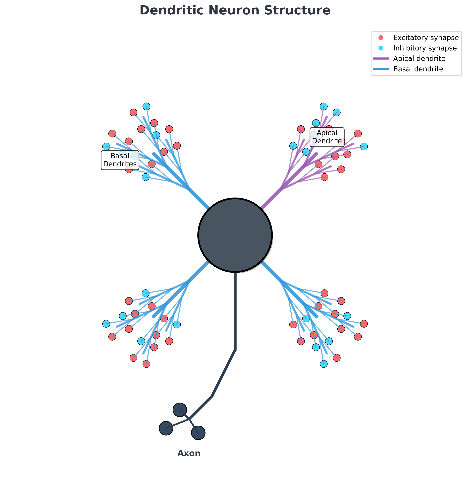
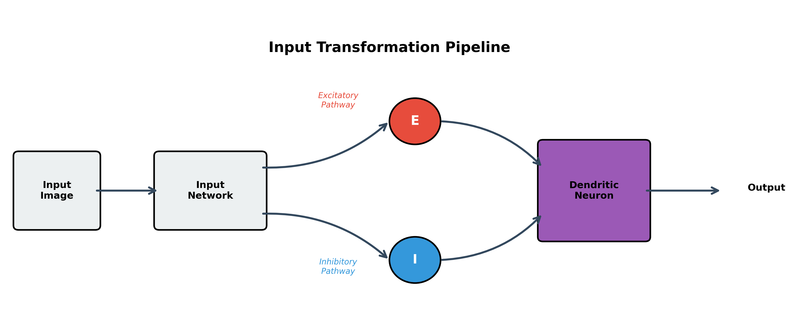

Architecture Overview
===================

The dendritic modeling framework implements biologically-inspired neural networks based on dendritic computation with shunting inhibition. This architecture enables neurons to perform divisive normalization through the interaction of excitatory and inhibitory inputs.

Core Concepts
------------

Dendritic Neuron Model
~~~~~~~~~~~~~~~~~~~~~

The fundamental computational unit in our framework is the dendritic neuron, which implements shunting inhibition (divisive normalization):

   **Basic Dendritic Neuron**: Shows excitatory (red triangles) and inhibitory (blue circles) synaptic inputs arriving at dendritic branches. Each dendrite performs divisive normalization computation locally, and the soma integrates the processed outputs from all dendrites.

Each neuron computes its output using the formula:

.. math::

   V_{out} = \frac{E}{E + I + \epsilon}

where:
- :math:`E` is the sum of excitatory inputs
- :math:`I` is the sum of inhibitory inputs  
- :math:`\epsilon` is a small constant for numerical stability

Shunting Inhibition Mechanism
~~~~~~~~~~~~~~~~~~~~~~~~~~~~

Shunting inhibition provides a biologically plausible mechanism for gain control and normalization:

.. figure:: ../../_static/shunting_inhibition_diagram.png
   :align: center
   :width: 800px
   :alt: Shunting inhibition mechanism

   **Shunting Inhibition in Dendritic Processing**: Shows how dendrites perform shunting inhibition computation. Each dendrite receives excitatory and inhibitory synaptic inputs and computes the divisive normalization locally. Dendrites can also receive inputs from previous dendritic layers. The soma integrates the processed outputs from all dendrites.

Network Architecture
-------------------

Input Transformation Pipeline
~~~~~~~~~~~~~~~~~~~~~~~~~~~~

The framework processes inputs through a specialized pipeline that separates excitatory and inhibitory pathways:

   **Input Transformation**: Input images are processed through an input network that generates separate excitatory and inhibitory signals, which then feed into dendritic neurons implementing divisive normalization.

Multi-Layer Networks
~~~~~~~~~~~~~~~~~~~

Complex computations are achieved by stacking multiple layers of E/I neurons:

.. figure:: ../../_static/multilayer_ei_network.png
   :align: center
   :width: 800px
   :alt: Multi-layer E/I network

   **Multi-Layer E/I Network**: Shows how excitatory (red) and inhibitory (blue) neurons are organized in layers. Each E neuron implements the divisive normalization computation. Connections show feedforward excitation and lateral inhibition patterns.

Complete Architecture Flow
~~~~~~~~~~~~~~~~~~~~~~~~~

The complete network architecture integrates all components:

.. figure:: ../../_static/network_architecture_overview.png
   :align: center
   :width: 1000px
   :alt: Network architecture overview

   **Complete Architecture**: Shows the full pipeline from input through the input network, E/I separation, multiple dendritic layers, to final output. Each layer implements the core divisive normalization computation.

Computation Flow
~~~~~~~~~~~~~~~

The dendritic computation flow shows how synaptic inputs are processed:

.. figure:: ../../_static/dendritic_computation_flow.png
   :align: center
   :width: 700px
   :alt: Dendritic computation flow

   **Computation Flow**: Illustrates how multiple excitatory and inhibitory synaptic inputs are received by dendrites, summed separately at each dendrite, and then combined through shunting inhibition division to produce each dendrite's output voltage.

Implementation Details
--------------------

Key Classes
~~~~~~~~~~

The framework provides several key classes for building dendritic networks:

1. **DendriticLayer**: Base class for layers implementing dendritic computation
2. **ExcitatoryInhibitoryLayer**: Implements E/I separation and processing
3. **InputTransformNetwork**: Converts inputs into E/I signals
4. **DendriticMLP**: Multi-layer perceptron with dendritic neurons

Example Usage
~~~~~~~~~~~~

Here's a simple example of creating a dendritic network:

.. code-block:: python

   import torch
   from dendritic_modeling.networks.architectures import DendriticMLP
   
   # Create a 3-layer dendritic network
   model = DendriticMLP(
       input_size=784,
       hidden_sizes=[128, 64],
       output_size=10,
       activation='relu',
       use_dendritic=True
   )
   
   # Forward pass
   x = torch.randn(32, 784)  # batch of 32 images
   output = model(x)

Biological Inspiration
--------------------

The architecture is inspired by several biological principles:

1. **Dendritic Integration**: Real neurons integrate inputs on their dendritic trees
2. **Shunting Inhibition**: A common mechanism in the brain for gain control
3. **E/I Balance**: The balance between excitation and inhibition is crucial for neural computation
4. **Divisive Normalization**: A canonical computation in sensory systems

Applications
-----------

This architecture is particularly well-suited for:

- Modeling visual neuron responses (simple cells, complex cells)
- Implementing biologically plausible CNNs
- Studying normalization mechanisms in neural networks
- Building interpretable models with clear computational principles

Next Steps
---------

- :doc:`../getting_started/quickstart` - Get started with the framework
- :doc:`../api/networks` - Detailed API documentation
- :doc:`../advanced/configuration/index` - Advanced configuration options 