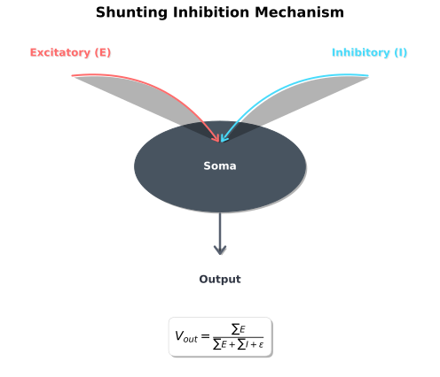
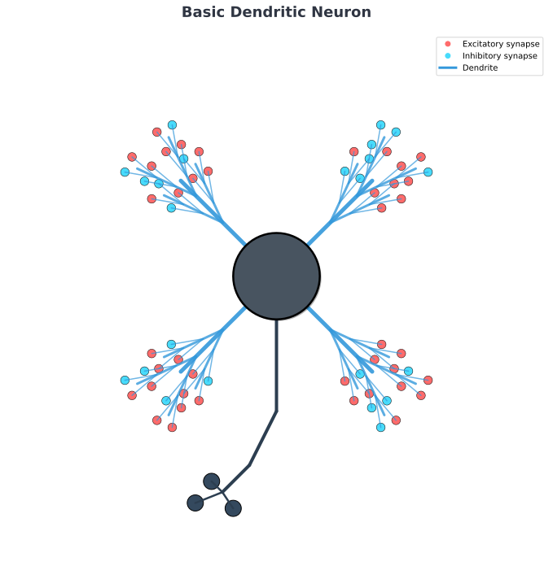
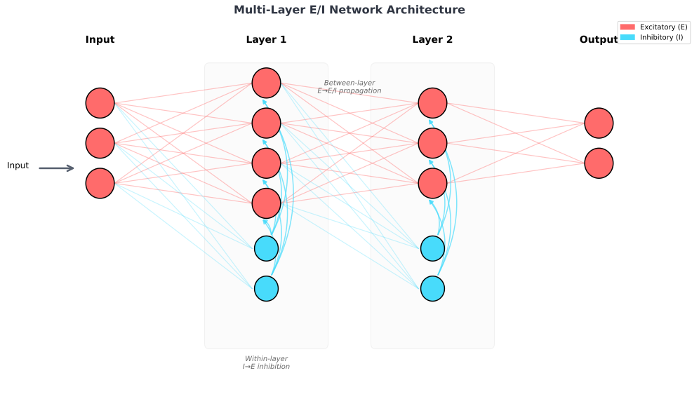
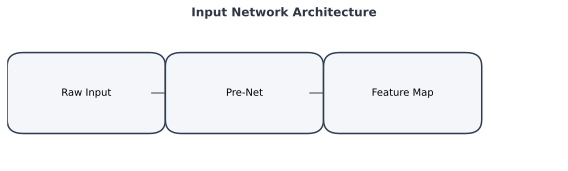

Architecture and Models
=====================

This comprehensive guide covers the network architectures and model types available in the Dendritic Modeling Framework, along with their biological foundations and practical usage.

   **Shunting Inhibition Mechanism**: Multi-dendrite neurons implementing divisive normalization. Each dendrite receives excitatory and inhibitory inputs, computes E/(E+I+ε) locally, and dendrites can receive inputs from previous dendritic layers. The soma integrates processed outputs from all dendrites.

Biological Foundations
---------------------

The framework is built on several key biological principles that inform both the architecture design and computational mechanisms.

Shunting Inhibition
~~~~~~~~~~~~~~~~~~

The core computational mechanism implements divisive normalization found throughout the nervous system:

.. math::

   V_{out} = \frac{E}{E + I + \epsilon}

Where:
- :math:`E` = sum of excitatory synaptic inputs
- :math:`I` = sum of inhibitory synaptic inputs
- :math:`\epsilon` = small constant preventing division by zero

This mechanism provides several key computational benefits:

* **Gain Control**: Automatic adjustment of response sensitivity based on input strength
* **Normalization**: Maintains output in bounded range regardless of input magnitude
* **Contrast Enhancement**: Emphasizes differences between inputs
* **Adaptation**: Dynamically adjusts to changing input statistics

Dendritic Computation
~~~~~~~~~~~~~~~~~~~~

   **Dendritic Neuron Structure**: Multi-branch architecture where each dendrite receives excitatory (red) and inhibitory (blue) synaptic inputs, performs local computation, and outputs to the soma for integration.

Biological neurons perform complex computations through their dendritic trees:

1. **Local Processing**: Each dendrite performs independent computations on its inputs
2. **Hierarchical Integration**: Dendrites can receive inputs from other dendrites
3. **Spatial Organization**: Synaptic inputs are spatially distributed across the dendritic tree
4. **Temporal Dynamics**: Dendritic processing includes temporal integration and filtering

Dale's Principle
~~~~~~~~~~~~~~~

The framework maintains biological realism through Dale's principle:

* **Excitatory Neurons**: Can only make excitatory synaptic connections
* **Inhibitory Neurons**: Can only make inhibitory synaptic connections
* **Population Separation**: Distinct excitatory and inhibitory neural populations

This separation enables:

* **Realistic Connectivity**: Biologically plausible connection patterns
* **E/I Balance**: Dynamic balance between excitation and inhibition
* **Emergent Dynamics**: Complex network behaviors arising from simple rules

Synaptic Organization
~~~~~~~~~~~~~~~~~~~

The framework models realistic synaptic organization:

* **Synaptic Densities**: Based on neurobiological measurements
* **Connection Patterns**: Realistic connectivity matrices
* **Synaptic Plasticity**: Activity-dependent connection strength changes
* **Spatial Constraints**: Distance-dependent connectivity probabilities

Network Architectures
--------------------

The framework provides several network architectures, each suited for different computational tasks and biological modeling goals.

Excitation-Inhibition Networks
~~~~~~~~~~~~~~~~~~~~~~~~~~~~~

The core architecture implements biologically-inspired excitation-inhibition dynamics:

   **Multi-Layer E/I Network**: Shows excitatory (red) and inhibitory (blue) neuron populations across multiple layers. Each excitatory neuron implements dendritic computation with shunting inhibition.

**Key Features:**

* Separate excitatory and inhibitory populations per layer
* Dendritic branching with configurable branch factors
* Flexible connectivity patterns (E→E, E→I, I→E, I→I)
* Somatic and dendritic synapses
* Reactivation mechanisms for enhanced plasticity

**Basic Usage:**

.. code-block:: python

   from dendritic_modeling.networks import ExcitationInhibitionNetwork
   from dendritic_modeling.config import TransferFunctionParams
   
   # Create transfer function parameters
   transfer_params = TransferFunctionParams(
       input_mode=0,
       multiplicative=True,
       shunting_inhibition=True
   )
   
   # Create E/I network
   ei_network = ExcitationInhibitionNetwork(
       input_dim=784,
       transfer_params=transfer_params.asdict(),
       excitatory_layer_sizes=[200, 100, 10],
       inhibitory_layer_sizes=[100, 50, 0],
       excitatory_branch_factors=[10, 5, 1],
       inhibitory_branch_factors=[5, 3, 0],
       ee_synapses_per_branch_per_layer=[15, 10, 1],
       ei_synapses_per_branch_per_layer=[8, 5, 0],
       ie_synapses_per_branch_per_layer=[3, 2, 0],
       ii_synapses_per_branch_per_layer=[],
       reactivate=True,
       somatic_synapses=True
   )

**Configuration Parameters:**

* **excitatory_layer_sizes**: Number of excitatory neurons per layer
* **inhibitory_layer_sizes**: Number of inhibitory neurons per layer
* **excitatory_branch_factors**: Dendritic branches per excitatory neuron
* **inhibitory_branch_factors**: Dendritic branches per inhibitory neuron
* **ee_synapses_per_branch_per_layer**: Excitatory→excitatory connections per branch
* **ei_synapses_per_branch_per_layer**: Excitatory→inhibitory connections per branch
* **ie_synapses_per_branch_per_layer**: Inhibitory→excitatory connections per branch
* **ii_synapses_per_branch_per_layer**: Inhibitory→inhibitory connections per branch
* **reactivate**: Enable reactivation mechanisms
* **somatic_synapses**: Include direct somatic connections

Multi-Layer Perceptron (MLP)
~~~~~~~~~~~~~~~~~~~~~~~~~~~

Standard fully-connected networks with optional dendritic processing:

.. code-block:: python

   from dendritic_modeling.networks import MLP
   
   # Standard MLP
   mlp_network = MLP(
       input_dim=784,
       hidden_dims=[512, 256, 128],
       output_dim=10,
       activation='relu',
       dropout=0.2,
       batch_norm=True
   )
   
   # MLP with dendritic processing
   dendritic_mlp = MLP(
       input_dim=784,
       hidden_dims=[512, 256, 128],
       output_dim=10,
       activation='relu',
       use_dendritic_processing=True,
       dendritic_params={
           'branch_factors': [5, 3, 1],
           'shunting_inhibition': True
       }
   )

Convolutional Networks
~~~~~~~~~~~~~~~~~~~~~

Convolutional architectures with dendritic processing capabilities:

.. code-block:: python

   from dendritic_modeling.networks import ConvNet
   
   # Standard CNN
   conv_network = ConvNet(
       input_channels=1,
       conv_layers=[
           {'out_channels': 32, 'kernel_size': 3, 'stride': 1, 'padding': 1},
           {'out_channels': 64, 'kernel_size': 3, 'stride': 2, 'padding': 1},
           {'out_channels': 128, 'kernel_size': 3, 'stride': 2, 'padding': 1}
       ],
       fc_layers=[256, 10],
       activation='relu',
       dropout=0.2
   )
   
   # CNN with dendritic layers
   dendritic_conv = ConvNet(
       input_channels=1,
       conv_layers=[
           {'out_channels': 32, 'kernel_size': 3, 'stride': 1, 'padding': 1},
           {'out_channels': 64, 'kernel_size': 3, 'stride': 2, 'padding': 1}
       ],
       fc_layers=[256, 10],
       use_dendritic_fc=True,
       dendritic_params={
           'branch_factors': [8, 4],
           'excitatory_inhibitory_ratio': 0.8
       }
   )

Vision Transformers
~~~~~~~~~~~~~~~~~~

Transformer architectures with dendritic attention mechanisms:

.. code-block:: python

   from dendritic_modeling.networks import DendriticViT
   
   # Vision Transformer with dendritic attention
   vit_network = DendriticViT(
       image_size=224,
       patch_size=16,
       num_classes=1000,
       dim=768,
       depth=12,
       heads=12,
       mlp_dim=3072,
       use_dendritic_attention=True,
       dendritic_attention_params={
           'branch_factors': [4, 2],
           'shunting_inhibition': True,
           'attention_dropout': 0.1
       }
   )

Hybrid Architectures
~~~~~~~~~~~~~~~~~~

Combining different network types for optimal performance:

.. code-block:: python

   from dendritic_modeling.networks import HybridNetwork
   
   # CNN backbone with dendritic head
   hybrid_network = HybridNetwork(
       backbone=conv_network,
       head=ei_network,
       backbone_output_dim=256,
       head_input_dim=256
   )
   
   # Multi-modal architecture
   multimodal_network = HybridNetwork(
       vision_backbone=conv_network,
       text_backbone=transformer_network,
       fusion_head=ei_network,
       fusion_strategy='concatenate'
   )

Input Transformation Networks
~~~~~~~~~~~~~~~~~~~~~~~~~~~

Specialized networks for preprocessing inputs before dendritic processing:

   **Input Network Architecture**: Shows how input networks transform raw inputs into excitatory and inhibitory signals for dendritic processing.

.. code-block:: python

   from dendritic_modeling.networks.input_transform import (
       MLPInputTransform, 
       ConvInputTransform, 
       AttentionInputTransform
   )
   
   # MLP-based input transformation
   mlp_input_net = MLPInputTransform(
       input_dim=784,
       hidden_dims=[512, 256],
       output_dim=128,
       excitatory_ratio=0.8
   )
   
   # Convolutional input transformation
   conv_input_net = ConvInputTransform(
       input_channels=3,
       conv_layers=[
           {'out_channels': 64, 'kernel_size': 7, 'stride': 2},
           {'out_channels': 128, 'kernel_size': 3, 'stride': 1}
       ],
       output_dim=256
   )
   
   # Attention-based input transformation
   attention_input_net = AttentionInputTransform(
       input_dim=512,
       attention_heads=8,
       output_dim=256,
       use_dendritic_attention=True
   )

Model Types
----------

The framework provides high-level model wrappers that combine networks with task-specific components.

Classification Models
~~~~~~~~~~~~~~~~~~~~

Models designed for classification tasks with cross-entropy loss:

.. code-block:: python

   from dendritic_modeling.models import Classifier
   
   # Basic classifier
   classifier = Classifier(
       core_network=ei_network,
       encoder_network=None,
       decoder_network=None
   )
   
   # Classifier with input preprocessing
   classifier_with_encoder = Classifier(
       core_network=ei_network,
       encoder_network=mlp_input_net,
       decoder_network=None
   )
   
   # Multi-class classifier with custom loss
   multiclass_classifier = Classifier(
       core_network=ei_network,
       encoder_network=conv_input_net,
       decoder_network=None,
       loss_function='focal_loss',
       num_classes=100
   )

**Key Features:**

* Automatic loss computation (cross-entropy, focal loss, etc.)
* Built-in accuracy metrics
* Support for multi-class and multi-label classification
* Optional label smoothing and temperature scaling
* Prediction methods (deterministic and probabilistic)

Regression Models
~~~~~~~~~~~~~~~~

Models designed for regression tasks with MSE or MAE loss:

.. code-block:: python

   from dendritic_modeling.models import Regressor
   
   # Basic regressor
   regressor = Regressor(
       core_network=ei_network,
       encoder_network=None,
       decoder_network=None,
       output_dim=1
   )
   
   # Multi-output regressor
   multioutput_regressor = Regressor(
       core_network=ei_network,
       encoder_network=conv_input_net,
       decoder_network=None,
       output_dim=10,
       loss_function='mse'
   )
   
   # Robust regressor with custom loss
   robust_regressor = Regressor(
       core_network=ei_network,
       encoder_network=None,
       decoder_network=None,
       output_dim=1,
       loss_function='huber',
       huber_delta=1.35
   )

**Key Features:**

* Multiple loss functions (MSE, MAE, Huber, quantile)
* Support for single and multi-output regression
* Built-in evaluation metrics (R², RMSE, MAE)
* Optional output normalization
* Uncertainty quantification capabilities

Generative Models
~~~~~~~~~~~~~~~~

Models for generative tasks including autoencoders and VAEs:

.. code-block:: python

   from dendritic_modeling.models import Autoencoder, VAE
   
   # Dendritic autoencoder
   autoencoder = Autoencoder(
       encoder_network=conv_encoder,
       decoder_network=conv_decoder,
       latent_dim=128,
       use_dendritic_latent=True
   )
   
   # Variational autoencoder with dendritic processing
   vae = VAE(
       encoder_network=conv_encoder,
       decoder_network=conv_decoder,
       latent_dim=128,
       use_dendritic_encoder=True,
       use_dendritic_decoder=True
   )

Transfer Function Parameters
---------------------------

Transfer function parameters control how dendritic computation is performed throughout the network.

.. code-block:: python

   from dendritic_modeling.config import TransferFunctionParams
   
   # Default parameters
   default_params = TransferFunctionParams()
   
   # Custom parameters
   custom_params = TransferFunctionParams(
       input_mode=2,                    # Input network mode
       multiplicative=True,             # Multiplicative interactions
       shunting_inhibition=True,        # Enable shunting inhibition
       independent_pathways=False,      # Separate E/I pathways
       excitatory_dim=None,            # Excitatory dimension
       inhibitory_dim=None             # Inhibitory dimension
   )

**Input Modes:**

* **Mode 0**: Direct input (excitatory = inhibitory = input)
* **Mode 1**: Positive-negative split (excitatory = positive, inhibitory = negative)
* **Mode 2**: Input network transformation (learned E/I separation)

**Parameter Options:**

* **multiplicative**: Enable multiplicative dendritic interactions
* **shunting_inhibition**: Use divisive normalization (E/(E+I+ε))
* **independent_pathways**: Separate excitatory and inhibitory processing paths
* **excitatory_dim/inhibitory_dim**: Explicit dimensionality control

Model Configuration
------------------

Models can be configured through Python code or YAML configuration files.

Python Configuration
~~~~~~~~~~~~~~~~~~~

.. code-block:: python

   from dendritic_modeling.config import (
       ModelConfig, 
       CoreNetworkConfig, 
       EINetParameters,
       TransferFunctionParams
   )
   
   # Create configuration
   config = ModelConfig(
       task='classification',
       core_network=CoreNetworkConfig(
           type='EINet',
           parameters=EINetParameters(
               input_dim=784,
               transfer_params=TransferFunctionParams(
                   input_mode=0,
                   multiplicative=True,
                   shunting_inhibition=True
               ),
               excitatory_layer_sizes=[200, 100, 10],
               inhibitory_layer_sizes=[100, 50, 0],
               excitatory_branch_factors=[10, 5, 1],
               inhibitory_branch_factors=[5, 3, 0],
               ee_synapses_per_branch_per_layer=[15, 10, 1],
               ei_synapses_per_branch_per_layer=[8, 5, 0],
               ie_synapses_per_branch_per_layer=[3, 2, 0],
               ii_synapses_per_branch_per_layer=[],
               reactivate=True,
               somatic_synapses=True
           )
       )
   )
   
   # Create model from configuration
   from dendritic_modeling.models import create_model
   model = create_model(config)

YAML Configuration
~~~~~~~~~~~~~~~~~

.. code-block:: yaml

   model:
     task: classification
     core_network:
       type: EINet
       parameters:
         input_dim: 784
         transfer_params:
           input_mode: 0
           multiplicative: true
           shunting_inhibition: true
         excitatory_layer_sizes: [200, 100, 10]
         inhibitory_layer_sizes: [100, 50, 0]
         excitatory_branch_factors: [10, 5, 1]
         inhibitory_branch_factors: [5, 3, 0]
         ee_synapses_per_branch_per_layer: [15, 10, 1]
         ei_synapses_per_branch_per_layer: [8, 5, 0]
         ie_synapses_per_branch_per_layer: [3, 2, 0]
         ii_synapses_per_branch_per_layer: []
         reactivate: true
         somatic_synapses: true
     
     encoder_network:
       type: MLPInputTransform
       parameters:
         input_dim: 784
         hidden_dims: [512, 256]
         output_dim: 128
         excitatory_ratio: 0.8
     
     decoder_network:
       type: identity

Load and use YAML configuration:

.. code-block:: python

   from dendritic_modeling.config import load_config
   from dendritic_modeling.models import create_model
   
   config = load_config('model_config.yaml')
   model = create_model(config)

Advanced Architecture Patterns
-----------------------------

Residual Connections
~~~~~~~~~~~~~~~~~~

Adding residual connections to dendritic networks:

.. code-block:: python

   from dendritic_modeling.networks import ResidualEINet
   
   # E/I network with residual connections
   residual_ei_net = ResidualEINet(
       input_dim=784,
       transfer_params=transfer_params.asdict(),
       excitatory_layer_sizes=[200, 200, 10],
       inhibitory_layer_sizes=[100, 100, 0],
       residual_connections=True,
       residual_strategy='add'  # 'add' or 'concatenate'
   )

Attention Mechanisms
~~~~~~~~~~~~~~~~~~

Incorporating attention into dendritic processing:

.. code-block:: python

   from dendritic_modeling.networks import AttentionEINet
   
   # E/I network with attention
   attention_ei_net = AttentionEINet(
       input_dim=784,
       transfer_params=transfer_params.asdict(),
       excitatory_layer_sizes=[200, 100, 10],
       inhibitory_layer_sizes=[100, 50, 0],
       attention_heads=8,
       attention_dropout=0.1,
       use_dendritic_attention=True
   )

Modular Architectures
~~~~~~~~~~~~~~~~~~~

Building modular networks with specialized components:

.. code-block:: python

   from dendritic_modeling.networks import ModularEINet
   
   # Modular network with specialized modules
   modular_network = ModularEINet(
       modules=[
           {'name': 'feature_extraction', 'type': 'conv', 'params': {...}},
           {'name': 'dendritic_processing', 'type': 'ei_net', 'params': {...}},
           {'name': 'classification', 'type': 'mlp', 'params': {...}}
       ],
       connections=[
           {'from': 'feature_extraction', 'to': 'dendritic_processing'},
           {'from': 'dendritic_processing', 'to': 'classification'}
       ]
   )

Performance Optimization
-----------------------

Computational Efficiency
~~~~~~~~~~~~~~~~~~~~~~~

Optimizing networks for computational efficiency:

.. code-block:: python

   # Efficient E/I network configuration
   efficient_ei_net = ExcitationInhibitionNetwork(
       input_dim=784,
       transfer_params=transfer_params.asdict(),
       excitatory_layer_sizes=[100, 10],
       inhibitory_layer_sizes=[50, 0],
       excitatory_branch_factors=[3, 1],  # Reduced branching
       inhibitory_branch_factors=[2, 0],
       ee_synapses_per_branch_per_layer=[5, 1],  # Reduced connections
       ei_synapses_per_branch_per_layer=[3, 0],
       ie_synapses_per_branch_per_layer=[2, 0],
       ii_synapses_per_branch_per_layer=[],
       reactivate=False,      # Disable for efficiency
       somatic_synapses=False  # Disable for efficiency
   )

Memory Optimization
~~~~~~~~~~~~~~~~~

Reducing memory usage for large networks:

.. code-block:: python

   # Memory-efficient configuration
   memory_efficient_net = ExcitationInhibitionNetwork(
       input_dim=784,
       transfer_params=transfer_params.asdict(),
       excitatory_layer_sizes=[200, 100, 10],
       inhibitory_layer_sizes=[100, 50, 0],
       excitatory_branch_factors=[5, 3, 1],
       inhibitory_branch_factors=[3, 2, 0],
       ee_synapses_per_branch_per_layer=[8, 5, 1],
       ei_synapses_per_branch_per_layer=[4, 3, 0],
       ie_synapses_per_branch_per_layer=[2, 1, 0],
       ii_synapses_per_branch_per_layer=[],
       reactivate=True,
       somatic_synapses=True,
       memory_efficient=True,  # Enable memory optimizations
       gradient_checkpointing=True  # Trade compute for memory
   )

Model Parameter Management
-------------------------

Parameter Groups
~~~~~~~~~~~~~~

Organizing model parameters for optimized training:

.. code-block:: python

   from dendritic_modeling.config import ParamGroupsConfig
   
   # Create parameter groups configuration
   param_config = ParamGroupsConfig(
       split_params=True,
       topk_lr=0.001,
       blocklinear_lr=0.001,
       reactivation_lr=0.0005,
       decoder_lr=0.002
   )
   
   # Get parameter groups
   param_groups = model.get_param_groups(param_config)
   
   # Use with optimizer
   optimizer = torch.optim.Adam(param_groups)

Parameter Initialization
~~~~~~~~~~~~~~~~~~~~~~

Controlling parameter initialization strategies:

.. code-block:: python

   # Custom initialization
   ei_network = ExcitationInhibitionNetwork(
       input_dim=784,
       transfer_params=transfer_params.asdict(),
       excitatory_layer_sizes=[200, 100, 10],
       inhibitory_layer_sizes=[100, 50, 0],
       # ... other parameters ...
       init_method='xavier_normal',
       weight_threshold=1e-6,
       freeze_excitatory_connectivity=False,
       freeze_inhibitory_connectivity=False
   )

Model Serialization
~~~~~~~~~~~~~~~~~

Saving and loading models:

.. code-block:: python

   # Save model
   torch.save(model.state_dict(), 'model.pth')
   
   # Load model
   model.load_state_dict(torch.load('model.pth'))
   
   # Save entire model configuration
   config_dict = model.get_config()
   with open('model_config.yaml', 'w') as f:
       yaml.dump(config_dict, f)

Next Steps
---------

Now that you understand the architecture and model options:

1. **Training Configuration**: Learn about training strategies in :doc:`training_and_configuration`
2. **Analysis Tools**: Explore analysis and visualization in :doc:`analysis_and_visualization`
3. **API Reference**: See detailed API documentation in :doc:`../api/index`
4. **Examples**: Try practical examples in :doc:`../examples/index` 