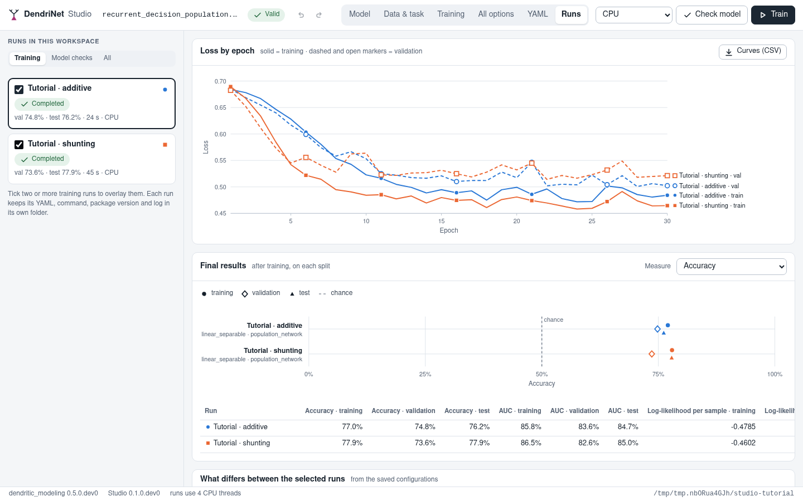

.. _studio:

DendriNet Studio
================

DendriNet Studio is a local application for designing, checking, training and
comparing DendriNet models in a web browser. It writes ordinary experiment
YAML files and runs them with the library's own loader, constructors and
training command. Studio contains no model equations and no training loop:
every option, default and list of allowed values on its forms is read from the
library's typed configuration and registries, so an option the library adds
appears in Studio without a Studio change, and a file designed in Studio runs
unchanged with ``dendritic-train``.

.. figure:: _static/studio/model_view.png
   :alt: The Model view: an outline on the left, the network of excitatory and
         inhibitory populations with a neuron's dendritic tree in the middle,
         and the selected population's options on the right.
   :width: 100%

   The Model view of the two-class tutorial. Excitatory populations are
   triangles and send arrows; inhibitory populations are circles and send
   bars. The neuron below the network is the selected population's exact
   compartment tree with its contacts per compartment.

Install and start
-----------------

Studio is a separate distribution, ``dendrinet-studio``, that depends on the
library. Installing it installs ``dendritic_modeling`` and PyTorch as
dependencies:

.. code-block:: bash

   pip install dendrinet-studio
   dendrinet-studio --workspace my-runs

From a source checkout, install both packages in editable mode:

.. code-block:: bash

   pip install -e . -e apps/studio

The command prints an address such as
``http://127.0.0.1:8765/#<token>`` and opens it in the default browser. The
part after ``#`` is a random session token; keep the command running while
you work, and stop it with Ctrl+C (running workers stop with it).

.. list-table::
   :header-rows: 1
   :widths: 26 74

   * - Option
     - Meaning
   * - ``--workspace DIR``
     - Folder for run records and results (default ``./studio-runs``).
   * - ``--port N``
     - Local port (default 8765; the next free port when it is taken; 0 picks
       any free port).
   * - ``--threads N``
     - CPU threads per run (default: up to 4, depending on the computer).
   * - ``--no-browser``
     - Print the address without opening a browser, for remote machines.
   * - ``--no-execution``
     - Design and export only: Studio never builds or trains a model on this
       machine (also set by ``DENDRINET_STUDIO_NO_EXECUTION=1``). Use it on
       shared machines where computation is not allowed.
   * - ``--allow-host NAME``
     - Also accept requests addressed to ``NAME``, for a trusted proxy in
       front of the local port. Repeatable.

On a remote machine (a workstation or a cluster compute node), start Studio
with ``--no-browser``, forward its port from your computer and open the
printed address locally:

.. code-block:: bash

   # on the remote machine
   dendrinet-studio --workspace ~/studio-runs --no-browser
   # on your computer
   ssh -L 8765:127.0.0.1:8765 user@remote-host

What Studio supports
--------------------

.. list-table::
   :header-rows: 1
   :widths: 30 70

   * - Model family
     - How it is edited
   * - ``population_network``, feedforward or recurrent
     - Visually: layers, excitatory and inhibitory populations, neuron
       counts, dendritic morphology (branching per level), contacts per
       compartment for each pathway (one count or one per level), contacts on
       the soma, the integration rule (shunting or the additive rules), leak,
       dendritic gates, initialization, time constants and every other
       population option; connections between populations with their timing
       (same step or delayed by one step), pathway, target levels,
       probability and seed.
   * - Structured dendritic trees (``dendritic_shunting``,
       ``dendritic_additive``, ``einet`` and the other structured types)
     - Forms for the architecture, connectivity, morphology, transfer,
       sparsity, gate and implementation sections.
   * - Recurrent baselines (``gru``, ``lstm``, ``vanilla_rnn``),
       ``heterogeneous_leak_ctrnn``, ``legendre_memory``
     - Typed forms for the family's options.
   * - Other built-in core types
     - Forms where the library types the section; YAML for nested options.

.. figure:: _static/studio/recurrent_view.png
   :alt: A recurrent population network in the Model view: delayed recurrent
         connections are dashed and labelled with a delta-t.
   :width: 100%

   The recurrent decision example. Delayed connections (dashed, Δt) carry the
   previous time step's activity, which makes the layer recurrent.

For every family Studio edits the task (classification or regression), the
dataset and its options, the loss (only losses that suit the task are offered
first), the learning strategy (standard backpropagation, recurrent training,
the local learning rules and the staged strategies), the optimizer, learning
rates per parameter group, the schedule, early stopping, initialization
(synaptic weights, branch couplings and gates), seeds, regularization,
pruning and evaluation measures. Values the forms do not show are kept: the
**All options** view lists every option of the configuration with a search
box, and the **YAML** view edits the file directly.

The installed examples cover each kind of model:

.. list-table::
   :header-rows: 1
   :widths: 30 70

   * - Example
     - What it shows
   * - ``synthetic_population``
     - A feedforward population network on a generated two-class task (no
       download). It trains 30 epochs in about 20 seconds on four CPU cores
       and reaches about 78% test accuracy.
   * - ``structured_tree_synthetic``
     - The same task with the structured dendritic tree family.
   * - ``recurrent_decision_population``
     - A recurrent population network with delayed recurrent connections on a
       context-dependent evidence-integration task (classification over time).
   * - ``adding_problem_gru``
     - A GRU baseline on the adding problem, a regression task over a
       sequence.
   * - ``mnist_population``
     - The tutorial's network on MNIST digits; the first run downloads MNIST.

Export any of them without Studio with
``dendritic-example <name> --output my_model.yaml``.

Working in Studio
-----------------

The tabs at the top hold the views of one design. **Check model** and
**Train** work on the design as it is; the status next to the file name says
whether DendriNet accepts it (a word and an icon, never a colour alone).

**Model.** Pick an example on the left or keep editing the current design.
Select a population, a connection (click its line or its label) or a layer
lane to edit it on the right. A tag such as *layer default* marks values that
come from a default; *reset* removes a setting so the default applies again.
Branching presets set common morphologies; *Set counts per level* gives each
level of the tree its own contact counts. Every edit is validated by the
library at once; an invalid edit is reported next to its field and in a
banner, and the drawing keeps showing the last valid design. Undo and redo
(Ctrl+Z, Ctrl+Shift+Z) cover every edit. *Show YAML keys* prints the key each
field writes. The diagram can be zoomed, fitted to the panel and exported as
an SVG file.

**Data & task.** The task, the number of classes or outputs, the loss, the
dataset (grouped into generated data, sequence tasks and image datasets that
download once into the data cache) and its options, splits, seeds and
evaluation measures.

**Training.** The learning strategy and its options, the schedule, the
optimizer and the learning rate of each parameter group, initialization and
seeds, dendritic gate calibration, regularization and pruning, and data
loading and precision settings. For population networks, initialization
settings apply to every layer; a layer or population can still override
them.

**All options.** Every section of the configuration with a search box.

**YAML.** The exact file that Train runs. Edit it, then **Apply** (or
Ctrl+Enter): DendriNet's strict loader checks the text first, and an error
marks its line. **Import** opens a standalone experiment file; **Export**
saves the current design. Comments and formatting of imported files are not
kept. Sweep files and files that ``extends`` another file are composed by
``dendritic-train``; open the composed file instead.

**Runs.** Every model check and training run in the workspace. Running
trainings show their progress; tick two or more to overlay their loss curves
(each run has its own marker shape and a text label), compare final measures
in a dot plot and a table, list the settings that differ between them, and
read a run's details: its status, timing, size, command, folder, notes and
worker log. **Open in editor** loads a run's configuration back into the
design. The curves can be exported as CSV.

         final accuracies and the settings that differ.
   :width: 100%

   Two runs of the tutorial compared in the Runs view.

Model checks, previews and runs
-------------------------------

The preview that redraws the design after every edit validates the
configuration and resolves the population graph; it does not build weights,
download data or touch a random stream. A population card shows the contact
budget for each input stream. When several connections supply the same stream,
the card labels their combined budget as shared. The connections show their
polarity and any target-level restrictions. Checking the model reports the
active contact count after construction.

**Check model** builds the network in a separate process with the dataset's
input shape and the configured seeds, and reports trainable parameters,
active synapses and candidate slots, before gate calibration. The selected
dataset is prepared first, so a check of an image dataset may download it.

**Train** runs ``dendritic-train`` in a separate process. One worker runs at a
time; it stops when you stop it, or when the Studio command ends. Each run is
a folder of the workspace::

   my-runs/20261118-142713-1f56b0/
     config.yaml        # the exact configuration
     studio_run.json    # status, command, package version, timings, notes
     worker.log         # everything the worker printed
     results/model_*/   # the library's normal run outputs and records

A run is reported as completed only when its worker exits successfully. A run
that was active when Studio stopped is shown as unknown, never as completed.
Studio runs one process on this machine; distributed training and cluster
submission stay with ``dendritic-train``, ``torchrun`` and ``dendritic-sweep``,
which read the exported YAML.

Privacy and security
--------------------

Studio listens on the loopback interface only. Its programming interface
answers only requests that carry the session token and address a local host
name, so other web pages and other users of the machine cannot drive it. It
sends nothing to any server: there is no telemetry, and the page loads no
external fonts, scripts or styles. The only network traffic is a DendriNet
dataset loader downloading a public dataset that the configuration names.
Studio is a single-user local tool, not a hosted service.

Accessibility
-------------

Meaning never rests on colour alone: excitatory and inhibitory populations
differ by shape (triangle, circle) and by line ends (arrow, bar), delayed
connections are dashed, statuses carry an icon and a word, and every run in a
comparison has its own marker shape and a text label. Every control is
reachable with the keyboard; Alt+1 to Alt+6 switch views. Light and dark
themes follow the operating system.

For developers
--------------

Studio lives in ``apps/studio`` of the DendriNet repository and is built as
its own wheel. The server (``dendrinet_studio.server``) is the Python
standard library's HTTP server; the client is plain HTML, CSS and JavaScript
modules with no build step and no external requests.

.. list-table::
   :header-rows: 1
   :widths: 30 70

   * - Module
     - Role
   * - ``schema.py``
     - Describes every configuration section, option, type, default and
       allowed value, read from the library's dataclasses and registries.
   * - ``model.py``
     - Validates a configuration with the library's strict loader and
       describes it for the editor (population graph, per-level contacts).
   * - ``runs.py``
     - Starts, stops and records worker processes and reads their results.
   * - ``worker.py``
     - The model check: builds the model as the trainer does and writes its
       resource counts.
   * - ``web/``
     - The client: ``js/store.js`` (state, validation, undo),
       ``js/design.js`` (Model view), ``js/forms.js`` (Data, Training, All
       options), ``js/runs.js`` and ``js/charts.js`` (Runs), ``js/graph.js``
       and ``js/morphology.js`` (drawings).

Run the tests on a workstation or compute node:

.. code-block:: bash

   PYTHONPATH=src:apps/studio/src python -m pytest apps/studio/tests -m "not slow"
   PYTHONPATH=src:apps/studio/src python -m pytest apps/studio/tests

The slow tests build and train small models, and the browser tests drive
Chromium through Playwright (``pip install -e "apps/studio[test]"`` and
``python -m playwright install chromium``); they are skipped when Playwright
is missing. Set ``STUDIO_BROWSER_ARTIFACTS=<folder>`` to keep their
screenshots.
