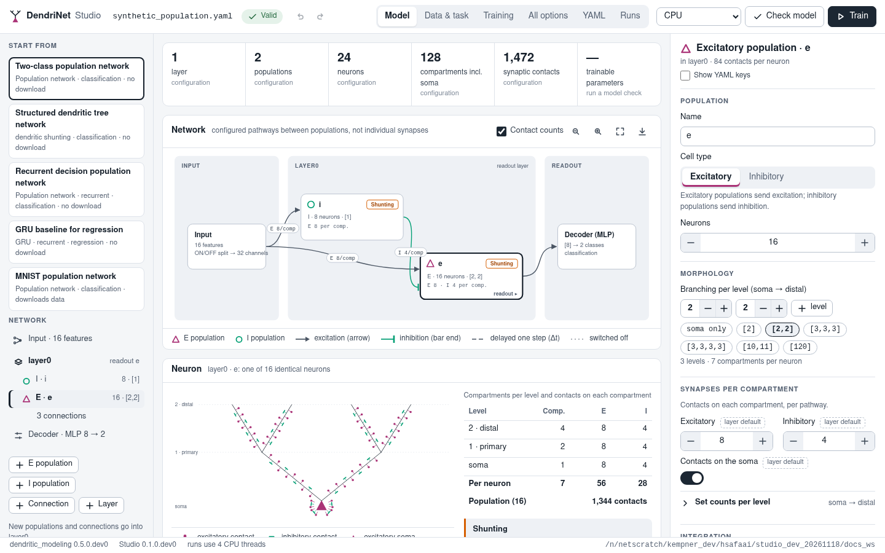
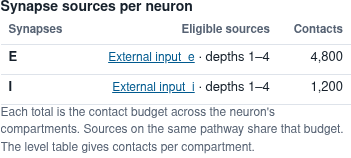
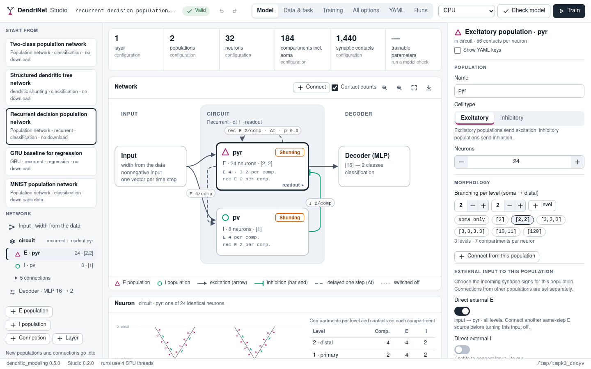

.. _studio:

DendriNet Studio
================

DendriNet Studio lets you draw a network, inspect the inputs to a neuron,
train the model and compare runs in a browser on your computer. The editor
and the command line use the same experiment YAML and the same DendriNet
model builders and trainer. You can move a design between them at any point.

.. contents:: On this page
   :local:
   :depth: 1

         inhibitory populations with a neuron's dendritic tree in the middle,
         and the selected population's options on the right.
   :width: 100%

   The Model view of the two-class tutorial. Excitatory populations are
   triangles and send arrows; inhibitory populations are circles and send
   bars. The neuron below the network is the selected population's exact
   compartment tree with its contacts per compartment.

.. _studio-install:

Install and start
-----------------

In a fresh Python 3.10 or later environment on your computer, install Studio
from PyPI. Pip installs the compatible core library and PyTorch.

.. code-block:: bash

   python -m pip install dendrinet-studio==0.1.0
   dendrinet-studio --workspace my-runs

For an editable install, run ``python -m pip install -e . -e ./apps/studio``
from the repository root. See :doc:`installation` for environment setup.

The command opens the local app and prints its address. If the tab fails to
open, paste the **whole printed address** into a browser on the same computer,
including its port and the session token after ``#``. Keep the command running
while you work. Ctrl+C stops the server and its workers. Training takes place
on the computer running the command. A local installation works offline after
its dependencies and any required datasets have been downloaded.

.. list-table::
   :header-rows: 1
   :widths: 26 74

   * - Option
     - Meaning
   * - ``--workspace DIR``
     - Folder for run records and results (default ``./studio-runs``).
   * - ``--port N``
     - Local port (default 8765; the next free port when it is taken; 0 picks
       any free port).
   * - ``--threads N``
     - CPU threads per run (default: up to 4, depending on the computer).
   * - ``--no-browser``
     - Print the address without opening a browser, for remote machines.
   * - ``--no-execution``
     - Design and export only: Studio never builds or trains a model on this
       machine (also set by ``DENDRINET_STUDIO_NO_EXECUTION=1``). Use it on
       shared machines where computation is not allowed.
   * - ``--allow-host NAME``
     - Also accept requests addressed to ``NAME``, for a trusted proxy in
       front of the local port. Repeatable.

On a remote machine (a workstation or a cluster compute node), start Studio
with ``--no-browser``, forward its port from your computer and open the
printed address locally:

.. code-block:: bash

   # on the remote machine
   dendrinet-studio --workspace ~/studio-runs --no-browser
   # on your computer
   ssh -L 8765:127.0.0.1:8765 user@remote-host

Use the actual port printed by Studio on both sides of the tunnel. If a
scheduler assigned a compute node, the tunnel must reach the machine running
Studio. A new session prints a new token.

.. _studio-first-run:

Train your first network
------------------------

#. In **Model**, open the two-class population example under **Start from**
   (``synthetic_population.yaml``). It generates its own data. Select
   population ``e``. Its 16 excitatory neurons each have two branches
   leaving the soma and two children per branch. The eight inhibitory
   neurons in population ``i`` receive excitation from the input and
   supply inhibition to ``e``.
#. Select **CPU**, then **Check model**. When the worker finishes, open its
   entry under **Runs → Model checks**. The model check reports trainable
   parameters, active synapses and candidate connections. Editing the design
   and checking it again creates a separate record.
#. Under **Training**, set **Epochs** to 1 for a quick test. Choose **Train**,
   name the run and select **Start training**. In **Runs**, open the finished
   training entry to inspect its loss, available evaluation measures and log.
#. For a comparison, change the epoch count, keeping the seed and network
   fixed, and train a second time. Select the two runs using their checkboxes.
   The comparison shows both learning curves and the settings that differ.
#. In **YAML**, choose **Export** to save the design. If you save the file
   as ``demo.yaml``, you can run it in the same environment with
   ``dendritic-train demo.yaml``. To get the original, unedited example
   directly, use ``dendritic-example synthetic_population --output original.yaml``.

.. _studio-afferents:

Trace excitation and inhibition into a neuron
---------------------------------------------

Select a first-layer population in **Model**. Its polarity describes the
synapses it *sends*. **Synapse sources per neuron** shows the inputs it
*receives*. In the two-class tutorial, external excitation drives both
populations. The excitatory neurons receive their inhibitory contacts from
the local inhibitory neurons. In a design with direct external inhibition,
the table names the external inhibitory stream instead.

.. list-table:: First-layer inputs in a population network
   :header-rows: 1
   :widths: 35 65

   * - Desired input to the selected population
     - Settings in **External input to this population**
   * - External excitation with inhibition supplied locally
     - Enable **Direct external E**. Leave **Direct external I** off. Connect
       the local I population to the target and set its incoming I contact budget.
   * - Both signs supplied by the input
     - Enable both switches and give both pathways contacts. For a biological
       model, choose **Distinct E and I afferents with matched features** or
       **Separate groups of input channels** under **External afferents for the
       first layer**.
   * - Only inhibition supplied by the external input
     - Connect a same-step excitatory population first. Enable **Direct
       external I** and turn off **Direct external E**. Each target needs a
       same-step excitatory source.

The switches edit connections to the selected target. The external afferent
choice applies to the whole first layer. In YAML, ``input`` or ``input_e``
supplies excitation and ``input_i`` supplies inhibition. With transfer
enabled, ``input_source_identity: paired_afferents`` gives distinct E and I
afferents the same feature values. With ``independent_pathways: true``, the
two streams read separate groups of channels. ON/OFF encoding
(``input_transform: signed_split``) is a separate choice about how to encode
feature values. In later layers, ``input`` refers to the preceding layer's
readout. See :doc:`population_networks` for connection and transfer settings.

Under **Synapses**, set counts per compartment or use **Set counts per level**.
Depth 0 is the soma. The level table gives the count on one compartment.
The source table sums the budget over one neuron. Two sources on the same
pathway share that budget. Enabling an additional source does not double it.

         and 1,200 from external input I, both at dendritic depths 1 through 4.
   :width: 351px

   In the empirical CIFAR-10 example, 120 dendritic compartments each receive
   40 E and 10 I contacts. The corresponding totals are 4,800 and 1,200 per
   neuron. Both external populations carry matched features. To inspect this
   design from the repository, import
   ``projects/empirical/configs/cifar_primary_shunting.yaml`` in the YAML view.
   The study's README gives the library version used for its published runs.

For structured feedforward E/I cores, **First-layer feedforward sources**
lists the routes fixed by the architecture. Local I cells, when present,
supply the E cells' inhibitory input. Without local I cells the first-layer E
cells can receive the external I stream directly. Change counts under
**Connectivity**, population sizes under **Architecture**, and external
channel identity under **Transfer**.

What Studio supports
--------------------

.. list-table::
   :header-rows: 1
   :widths: 30 70

   * - Model family
     - How it is edited
   * - ``population_network``, feedforward or recurrent
     - Visually: layers, excitatory and inhibitory populations, neuron
       counts, dendritic morphology (branching per level), contacts per
       compartment for each pathway (one count or one per level), contacts on
       the soma, the integration rule (shunting or the additive rules), leak,
       dendritic gates, initialization, time constants and every other
       population option; connections between populations with their timing
       (same step or delayed by one step), pathway, target levels,
       probability and seed.
   * - Structured dendritic trees (``dendritic_shunting``,
       ``dendritic_additive``, ``einet`` and the other structured types)
     - Forms for the architecture, connectivity, morphology, transfer,
       sparsity, gate and implementation sections.
   * - Recurrent baselines (``gru``, ``lstm``, ``vanilla_rnn``),
       ``heterogeneous_leak_ctrnn``, ``legendre_memory``
     - Typed forms for the family's options.
   * - Other built-in core types
     - Forms where the library types the section; YAML for nested options.

         connections are dashed and labelled with a delta-t.
   :width: 100%

   The recurrent decision example. Delayed connections (dashed, Δt) carry the
   previous time step's activity, which makes the layer recurrent.

For every family Studio edits the task (classification or regression), the
dataset and its options, the loss (only losses that suit the task are offered
first), the learning strategy (standard backpropagation, recurrent training,
the local learning rules and the staged strategies), the optimizer, learning
rates per parameter group, the schedule, early stopping, initialization
(synaptic weights, branch couplings and gates), seeds, regularization,
pruning and evaluation measures. Values the forms do not show are kept: the
**All options** view lists every option of the configuration with a search
box, and the **YAML** view edits the file directly.

The installed examples cover each kind of model:

.. list-table::
   :header-rows: 1
   :widths: 30 70

   * - Example
     - What it shows
   * - ``synthetic_population``
     - A feedforward E/I population network on a generated two-class task.
       It defaults to 30 epochs and runs locally without a dataset download.
   * - ``structured_tree_synthetic``
     - The same task with the structured dendritic tree family.
   * - ``recurrent_decision_population``
     - A recurrent population network with delayed recurrent connections on a
       context-dependent evidence-integration task (classification over time).
   * - ``adding_problem_gru``
     - A GRU baseline on the adding problem, a regression task over a
       sequence.
   * - ``mnist_population``
     - The tutorial's network on MNIST digits; the first run downloads MNIST.

Export any of them without Studio with
``dendritic-example <name> --output my_model.yaml``.

Working in Studio
-----------------

The tabs at the top hold the views of one design. **Check model** and
**Train** work on the design as it is; the status next to the file name says
whether DendriNet accepts it (a word and an icon, never a colour alone).

**Model.** Pick an example on the left or keep editing the current design.
Select a population, a connection (click its line or its label) or a layer
lane to edit it on the right. A tag such as *layer default* marks values that
come from a default; *reset* removes a setting so the default applies again.
To extend a population network:

#. Select the receiving layer and choose **E population** or **I population**.
   Set the neuron count and the branching factors from the soma outward.
   For example, ``[2, 2]`` gives two proximal and four distal compartments
   per cell. The **soma only** preset gives a point neuron. Use **Contacts
   on the soma** when the design calls for direct somatic input.
#. Use **Connection** to choose a source and target. Set whether the
   connection carries current-step or previous-step activity and which
   target depths receive it. Use **Synapses** on the receiving population
   for the corresponding feedforward or recurrent E or I contact count.
#. Use **Layer** to extend the stack. Select a layer to choose its readout
   population. The next layer receives that population's output. Select the
   network to choose which layer supplies the decoder.

An invalid edit is reported and the drawing keeps the last valid preview.
Small neurons are drawn in full when their branches fit. For large trees,
the neuron view draws representative branches and labels how many children
each represents. The caption gives the number drawn and the total, including
the soma. The adjacent table covers every configured depth.
Use undo and redo (Ctrl+Z, Ctrl+Shift+Z) to revisit a design, and **Show
YAML keys** to see what a field writes. The diagram can be zoomed, fitted
to the panel and exported as SVG.

**Data & task.** The task, the number of classes or outputs, the loss, the
dataset (grouped into generated data, sequence tasks and image datasets that
download once into the data cache) and its options, splits, seeds and
evaluation measures.

**Training.** The learning strategy and its options, the schedule, the
optimizer and the learning rate of each parameter group, initialization and
seeds, dendritic gate calibration, regularization and pruning, and data
loading and precision settings. For population networks, initialization
settings apply to every layer; a layer or population can still override
them.

**All options.** Every section of the configuration with a search box.

**YAML.** Edit the design and choose **Apply** (Ctrl+Enter). The strict
loader checks it before replacing the current design. If you continue typing
during validation, choose **Apply** again to use the latest text. Restoring
an unsaved design keeps its browser draft available across reloads. Syntax errors include
the line when the parser can identify it. **Import** opens a standalone
experiment. **Export** writes its settings as YAML. Re-exporting preserves
configuration values, including options without a graphical control.
Comments and original formatting are lost. For a sweep, use
``dendritic-sweep --config my_sweep.yaml --generate-only`` and import one
generated experiment. For a file that uses ``extends``, open an already
composed experiment with its parent settings included. See :ref:`config-extends`
and :doc:`sweeps`.

**Runs.** Every model check and training run in the workspace. Running
trainings show their progress. Select up to eight training runs to overlay
their loss curves. Each run has its own marker shape and a text label.
The view compares final measures in a dot plot and a table and lists
settings that differ. Select a run to see its status, timing, model size,
command, folder, notes and worker log. **Open in editor** loads its
configuration back into the design. The curves can be exported as CSV.

.. figure:: _static/studio/runs_view.png
   :alt: The Runs view comparing two training runs: overlaid loss curves,
         final accuracies and the settings that differ.
   :width: 100%

   Two runs of the tutorial compared in the Runs view.

Model checks, previews and runs
-------------------------------

The preview that redraws the design after every edit validates the
configuration and resolves the population graph; it does not build weights,
download data or touch a random stream. A population card shows the contact
budget for each input stream. When several connections supply the same stream,
the card labels their combined budget as shared. The connections show their
polarity and any target-level restrictions. Checking the model reports the
active contact count after construction.

**Check model** builds the network in a separate process with the dataset's
input shape and the configured seeds, and reports trainable parameters,
active synapses and candidate slots, before gate calibration. The selected
dataset is prepared first, so a check of an image dataset may download it.

**Train** calls the same Python entry point as ``dendritic-train``. The
device selector offers **CPU** or **GPU if available**. One check or training
worker runs at a time. Studio writes each run in its own workspace folder.
For instance, a training run with the tutorial defaults produces::

   my-runs/20261118-142713-1f56b0/
     config.yaml        # the design as submitted
     studio_run.json    # config hash, command, device, threads, core path and version
     worker.log         # everything the worker printed
     results/model_*/   # the library's normal run outputs and records

Studio passes ``--output_dir <run-folder>/results --run_name model`` to the
trainer. The name entered in the browser labels the Studio record. Use the
saved command, working directory and device settings to reproduce the
launch. Set an absolute ``data.base_dir`` when several runs should share a
local dataset. For a check, the resource counts live in ``resources.json``.
For training, see :doc:`runs_and_outputs` for the trainer's configuration,
seeds, metrics and environment records.

A run is reported as completed only when its worker exits successfully. A run
that was active when Studio stopped is shown as unknown, never as completed.
Studio runs one process on this machine; distributed training and cluster
submission stay with ``dendritic-train``, ``torchrun`` and ``dendritic-sweep``,
which read the exported YAML.

Troubleshooting
---------------

* **Browser says the site cannot be reached.** Confirm the command is still
  running and use its printed port. A browser on another computer needs a
  connection to that host (see :ref:`studio-install`). If the page opens but
  cannot reach the local service, reopen the complete URL with its current token.
* **The diagram looks valid but Check model fails.** The live preview validates
  the configuration. The check also constructs the model with a sample from the
  configured dataset. Open **Runs → Model checks**, select the failed check
  and read **Worker log** for the loader or constructor error.
* **The controls for starting a run are missing or disabled.** A *design only*
  label means the server was launched with execution disabled. With execution
  enabled, clear any field error and finish or stop the current worker.

Privacy and security
--------------------

Studio listens on the loopback interface only. Its programming interface
requires the session token and an accepted host name. Treat the printed URL
as private. The browser interface loads its assets locally and has no
telemetry. A dataset loader can contact its data provider when a configured
dataset needs downloading. The server and its workspace are intended for
one user.

Accessibility
-------------

Meaning never rests on colour alone: excitatory and inhibitory populations
differ by shape (triangle, circle) and by line ends (arrow, bar), delayed
connections are dashed, statuses carry an icon and a word, and every run in a
comparison has its own marker shape and a text label. Alt+1 to Alt+6 switch
views. Use the labelled population and connection buttons in the outline
to select elements with the keyboard. Light and dark
themes follow the operating system.

For developers
--------------

Studio lives in ``apps/studio`` of the DendriNet repository and is built as
its own wheel. The server (``dendrinet_studio.server``) is the Python
standard library's HTTP server; the client is plain HTML, CSS and JavaScript
modules with no build step and no external requests.

.. list-table::
   :header-rows: 1
   :widths: 30 70

   * - Module
     - Role
   * - ``schema.py``
     - Describes every configuration section, option, type, default and
       allowed value, read from the library's dataclasses and registries.
   * - ``model.py``
     - Validates a configuration with the library's strict loader and
       describes it for the editor (population graph, per-level contacts).
   * - ``runs.py``
     - Starts, stops and records worker processes and reads their results.
   * - ``worker.py``
     - The model check: builds the model as the trainer does and writes its
       resource counts.
   * - ``web/``
     - The client: ``js/store.js`` (state, validation, undo),
       ``js/design.js`` (Model view), ``js/afferents.js`` (incoming sources,
       external routes and contact budgets), ``js/forms.js`` (Data, Training, All
       options), ``js/runs.js`` and ``js/charts.js`` (Runs), ``js/graph.js``
       and ``js/morphology.js`` (drawings).

Run the tests on a workstation or compute node:

.. code-block:: bash

   PYTHONPATH=src:apps/studio/src python -m pytest apps/studio/tests -m "not slow"
   PYTHONPATH=src:apps/studio/src python -m pytest apps/studio/tests

The slow tests build and train small models, and the browser tests drive
Chromium through Playwright (``pip install -e "apps/studio[test]"`` and
``python -m playwright install chromium``); they are skipped when Playwright
is missing. Set ``STUDIO_BROWSER_ARTIFACTS=<folder>`` to keep their
screenshots.
