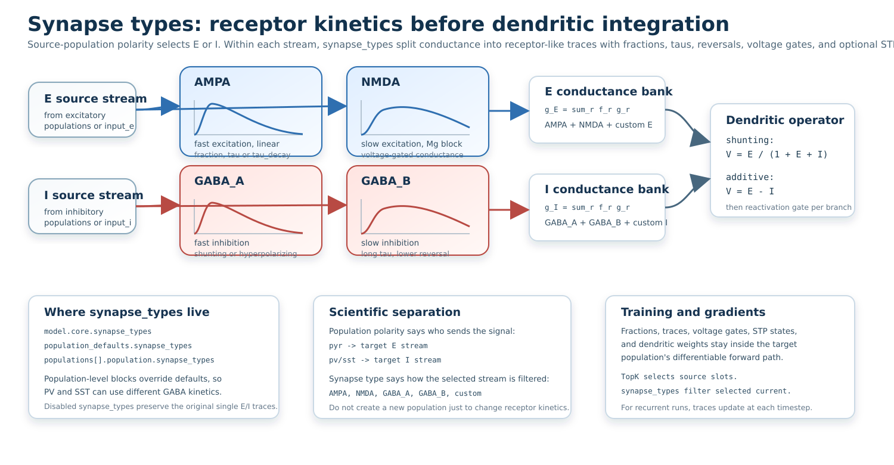
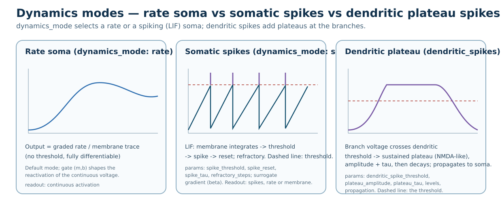
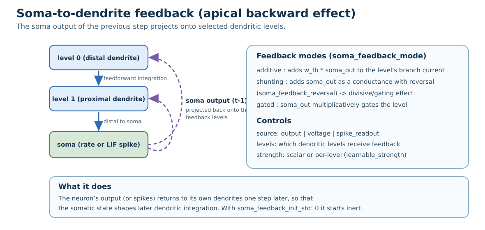

.. _temporal-dynamics:

Temporal dynamics
=================

These options give dendritic populations a state that carries over from one
timestep to the next: receptor synapse types with their own kinetics and
short-term plasticity, a spiking soma, dendritic spikes and plateaus, and
feedback from the soma to the dendrites. Each option is set per population
and is off by default. Use them for sequence tasks; a core that enables any of
them processes its input one timestep at a time.

.. _temporal-placement:

Where the options are set
-------------------------

The four features are population options (see :ref:`population-options`). The
core families accept them as follows:

.. list-table::
   :header-rows: 1
   :widths: 24 38 38

   * - Core
     - Where the options go
     - Effect of enabling one
   * - Population network (``population_network``)
     - ``model.core.population_network.layers[].population_defaults`` or a
       population's ``population`` block
     - The layer steps through time, with or without ``recurrent: true``, and
       the network processes sequences (see :ref:`temporal-constants`).
   * - Unified E/I core (``unified_ei``, see :ref:`unified-ei`)
     - The same fields in ``model.core.unified_ei.layers[].excitatory`` and
       ``.inhibitory``
     - The layer must set ``recurrent: true``; otherwise building raises.
   * - Structured E/I core (``einet``, ``dendritic_shunting``,
       ``dendritic_additive``, ``dendritic_normalized_additive``)
     - The blocks ``model.core.synapse_types``, ``model.core.dynamics``,
       ``model.core.dendritic_spikes`` and ``model.core.soma_feedback``
     - The core is built as the recurrent E/I network, and the settings apply
       to the excitatory and inhibitory populations of every layer (see
       :ref:`recurrent-structured-cores`).

The structured types ``flat_shunting``, ``flat_additive``,
``flat_normalized_additive``, ``flat_mlp``, ``dendritic_mlp``,
``dendritic_signed`` and ``flat_signed`` cannot be made recurrent, and
enabling any of these features with them raises when the model is built.

A core with temporal state takes inputs of shape ``[batch, time, features]``;
a two-dimensional input is treated as a single timestep. Train it on sequence
data with ``training.main.strategy: recurrent`` (see :ref:`training-strategies`).
Besides these features, recurrent connections also give a core temporal state:
delayed connections and ``recurrent: true`` layers in population networks,
``recurrent: true`` layers in unified E/I cores, and recurrent synapse counts in
structured E/I cores. None of the four features can be combined with a
non-unit or learnable leak, ``endpoint_tanh`` gates, ``indexed_release``
synapses, ``signal_rounding``, a ``cross_level_mode`` other than
``hierarchical``, or ``autograd_credit_mode: soma_broadcast``; building such a
population raises.

In a structured E/I core, the four blocks use the population field names
without their prefix, for example ``model.core.dynamics.threshold`` for
``spike_threshold`` and ``model.core.soma_feedback.mode`` for
``soma_feedback_mode``. This structured core enables all four features.
Its soma-feedback projections have signed weights, so the example explicitly
opts out of the biological constraint set:

.. code-block:: yaml

   model:
     core:
       type: dendritic_shunting
       biological_neuron: false  # Signed soma-feedback projections.
       architecture:
         excitatory_layer_sizes: [32]
         inhibitory_layer_sizes: [8]
         excitatory_branch_factors: [2, 2]
       connectivity:
         ee_synapses_per_branch_per_layer: [8]
         ei_synapses_per_branch_per_layer: [8]
         ie_synapses_per_branch_per_layer: [4]
       synapse_types:
         enabled: true
         excitatory:
           - {name: AMPA, fraction: 0.8, tau_rise: 0.5, tau_decay: 2.0}
           - {name: NMDA, fraction: 0.2, tau_rise: 3.0, tau_decay: 70.0, magnesium_block: true}
         inhibitory:
           - {name: GABA_A, fraction: 1.0, tau_decay: 7.0}
       dynamics:
         mode: spike
         threshold: 0.6
         readout: rate
       dendritic_spikes:
         enabled: true
         levels: distal
       soma_feedback:
         enabled: true
         mode: gated
         source: voltage
         levels: distal
   training:
     main:
       strategy: recurrent

``model.core.dynamics`` also accepts the population field names of its own
options (``dynamics_mode``, ``spike_threshold``, ...) and of the dendritic-spike
and soma-feedback options (``dendritic_spikes_enabled``,
``dendritic_spike_threshold``, ``soma_feedback_mode``, ...); writing the same
option twice raises. Nesting the
``dendritic_spikes`` or ``soma_feedback`` block inside ``model.core.dynamics``,
or ``soma_feedback`` inside ``model.core.recurrent_ei``, raises when the
configuration loads. ``model.core.spiking`` still loads as
``model.core.dynamics``, with a deprecation warning.

.. _synapse-types:

Receptor synapse types
----------------------

   Receptor types split the excitatory and inhibitory input of a compartment
   into traces with their own fraction, time course, reversal potential and
   voltage gate, here AMPA and NMDA for excitation and GABA-A and GABA-B for
   inhibition. The traces of each polarity are summed into conductances, which
   enter the shunting or additive voltage. The lower panels show where the
   block is set and the difference between a population's polarity and a
   receptor type.

Polarity and receptor type are separate. The polarity of the source
population decides whether its output enters the excitatory or the inhibitory
input of a target. Receptor types (``synapse_types``) decide how that input
becomes a conductance over time. They belong to the receiving population: the
types set in a population's options filter all of its excitatory or all of its
inhibitory input, whichever source population sent it, so they cannot be
assigned per connection. A receptor type does not create a population, a
connection or a readout; different populations of a layer can use different
receptor mixtures through their ``population`` blocks.

Receptor types are set in the population option ``synapse_types``, for
example ``model.core.population_network.layers[].population_defaults.synapse_types``.
Without receptor types, every compartment keeps one trace per input stream
(see :ref:`temporal-constants`). With ``synapse_types.enabled: true``, each
excitatory input current is divided among the excitatory types and each
inhibitory current among the inhibitory types, in proportion to their
``fraction`` values (normalized within each polarity). For each type, the
current ``u`` is transformed by ``nonlinearity`` and ``conductance_power``,
scaled by short-term plasticity when ``stp`` is enabled, and integrated into a
conductance trace ``g``. With a single time constant (``tau`` or
``tau_decay``):

.. math::

   g(t) = \alpha\, g(t - \Delta t) + (1 - \alpha)\, f\, u(t),
   \qquad \alpha = e^{-\Delta t / \tau_{\text{decay}}} ,

where ``f`` is the normalized fraction. A type without a time constant uses
the population's trace constant of the level. With ``tau_rise`` and
``tau_decay`` the trace is a difference of two exponential traces:

.. math::

   r(t) = \alpha_r\, r(t - \Delta t) + f\, u(t), \qquad
   d(t) = \alpha_d\, d(t - \Delta t) + f\, u(t), \qquad
   g(t) = \max\bigl(d(t) - r(t),\, 0\bigr),

with :math:`\alpha_r = e^{-\Delta t/\tau_{\text{rise}}}` and
:math:`\alpha_d = e^{-\Delta t/\tau_{\text{decay}}}`. A voltage gate then
multiplies the trace by a function of the compartment's output at the previous
step (see the field table). In shunting populations every trace ``g_k`` enters
the voltage with its reversal potential ``E_k``:

.. math::

   V = \frac{\sum_k g_k E_k + I_{\text{branch}}}{1 + \sum_k g_k + G_{\text{branch}} + \epsilon} ,

where the sums run over the types of all four input streams, and
:math:`I_{\text{branch}}` and :math:`G_{\text{branch}}` are the current and
coupling conductance from the child branches. Reversal potentials use the
normalized convention of the model (excitation 1, inhibition 0) and must lie in
``[-1, 2]``. A type need not stand for a named receptor: a custom type such as
``E_rev_0p4`` with ``reversal_potential: 0.4`` is a conductance class defined
by its reversal potential. Additive populations accept only the reversal
potentials 1.0 for excitatory and 0.0 for inhibitory types, and only
``additive_mode: raw``; use shunting populations for other reversal
potentials.

One excitatory and one inhibitory type with ``fraction: 1.0`` and no time
constants reproduce the dynamics without receptor types exactly.

This recurrent layer gives its populations AMPA and NMDA excitation and GABA-A
and GABA-B inhibition, with depressing short-term plasticity on GABA-B:

.. code-block:: yaml

   population_network:
     layers:
       - name: recurrent_layer
         recurrent: true
         readout_population: pyr
         population_defaults:
           ff_excitatory_synapses: 12
           ff_inhibitory_synapses: 4
           rec_excitatory_synapses: 8
           rec_inhibitory_synapses: 4
           synapse_types:
             enabled: true
             excitatory:
               - {name: AMPA, fraction: 0.8, tau_rise: 0.5, tau_decay: 2.0, reversal_potential: 1.0}
               - name: NMDA
                 fraction: 0.2
                 tau_rise: 3.0
                 tau_decay: 70.0
                 reversal_potential: 1.0
                 magnesium_block: true
             inhibitory:
               - {name: GABA_A, fraction: 0.9, tau_rise: 1.0, tau_decay: 7.0, reversal_potential: 0.0}
               - name: GABA_B
                 fraction: 0.1
                 tau_rise: 20.0
                 tau_decay: 150.0
                 reversal_potential: -0.25
                 stp: {enabled: true, u0: 0.25, depression: 0.2}
         populations:
           - {name: pyr, polarity: excitatory, n_neurons: 32, branch_factors: [2, 2]}
           - {name: pv, polarity: inhibitory, n_neurons: 8, branch_factors: [1]}
         connections:
           - {source: input, target: pyr}
           - {source: input, target: pv}
           - {source: pv, target: pyr}
           - {source: pyr, target: pyr, timing: delayed}
           - {source: pv, target: pyr, timing: delayed}

The ``synapse_types`` block has these keys:

``enabled``
   Whether the types apply. A block that lists types without ``enabled``
   raises, and ``enabled: true`` requires both an excitatory and an inhibitory
   list.

``excitatory`` and ``inhibitory``
   Lists of types for each polarity (``exc``/``e`` and ``inh``/``i`` are also
   accepted). Alternatively, one ``types`` list may hold both, with
   ``polarity`` written on every entry. A list may also be a mapping from type
   names to their settings.

Each type has these fields:

.. list-table::
   :header-rows: 1
   :widths: 26 14 14 46

   * - Field
     - Type
     - Default
     - Meaning
   * - ``name``
     - str
     - ``AMPA``
     - Label of the type, for example ``AMPA``, ``NMDA``, ``GABA_A``,
       ``GABA_B`` or a custom name.
   * - ``polarity``
     - str
     - from its list
     - ``excitatory`` or ``inhibitory``; required in a ``types`` list.
   * - ``fraction``
     - float
     - 1.0
     - Share of the polarity's current, normalized over the enabled types of
       that polarity.
   * - ``enabled``
     - bool
     - ``true``
     - ``false`` (or ``fraction: 0``) leaves the type out. Each polarity needs
       at least one enabled type.
   * - ``tau``
     - float or null
     - ``null``
     - Single decay time constant; used as ``tau_decay`` when that is not
       written.
   * - ``tau_rise``
     - float or null
     - ``null``
     - Rise time constant of a double-exponential trace; must be smaller than
       ``tau_decay``.
   * - ``tau_decay``
     - float or null
     - ``null``
     - Decay time constant. Without any time constant the type uses the
       population's trace constant of the level.
   * - ``reversal_potential``
     - float or null
     - 1.0 (excitatory), 0.0 (inhibitory)
     - Reversal potential in the normalized convention, within ``[-1, 2]``.
   * - ``nonlinearity``
     - str
     - ``linear``
     - Transform of the input current: ``linear``, ``relu``, ``sigmoid``,
       ``tanh`` or ``softplus``.
   * - ``conductance_power``
     - float
     - 1.0
     - Signed power applied to the transformed current,
       ``sign(u) |u|^p``.
   * - ``magnesium_block``
     - bool
     - ``false``
     - Shorthand for ``voltage_gate: nmda_magnesium``.
   * - ``voltage_gate``
     - str
     - ``none``
     - ``nmda_magnesium`` multiplies the trace by
       ``1 / (1 + mg_concentration * exp(-V_mV / mg_slope) / mg_scale)``;
       ``sigmoid`` by ``sigmoid(V_mV / mg_slope)``.
   * - ``voltage_scale_mv``
     - float
     - 100.0
     - Scale from the unitless compartment output ``V`` of the previous step
       to ``V_mV = voltage_scale_mv * V + mg_v_offset``, so the gate varies
       over the model's usual 0 to 1 range.
   * - ``mg_v_offset``
     - float
     - 0.0
     - Offset of ``V_mV``.
   * - ``mg_concentration``
     - float
     - 1.0
     - Magnesium concentration of the ``nmda_magnesium`` gate.
   * - ``mg_scale``
     - float
     - 3.57
     - Scale of the ``nmda_magnesium`` gate.
   * - ``mg_slope``
     - float
     - 16.13
     - Voltage slope of both gates.
   * - ``stp``
     - mapping
     - none (off)
     - Short-term plasticity; the keys are listed below. A written ``stp``
       block is enabled unless it sets ``enabled: false``.

Short-term plasticity tracks a utilization ``u_s`` and available resources
``x_s`` for each type and multiplies the type's current by ``u_s x_s``. The
presynaptic activity ``a`` is derived from the type's rectified current ``r``:
``saturating`` (default) uses ``a = r / (activity_scale + r)`` and ``clamped``
uses ``a = min(r, 1)`` for currents already in rate units. Without input the
activity is 0, so the resources stay full and the utilization stays at
``u0``. Each step updates, with both values clipped to ``[0, 1]``:

.. math::

   u_s(t) = u_s + \frac{\Delta t}{\tau_u}(u_0 - u_s) + F (1 - u_s)\, a,
   \qquad
   x_s(t) = x_s + \frac{\Delta t}{\tau_x}(1 - x_s) - D\, u_s(t)\, x_s\, a ,

where the right-hand sides use the previous values :math:`u_s(t-\Delta t)` and
:math:`x_s(t-\Delta t)`. The keys of the ``stp`` block are ``enabled``,
``u0`` (0.2), ``tau_u`` (200), ``tau_x`` (700), ``facilitation`` ``F`` (0),
``depression`` ``D`` (1), ``activity`` (``saturating`` or ``clamped``),
``activity_scale`` (1) and ``differentiable_state`` (``false``); the same
options can be written on the type as fields with the prefix ``stp_``
(``stp_enabled``, ``stp_u0``, ...). By default the
state is updated from a detached copy of the current, so gradients reach the
current scaled by the present ``u_s x_s`` but do not flow through the state
history; ``differentiable_state: true`` backpropagates through it.

Type entries also accept the names ``weight`` (for ``fraction``), ``tau_r``,
``tau_d``, ``mg_block``, ``voltage_scale``, ``mg_voltage_scale``,
``mg_voltage_scale_mv`` and ``short_term_plasticity`` (for ``stp``).

.. _spiking-soma:

Spiking soma
------------

   Three output behaviours. A rate soma (the default) emits a graded,
   differentiable output. A spiking soma (``dynamics_mode: spike``) integrates
   its membrane to ``spike_threshold``, spikes and resets. A dendritic plateau
   (:ref:`dendritic-spikes`) starts when a branch output crosses
   ``dendritic_spike_threshold``; somatic and dendritic spikes act at different
   sites and can be combined.

With the population option ``dynamics_mode: spike``
(``model.core.population_network.layers[].population_defaults.dynamics_mode``)
the output of the soma level (after its reactivation gate) drives a leaky
integrate-and-fire membrane ``m`` instead of being the population output
directly. With :math:`\lambda = e^{-\Delta t/\tau}`
(``spike_tau``) and threshold :math:`\theta` (``spike_threshold``):

.. math::

   \tilde m(t) = \lambda\, m(t - \Delta t) + (1 - \lambda)\, v(t), \qquad
   s(t) = H\bigl(\tilde m(t) - \theta\bigr),

where ``v`` is the soma-level output. After a spike the membrane is set to
``spike_reset``, and for ``spike_refractory_steps`` steps the membrane is held
at the reset value and cannot spike. The step function has a fast-sigmoid
surrogate gradient :math:`1 / (1 + \beta_s |\tilde m - \theta|)^2` with
:math:`\beta_s` = ``spike_surrogate_beta``. ``spike_readout`` selects the
population output:

``spikes`` (default)
   The binary spikes ``s(t)``.

``rate``
   A leaky spike trace with time constant ``spike_readout_tau``, which gives
   the decoder and downstream populations a graded signal.

``membrane``
   The membrane :math:`\tilde m(t)` before threshold and reset, for
   comparisons with the rate output.

With ``spike_readout: spikes`` and ``output_mode: last``, the decoder sees
only the spikes of the final step; ``rate`` or ``output_mode: mean`` combines
activity over time. The defaults of all ``spike_*`` fields are listed under
:ref:`population-options`. The ``spike_train`` analyzer reports firing rates,
spike-count statistics and rasters of spiking populations (see
:ref:`analyzer-catalogue`).

.. code-block:: yaml

   population_network:
     layers:
       - name: recurrent_layer
         recurrent: true
         readout_population: pyr
         population_defaults:
           ff_excitatory_synapses: 8
           rec_excitatory_synapses: 4
           dynamics_mode: spike
           spike_threshold: 0.6
           spike_tau: 20.0
           spike_refractory_steps: 2
           spike_readout: rate
           spike_readout_tau: 20.0
         populations:
           - {name: pyr, polarity: excitatory, n_neurons: 32, branch_factors: [2, 2]}
         connections:
           - {source: input, target: pyr}
           - {source: pyr, target: pyr, timing: delayed}

In a structured E/I core the block is ``model.core.dynamics`` with the keys
``mode``, ``threshold``, ``reset``, ``tau``, ``refractory_steps``,
``surrogate_beta``, ``readout`` and ``readout_tau``.

.. _dendritic-spikes:

Dendritic spikes and plateaus
-----------------------------

Dendritic spikes are local events in the dendritic levels, separate from the
soma, enabled with the population option ``dendritic_spikes_enabled``
(``model.core.population_network.layers[].population_defaults.dendritic_spikes_enabled``).
They act after a level has computed its output (after its reactivation gate)
and before that output reaches the parent level, so a local event propagates
toward the soma. With threshold :math:`\theta_d`
(``dendritic_spike_threshold``):

.. math::

   z_l(t) = H\bigl(V_l(t) - \theta_d\bigr), \qquad
   p_l(t) = \alpha_p\, p_l(t - \Delta t) + (1 - \alpha_p)\, z_l(t), \qquad
   \alpha_p = e^{-\Delta t / \tau_p},

where :math:`V_l` is the output of level ``l`` and :math:`\tau_p` is
``dendritic_spike_plateau_tau``. In
``dendritic_spike_mode: plateau`` (default) the plateau trace ``p`` modifies the
branch output; in ``threshold`` mode the event ``z`` does so directly. With
amplitude ``A`` (``dendritic_spike_plateau_amplitude``),
``dendritic_spike_propagation`` selects the modification:

.. math::

   V_l^{\text{additive}} = V_l + A\, p_l, \qquad
   V_l^{\text{replace}} = V_l (1 - p_l) + A\, p_l, \qquad
   V_l^{\text{gated}} = V_l (1 + A\, p_l).

Events use the same fast-sigmoid surrogate gradient as the soma
(``dendritic_spike_surrogate_beta``), and after an event a branch cannot fire
for ``dendritic_spike_refractory_steps`` steps.

``dendritic_spike_levels`` selects the levels with events. Levels are counted
from the most distal level (0) toward the soma, and the soma level never has
dendritic events; use ``dynamics_mode: spike`` for a spiking soma.
``non_soma`` (default) and ``all`` select every dendritic level, ``distal``
level 0, ``proximal`` the last level before the soma, and ``none`` no level; a
list of indices selects those levels.

.. code-block:: yaml

   population_network:
     layers:
       - name: recurrent_layer
         recurrent: true
         readout_population: pyr
         population_defaults:
           ff_excitatory_synapses: 8
           rec_excitatory_synapses: 4
           dendritic_spikes_enabled: true
           dendritic_spike_mode: plateau
           dendritic_spike_levels: distal
           dendritic_spike_threshold: 0.7
           dendritic_spike_plateau_tau: 20.0
           dendritic_spike_refractory_steps: 5
           dendritic_spike_propagation: additive
         populations:
           - {name: pyr, polarity: excitatory, n_neurons: 32, branch_factors: [2, 2]}
         connections:
           - {source: input, target: pyr}
           - {source: pyr, target: pyr, timing: delayed}

In a structured E/I core the block is ``model.core.dendritic_spikes`` with the
keys ``enabled``, ``mode``, ``levels``, ``threshold``, ``plateau_amplitude``,
``plateau_tau``, ``refractory_steps``, ``surrogate_beta`` and ``propagation``.

.. _soma-feedback:

Soma-to-dendrite feedback
-------------------------

   Soma-to-dendrite feedback. The soma signal of the previous timestep (dashed
   lines) is projected back onto selected dendritic levels, here the distal
   level 0 and the proximal level 1. The right panel lists the feedback modes
   and the controls.

Soma feedback (the population option ``soma_feedback_enabled``, for example
``model.core.population_network.layers[].population_defaults.soma_feedback_enabled``)
sends a population's soma signal from the previous timestep back into selected
levels of its own dendritic tree. Because the signal comes from the previous
step, the dendrites still update before the soma within a step, and there is no
same-step loop. For each receiving level ``l`` a learned
projection :math:`W_l` maps the soma signal ``y`` to the level's compartments:

.. math::

   f_l(t) = s_l\, W_l\, y(t - \Delta t),

where :math:`s_l` is the feedback strength (``soma_feedback_strength``; one
value per level with ``soma_feedback_per_level: true``, learned with
``soma_feedback_learnable_strength: true``). ``soma_feedback_mode`` selects
how :math:`f_l` acts:

``additive`` (default)
   Adds :math:`f_l` to the level's branch current.

``shunting``
   Rectifies the feedback into a conductance :math:`g = \max(f_l, 0)` and adds
   :math:`g\,E_{\text{fb}}` to the branch current and ``g`` to the branch
   conductance of the shunting denominator, where :math:`E_{\text{fb}}` is
   ``soma_feedback_reversal``. It requires ``use_shunting: true``.

``gated``
   Multiplies the level's output by :math:`1 + \tanh(f_l)`.

``soma_feedback_source`` selects ``y``: ``output`` (default) is the
population output; ``voltage`` is the membrane of a spiking soma; and
``spike_readout`` is the spike trace of a spiking soma. For a rate soma all
three are the population output. (``soma_output`` and ``readout`` are also
accepted for ``output``, ``soma_voltage``, ``membrane`` and ``v_soma`` for
``voltage``, and ``spike``, ``spikes`` and ``rate`` for ``spike_readout``.) ``soma_feedback_levels`` uses the level
indices of dendritic spikes, but ``all`` includes the soma level: ``non_soma``
(default), ``all``, ``distal``, ``proximal``, ``soma``, ``none`` or a list of
indices.

The projections start at zero (``soma_feedback_init_std: 0``), so additive and
gated feedback begin as a no-op that training can change. A positive
``soma_feedback_init_std`` starts with random feedback. ``shunting`` feedback
requires ``soma_feedback_init_std`` greater than 0, because the rectified
projection has no gradient at zero. Enabling feedback does not change the
initialization of the other parameters.

.. code-block:: yaml

   population_network:
     layers:
       - name: recurrent_layer
         recurrent: true
         readout_population: pyr
         population_defaults:
           ff_excitatory_synapses: 8
           rec_excitatory_synapses: 4
           soma_feedback_enabled: true
           soma_feedback_mode: additive
           soma_feedback_source: output
           soma_feedback_levels: non_soma
           soma_feedback_strength: 0.15
           soma_feedback_learnable_strength: true
           soma_feedback_init_std: 0.01
         populations:
           - {name: pyr, polarity: excitatory, n_neurons: 32, branch_factors: [2, 2]}
         connections:
           - {source: input, target: pyr}
           - {source: pyr, target: pyr, timing: delayed}

In a structured E/I core the block is ``model.core.soma_feedback`` with the
keys ``enabled``, ``mode``, ``source``, ``levels``, ``strength``,
``learnable_strength``, ``per_level``, ``init_std`` and ``reversal``.

.. _temporal-output-mode:

Sequence output
---------------

``output_mode`` decides what a core that processes sequences returns to the
decoder. It is ``model.core.population_network.output_mode`` for population
networks, ``model.core.unified_ei.output_mode`` for unified E/I cores and
``model.core.recurrent_ei.output_mode`` for recurrent structured E/I cores:

``last`` (default)
   The output of the last timestep, ``[batch, features]``. For sequences of
   different lengths it is the last valid step of each sequence.

``mean``
   The mean over the (valid) timesteps, ``[batch, features]``.

``all``
   Every timestep, ``[batch, time, features]``, with steps beyond a
   sequence's length set to zero. The decoder is applied at every step.
