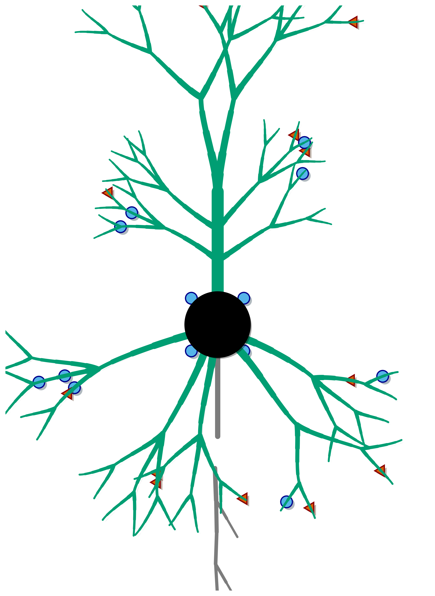
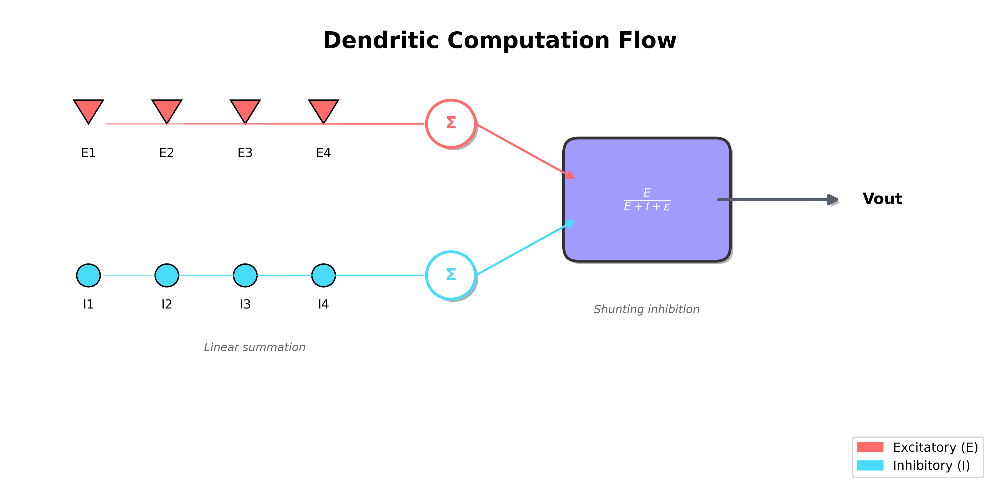
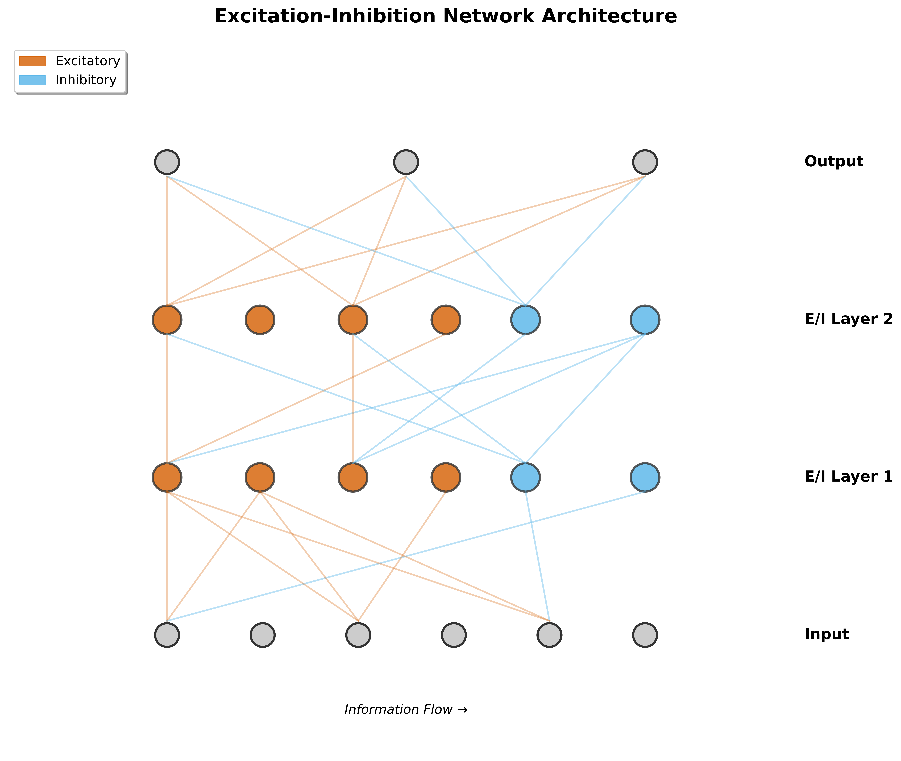
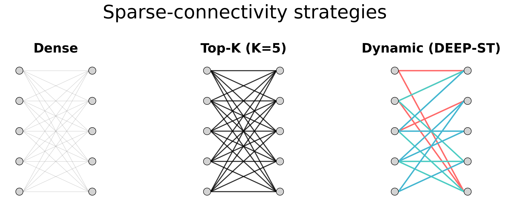

Theory and Background
====================

This section covers the theoretical foundations and biological principles underlying the Dendritic Modeling Framework.

Biological Foundations
----------------------

Dendritic Computation
~~~~~~~~~~~~~~~~~~~~~

Neurons are not simple point processors. Their dendritic trees perform sophisticated local computations before signals reach the soma:

**Key principles:**

- **Spatial segregation**: Different dendritic branches can process different input streams independently
- **Local nonlinearities**: Dendritic branches implement nonlinear operations through voltage-gated channels
- **Compartmentalization**: Electrical and biochemical isolation allows for localized processing

Shunting Inhibition
~~~~~~~~~~~~~~~~~~~

The core computational principle in our framework is shunting inhibition, a divisive form of inhibition ubiquitous in biological neural circuits:

.. math::

   V_{out} = \frac{E}{E + I + \epsilon}

Where:
- :math:`E` is the excitatory input
- :math:`I` is the inhibitory input  
- :math:`\epsilon` is a small constant preventing division by zero

This provides several computational advantages:
- **Gain control**: Automatic adjustment of neural sensitivity
- **Normalization**: Inputs are normalized by total activity
- **Stability**: Prevents runaway excitation

Excitation-Inhibition Balance
~~~~~~~~~~~~~~~~~~~~~~~~~~~~~

Following Dale's principle, neurons in biological networks are either excitatory or inhibitory, but not both:

**Network organization:**
- Separate excitatory (E) and inhibitory (I) populations
- E→E connections propagate signals between layers
- E→I connections recruit inhibition
- I→E connections provide feedback inhibition within layers
- I→I connections between layers

Mathematical Framework
----------------------

Dendritic Integration
~~~~~~~~~~~~~~~~~~~~~

Each dendritic branch :math:`d_i` performs the following computation:

.. math::

   V_{d_i} = \begin{cases}
   \frac{E_i}{E_i + I_i + \epsilon} & \text{if } i = n \text{ (distal)} \\
   \frac{E_i + V_{d_{i+1}}}{E_i + V_{d_{i+1}} + I_i + \epsilon} & \text{otherwise}
   \end{cases}

This creates a sequential processing chain from distal to proximal dendrites:

Network Dynamics
~~~~~~~~~~~~~~~~

The full network dynamics for layer :math:`\ell` are described by:

.. math::

   \mathbf{h}^{(\ell)}_E = f_{dendrite}(W^{(\ell)}_{EE} \mathbf{h}^{(\ell-1)}_E, W^{(\ell)}_{IE} \mathbf{h}^{(\ell-1)}_I)

   \mathbf{h}^{(\ell)}_I = g(W^{(\ell)}_{EI} \mathbf{h}^{(\ell-1)}_E + W^{(\ell)}_{II} \mathbf{h}^{(\ell-1)}_I)

Where :math:`f_{dendrite}` implements the sequential dendritic computation with shunting inhibition.

Sparse Connectivity
~~~~~~~~~~~~~~~~~~~

Biological networks are sparsely connected. We implement several strategies:

1. **Dense Connectivity**: Traditional fully-connected layers
2. **TopK Sparse**: Each neuron connects to exactly K others
3. **DEEPST Dynamic**: Adaptive rewiring based on importance

Implementation Details
----------------------

Computational Efficiency
~~~~~~~~~~~~~~~~~~~~~~~~

Despite biological complexity, our implementation is computationally efficient:

- Sparse matrix operations for connectivity
- Vectorized dendritic computations
- GPU-accelerated forward/backward passes
- Memory-efficient gradient computation

Stability Considerations
~~~~~~~~~~~~~~~~~~~~~~~~

To ensure stable training:

1. **Voltage stabilization**: Pre-training phase to establish proper voltage ranges
2. **Gradient scaling**: Adaptive normalization for dendritic gradients
3. **Weight initialization**: Specialized initialization for E/I balance
4. **Homeostatic regularization**: Maintains healthy activity levels

Key Advantages
--------------

The dendritic modeling framework offers several advantages over traditional neural networks:

**Biological Plausibility**
   - Respects Dale's principle (separate E/I populations)
   - Implements realistic synaptic dynamics
   - Models dendritic computation

**Computational Benefits**
   - Natural normalization through shunting inhibition
   - Enhanced gradient flow through dendrites
   - Sparse connectivity for efficiency

**Robustness**
   - Inherent stability from divisive normalization
   - Superior noise tolerance
   - Reduced need for explicit regularization

References
----------

Key papers underlying this framework:

1. **Shunting inhibition**: Carandini & Heeger (2012) "Normalization as a canonical neural computation"
2. **Dendritic computation**: Stuart & Spruston (2015) "Dendritic integration: 60 years of progress"
3. **E/I balance**: Denève & Machens (2016) "Efficient codes and balanced networks"
4. **Sparse connectivity**: Litwin-Kumar & Doiron (2014) "Formation and maintenance of neuronal assemblies"

For implementation details, see the :doc:`api_reference`. 