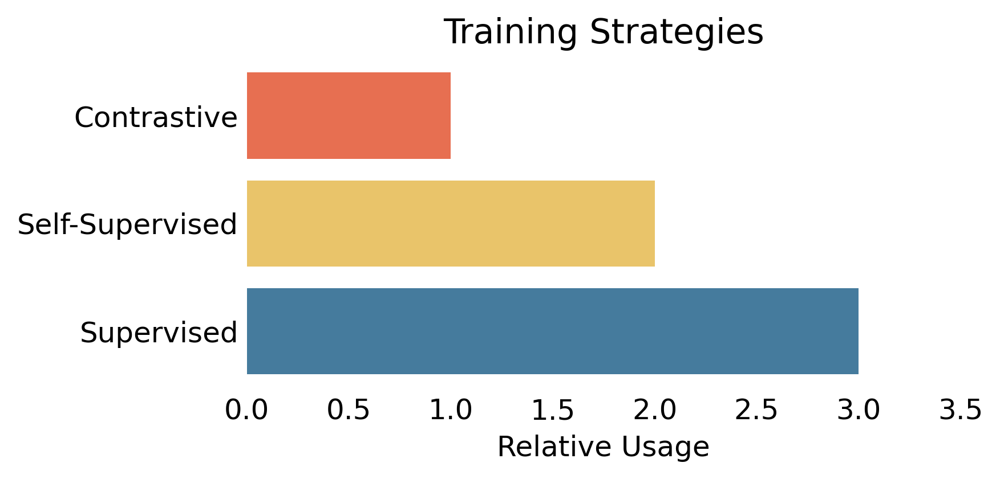

Training Strategies and Usage
============================

This section covers the comprehensive suite of training strategies available in the Dendritic Modeling Framework, from standard backpropagation to bio-inspired local learning algorithms and large-scale distributed training.

   **Training Strategies**: The framework supports multiple training approaches from end-to-end backpropagation to biologically-plausible local credit assignment.

Overview
--------

The framework provides multiple training strategies to suit different research goals and computational constraints:

* **Standard Training**: Traditional end-to-end backpropagation
* **Bio-inspired Strategies**: Layer-wise, branch-wise, and local credit assignment
* **Specialized Methods**: Two-step training, voltage stabilization
* **Distributed Training**: FSDP for large-scale models
* **Custom Strategies**: Extensible framework for novel approaches

.. toctree::
   :maxdepth: 2
   :caption: Training Topics

   strategies
   optimization
   distributed
   fsdp_guide
   custom_training

Training Strategy Framework
---------------------------

All training strategies in the framework follow a common interface that allows for easy switching and comparison:

.. code-block:: yaml

   train:
     learning_strategy: "standard"  # or "layer_wise", "two_step", etc.
     trainer:
       epochs: 100
       batch_size: 64
       learning_rate: 0.001
     # Strategy-specific parameters
     strategy_params:
       key: value

This design enables researchers to:
- Compare different learning algorithms on the same task
- Gradually transition from standard to bio-inspired training
- Combine strategies for hybrid approaches
- Extend with custom implementations

Standard Training
-----------------

Traditional end-to-end backpropagation for fast, reliable training.

Configuration
~~~~~~~~~~~~

.. code-block:: yaml

   train:
     learning_strategy: "standard"
     trainer:
       epochs: 100
       batch_size: 64
       learning_rate: 0.001
       optimizer: "adam"
       scheduler: "cosine"
       early_stopping: true
       patience: 10

Features
~~~~~~~~

* **Full end-to-end optimization**: All parameters updated simultaneously
* **Standard optimizers**: Adam, SGD, AdamW, RMSprop
* **Learning rate scheduling**: Cosine, exponential, step, plateau
* **Early stopping**: Automatic training termination
* **Gradient clipping**: Prevent exploding gradients

When to Use
~~~~~~~~~~~

* **Quick prototyping**: Fast iteration and testing
* **Baseline comparisons**: Standard ML benchmark
* **Small to medium models**: When computational resources allow
* **Well-understood tasks**: Classification, regression

Performance Optimizations
~~~~~~~~~~~~~~~~~~~~~~~~~

.. code-block:: yaml

   train:
     learning_strategy: "standard"
     trainer:
       # Performance optimizations
       enable_amp: true              # Mixed precision training
       gradient_accumulation_steps: 4 # Larger effective batch size
       dataloader_num_workers: 8     # Parallel data loading
       pin_memory: true              # Faster GPU transfers

Bio-inspired Training Strategies
-------------------------------

Strategies that capture aspects of biological learning mechanisms.

Layer-wise Training
~~~~~~~~~~~~~~~~~~

Sequential training of network layers, inspired by developmental biology.

.. code-block:: yaml

   train:
     learning_strategy: "layer_wise"
     strategy_params:
       epochs_per_layer: 20          # Train each layer for 20 epochs
       freeze_trained_layers: true   # Keep trained layers frozen
       layer_wise_lr_decay: 0.9      # Reduce LR for deeper layers

**How it works**:
1. Train only the first layer while keeping others frozen
2. Once converged, freeze first layer and train second layer
3. Continue sequentially through all layers
4. Optional final fine-tuning of all layers

**Benefits**:
- Reduces memory usage for deep networks
- More stable training for very deep dendrites
- Biological plausibility (developmental learning)
- Better gradient flow in deep branches

**Use cases**:
- Very deep dendritic networks
- Limited computational resources
- Studying layer-wise learning dynamics

Branch-wise Training
~~~~~~~~~~~~~~~~~~~

Local credit assignment at the dendritic branch level.

.. code-block:: yaml

   train:
     learning_strategy: "branch_wise"
     strategy_params:
       local_learning_rate: 0.01     # LR for local updates
       global_learning_rate: 0.001   # LR for global updates
       local_epochs: 5               # Local updates per global step
       branch_independence: 0.8      # How independent branches are

**Mechanism**:
- Each dendritic branch maintains local learning objectives
- Branches update based on local error signals
- Periodic global coordination aligns branch objectives
- Mimics biological local plasticity

**Benefits**:
- High biological realism
- Parallelizable across branches
- Robust to local damage/noise
- Novel learning dynamics

Two-step Training
~~~~~~~~~~~~~~~~

Local pre-training followed by global fine-tuning.

.. code-block:: yaml

   train:
     learning_strategy: "two_step"
     strategy_params:
       pretrain_epochs: 50           # Local pre-training phase
       finetune_epochs: 30           # Global fine-tuning phase
       pretrain_learning_rate: 0.01  # Higher LR for pre-training
       finetune_learning_rate: 0.001 # Lower LR for fine-tuning
       freeze_pretrained: false      # Allow updates during fine-tuning

**Phase 1 - Local Pre-training**:
- Each component learns local representations
- Unsupervised or self-supervised objectives
- High learning rates for fast convergence

**Phase 2 - Global Fine-tuning**:
- End-to-end supervised training
- Lower learning rates for stability
- Fine-tune pre-trained representations

**Benefits**:
- Stable training for complex architectures
- Better initialization than random
- Combines unsupervised and supervised learning
- Biologically plausible (development + experience)

Two-step KL Training
~~~~~~~~~~~~~~~~~~~

Two-step training with KL divergence regularization.

.. code-block:: yaml

   train:
     learning_strategy: "two_step_kl"
     strategy_params:
       pretrain_epochs: 50
       finetune_epochs: 30
       kl_weight: 0.1               # KL regularization strength
       kl_schedule: "linear"        # How KL weight changes
       target_distribution: "uniform" # Target for KL divergence

**Additional Features**:
- KL divergence encourages specific activation patterns
- Regularizes against overfitting during fine-tuning
- Can target different activation distributions
- Helps maintain biological realism

Voltage Stabilization Training
~~~~~~~~~~~~~~~~~~~~~~~~~~~~~

Warm-up phase to stabilize dendritic voltages before main training.

.. code-block:: yaml

   train:
     learning_strategy: "voltage_stabilization"
     strategy_params:
       stabilization_epochs: 10     # Warm-up phase duration
       target_voltage: 0.5          # Target average voltage
       stabilization_lr: 0.1       # High LR for quick stabilization
       main_learning_rate: 0.001   # Normal LR after stabilization

**Purpose**:
- Prevents initial training instability
- Ensures biological voltage ranges
- Particularly important for shunting inhibition
- Improves convergence in deep dendritic networks

**Use cases**:
- Networks with shunting inhibition
- Deep dendritic architectures
- When experiencing training instability

Advanced Optimization Techniques
--------------------------------

Split Parameter Optimization
~~~~~~~~~~~~~~~~~~~~~~~~~~~

Different optimization strategies for excitatory and inhibitory parameters.

.. code-block:: yaml

   train:
     trainer:
       split_params: true
       excitatory_optimizer:
         type: "adam"
         lr: 0.001
         weight_decay: 0.0001
       inhibitory_optimizer:
         type: "sgd"
         lr: 0.01
         momentum: 0.9

**Benefits**:
- Excitatory and inhibitory neurons have different dynamics
- Allows for biologically-motivated learning rules
- Can improve training stability
- Enables asymmetric regularization

Adaptive Learning Rates
~~~~~~~~~~~~~~~~~~~~~~

Learning rate schedules adapted to dendritic networks.

.. code-block:: yaml

   train:
     trainer:
       scheduler: "dendritic_adaptive"
       scheduler_params:
         base_lr: 0.001
         branch_lr_factor: 0.1      # Distal branches learn slower
         inhibitory_lr_factor: 2.0  # Inhibitory faster
         adaptation_window: 100     # Adaptation frequency

Gradient Scaling and Clipping
~~~~~~~~~~~~~~~~~~~~~~~~~~~~

.. code-block:: yaml

   train:
     trainer:
       gradient_clipping: true
       max_grad_norm: 1.0
       gradient_scaling:
         method: "dendritic_aware"   # Scale by branch depth
         scale_factor: 2.0

Distributed Training with FSDP
------------------------------

For large-scale models requiring multiple GPUs or nodes.

Basic FSDP Configuration
~~~~~~~~~~~~~~~~~~~~~~~

.. code-block:: yaml

   train:
     use_fsdp: true
     fsdp_config:
       mixed_precision: true
       sharding_strategy: "full"    # "full", "grad_op", "no_shard"
       cpu_offload: false          # Keep parameters on GPU
       backward_prefetch: true     # Optimize communication
       limit_all_gathers: true     # Memory optimization

Advanced FSDP Settings
~~~~~~~~~~~~~~~~~~~~~

.. code-block:: yaml

   train:
     fsdp_config:
       # Memory management
       cpu_offload: true           # Offload to CPU when memory-constrained
       offload_params: true
       offload_optimizer: true
       
       # Communication optimization
       backward_prefetch: "backward_post"
       forward_prefetch: false
       limit_all_gathers: true
       
       # Precision settings
       mixed_precision: true
       mixed_precision_param_dtype: "float16"
       mixed_precision_reduce_dtype: "float16"
       mixed_precision_buffer_dtype: "float16"

Multi-node Training
~~~~~~~~~~~~~~~~~~

.. code-block:: bash

   # Launch distributed training across nodes
   torchrun --nnodes=4 --nproc_per_node=8 \
            --master_addr=node0 --master_port=29500 \
            train_experiments_fsdp.py config.yaml

FSDP Performance Optimization
~~~~~~~~~~~~~~~~~~~~~~~~~~~~

.. code-block:: yaml

   train:
     fsdp_config:
       # For maximum performance
       sharding_strategy: "full"
       mixed_precision: true
       cpu_offload: false
       backward_prefetch: "backward_post"
       
       # For maximum memory efficiency
       sharding_strategy: "full"
       mixed_precision: true
       cpu_offload: true
       gradient_checkpointing: true

Memory Management Strategies
---------------------------

Gradient Checkpointing
~~~~~~~~~~~~~~~~~~~~~

Trade computation for memory by recomputing activations.

.. code-block:: yaml

   train:
     memory_management:
       gradient_checkpointing: true
       checkpoint_ratio: 0.5       # Checkpoint every 2nd layer

Gradient Accumulation
~~~~~~~~~~~~~~~~~~~~

Simulate larger batch sizes with limited memory.

.. code-block:: yaml

   train:
     trainer:
       batch_size: 32              # Physical batch size
       gradient_accumulation_steps: 4  # Effective batch size = 128

Mixed Precision Training
~~~~~~~~~~~~~~~~~~~~~~~

Use float16 for training while maintaining float32 precision where needed.

.. code-block:: yaml

   train:
     trainer:
       enable_amp: true
       grad_scaler_init_scale: 65536.0
       grad_scaler_growth_factor: 2.0

Custom Training Strategies
-------------------------

The framework allows for easy extension with custom training strategies.

Creating Custom Strategies
~~~~~~~~~~~~~~~~~~~~~~~~~

.. code-block:: python

   from dendritic_modeling.training.base import BaseTrainingStrategy
   
   class MyCustomStrategy(BaseTrainingStrategy):
       def __init__(self, custom_param=1.0):
           super().__init__()
           self.custom_param = custom_param
       
       def training_step(self, batch, model, optimizer):
           # Implement custom training logic
           loss = self.compute_custom_loss(batch, model)
           return loss
       
       def compute_custom_loss(self, batch, model):
           # Custom loss computation
           pass

**Register the strategy**:

.. code-block:: python

   from dendritic_modeling.core.factory import register_strategy
   
   @register_strategy("my_custom")
   class MyCustomStrategy(BaseTrainingStrategy):
       # Implementation

**Use in configuration**:

.. code-block:: yaml

   train:
     learning_strategy: "my_custom"
     strategy_params:
       custom_param: 2.0

Example Custom Strategies
~~~~~~~~~~~~~~~~~~~~~~~~~

**Hebbian Learning**:

.. code-block:: python

   class HebbianStrategy(BaseTrainingStrategy):
       def training_step(self, batch, model, optimizer):
           # Implement Hebbian learning rule
           x, y = batch
           activations = model.get_activations(x)
           hebbian_updates = self.compute_hebbian_updates(activations)
           model.apply_hebbian_updates(hebbian_updates)

**Contrastive Learning**:

.. code-block:: python

   class ContrastiveStrategy(BaseTrainingStrategy):
       def training_step(self, batch, model, optimizer):
           # Implement contrastive divergence
           positive_phase = model.forward(batch)
           negative_phase = model.generate_negative_samples()
           loss = self.contrastive_loss(positive_phase, negative_phase)
           return loss

Performance Monitoring and Debugging
------------------------------------

Training Metrics
~~~~~~~~~~~~~~~

.. code-block:: yaml

   train:
     monitoring:
       log_frequency: 100          # Log every 100 steps
       metrics: 
         - "loss"
         - "accuracy"
         - "gradient_norm"
         - "learning_rate"
         - "memory_usage"

Profiling Training
~~~~~~~~~~~~~~~~~

.. code-block:: yaml

   train:
     profiling:
       enabled: true
       profile_memory: true
       profile_compute: true
       output_dir: "./profiling_results"

Early Stopping and Checkpointing
~~~~~~~~~~~~~~~~~~~~~~~~~~~~~~~

.. code-block:: yaml

   train:
     trainer:
       early_stopping: true
       patience: 10                # Stop after 10 epochs without improvement
       min_delta: 0.001           # Minimum improvement threshold
       
       checkpointing:
         save_best: true           # Save best model
         save_frequency: 10        # Save every 10 epochs
         keep_last_n: 3           # Keep last 3 checkpoints

Best Practices
-------------

Choosing Training Strategies
~~~~~~~~~~~~~~~~~~~~~~~~~~

**Use Standard Training when**:
- Baseline comparisons needed
- Fast prototyping required
- Standard ML tasks
- Computational resources abundant

**Use Bio-inspired Training when**:
- Studying biological learning
- Deep dendritic networks
- Memory constraints exist
- Novel learning dynamics desired

**Use FSDP Training when**:
- Model size > 1B parameters
- Multiple GPUs available
- Distributed computation needed
- Maximum scaling required

Common Training Issues
~~~~~~~~~~~~~~~~~~~~

**Convergence Problems**:
- Try voltage stabilization for shunting inhibition
- Use gradient clipping for deep dendrites
- Consider layer-wise training for stability

**Memory Issues**:
- Enable gradient checkpointing
- Use gradient accumulation
- Try CPU offloading with FSDP

**Performance Issues**:
- Enable mixed precision training
- Optimize data loading pipeline
- Use appropriate batch sizes

Hyperparameter Guidelines
~~~~~~~~~~~~~~~~~~~~~~~

**Learning Rates**:
- Standard training: 0.001 - 0.01
- Bio-inspired: 0.01 - 0.1 (often higher)
- Fine-tuning: 0.0001 - 0.001

**Batch Sizes**:
- Small models: 32 - 128
- Medium models: 64 - 256
- Large models: 128 - 512 (with accumulation)

**Training Duration**:
- Simple tasks: 50 - 100 epochs
- Complex tasks: 100 - 500 epochs
- Bio-inspired: Often requires more epochs

Next Steps
----------

Explore specific training approaches:

1. **Try standard training**: Start with :doc:`strategies`
2. **Explore bio-inspired methods**: Learn about layer-wise and branch-wise training
3. **Scale up**: Master :doc:`distributed` training with FSDP
4. **Optimize performance**: Check :doc:`../performance/index`
5. **Create custom strategies**: Extend with :doc:`custom_training`

.. seealso::
   * :doc:`../architectures/index` - Choosing the right architecture for your training strategy
   * :doc:`../configuration/index` - Complete training configuration options
   * :doc:`../troubleshooting` - Solutions for common training issues 