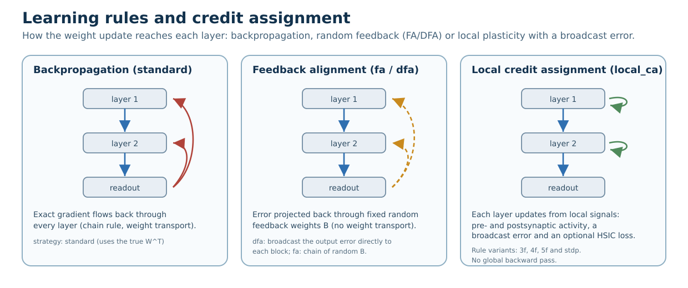

Training
========

``dendritic-train config.yaml`` trains the model that a configuration file
describes. One trainer updates the encoder (when it has trainable
parameters), the core network and the decoder together; there is no separate
encoder phase. ``training.main.strategy`` selects how the trainer computes the
weight updates: backpropagation, a feedback-alignment rule, local learning
rules, a warm-up or layer-wise schedule, or a sequence of stages. Every
training option lives under ``training.main``:

.. code-block:: yaml

   training:
     main:
       strategy: standard        # how the updates are computed (see "Training strategies")
       common:                   # the training loop: epochs, batches, loss, clipping, checkpoints
         epochs: 100
         batch_size: 256
         loss_function: ce
         param_groups:           # learning rate of each parameter group
           lr: 0.01
       optimizer:                # optimizer and its hyperparameters
         name: adam
       regularization: {}        # auxiliary L1/L2 and E/I weight-ratio penalties
       pruning: {}               # magnitude pruning after training
       strategies: {}            # one options block per strategy that has options
       learning_strategy_config: null   # local learning rules (local_ca and multi_stage)

The former ``training.encoder`` section is ignored with a warning. Training on
several GPUs is described in :ref:`distributed-training`; the run directory
and the files a run writes are described in :ref:`run-outputs`.

.. contents:: On this page
   :local:
   :depth: 1

Training loop options
---------------------

``training.main.common`` holds the options of the training loop that every
strategy shares; the annotated reference configuration
(:ref:`reference-config`) shows them in context.

.. list-table::
   :header-rows: 1
   :widths: 30 17 53

   * - Option
     - Default
     - Meaning
   * - ``epochs``
     - ``1000``
     - Training epochs. Strategies with several phases add their own phase
       epochs (see their sections).
   * - ``batch_size``
     - ``512``
     - Samples per optimizer step, per process.
   * - ``shuffle``
     - ``true``
     - Reshuffle the training set every epoch (seeded by the loader seed).
   * - ``loss_function``
     - ``ce``
     - Registered loss name (:ref:`loss-functions`).
   * - ``grad_clip_value``, ``grad_clip_mode``
     - ``2.0``, ``null``
     - Gradient clipping (:ref:`training-gradient-clipping`).
   * - ``early_stopping``, ``patience``
     - ``true``, ``500``
     - Stop when the validation loss has not improved for ``patience``
       epochs.
   * - ``load_best_state_dict``, ``best_state_device``,
       ``save_best_checkpoint``
     - ``true``, ``model``, ``every_improvement``
     - Which weights the run ends with and when the best checkpoint is
       written (:ref:`training-checkpoints`).
   * - ``lr_schedule``, ``lr_warmup_epochs``
     - ``none``, ``0``
     - Learning-rate schedule (:ref:`training-lr-schedule`).
   * - ``use_amp``
     - ``false``
     - Automatic mixed precision with a gradient scaler. It takes effect
       only on CUDA devices; without CUDA the trainer logs a warning and
       trains in full precision.
   * - ``enable_nan_checking``
     - ``false``
     - Set non-finite gradient entries to zero before clipping and the
       optimizer step.
   * - ``profile_dataloader``
     - ``false``
     - Log how long each epoch waits for data.
   * - ``log_first_step_diagnostics``
     - ``false``
     - Record decoder-input, logit and gradient statistics of the first
       optimizer step. Only the FSDP trainer reads it; every other trainer
       raises when it is true.
   * - ``plot_losses``, ``suppress_prints``, ``print_every``
     - ``true``, ``false``, ``10``
     - Loss-curve plots, and the per-epoch progress log every
       ``print_every`` epochs.
   * - ``num_workers``
     - ``null``
     - DataLoader worker processes. ``null`` chooses a count: 0 for
       in-memory tensor datasets, several for file-backed image datasets.
   * - ``pin_memory``
     - ``null``
     - Pin host batches; ``null`` pins them when training on CUDA.
   * - ``persistent_workers``, ``prefetch_factor``
     - ``null``, ``null``
     - Keep workers between epochs (``null``: when workers are used) and
       the batches each worker prefetches. Both need ``num_workers > 0``.
   * - ``in_order``
     - ``null``
     - Deliver worker batches in sampler order. ``null`` lets image datasets
       with workers deliver them out of order;
       ``experiment.strict_deterministic`` forces sampler order.
   * - ``reactivation_initialization_batch_size``,
       ``reactivation_initialization_num_batches``,
       ``reactivation_initialization_max_iterations``
     - ``256``, ``3``, ``null``
     - Batches used by data-driven gate initialization before training
       (:ref:`gate-initialization`).
   * - ``recalibrate_reactivation_every``,
       ``reactivation_update_mode``,
       ``reactivation_recalibration_mode``,
       ``reactivation_recalibration_start_epoch``,
       ``reactivation_recalibration_num_batches``,
       ``reactivation_recalibration_ema_alpha``
     - ``0``, ``backprop``, ``from_init_policy``, ``1``, ``3``, ``1.0``
     - How the reactivation gates change during training: by the optimizer
       (``backprop``), only by periodic recalibration every N epochs
       (``quantile``, which needs ``recalibrate_reactivation_every > 0``) or
       not at all (``frozen``) (:ref:`gate-initialization`).
   * - ``synapse_decay_rate``, ``weight_boosting``
     - ``0.01``, ``false``
     - Maintenance of sparse synapse banks before every optimizer step
       (:ref:`training-sparse-maintenance`). The former name
       ``weight_decay_rate`` still loads with a warning.
   * - ``param_groups``
     - see :ref:`parameter-groups`
     - Learning rate of each parameter group.
   * - ``impact_rewiring``
     - ``{}``
     - Cellwise impact rewiring of ``indexed_release`` synapses after every
       optimizer step. It needs a population network, the ``standard`` or
       ``presentation_stream`` strategy and a single process.

The command line overrides several of these options before the
configuration is validated: ``--epochs``, ``--lr``, ``--topk_lr``,
``--blocklinear_lr``, ``--reactivation_lr``, ``--decoder_lr``,
``--learning_strategy``, ``--seed`` and others (:ref:`cli-reference`).

``batch_size`` is per process: with ``W`` DDP or FSDP processes one optimizer
step sees ``W * batch_size`` samples and the learning rate is not rescaled
(:ref:`distributed-training`).

.. _parameter-groups:

Parameter groups and learning rates
-----------------------------------

The optimizer receives the model's parameters in groups, each with its own
learning rate, set under ``training.main.common.param_groups``:

.. list-table::
   :header-rows: 1
   :widths: 22 13 65

   * - Option
     - Default
     - Parameters it sets
   * - ``split_params``
     - ``true``
     - Use the component groups below. ``false`` puts every parameter in
       one group at ``lr``.
   * - ``topk_lr``
     - ``0.001``
     - Group ``topk``: the sparse synapses of the core network (Top-K,
       indexed and DeepST synapse banks).
   * - ``blocklinear_lr``
     - ``0.0001``
     - Group ``blocklinear``: the ``BlockLinear`` couplings between the
       branches of a dendritic tree.
   * - ``reactivation_lr``
     - ``0.0001``
     - Group ``reactivation``: the reactivation gates of the core network.
   * - ``decoder_lr``
     - ``0.001``
     - Group ``decoder``: every decoder parameter, including synapse or gate
       modules inside the decoder, and the learned output scales.
   * - ``decoder_input_lr``
     - ``null``
     - Group ``decoder_input``: the weight of the decoder's first
       ``Linear`` layer, when set. ``null`` leaves it in ``decoder``.
   * - ``encoder_lr``
     - ``null``
     - Group ``encoder``: trainable encoder parameters. ``null`` uses
       ``lr``.
   * - ``lr``
     - ``0.01``
     - Group ``mlp_inh_net`` (MLP inhibitory cells of structured E/I cores)
       and group ``catch_all``: every other trainable parameter, for example
       recurrent weights and learnable time constants.

With the default ``split_params: true``, ``lr`` does not reach the sparse
synapses, the branch couplings, the gates or the decoder. A sweep or a
command-line override of ``lr`` alone can therefore leave most of a dendritic
model's training unchanged; change ``topk_lr`` and the other component rates
(``--topk_lr``, ``--blocklinear_lr``, ``--reactivation_lr``,
``--decoder_lr``) instead. Single-process, DDP and FSDP training build the
optimizer from these same groups, and ``training.main.regularization``
can penalize them by name (:ref:`regularization-pruning`).

Optimizer
---------

``training.main.optimizer.name`` selects the optimizer:

.. list-table::
   :header-rows: 1
   :widths: 25 75

   * - Name
     - Optimizer and the fields it reads
   * - ``adam`` (default)
     - ``torch.optim.Adam``: ``weight_decay`` (``0.0``), ``betas``
       (``[0.9, 0.999]``), ``eps`` (``1e-8``), ``foreach`` (``null``: the
       PyTorch default).
   * - ``adamw``
     - ``torch.optim.AdamW`` with the same fields; ``weight_decay`` is
       decoupled.
   * - ``sgd``
     - ``torch.optim.SGD``: ``weight_decay``, ``momentum`` (``0.9``).
   * - ``rmsprop``
     - ``torch.optim.RMSprop``: ``weight_decay``, ``momentum``, ``eps``.
   * - ``muonh`` (alias ``muon_hyperball``)
     - Muon updates for matrix parameters (momentum and Newton-Schulz
       orthogonalization), each matrix projected back onto the sphere of its
       initial Frobenius norm; every other parameter uses AdamW with
       ``betas``, ``eps`` and ``weight_decay``. Fields: ``muon_lr_multiplier``
       (``10``; matrix rate = group rate times this factor),
       ``muon_momentum`` (``0.95``), ``muon_nesterov`` (``true``),
       ``muon_ns_steps`` (``5``), ``muon_hyperball`` (``true``),
       ``muon_min_dim`` (``2``; narrower matrices use AdamW) and
       ``muon_rank_consistency_check_steps`` (``1``; distributed steps whose
       updated matrices are compared across ranks).

``training.main.optimizer`` must be a mapping (``optimizer: {name: adamw}``,
not ``optimizer: adamw``). Every parameter group carries its own learning
rate, so ``optimizer.lr`` is only the optimizer's unused default: a value other
than ``0.001`` must equal ``param_groups.lr``, and training raises otherwise.
Set learning rates under ``param_groups``. A misspelled optimizer name loads
and fails when the optimizer is built (``dendritic-train --validate-only``
builds it). ``dendritic_modeling.training.optimizers.register_optimizer``
adds an optimizer (:ref:`extension-registries`).

.. _training-lr-schedule:

Learning-rate schedule
----------------------

``lr_schedule: none`` (default) keeps every group's learning rate. With
``lr_schedule: cosine`` the scheduler steps once after each training epoch
and multiplies every group's rate in epoch :math:`e` (counted from 0) by

.. math::

   f(e) =
   \begin{cases}
     \dfrac{e + 1}{W}, & e < W,\\[6pt]
     \dfrac{1}{2}\left(1 + \cos\dfrac{\pi\,(e - W)}{E - W}\right), & e \ge W,
   \end{cases}

where :math:`W` is ``lr_warmup_epochs`` and :math:`E` is ``epochs``. A
positive ``lr_warmup_epochs`` without ``cosine`` raises, because the warm-up
is part of the cosine schedule. ``standard``, ``recurrent``, ``fa``, ``dfa``
and ``soma_dfa`` apply this schedule. ``presentation_stream`` schedules per
optimizer step instead (:ref:`training-presentation-stream`). The other
strategies run separate phases or their own optimizer steps, so they raise
``ValueError`` for any schedule other than ``none``: ``local_ca``,
``voltage_stabilization``, ``homeostatic_control``, ``ei_equilibrium``,
``freeze_layers``, ``freeze_branches``, ``freeze_branch_kl``, ``multi_stage``
and the FSDP trainer.

.. _training-gradient-clipping:

Gradient clipping and non-finite gradients
------------------------------------------

``grad_clip_mode: value`` clamps every gradient element to
``[-grad_clip_value, grad_clip_value]``; ``grad_clip_mode: norm`` rescales all
gradients together so that their global L2 norm is at most
``grad_clip_value``. ``grad_clip_value: 0`` or ``null`` disables clipping.
When the mode is unset, ``recurrent`` and the FSDP trainer clip the norm and
every other strategy clips by value; ``config.json`` records the resolved
mode. The former ``enable_adaptive_clipping: true`` loads as
``grad_clip_mode: norm`` with a deprecation warning. ``local_ca`` clips its
local-rule gradients by value with
``learning_strategy_config.clip_grad_value``; a different common
``grad_clip_value`` or ``grad_clip_mode: norm`` raises.

``enable_nan_checking: true`` sets NaN and infinite gradient entries to zero
before clipping and the optimizer step, after AMP unscaling, so the gradient
scaler still skips an overflowing step and lowers its scale.

``use_amp``, ``enable_nan_checking`` and ``profile_dataloader`` act inside the
training step. A strategy whose own loop does not implement one of them raises
``ValueError`` when it is true:

.. list-table::
   :header-rows: 1
   :widths: 45 55

   * - Strategy
     - Step options it does not apply
   * - ``fa``, ``dfa``, ``presentation_stream``, ``freeze_branches``,
       ``freeze_branch_kl``
     - ``use_amp``, ``enable_nan_checking``, ``profile_dataloader``
   * - ``local_ca``, ``soma_dfa``
     - ``use_amp``, ``enable_nan_checking``
   * - ``recurrent``, FSDP trainer
     - ``enable_nan_checking``, ``profile_dataloader``

Gradient-scaling hooks (the ``gradient_scaling`` options of the sparse
synapses, branch couplings and gates; :ref:`synapse-variants`) act on
autograd gradients. ``fa``, ``dfa`` and ``local_ca`` assign gradients
directly and raise when a ``gradient_scaling`` option is not ``none``;
``soma_dfa`` backpropagates inside each neuron and applies them.

.. _loss-functions:

Loss functions
--------------

``training.main.common.loss_function`` names a registered loss. Names are
matched exactly, then case-insensitively; an unknown name fails when the
trainer is built. ``ce``, ``bce`` and ``cat_nll`` are defined for
``model.task: classification`` only; a trainer that applies the configured
loss raises when one of them is combined with another task (``recurrent``
applies its own task loss, described below the table).

.. list-table::
   :header-rows: 1
   :widths: 24 30 46

   * - Name
     - Alias
     - Loss
   * - ``ce``
     - ``cross_entropy``
     - Cross-entropy of class logits and integer labels.
   * - ``cat_nll``
     - ``categorical_negative_log_likelihood``
     - Negative log-likelihood of a categorical distribution with the
       outputs as logits.
   * - ``bce``
     - ``binary_cross_entropy``
     - Binary cross-entropy of probabilities (``torch.nn.BCELoss``).
   * - ``mse``
     - ``mean_squared_error``
     - Mean squared error.
   * - ``log_mse``
     - ``log_mean_squared_error``
     - Logarithm of the mean squared error.
   * - ``neg_cos_sim``
     - ``negative_cosine_similarity``
     - Negative cosine similarity of outputs and targets along the last
       dimension.
   * - ``log_adj_neg_cos_sim``
     - ``log_adjusted_negative_cosine_similarity``
     - :math:`\log(1 + \text{neg\_cos\_sim})`, which keeps a gradient
       near perfect similarity.
   * - ``vae_elbo``
     - ``variational_autoencoder_elbo``
     - Reconstruction error plus the KL divergence of the latent
       distribution; the model must be a variational autoencoder.
   * - ``temporal_event_ce``
     - ``temporal_event_cross_entropy``
     - Sequence loss: cross-entropy over the time axis for one event time.
       Outputs ``[batch, time]`` (or ``[batch, time, 1]``); targets are
       event indices ``[batch]`` or non-negative time distributions
       ``[batch, time]``.
   * - ``masked_dual_task_temporal``
     - ``masked_dual_task``
     - Sequence loss: balanced binary-logit loss of two output heads,
       ``[batch, time, 2]``, with targets ``[batch, time, 4]`` holding a
       label and a mask for each head.

The ``recurrent`` strategy trains classification with cross-entropy and
regression with mean squared error. It accepts ``ce``/``cross_entropy``
(classification), ``mse``/``mean_squared_error`` (regression) or one of the two
sequence losses, which it applies to whole sequences; other names raise. The
FSDP trainer evaluates the loss on precomputed outputs, so the losses that
need the model itself (``neg_cos_sim``, ``log_adj_neg_cos_sim``,
``vae_elbo``) and the sequence losses raise there.
``dendritic_modeling.training.loss.register_loss_function`` adds a loss
(:ref:`extension-registries`).

.. _training-checkpoints:

Best state and checkpoints
--------------------------

With ``load_best_state_dict: true`` (default) training ends on the weights of
the epoch with the lowest validation loss. Epochs whose validation loss is
not finite are never selected, and a run in which no epoch had a finite
validation loss raises instead of restoring the untrained weights;
``load_best_state_dict: false`` keeps the final weights.
``best_state_device: cpu`` keeps the best-epoch copy in host memory instead of
on the model's device. ``save_best_checkpoint`` writes the best weights to
``<prefix>best_model.pt`` on every improvement (``every_improvement``), once
at the end of the phase (``end``) or not at all (``never``). The trainer
writes into the run's ``main_network/`` directory, and ``<prefix>`` names the
strategy or phase, for example ``standard_best_model.pt``.

``experiment.checkpointing.enabled: true`` adds periodic checkpoints: the
model weights every ``save_every_n_epochs`` epochs (default ``10``) in
``main_network/<prefix>checkpoints/epoch_<N>.pt``, where ``N`` counts epochs
from 1 and ``epoch_0.pt`` holds the weights before the first epoch. At the end
of a run ``final_model.pt`` in the run directory holds the final weights; when
they are those of the single best checkpoint it is a hard link to that file.
The FSDP trainer writes its own checkpoints (:ref:`distributed-training`).

Every checkpoint the trainers write goes through
``networks.checkpoints.atomic_torch_save``: the file is written next to its
destination, flushed to disk and renamed over it, so an interrupted save keeps
the previous file, and its mode follows the umask. Multi-stage checkpoints
store their stage configuration and results as plain containers and load with
PyTorch's weights-only loader.

.. _checkpoint-versions:

Checkpoint versions
~~~~~~~~~~~~~~~~~~~

A module whose saved state gained entries records a version in the state
dict's ``_metadata``, and ``networks/state_versions.py`` lists the entries
each version added. Loading follows one rule:

- A file of the current version that lacks such an entry fails strict
  loading, like any other missing key.
- A file that predates the entry keeps the module's constructed value, with a
  warning. The loaders (``load_initial_model_checkpoint``, checkpoint
  analysis and Poisson transfer) return these entries under
  ``legacy_state``.
- A state dict rebuilt without its ``_metadata`` counts as predating every
  version, so code that rebuilds state dicts should carry the metadata over
  (``networks.checkpoints.copy_state_metadata``).
  ``networks.state_versions.compare_state_dict_keys`` compares a file with a
  model and lists entries of a newer version separately
  (``version_added``) from missing and unexpected keys.

The versioned entries are:

- ``DendriticBranchLayer`` version 2: the analytical calibration priors
  ``reactivation_analytical_init_m`` and ``reactivation_analytical_init_b``
  (float64) and the additive tangent anchors. For the tangent anchors, an
  operating point the module already has from its configuration takes
  precedence over a file that recorded none.
- Parametric activations version 2: ``fixed_b_buffer``.
- Indexed synapse layers version 2: the allowed-connection mask of the
  rewiring layers (``indexed_rewire``, ``indexed_release``). A kept mask is
  reported with the number of loaded contacts it disallows.
- DeepST version 2: the rewiring counter ``rewire_step``.
- ``indexed_release`` version 2: contact ages count optimizer steps. A
  version-1 file records a ``legacy_state`` note because its ages counted
  training forward passes; the two agree when every optimizer step runs one
  training forward pass.

A library version that predates an entry rejects files that contain it as
unexpected keys under strict loading.

.. _training-sparse-maintenance:

Sparse synapse maintenance and rewiring
---------------------------------------

The trainers wrap the optimizer in ``CustomWeightDecayOptimizer``. Before
each update it decays the selected sparse weights with their parameter
group's current learning rate; after the update it advances rewiring and any
configured topology controllers. Three separate settings shrink weights:

.. list-table::
   :header-rows: 1
   :widths: 40 12 48

   * - Setting
     - Default
     - Effect
   * - ``training.main.common.synapse_decay_rate``
     - ``0.01``
     - Multiplies the active weights of sparse synapse banks by
       ``1 - lr * synapse_decay_rate`` before every step.
   * - ``training.main.optimizer.weight_decay``
     - ``0.0``
     - The optimizer's own weight decay (L2 for Adam, decoupled for AdamW).
   * - ``training.main.regularization.l2_weight``
     - ``0.0``
     - An L2 penalty added to the loss.

- ``weight_boosting: true`` multiplies eligible unselected candidate weights
  by ``1 + lr * synapse_decay_rate``; it needs a positive
  ``synapse_decay_rate``. Forbidden inputs and entries excluded by a
  connection mask are never boosted.
- Dense Top-K banks with a deterministic selection (``topk`` without
  selection noise) decay the synapses that their training forward pass
  selected in the same step instead of selecting again; decay runs before the
  optimizer update, so the selection is the same. A bank whose ``pre_w``
  changed after that forward pass (an in-place update, a state load or a
  device move) selects again. Stochastic, variance and dense-to-sparse
  selection always select again.
- Fixed-index layers (``indexed``, ``indexed_rewire``, ``indexed_release``)
  store only active contacts. Their weights decay; they have no unselected
  candidates to boost.
- Maintenance reaches sparse leaves in the encoder, core and decoder once per
  optimizer step. Frozen weights and parameters outside the stepping
  optimizer's groups are excluded.
- DeepST and indexed-rewire layers count optimizer steps in their
  ``rewire_step`` buffer and rewire every ``rewire_frequency`` steps. DeepST
  with signed weights prunes by magnitude and regrows at
  ``+weight_threshold``.
- ``credit_deepst`` needs recorded local-learning credit after
  ``credit_warmup_steps``: use it with ``local_ca``, or select ``deepst`` for
  backpropagation. New candidates stay in the pool until they have been
  observed ``credit_min_observations`` times; at each event, mature candidates
  that were not swapped in are replaced by new random ones.
- Dense-to-sparse layers with ``advance_on_forward: true`` keep one mask per
  recurrent unroll and advance the schedule once it completes. With
  ``advance_on_forward: false`` the optimizer-step hook advances it.
- Indexed-release contact ages count optimizer steps. Cellwise impact
  rewiring replaces at most ``floor(n_eligible * eligible_fraction)`` contacts
  per cell and ``floor(K * segment_fraction)`` per segment.

Selection noise and stochastic Top-K selection apply in training mode.
Evaluation uses deterministic selection, and signed weights are ranked by
magnitude. The VAE encoder samples during training and returns its latent
mean in evaluation mode.

Indexed-rewire and indexed-release checkpoints keep their allowed-connection
masks, and indexed-rewire also records its resolved random seed and step
counter. A rewired contact keeps the weight of the contact it replaces; the
new inputs are drawn from the layer's rewiring seed, not from the training
random stream, and every DDP rank reads the same synchronized seed buffer. Deep copies keep gradient-scaling hooks. A model can be deep-copied or
pickled after a training forward: the tensors that modules keep from their
last forward pass for analyses (population outputs, routing information,
branch currents and diagnostics) are copied without their autograd graph,
and the original keeps them unchanged, so the copy trains on exactly as the
original does. Calling ``train()`` after
``freeze_for_inference()`` restores the saved trainability flags of the
parameters. :ref:`synapse-variants` describes the synapse families and their
options.

.. _training-strategies:

Training strategies
-------------------

   How the weight update reaches each layer: backpropagation (``standard``)
   sends the exact gradient back through every layer; feedback alignment
   (``fa``, ``dfa``) sends the error through fixed random matrices instead of
   the transposed weights; local credit assignment (``local_ca``) combines
   local presynaptic and postsynaptic activity with a broadcast error, with no
   global backward pass.

``training.main.strategy`` takes one of these values. Strategies with options
read them from ``training.main.strategies.<name>``; ``local_ca`` reads
``training.main.learning_strategy_config`` instead. ``strategies.standard``
takes no options, and a block for ``fa``, ``dfa`` or ``soma_dfa`` raises.

.. list-table::
   :header-rows: 1
   :widths: 19 43 38

   * - Strategy
     - What it does
     - Options block and use
   * - ``standard``
     - Backpropagation, with optional regularization, pruning, AMP and the
       cosine schedule.
     - None. The default for feedforward models.
   * - ``recurrent``
     - Backpropagation through time on ``[batch, time, features]``
       sequences; applies the sequence losses.
     - ``strategies.recurrent``. Recurrent cores and sequence datasets.
   * - ``fa``, ``dfa``
     - Feedback alignment and direct feedback alignment: fixed random
       feedback matrices replace the transposed weights; each block receives
       the exact local gradient of its output.
     - None. Credit-assignment baselines; dendritic tree cores need ``dfa``.
   * - ``soma_dfa``
     - Projects the output error through one fixed random matrix onto the
       somatic output of the core and backpropagates only inside each
       neuron; the decoder receives its exact gradient.
     - None. A layer-level feedback-alignment baseline.
   * - ``local_ca``
     - Local three-, four- and five-factor rules and trace STDP with a
       broadcast output error.
     - ``learning_strategy_config``. Local-learning models with dendritic
       branch layers.
   * - ``voltage_stabilization``
     - Warm-up that drives gate inputs, gate outputs or gate occupancy toward
       targets, then standard training.
     - ``strategies.voltage_stabilization``.
   * - ``homeostatic_control``
     - Warm-up on the voltage objective averaged with an E/I balance term,
       then standard training.
     - ``strategies.homeostatic_control``. Needs inhibitory synapses.
   * - ``ei_equilibrium``
     - Warm-up that balances each branch's excitatory and inhibitory
       conductance, then standard training.
     - ``strategies.ei_equilibrium``. Needs inhibitory synapses.
   * - ``freeze_layers``
     - Whole-network pretraining, then each layer alone with the others
       frozen, then whole-network fine-tuning.
     - ``strategies.freeze_layers``. Structured E/I cores.
   * - ``freeze_branches``
     - Each layer pretrained with its own linear readout head, then
       end-to-end training.
     - ``strategies.freeze_branches``. Feedforward structured E/I and
       population cores.
   * - ``freeze_branch_kl``
     - ``freeze_branches`` with a KL term toward the full model's
       predictions.
     - ``strategies.freeze_branch_kl``.
   * - ``presentation_stream``
     - Epochs of freshly sampled presentations from a stream dataset, with
       cross-entropy and a per-step schedule.
     - ``strategies.presentation_stream``. Stream datasets such as
       ``contextual_remapping``.
   * - ``multi_stage``
     - A list of stages, each with its own strategy, epochs and settings.
     - ``strategies.multi_stage``. Curricula, for example backpropagation
       followed by a local rule.

``shunting_fa`` and ``shunting_dfa`` are deprecated names that run ``fa`` and
``dfa`` with a warning, as does the deprecated class
``ShuntingFeedbackAlignmentTrainer``. A misspelled strategy name loads and
fails when the trainer is built, so check a new configuration with
``dendritic-train config.yaml --validate-only``. The strategies differ in the
schedule and the runtimes they support:

.. list-table::
   :header-rows: 1
   :widths: 34 22 22 22

   * - Strategy
     - ``lr_schedule``
     - DDP
     - FSDP
   * - ``standard``, ``recurrent``
     - per epoch
     - yes
     - yes
   * - ``fa``, ``dfa``, ``soma_dfa``
     - per epoch
     - yes
     - no
   * - ``local_ca``
     - raises
     - yes
     - no
   * - ``presentation_stream``
     - per step
     - no
     - no
   * - ``voltage_stabilization``, ``homeostatic_control``,
       ``ei_equilibrium``, ``freeze_layers``, ``freeze_branches``,
       ``freeze_branch_kl``, ``multi_stage``
     - raises
     - no
     - no

:ref:`distributed-training` gives the reasons and the other options that
DDP and FSDP reject.

Adding a strategy
~~~~~~~~~~~~~~~~~

``dendritic_modeling.training.register_trainer_strategy(name, trainer_class,
fixed_kwargs=...)`` registers a trainer class (a subclass of
``training.strategies.standard.Trainer``) under a strategy name
(:ref:`extension-registries`). The factory builds it with the
``training.main.common`` options, the values the training scripts add (seeds,
task, regularization, pruning and parameter-group settings, ``device``) and
``fixed_kwargs``; any other keyword raises with a did-you-mean hint. Class
attributes declare what the trainer supports: ``strategy_options`` (extra
keywords it reads), ``supports_lr_schedule`` and ``applies_own_lr_schedule``,
``unapplied_options`` (step options it rejects), ``ddp_reduces_gradients``
and ``default_grad_clip_mode``. The configuration loader accepts
``strategies`` blocks only for the built-in strategies listed above.

Backpropagation
---------------

``standard`` trains with backpropagation and the options of the training
loop:

.. code-block:: yaml

   training:
     main:
       strategy: standard
       common:
         epochs: 100
         batch_size: 256
         loss_function: ce
         grad_clip_value: 5.0
         early_stopping: true
         patience: 20

``recurrent`` trains recurrent cores on sequence inputs ``[batch, time,
features]`` and computes the loss for both ``output_mode: last`` and
``output_mode: all``. ``training.main.strategies.recurrent`` may override
``grad_clip_value`` (clipping the global gradient norm by default),
``use_amp``, ``lr_schedule`` and ``lr_warmup_epochs``; each defaults to
``null``, which inherits the ``common`` setting of the same name. The former
name ``grad_clip`` still loads with a warning.

.. code-block:: yaml

   training:
     main:
       strategy: recurrent
       common:
         epochs: 100
         batch_size: 64
         loss_function: ce
         lr_schedule: cosine
         lr_warmup_epochs: 5
       strategies:
         recurrent:
           grad_clip_value: 1.0

Auxiliary regularization is added to the recurrent sequence loss as in
``standard``.

Feedback alignment
------------------

``fa`` and ``dfa`` implement feedback alignment (Lillicrap et al., 2016) and
direct feedback alignment (Nøkland, 2016), which replace the transposed
forward weights of backpropagation with fixed random matrices. Training cuts
the forward pass into blocks: every dendritic branch layer (one level of a
dendritic tree), and, in MLP cores, encoders and decoders, the computation that
ends at the input of each linear layer (the previous linear layer and its
nonlinearity).

- The computation after the last cut, such as a linear readout and the output
  scale, is the output layer. It receives the exact gradient of the
  configured loss, computed from the model output by autograd.
- Every other block receives an error signal at its output and updates its
  parameters with the exact gradient of that output, its inputs held fixed.
  This local gradient includes the block's nonlinearity, weight transforms
  and connectivity masks (inactive Top-K candidates get no update), and in
  shunting branch layers the conductance and driving force of each pathway.
- ``dfa`` gives each block the output-layer error through the block's own
  random matrix. A block that feeds the output layer directly, such as the
  soma of a network with an identity decoder, receives the exact error.
- ``fa`` passes the error from block to block, multiplying the error at each
  linear layer's output by a random matrix in place of the transposed
  weights. It needs a sequential chain of linear layers, so dendritic tree
  cores use ``dfa``.

The matrices are drawn from the run seed and the block names, so a resumed
run and every DDP rank rebuild the same feedback. The loss must be computable
from the model output. Branch layers must run once per forward pass through
their ``forward`` method, so recurrent cells raise; use ``recurrent`` or
``standard`` for them. Trainable parameters that several blocks read, such as
a trainable encoder feeding several branch layers, receive no gradient, and
training lists them in a warning. Auxiliary regularization is added to the
assigned gradients. Under DDP, ``fa`` and ``dfa`` average their assigned
gradients across ranks before clipping.

.. code-block:: yaml

   training:
     main:
       strategy: dfa

``soma_dfa`` projects the output error through one fixed random matrix onto
the input of the decoder's first linear layer (the somatic output of the
core). Autograd then propagates that projected signal only within each
dendritic neuron, and the decoder receives its exact gradient. It needs a
decoder with a linear layer and a frozen or parameter-free encoder, and it
rejects auxiliary regularization. The feedback matrix is drawn from the run
seed with scale 1; there is no ``strategies.soma_dfa`` block to change them.

.. _local-credit-assignment:

Local credit assignment
-----------------------

``local_ca`` trains the dendritic synapses and branch couplings with local
learning rules. Each step runs the forward pass once while recording the
inputs, voltages and conductances of every dendritic branch layer, computes
the output error, routes it to the compartments and combines it with local
presynaptic and postsynaptic factors. The resulting updates are assigned as
gradients and applied by the configured optimizer. The rules are configured
under ``training.main.learning_strategy_config``; only ``local_ca`` and
``multi_stage`` read that section, and other strategies log that it has no
effect. A ``training.main.strategies.local_ca`` block is ignored with a
warning. The annotated reference configuration (:ref:`reference-config`)
lists every option of the section with its default.

.. code-block:: yaml

   training:
     main:
       strategy: local_ca
       common:
         epochs: 50
         loss_function: ce
       learning_strategy_config:
         rule_variant: "4f"
         error_broadcast_mode: per_soma_shared
         three_factor:
           dynamics_mode: auto
           use_conductance_scaling: true
           use_driving_force: true
         four_factor:
           rho_mode: pearson
           rho_estimator: ema
           ema_alpha: 0.05
         hsic:
           enabled: true
           weight: 0.01
         clip_grad_value: 5.0

The rules derive their updates from the branch-layer forward equations, so
``local_ca`` needs dendritic branch layers that each run once per forward
pass. It raises for:

- models without dendritic branch layers, and recurrent unrolls (branch
  layers that run several times per forward pass);
- population cores with typed synapses, a spiking soma, dendritic spikes,
  soma feedback, or the ``parallel_readout`` or ``all_active_star`` cross-level
  modes, unless ``learning_strategy_config.allow_unmodeled_forward_features``
  is true: the rules then run as a variant whose updates ignore those
  features, and the run logs which ones;
- ``indexed_release`` synapses, a configurable or learnable leak,
  ``endpoint_tanh`` gates, and additive layers whose ``additive_mode`` is not
  ``raw`` (``tangent_matched``, ``conductance_normalized``);
- synapse banks that normalize their weight rows (``weight_norm_order``);
- auxiliary regularization (``training.main.regularization``) and
  gradient-scaling hooks.

Error signal
~~~~~~~~~~~~

The output error is the per-sample gradient of the summed loss with respect
to the model output. ``error_mode`` selects it: ``ce``
(:math:`\mathrm{softmax}(\hat y) - \mathrm{onehot}(y)` for logits), ``bce``
(:math:`(p - y) / (p(1 - p))` for probability outputs, as
``torch.nn.BCELoss`` expects), ``mse`` (:math:`\hat y - y`, the gradient of
:math:`\lVert \hat y - y\rVert^2 / 2`), or ``auto`` (default), which takes
the rule from the configured loss (``ce`` and ``cat_nll``, ``bce``, ``mse``)
and raises for any other loss. ``soma_error_source`` maps the output error to
the somas: ``decoder`` (default) uses the exact readout Jacobian, ``dfa`` a
fixed random matrix (``dfa_feedback_seed``, default the run seed;
``dfa_feedback_scale``, default 1). ``error_noise_sigma`` adds Gaussian noise
to the broadcast error.

Rule variants
~~~~~~~~~~~~~

``rule_variant`` selects the local rule:

``3f``: three-factor rule (default)
   ``pre * post * error``. The postsynaptic factor follows each layer's own
   integration. On a shunting layer it is the driving force
   :math:`(E_\mathrm{rev} - V)` scaled by :math:`1/g_\mathrm{tot}`, where
   :math:`E_\mathrm{rev}` is 1 for excitation and 0 for inhibition (the
   reversal potentials of the forward equations, which
   ``three_factor.e_rev_exc`` and ``e_rev_inh`` must keep) and
   :math:`g_\mathrm{tot}` is the forward denominator: the layer's leak plus
   its synaptic conductances and child-branch coupling. On an additive layer
   it is :math:`+x` for excitation and :math:`-x` for inhibition, with
   optional gain control (``three_factor.additive_gain_mode``: ``none``,
   ``input_dependent`` or ``running_stats``, whose moving-average rate is
   ``additive_stats_ema_alpha``). A layer with ``use_additive_normalization``
   z-scores its voltages across its outputs, and the derivative of that
   z-score couples the outputs: the error at the voltage before it is
   :math:`(e - \bar e - z\,\overline{e z})/\sigma` per sample, which needs the
   layer means :math:`\bar e` and :math:`\overline{e z}`.
   ``additive_gain_mode: normalization_jacobian`` applies this exact
   derivative to the layer's own updates and to path transport through it.
   The updates equal backpropagation's only where the rest of the rule is
   gradient-consistent as well, for example with ``error_broadcast_mode:
   path_transport`` and no projection, modulators or bandwidth limits;
   scalar or per-soma broadcasts and projected errors remain
   approximations. Because the derivative uses layer-wide means, it is not
   local to a synapse. The other modes omit it, so on normalized layers they
   approximate the derivative, and training warns. ``use_driving_force: false``
   replaces the driving forces with the threshold factors
   :math:`(V - \theta)` and :math:`(\theta - V)` (``three_factor.theta``), and
   ``use_conductance_scaling: false`` drops :math:`1/g_\mathrm{tot}`; both are
   rule variants rather than derivatives of the forward pass.
   ``three_factor.dynamics_mode`` ``conductance`` or ``additive`` asserts that
   every layer integrates that way and raises otherwise; with
   ``allow_mismatched_dynamics_mode: true`` it applies that mode's derivatives
   to every layer instead, a rule variant for controls such as applying
   conductance-aware updates to an additive network.

``4f``: four-factor rule
   Adds a morphology factor :math:`\rho` for the correlation between branch
   and soma activity. ``four_factor.rho_mode`` is ``pearson``, ``dot`` or
   ``none``; ``rho_estimator`` is ``ema`` (moving averages with
   ``ema_alpha``), ``augment`` (``augment_k`` noisy copies of each sample with
   ``augment_noise_sigma``) or ``ema+augment``. A positive
   ``layer_wise_rho_scale`` :math:`s` (default 1) divides :math:`\rho` by
   :math:`s\sqrt{d}` in a layer at depth :math:`d`; 0 turns this scaling off.

``5f``: five-factor rule
   Adds, to the four-factor rule, an information factor :math:`\phi` for how
   much class-conditional information a compartment carries.
   ``five_factor.phi_mode`` is ``conditional`` (conditional-variance proxy,
   ridge-regularized by ``phi_ridge_lambda``) or ``variance``, and
   ``phi_estimator`` is ``conditional_ema`` or ``variance_ema``.
   :math:`\phi` is clamped to ``[phi_clamp_min, phi_clamp_max]`` and scaled
   with depth by ``layer_wise_phi_scale`` as :math:`\rho` is.

``stdp``: trace-based STDP
   Updates the Top-K synapses from presynaptic and postsynaptic activity
   traces (:ref:`local-credit-assignment-stdp`). It needs no task error unless
   ``stdp.use_error_modulation`` is true.

``spike_timing``, ``spike_timing_dependent_plasticity`` and ``trace_stdp``
are aliases of ``stdp``. ``3f_vh`` (also ``3f+vh``, and the same for ``4f``
and ``5f``) selects the rule and enables ``voltage_homeostasis`` with weight
``0.02`` unless it is already enabled.

Routing the error to compartments
~~~~~~~~~~~~~~~~~~~~~~~~~~~~~~~~~

``error_broadcast_mode`` selects how the soma error reaches the compartments
of a dendritic tree:

- ``scalar`` (default): one scalar error for the whole network.
- ``per_soma``: the per-neuron error at the soma stage and the scalar error at
  wider dendritic stages.
- ``per_soma_shared`` (alias ``per_soma_tree``): each soma's error repeated
  over the compartments of that soma's subtree, at every stage.
- ``per_soma_shuffled``: the same feedback values and bandwidth, with each
  soma's error assigned to the wrong subtree (``broadcast_seed``).
- ``local_mismatch``: a locally computed mismatch signal.
- ``low_rank``: the soma error projected into a layer-specific vector through
  fixed low-rank factors (``broadcast_rank``, default 4;
  ``broadcast_init_scale``; ``broadcast_seed``).
- ``path_transport``: soma errors transported down the tree with the
  recursion :math:`\partial L/\partial a_\mathrm{child} = \partial
  L/\partial a_\mathrm{parent}\, f'(V_\mathrm{parent})\,
  R_\mathrm{parent}\, g_\mathrm{child}`, keeping vector errors where the
  dimensions align.
- ``pathway_vector``: the soma error projected onto each branch's pathway-role
  profile, blended with the direct error (``pathway_broadcast_residual``,
  default 0.25) and modulated by local pathway activity
  (``pathway_activity_gate_strength``); without a recorded profile it uses the
  scalar error.

An unset ``broadcast_seed`` is derived from the run seed, so seed replicates
use independent random controls. The per-soma modes and the path modes route
the error into the readout tree, the dendritic tree whose somas feed the
output: the excitatory cells of the last layer of a structured E/I core, the
readout population of a population network, a ``DendriNet`` core itself, or
the only tree of a model that has one. Every other tree (hidden layers,
inhibitory populations) receives the scalar error. ``path_transport``,
``pathway_vector`` and ``morphology_aware.use_path_propagation`` follow the
path from each compartment to one soma, so they need a single dendritic tree
whose soma feeds the readout; models with several trees, explicit inhibitory
cells or several populations raise, unless
``learning_strategy_config.allow_scalar_fallback`` is true: compartments
without a path then receive the scalar error (and a unit path factor).

``path_transport_projection`` (default ``none``) replaces the transported
error of every dendritic compartment by a group mean before the rules use it.
``arbor_mean`` takes the mean over all dendritic compartments of a neuron,
one coefficient per neuron. ``subtree_mean`` takes the mean over the subtree
of each child of the soma, so a soma with three children receives three
coefficients. Soma errors stay exact, and each group keeps the sum of its
transported errors. These are oracle-informed delivery controls: the
coefficients are computed from the exact field, so the settings limit what
the delivered error can express and say nothing about how a neuron could
acquire the coefficients locally. They require ``error_broadcast_mode:
path_transport`` and a transported error at every compartment of the readout
tree, and raise otherwise.

.. code-block:: yaml

   training:
     main:
       strategy: local_ca
       learning_strategy_config:
         error_broadcast_mode: path_transport
         path_transport_projection: subtree_mean

``broadcast_bandwidth`` limits what the broadcast carries: ``full``
(default), ``sign_only``, ``quantized`` (``broadcast_bits``, default 8) or
``sparse_topk`` (the largest ``broadcast_topk_fraction`` of the values,
default 0.3).

.. _local-credit-assignment-stdp:

STDP
~~~~

The STDP rule keeps one presynaptic and one postsynaptic trace per recorded
Top-K synapse module and applies, at each local update,

.. math::

   \Delta w_{ij} = A_{+}\, \mathrm{post}_i(t)\, \mathrm{pretrace}_j(t-1)
                 - A_{-}\, \mathrm{posttrace}_i(t-1)\, \mathrm{pre}_j(t).

A positive :math:`\Delta w` becomes a negative optimizer gradient, so the
optimizer potentiates the underlying raw synapse parameter. With
``rule_variant: stdp`` it is the only rule; with ``stdp.enabled: true`` it is
added to a ``3f``, ``4f`` or ``5f`` rule.

.. code-block:: yaml

   training:
     main:
       strategy: local_ca
       learning_strategy_config:
         rule_variant: stdp
         stdp:
           apply_to: [exc, rec_exc]
           activity_mode: relu
           tau_pre: 20.0
           tau_post: 20.0
           a_plus: 1.0
           a_minus: 0.5
           learning_rate_scale: 1.0

- ``apply_to``: the synaptic pathways to update: ``exc``, ``inh``,
  ``rec_exc``, ``rec_inh`` or ``all`` (default ``[exc, rec_exc]``). STDP
  updates Top-K synapse banks only.
- ``activity_mode``: how recorded tensors become activities: ``relu``
  (default), ``identity``, ``binary`` or ``abs``; ``pre_threshold`` and
  ``post_threshold`` offset them.
- ``use_error_modulation``: scale the update by the broadcast error
  (``error_modulation_mode``: ``scalar_abs`` or ``scalar_signed``).
- ``inhibitory_update_sign``: sign multiplier for ``inh`` and ``rec_inh``.
  The default ``-1`` makes inhibitory STDP anti-Hebbian.
- ``clamp_update`` bounds each update (0 disables it), and ``detach_traces``
  (default ``true``) keeps the traces out of autograd.

Auxiliary local terms
~~~~~~~~~~~~~~~~~~~~~

Each auxiliary term acts only when it is enabled and its weight is nonzero
(positive for the three homeostasis terms); every weight defaults to 0, so
``enabled: true`` alone changes nothing. The trainer logs a warning that names
each enabled term whose weights leave it inactive.

- ``hsic``: a Hilbert-Schmidt independence criterion loss that decorrelates
  layer representations (``self_weight``) and aligns them with the targets
  (``target_weight``, ``target_source``: ``labels`` or ``logits``), scaled by
  ``weight``. ``kernel`` is ``linear``, ``rbf`` (``sigma``) or ``polynomial``
  (``degree``, ``coef0``); ``warmup_epochs`` delays it and
  ``apply_last_layer_only`` restricts it to the last layer.
- ``voltage_homeostasis``: adds the error
  :math:`w\,(V - V_\mathrm{target})` (``weight``, ``target_voltage``) at
  every compartment through the same local sensitivities as the task error,
  which moves each voltage toward ``target_voltage``.
- ``inhibitory_homeostasis``: updates of inhibitory synapses only, toward a
  target total resistance (``mode: r_tot``, ``target_r_tot``) or voltage
  (``mode: voltage``, ``target_voltage``).
- ``gate_homeostasis``: updates of the reactivation gates only, toward a mean
  gate output (``center_weight``, ``target_mean``) and a fraction of
  saturated outputs (``saturation_weight``, ``target_saturation``,
  ``low_threshold``, ``high_threshold``, ``saturation_slope``).

Morphology-aware extensions
~~~~~~~~~~~~~~~~~~~~~~~~~~~

``morphology_aware`` options use the tree topology explicitly:

- ``use_path_propagation``: scale updates by the attenuation along the path
  to the soma (``path_factor_mode``: ``per_branch`` or ``scalar_mean``).
- ``morphology_modulator_mode``: ``depth`` divides the morphology factor by
  ``depth + morphology_depth_offset``; ``centrality`` uses inverse branch
  depth normalized to unit mean.
- ``use_dendritic_normalization``: normalize each update by the total
  conductance of its branch.
- ``use_branch_type_rules``: separate scales for apical and basal branches
  (``apical_branch_scale``, ``basal_branch_scale``);
  ``use_branch_length_modulation`` modulates by branch length.
- ``use_branch_role_rules``: scales from the branch roles of a pathway-router
  encoder (``branch_role_source: router_pathways``,
  ``specialized_branch_scale``, ``mixed_branch_scale``,
  ``branch_role_power``, ``branch_role_alignment_weight``).

What the rules update
~~~~~~~~~~~~~~~~~~~~~

- ``update_inactive_weights`` (default ``false``) lets local updates reach
  Top-K candidates outside the current selection; connection masks always
  apply.
- ``update_reactivation`` (default ``true``) updates the reactivation gates
  locally; it acts only with ``reactivation_update_mode: backprop``.
- ``explicit_inhibitory_update_mode``: ``local_ca`` (default) updates the
  inhibitory populations with the same rules; ``freeze`` leaves them fixed and
  raises when the model has none. It applies to the inhibitory cells of
  structured E/I layers, the inhibitory population of recurrent E/I layers
  and the inhibitory-polarity populations of population networks; I-to-E
  synapses on excitatory dendrites are always updated. The deprecated boolean
  ``update_explicit_inhibitory_cells`` still loads.
- ``core_update_mode``: ``local`` (default) updates the dendritic core with
  the rules above; ``none`` holds the core fixed while the encoder and
  decoder follow their update modes, for example a decoder trained on fixed
  dendritic features. The core then receives no local-rule update, its
  parameters stop requiring gradients for the run (so sparse maintenance,
  rewiring and topology controllers skip them) and training forwards do not
  change sparse selection state (variance Top-K statistics, release
  tracking, dense-to-sparse schedules); trainability is restored when
  training ends. It raises with periodic reactivation recalibration,
  batch normalization in the core, such stateful sparse layers outside the
  core and multi-process training, and when it, ``encoder_update_mode`` and
  ``decoder_update_mode`` are all ``none`` without a ``training_schedule``.
- ``encoder_update_mode``: ``none`` (default) or ``backprop``;
  ``decoder_update_mode``: ``backprop`` (default), ``local`` or ``none``.
- ``freeze_encoder_epochs``, ``freeze_reactivation_epochs`` and
  ``freeze_decoder_epochs`` switch those updates off for the first N epochs.
- ``training_schedule`` lists epoch ranges with their own
  ``update_reactivation``, ``encoder_update_mode`` and
  ``decoder_update_mode``; the first entry whose inclusive range contains
  the epoch (counted from 1) applies.
- ``normalize_by_batch`` (default ``true``) divides summed updates by the
  batch size.

.. code-block:: yaml

   training:
     main:
       strategy: local_ca
       learning_strategy_config:
         rule_variant: "3f"
         decoder_update_mode: local
         freeze_reactivation_epochs: 5
         training_schedule:
           - start_epoch: 1
             end_epoch: 10
             decoder_update_mode: backprop
           - start_epoch: 11
             update_reactivation: false

Trainable parameters that no rule and no update mode reach stay fixed, and
training lists them in a warning.

Synapses and components
~~~~~~~~~~~~~~~~~~~~~~~

The recorder captures the Top-K pathways of every ``DendriticBranchLayer``:

.. code-block:: text

   external E input  -> branch_excitation      -> exc
   external I input  -> branch_inhibition      -> inh
   recurrent E input -> branch_recurrent       -> rec_exc
   recurrent I input -> branch_rec_inhibition  -> rec_inh

- In population networks the rules update the dendritic branch layers of
  every population, within the restrictions listed above.
- Connection masks always apply. Fixed ``indexed`` synapses compute 3F/4F/5F
  updates on their stored contacts, without a dense output-by-input gradient.
- The rules and STDP update the ``rec_exc`` and ``rec_inh`` banks like the
  feedforward banks when a branch layer has them; a branch layer that runs
  more than once in a forward pass (a recurrent unroll) raises.

Under DDP, ``local_ca`` averages its assigned gradients across ranks before
clipping and the optimizer step, because they do not come from a
``backward()`` call whose gradients DDP reduces.

.. _local-delivery:

Delivered errors with autograd eligibilities
~~~~~~~~~~~~~~~~~~~~~~~~~~~~~~~~~~~~~~~~~~~~

``dendritic_modeling.training.local_delivery`` provides building blocks for
local rules that a training loop of its own computes with autograd, outside
the ``local_ca`` trainer. Every level of a ``DendriNet`` is trained by the
gradient of a surrogate objective, the sum over levels of the level's output
times a delivered error, computed on
``DendriNet.forward_levels(..., detach_child_inputs=True)``
(:ref:`dendrinet-level-overrides`). Autograd then gives each level's
parameters their exact local eligibility times the delivered error.

- ``soma_error(loss, soma_output)``: the detached loss gradient at the somata;
- ``delivered_error_objective(level_outputs, error, gains)``: the surrogate
  objective; the error is repeated over each neuron's compartments and
  multiplied by the level's gain (``None`` for none). The error and the gains
  are supplied signals and must be detached; a graph-connected one raises,
  because it would add its own derivative. Add the objective to the loss and
  call ``backward()``;
- gain quantities, computed without gradients: ``relative_resistance(layer,
  inhibitory_input)`` ((D0 + eps) / (D0 + I + eps), with D0 the leak,
  coupling and, where present, excitatory conductance and eps the level's
  ``epsilon``, which the forward pass adds to its denominator),
  ``coupling_ratios(layer)`` (g_child / (D0 + eps) for every child of every
  parent), ``activation_slope(layer)`` (the activation derivative at the
  last forward voltage; needs branch diagnostics; identity and tanh) and
  ``expand_to_children(values, branch_factor)``.

The delivered error equals the backpropagated one when each level's gain is
the product, over its ancestors up to and including the soma, of activation
slope, coupling ratio and relative resistance; the tests check this against
autograd. Which products a rule uses, and any permutation, binning or noise
applied to them, belongs to the protocol.

Warm-up strategies
------------------

``voltage_stabilization``, ``homeostatic_control`` and ``ei_equilibrium``
train ``pretrain_epochs`` warm-up epochs (default 1, at least 1) on a warm-up
loss and then ``epochs`` epochs of standard training:

- ``voltage_stabilization`` drives what ``stabilize_mode`` selects toward its
  target: the gate input ``vinf`` (default) or output ``vout`` (or ``both``)
  toward ``target_voltage`` (0.5), or ``gate_occupancy``, which centres the
  outputs of parametric gates at 0.5 with a ``target_saturation`` fraction
  (0.2) of them near either rail. ``loss_metric`` (default ``mse``) measures
  the distance.
- ``homeostatic_control`` averages the objective of its ``stabilize_mode``
  with an E/I balance term and needs branches with inhibitory synapses.
- ``ei_equilibrium`` drives each branch's excitatory conductance output toward
  its inhibitory one (options ``pretrain_epochs``, ``freeze_reactivation``,
  ``loss_metric``) and needs inhibitory synapses.

A warm-up whose loss finds no layer to read raises. ``freeze_reactivation:
true`` keeps the reactivation parameters fixed during the warm-up; the main
phase restores each parameter's trainability and selects its best state among
its own epochs. The loss histories start with the warm-up epochs (values of
the warm-up loss), and ``phases`` in the results gives the epochs of each
phase.

.. code-block:: yaml

   training:
     main:
       strategy: voltage_stabilization
       strategies:
         voltage_stabilization:
           pretrain_epochs: 3
           stabilize_mode: gate_occupancy
           target_saturation: 0.2
           freeze_reactivation: true

Layer-wise strategies
---------------------

``freeze_layers`` trains the whole network for ``pretrain_epochs`` (10), then
each layer alone for ``epochs_per_layer`` (5) epochs with the others frozen,
from the input side (``reverse_training: true`` starts at the soma side), and
finally the whole network for ``final_tune_epochs`` (10). Final tuning starts
from the best validation state of the earlier phases and raises when none of
those epochs had a finite validation loss. It supports structured E/I cores
(``ExcitationInhibitionNetwork``).

``freeze_branches`` and ``freeze_branch_kl`` need feedforward cores that
compute one layer's output as their forward pass does: structured E/I cores
and feedforward population networks. Stage 1 trains each layer for
``pretrain_epochs`` (5), in training mode, on its input in the model's own
forward pass (encoder, transfer layer, inhibitory stream, projections and
routing), scored by a linear head on its output with the configured loss; a
loss that needs the whole model raises. ``freeze_branch_kl`` adds
``kl_weight`` (0.1) times the KL divergence from the model's eval-mode
predictions. Stage 2 trains end to end for ``epochs``. Each stage-1 epoch is
validated like a standard epoch, and the result is selected among stage-2
epochs. The local heads use the model's output width and the decoder learning
rate, while each pretrained layer keeps its component rates and sparse
maintenance. ``reverse_training``, ``epochs_per_branch`` and
``final_tune_epochs`` are not implemented for these two strategies and raise
when set to other values than their defaults; both strategies reject auxiliary
regularization.

These strategies number epochs across their phases: epoch files
(``performance/epochs/epoch<N>.json``, checkpoints ``epoch_<N>.pt``), logs and
``best_epoch`` count from the run's first epoch, matching the concatenated
loss histories. A parameter that does not require gradients when a phase
starts stays fixed while its layer trains (the slope of a fixed
``linear_sigmoid`` or ``linear_tanh`` gate, a frozen encoder, or the gates
under ``reactivation_update_mode: quantile`` or ``frozen``); when the phase
ends, or fails, every parameter's ``requires_grad`` returns to its value
before the phase.

.. _training-presentation-stream:

Presentation streams
--------------------

``presentation_stream`` trains on a stream dataset: every epoch draws
``presentations_per_epoch`` presentations with replacement from the training
set's sampling stream and samples their corruption and context on the
training device. The training set must expose ``stream.sample(count,
index_generator=..., noise_generator=...)`` and ``stream.to(device)``, as
``data.dataset_name: contextual_remapping`` does. Each step computes
cross-entropy (``loss_function: ce`` is required), optional value clipping and
the optimizer step, including sparse maintenance and impact rewiring. After
each epoch every validation variant of the dataset is evaluated (for example
noisy and clean).

.. list-table::
   :header-rows: 1
   :widths: 30 15 55

   * - Option
     - Default
     - Meaning
   * - ``presentations_per_epoch``
     - ``65536``
     - Presentations drawn per epoch.
   * - ``lr_terminal_multiplier``
     - ``1.0``
     - Final learning-rate factor of the cosine schedule; must be below 1
       with ``lr_schedule: cosine``.
   * - ``selection_metric``
     - ``accuracy``
     - Best-epoch selection: ``accuracy`` (loss breaks ties) or ``loss``.
   * - ``selection_variant``
     - ``null``
     - Validation variant used for selection; ``null`` is ``noisy`` when
       present, else the only variant.
   * - ``evaluation_batch_size``
     - ``512``
     - Batch size of the validation passes.
   * - ``require_finite``
     - ``true``
     - Raise on a non-finite loss or gradient.
   * - ``metrics_file``
     - ``metrics.jsonl``
     - Per-epoch metrics file in the trainer directory; it must not exist.
   * - ``sample_seed_offset``, ``noise_seed_offset``
     - ``4100``, ``9100``
     - Offsets from the run seed of the index and corruption generators.
   * - ``stop_after_epochs``
     - ``0``
     - Train only the first N epochs of the full schedule (0 runs all
       epochs).

The learning rate follows ``lr_schedule`` per optimizer step: ``cosine``
falls from the initial rate at the first step to ``lr_terminal_multiplier``
times it at the last step of all ``epochs``, and during the first
``lr_warmup_epochs`` (fractions allowed) it is multiplied by a linear ramp.
The strategy runs in a single process and rejects ``use_amp``,
``recalibrate_reactivation_every`` and data-driven gate initialization (use
the ``fixed`` or ``analytical`` gate ``init_policy``).

.. code-block:: yaml

   training:
     main:
       strategy: presentation_stream
       common:
         epochs: 20
         batch_size: 256
         loss_function: ce
         lr_schedule: cosine
       strategies:
         presentation_stream:
           presentations_per_epoch: 32768
           lr_terminal_multiplier: 0.1

.. _multi-stage-training:

Multi-stage training
--------------------

``multi_stage`` runs a list of stages on one model, each with its own
strategy, epoch count and settings:

.. code-block:: yaml

   training:
     main:
       strategy: multi_stage
       strategies:
         multi_stage:
           analyze_between_stages: true
           final_state: last_stage
           stages:
             - learning_strategy: standard
               stage_name: backprop
               epochs: 50
               trainer_config:
                 loss_function: ce
                 early_stopping: true
             - learning_strategy: local_ca
               stage_name: local
               epochs: 50
               local_rule_config:
                 rule_variant: "4f"

Each entry of ``stages`` takes these keys:

.. list-table::
   :header-rows: 1
   :widths: 24 20 56

   * - Key
     - Default
     - Meaning
   * - ``learning_strategy``
     - ``standard``
     - The stage's strategy.
   * - ``stage_name``
     - ``stage_<N>``
     - Name of the stage's directory and log entries (``N`` counts from 1).
   * - ``epochs``, ``batch_size``
     - ``null``
     - Override the ``common`` values for this stage.
   * - ``trainer_config``
     - ``{}``
     - Other ``training.main.common`` options for this stage, including
       ``synapse_decay_rate`` and ``weight_boosting``. ``epochs``,
       ``batch_size``, ``param_groups`` and ``local_rule_config`` are
       stage-level keys and raise here.
   * - ``param_groups``
     - ``null``
     - Learning rates of this stage; rebuilds the optimizer.
   * - ``reset_optimizer``
     - ``false``
     - Rebuild the optimizer (fresh state) from ``training.main.optimizer``
       and the parameter groups.
   * - ``reset_model``
     - ``false``
     - Re-initialize the model before the stage. Models with parameters that
       cannot be reset (for example Top-K ``pre_w``) raise before training.
   * - ``load_checkpoint``
     - ``null``
     - Load a stage checkpoint or a state dict before the stage.
   * - ``save_checkpoint``
     - ``true``
     - Write ``stage_checkpoint.pt`` (weights, stage configuration and
       results) after the stage.
   * - ``local_rule_config``
     - ``null``
     - Local rules of a ``local_ca`` stage; ``null`` uses
       ``training.main.learning_strategy_config``.

The stage keys are checked when the configuration loads: unknown keys,
stage-level keys inside ``trainer_config`` and repeated stage names raise. An
empty ``stages`` list and the stage strategies are checked when the trainer is
built. The first stage continues the configured optimizer, and every stage
keeps sparse
maintenance and topology updates. Each stage writes its trainer files (best
model, loss plots, checkpoints, ``stage_checkpoint.pt``) into its own directory
under the run's ``main_network`` directory, named by ``stage_name``; the same
name is the stage's analysis directory. ``analyze_between_stages`` (default
``true``) runs the configured analyses after every stage.
``continue_on_failure`` (default ``false``) logs a failed stage and continues
with the next one.

``final_state: last_stage`` (default) ends the run with the last stage's
result; ``best_stage`` reloads the stage with the lowest validation loss and
requires every stage to use the same loss function and no
``presentation_stream`` stage. The former ``use_best_from_each_stage`` loads
as ``final_state`` (``true`` is ``best_stage``). The results name the
``final_stage`` and its ``best_loss`` and ``best_epoch``.

.. _regularization-pruning:

Regularization and pruning
--------------------------

``training.main.regularization`` adds penalties to the training loss:

.. code-block:: yaml

   training:
     main:
       regularization:
         l1_weight: 0.0
         l2_weight: 1.0e-5
         selective:
           layers: [0]
           branches: []
           weight_types: [all]
         enforce_ei_weight_ratio: true
         target_ei_weight_ratio: 0.5
         ei_ratio_loss_weight: 0.5
         ei_ratio_scope: per_branch
         ei_ratio_metric: mean

- ``l1_weight`` and ``l2_weight`` (default 0) weight L1 and L2 penalties on
  an explicit set of weight tensors: ``pre_w`` of the synapse modules
  (``TopKLinear``, ``IndexedSparseLinear``, ``IndexedDynamicTopKLinear``,
  ``DeepstLinear`` and their subclasses), ``log_weight`` of the
  ``BlockLinear`` branch couplings and ``weight`` of dense layers
  (``nn.Linear``, ``nn.Conv1d/2d/3d``). Biases, leaks, gate parameters and
  output scales are never penalized. The stored tensor is penalized, which is
  the pre-transform value for ``exp`` and ``softplus`` synapses, so the
  penalty pulls those conductances toward ``transform(0)`` rather than toward
  zero.
- ``selective`` restricts that set by parameter name: ``layers`` (compared
  with the first number in the name, the layer index of
  ``core_network.layers.<i>``; empty means all), ``branches`` (name
  fragments; empty means all) and ``weight_types`` (name fragments; default
  ``[all]``).
- ``split_params: true`` with ``param_group_weights`` penalizes every tensor
  of the named optimizer groups instead (``topk``, ``blocklinear``,
  ``reactivation``, ``decoder`` and the other groups of
  :ref:`parameter-groups`), each with its own ``l1_weight`` and
  ``l2_weight``; groups it does not name use the global weights.
- ``enforce_ei_weight_ratio: true`` adds a penalty that drives the ratio of
  excitatory to inhibitory weight statistics toward
  ``target_ei_weight_ratio`` (0.5), weighted by ``ei_ratio_loss_weight``
  (0.5). ``ei_ratio_metric`` is ``mean`` (default), ``median`` or ``rms`` of
  each synapse bank's dense weight matrix (inactive candidates count as
  zeros); ``ei_ratio_scope`` compares each branch (``per_branch``, default),
  each layer (``per_layer``) or the per-layer ratio averaged over layers
  (``global``).

``local_ca``, ``soma_dfa``, ``freeze_branches``, ``freeze_branch_kl`` and the
FSDP trainer raise when a penalty is configured. The other strategies add the
penalties to their loss (``fa`` and ``dfa`` to their assigned gradients).

``training.main.pruning`` sets small weights to zero once, after training:

.. code-block:: yaml

   training:
     main:
       pruning:
         enabled: true
         threshold: 0.01
         selective:
           layers: []
           branches: []
           weight_types: [decoder]
         re_evaluate_after: true
         save_pruning_stats: true

- ``threshold`` (default 2): stored values with a smaller magnitude become
  zero.
- ``selective``: the same name filters as for regularization, applied to the
  same weight set. ``weight_types`` defaults to ``[excitatory, inhibitory]``,
  which matches the cell names of structured E/I cores; in population networks
  the synapse banks are named ``branch_excitation`` and ``branch_inhibition``.
- ``re_evaluate_after`` (default ``false``) records the training and
  validation loss before and after pruning in the results
  (``pre_pruning_performance``, ``post_pruning_performance``).
- ``report_non_pruned`` (default ``true``) prints the pruning report,
  ``detailed_branch_report`` (default ``true``) adds per-branch statistics to
  it, and ``save_pruning_stats`` (default ``false``) writes
  ``pruning_stats.json`` to the trainer directory.

Pruning raises before training when its selection matches no weight tensor,
and for weights that pass through a positive transform (``exp``,
``softplus``), because a zero stored value is a conductance of
``transform(0)``, not a removed contact. ``redo_analysis_after_pruning: true``
is not implemented and raises; run the analyses on the saved pruned model
instead.

.. _resuming-training:

Resuming from an epoch boundary
-------------------------------

``dendritic_modeling.training.state`` captures and restores the state of a
single-process trainer at the end of a completed epoch.
``capture_epoch_state(trainer, model, *, loaders, loss_lists,
source_commit)`` returns independent copies of:

- the current weights and the best-validation weights;
- the optimizer state (through a ``CustomWeightDecayOptimizer`` wrapper);
- the epoch, best-epoch, best-loss and patience counters;
- the four loss histories (``train_losses``, ``valid_losses``,
  ``train_losses_base``, ``train_losses_reg``), whose lengths must equal the
  number of completed epochs;
- the generators of the two loaders and the Python, NumPy, Torch CPU and CUDA
  random states (``capture_random_state``);
- the state of the trainer's own ``lr_schedule``;
- ``source_commit``, a string the caller chooses.

``loaders`` must be exactly ``{"train_loader": ..., "valid_loader": ...}``,
each with its own ``generator`` and ``num_workers=0``. The trainer must run in
one process, without AMP and with pruning disabled.
``restore_epoch_state(trainer, model, state, *, loaders,
expected_source_commit)`` checks that ``expected_source_commit`` equals the
stored ``source_commit``, that the optimizer wrapper and the loader layout
match, that the process sees the same number of CUDA devices, and that the
trainer and the state agree on having an LR schedule. It then restores
everything and returns the loss histories.

To continue a run, build the same model, optimizer, trainer and loaders from
the same resolved configuration, restore the state immediately before the
epoch loop, and run only the remaining epochs, honouring a stopping rule the
saved run has already reached. The trainer's public ``train()`` builds its own
loaders and starts new loss histories, so continuing uses its internal methods
``_dataloaders``, ``_initialize_attributes``, ``_build_scheduler`` and
``_run_training_loop``, which are not a stable API. The helpers are tested with
the standard trainer (``training.strategies.standard.Trainer``); this example
trains two epochs, saves the state, and continues for two more epochs, which
reproduces an uninterrupted four-epoch run:

.. code-block:: python

   import torch
   from torch.utils.data import TensorDataset

   from dendritic_modeling.training.state import (
       capture_epoch_state,
       restore_epoch_state,
   )
   from dendritic_modeling.training.strategies.standard import Trainer

   HISTORIES = ("train_losses", "valid_losses", "train_losses_base", "train_losses_reg")

   def build(epochs=4):
       """The same model, optimizer, trainer and loaders, built from scratch."""
       torch.manual_seed(0)
       model = torch.nn.Sequential(
           torch.nn.Linear(3, 5), torch.nn.Tanh(), torch.nn.Linear(5, 2)
       )
       trainer = Trainer(
           torch.optim.Adam(model.parameters(), lr=0.01),
           loss_function="ce",
           epochs=epochs,
           batch_size=8,
           num_workers=0,
           seed=7,
           suppress_prints=True,
       )
       trainer.device = "cpu"
       data = TensorDataset(torch.randn(32, 3), torch.randint(0, 2, (32,)))
       train_loader, valid_loader = trainer._dataloaders(data, data)
       trainer._initialize_attributes(model, epochs)
       trainer._build_scheduler(epochs)
       return trainer, model, {"train_loader": train_loader, "valid_loader": valid_loader}

   def run(trainer, model, loaders, histories, epochs):
       return trainer._run_training_loop(
           n_epochs=epochs, model=model, **loaders, **dict(zip(HISTORIES, histories))
       )

   trainer, model, loaders = build()
   histories = run(trainer, model, loaders, ([], [], [], []), 2)
   state = capture_epoch_state(
       trainer, model, loaders=loaders, loss_lists=histories, source_commit="abc123"
   )
   torch.save(state, "epoch_state.pt")

   # Later: rebuild everything, restore the state and run the remaining epochs.
   trainer, model, loaders = build()
   state = torch.load("epoch_state.pt", weights_only=False)  # trusted files only
   histories = restore_epoch_state(
       trainer, model, state, loaders=loaders, expected_source_commit="abc123"
   )
   histories = run(trainer, model, loaders, histories, 2)

External schedulers, custom sampler state, recurrent state that persists
across batches and the extra state of trainer subclasses are not captured.
The state keeps Python and NumPy random states, which need PyTorch's full
(not weights-only) loader, so load only trusted files. FSDP checkpoints have
their own resume function (:ref:`distributed-training`).
